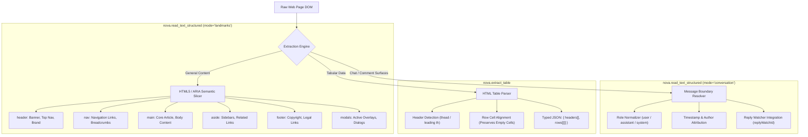

# Semantic Landmark Reading & Tabular Extraction

> [!NOTE]
> Extracting text by dumping the entire HTML body or reading flat `innerText` is one of the most common causes of LLM context exhaustion. It jumbles legal disclaimers, cookie notices, and sidebar navigation links with core article content. Nova AI Workspace provides **semantic reading engines**—`nova.read_text_structured`, `nova.extract_table`, and `nova.read_text`—that partition page text by HTML5 landmark regions, parse conversation streams with author roles, and transform complex HTML tables into clean structured JSON.

---

## 1. The Problem of Flat Text Dumps

When an agent executes `document.body.innerText` or downloads raw HTML, three major deficiencies occur:

1. **Context Window Pollution:** In a typical news article or web dashboard, 70% of all text belongs to navigation bars, footer links, privacy policies, and related recommendations. Only 30% is the actual content the agent needs.
2. **Loss of Message Semantics:** In chat surfaces (such as ChatGPT, Slack, or Jira comments), flat text flattens message boundaries, making it impossible to reliably determine who said what, when it was sent, or which role authored a turn.
3. **Tabular Fragmentation:** Standard text scrapers break HTML tables into unaligned string fragments where rows and columns lose their horizontal and vertical alignment.

Nova solves this by parsing documents into structured, scoped semantic regions:



---

## 2. Landmark-Scoped Extraction (`nova.read_text_structured`)

`nova.read_text_structured` organizes page text into WAI-ARIA and HTML5 semantic landmark regions:

```json
{
  "targetId": "tab-101",
  "result": {
    "ok": true,
    "regions": {
      "main": "Quarterly Financial Results: Q3 revenue exceeded projections by 14%...",
      "header": "Acme Corp | Investor Relations | Contact Support",
      "nav": "Overview | Reports | SEC Filings | Governance",
      "aside": "Upcoming Investor Events: Annual Shareholder Meeting Nov 12",
      "footer": "© 2026 Acme Corp. All rights reserved. Privacy Policy | Terms of Service",
      "modals": ""
    }
  }
}
```

### Key Advantages:
* **Targeted LLM Prompting:** An agent can pass *only* `regions.main` to its reasoning model, reducing token consumption by up to **75%** while eliminating hallucination risks caused by unrelated footer links.
* **Modal Awareness:** If a cookie banner or dialog is active, its text appears isolated in `regions.modals`, allowing the agent to immediately detect that an overlay is obstructing the page.
* **Per-Region Character Caps (`maxCharsPerRegion`):** Enforces predictable payload bounds (default `10,000` characters). Long regions are safely truncated with ellipsis indicators.

### Subtree Scoping & Shadow Piercing (`selector`)
When an agent only needs to read a specific component (such as an article card or a checkout summary):
* Pass `selector: "div.order-summary"`.
* Supports piercing open Shadow DOM using the ` >>> ` combinator (e.g. `user-dashboard >>> .account-details`).

---

## 3. Conversation & Chat Extraction (`mode: "conversation"`)

For autonomous agents interacting with web-based chat tools, customer support portals, or AI model interfaces (such as ChatGPT, Claude.ai, Slack, or Teams), reading flat text destroys conversational structure.

Setting `mode: "conversation"` in `nova.read_text_structured` activates the **conversation projection engine**:

```json
{
  "mode": "conversation",
  "selector": "#chat-history",
  "messageSelector": ".chat-bubble",
  "textSelector": ".bubble-text",
  "authorSelector": ".author-name",
  "roleAttribute": "data-message-author-role"
}
```

### Structured Output:
```json
{
  "messages": [
    {
      "index": 0,
      "role": "user",
      "author": "Joel",
      "timestamp": "2026-10-17T06:50:00Z",
      "text": "Can you summarize the latest deployment logs?"
    },
    {
      "index": 1,
      "role": "assistant",
      "author": "Nova",
      "timestamp": "2026-10-17T06:50:05Z",
      "text": "All 93 tests passed successfully with zero errors."
    }
  ],
  "messageCount": 2,
  "historyComplete": null
}
```

### Integrated Reply-Watch Stream Continuation
When sending a prompt using [`nova.guarded_send_message`](../../../mcp-reference/tools/guarded-actions/nova-guarded-send-message.md), the tool returns a `reply.watchId`.

If the AI's response takes longer than the initial timeout to finish generating, the agent can continue observing the stream via `nova.read_text_structured`:
```json
{
  "mode": "conversation",
  "replyWatchId": "rw-123456789",
  "waitMs": 30000
}
```
* **Read-Only Stream Monitoring:** Evaluates whether the reply has transitioned to `done` or `settled`.
* **Zero Duplicate Sends:** Reads the live generation without risking duplicate prompt submission.

---

## 4. Tabular Data Extraction Engine (`nova.extract_table`)

Attempting to parse tables using ad-hoc JavaScript `eval` loops is brittle: merged headers (`colspan`/`rowspan`), hidden columns, and unescaped HTML entities frequently break JSON encoders.

`nova.extract_table` is a native C# tabular parser that extracts HTML `<table>` elements into strongly-typed tabular structures:

```json
{
  "targetId": "tab-101",
  "selector": "table.pricing-matrix",
  "maxRows": 100
}
```

### Result Schema:
```json
{
  "tableCount": 1,
  "tables": [
    {
      "index": 0,
      "caption": "Subscription Tiers",
      "headers": ["Plan", "Monthly Price", "Concurrent Sandboxes", "API Rate Limit"],
      "rows": [
        ["Starter", "Free", "1", "60 req/min"],
        ["Pro", "€49", "5", "300 req/min"],
        ["Enterprise", "Custom", "Unlimited", "Custom"]
      ],
      "rowCount": 3,
      "colCount": 4,
      "truncated": false
    }
  ]
}
```

### Tabular Invariants & Normalization:
* **Header Auto-Detection:** Automatically extracts column names from `<thead>` rows or leading `<th>` row cells. If headers are absent, synthetic column indices (`Col 1`, `Col 2`) are provided.
* **Row Alignment & Empty Cells:** Empty cells (`<td></td>`) are preserved as empty strings (`""`) rather than omitted, ensuring that column positions never shift between rows.
* **Cell Normalization & Truncation:** Whitespace is trimmed, line breaks are normalized, and cell text is bounded by `maxCellChars` (default `500`) to prevent runaway table sizes.
* **Multi-Table Scoping:** When invoked without a selector, Nova extracts all tables on the page up to `maxTables` (default `20`). If scoped to a dashboard container (`div.report-card`), it extracts only the tables within that widget.

---

## 5. Clean Plain Text & Markdown Extraction (`nova.read_text`)

For simple inspection tasks where structured regions are not required, [`nova.read_text`](../../../mcp-reference/tools/dom-and-reading/nova-read-text.md) provides lightweight, clean text extraction:

* **Format Options:** Supports `format: "plain"` for pure text and `format: "markdown"` for semantic Markdown rendering (headings `#`, lists `-`, bold/italic formatting).
* **Debris Stripping:** Automatically removes `<script>`, `<style>`, `<noscript>`, hidden elements (`display: none`, `visibility: hidden`), and duplicate whitespace.
* **Subtree Targeting:** Scopes extraction to an arbitrary CSS selector, keeping token consumption minimal.

---

## Related Documentation

* [DOM Perception & Structured Reading Overview](../README.md)
* [Multimodal Fusion Perception Architecture](../multimodal-perception/README.md)
* [Deep Element Traversal & Geometry](../element-inspection/README.md)
* [Tool Reference: `nova.read_text_structured`](../../../mcp-reference/tools/dom-and-reading/nova-read-text-structured.md)
* [Tool Reference: `nova.extract_table`](../../../mcp-reference/tools/dom-and-reading/nova-extract-table.md)
* [Tool Reference: `nova.read_text`](../../../mcp-reference/tools/dom-and-reading/nova-read-text.md)
