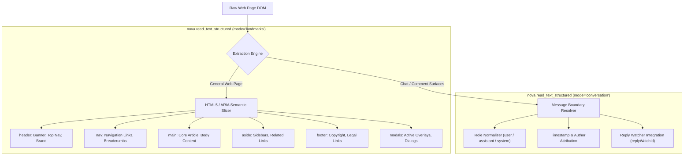

# Landmark-Scoped & Conversational Reading

> [!NOTE]
> Extracting text by dumping the entire HTML body or reading flat `innerText` is one of the most common causes of LLM context exhaustion. It jumbles legal disclaimers, cookie notices, and sidebar navigation links with core article content. Nova AI Workspace provides **semantic reading engines**—[`nova.read_text_structured`](../../../../mcp-reference/tools/dom-and-reading/nova-read-text-structured.md) and [`nova.read_text`](../../../../mcp-reference/tools/dom-and-reading/nova-read-text.md)—that partition page text by HTML5 landmark regions, parse conversation streams with author roles, and provide clean Markdown output.

---

## 1. The Challenge of Flat Text Dumps

When an agent executes `document.body.innerText` or downloads raw HTML, three major deficiencies occur:

```
┌────────────────────────────────────────────────────────────────────────┐
│                      Flat Text Extraction Traps                        │
├──────────────────────────────────┬─────────────────────────────────────┤
│ Architectural Obstacle           │ Impact on Autonomous Agents         │
├──────────────────────────────────┼─────────────────────────────────────┤
│ Context Window Flooding          │ In a typical news article or SaaS   │
│ (70%+ Boilerplate Debris)        │ dashboard, 70% of text belongs to   │
│                                  │ navbars, footers, and cookie walls. │
│                                  │ Only 30% is actual core content.    │
├──────────────────────────────────┼─────────────────────────────────────┤
│ Loss of Message Attribution      │ In chat surfaces (Slack, ChatGPT,   │
│ (Flattened Conversation Feeds)   │ Jira), flat text flattens turns,    │
│                                  │ making it impossible to reliably    │
│                                  │ map who said what or when.          │
├──────────────────────────────────┼─────────────────────────────────────┤
│ Hidden Overlay Interference      │ Injected modals and cookie notices  │
│ (Invisible Blocker Text)         │ appear inline, tricking the LLM into│
│                                  │ answering questions about disclaimers.│
└──────────────────────────────────┴─────────────────────────────────────┘
```

Nova resolves this by parsing documents into structured, scoped semantic regions:



---

## 2. Landmark-Scoped Extraction (`mode: "landmarks"`)

`nova.read_text_structured` organizes page text into standard WAI-ARIA and HTML5 semantic landmark regions:

```json
{
  "targetId": "tab-101",
  "result": {
    "ok": true,
    "regions": {
      "main": "Quarterly Financial Results: Q3 revenue exceeded projections by 14%...",
      "header": "Acme Corp | Investor Relations | Contact Support",
      "nav": "Overview | Reports | SEC Filings | Governance",
      "aside": "Upcoming Investor Events: Annual Shareholder Meeting Nov 12",
      "footer": "© 2026 Acme Corp. All rights reserved. Privacy Policy | Terms of Service",
      "modals": ""
    }
  }
}
```

### Key Advantages:

1. **Targeted LLM Prompting:** An agent can pass *only* `regions.main` to its reasoning model, reducing token consumption by up to **75%** while eliminating hallucination risks caused by unrelated footer links.
2. **Modal Awareness:** If a cookie banner or dialog is active, its text appears isolated in `regions.modals`, allowing the agent to immediately detect that an overlay is obstructing the page.
3. **Per-Region Character Caps (`maxCharsPerRegion`):** Enforces predictable payload bounds (default `10,000` characters). Long regions are safely truncated with ellipsis indicators.

### Subtree Scoping & Shadow Piercing (`selector`)
When an agent only needs to read a specific component (such as an article card or a checkout summary):
* Pass `selector: "div.order-summary"`.
* Supports piercing open Shadow DOM using the ` >>> ` combinator (e.g. `user-dashboard >>> .account-details`).

---

## 3. Conversation & Chat Extraction (`mode: "conversation"`)

For autonomous agents interacting with web-based chat tools, customer support portals, or AI model interfaces (such as ChatGPT, Claude.ai, Slack, or Teams), reading flat text destroys conversational structure.

Setting `mode: "conversation"` in `nova.read_text_structured` activates the **conversation projection engine**:

```json
{
  "targetId": "tab-101",
  "mode": "conversation",
  "selector": "#chat-history",
  "messageSelector": ".chat-bubble",
  "textSelector": ".bubble-text",
  "authorSelector": ".author-name",
  "roleAttribute": "data-message-author-role"
}
```

### Structured Output:

```json
{
  "messages": [
    {
      "index": 0,
      "role": "user",
      "author": "Joel",
      "timestamp": "2026-10-17T06:50:00Z",
      "text": "Can you summarize the latest deployment logs?"
    },
    {
      "index": 1,
      "role": "assistant",
      "author": "Nova",
      "timestamp": "2026-10-17T06:50:05Z",
      "text": "All 93 tests passed successfully with zero errors."
    }
  ],
  "messageCount": 2,
  "historyComplete": null
}
```

### Integrated Reply-Watch Stream Continuation
When sending a prompt using [`nova.guarded_send_message`](../../../../mcp-reference/tools/guarded-actions/nova-guarded-send-message.md), the tool returns a `reply.watchId`.

If the AI's response takes longer than the initial timeout to finish generating, the agent can continue observing the stream via `nova.read_text_structured`:

```json
{
  "targetId": "tab-101",
  "mode": "conversation",
  "replyWatchId": "rw-123456789",
  "waitMs": 30000
}
```
* **Read-Only Stream Monitoring:** Evaluates whether the reply has transitioned to `done` or `settled`.
* **Zero Duplicate Sends:** Reads the live generation without risking duplicate prompt submission.

---

## 4. Clean Plain Text & Markdown Extraction (`nova.read_text`)

For simple inspection tasks where structured regions are not required, [`nova.read_text`](../../../../mcp-reference/tools/dom-and-reading/nova-read-text.md) provides lightweight, clean text extraction:

* **Format Options:** Supports `format: "plain"` for pure text and `format: "markdown"` for semantic Markdown rendering (headings `#`, lists `-`, bold/italic formatting).
* **Debris Stripping:** Automatically removes `<script>`, `<style>`, `<noscript>`, hidden elements (`display: none`, `visibility: hidden`), and duplicate whitespace.
* **Subtree Targeting:** Scopes extraction to an arbitrary CSS selector, keeping token consumption minimal.

---

## 5. Practical Agent Invocation Examples

### Reading Landmark Regions of an Article

```json
{
  "targetId": "tab-101",
  "mode": "landmarks",
  "maxCharsPerRegion": 8000
}
```

### Extracting Scoped Clean Markdown

```json
{
  "targetId": "tab-101",
  "selector": "article.documentation-entry",
  "format": "markdown"
}
```

### Following Up on Streaming Chat Generation

```json
{
  "targetId": "tab-101",
  "mode": "conversation",
  "replyWatchId": "rw-49812-38491",
  "waitMs": 20000
}
```

---

## Related Documentation

* [Semantic Landmark Reading & Tabular Extraction Hub](../README.md)
* [Tabular Data Extraction Engine](../tabular-data-extraction/README.md)
* [Multimodal Fusion Perception Architecture](../../multimodal-perception/README.md)
* [Deep Element Traversal & Geometry](../../element-inspection/README.md)
* [Tool Reference: `nova.read_text_structured`](../../../../mcp-reference/tools/dom-and-reading/nova-read-text-structured.md)
* [Tool Reference: `nova.read_text`](../../../../mcp-reference/tools/dom-and-reading/nova-read-text.md)
