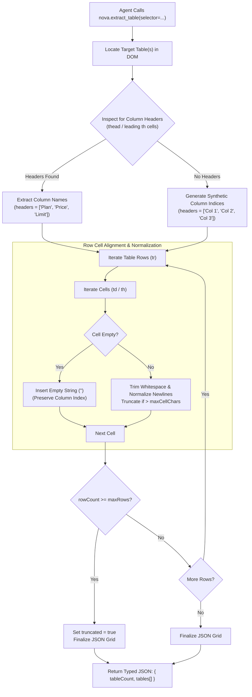

# Tabular Data Extraction Engine

> [!NOTE]
> Financial reports, pricing matrices, inventory logs, and analytics dashboards represent structured information as HTML `<table>` elements. Extracting tabular data using naive JavaScript snippets or plain text dumps destroys column alignment, ignores header spans, and breaks downstream LLM analysis. The **Tabular Data Extraction Engine** ([`nova.extract_table`](../../../../mcp-reference/tools/dom-and-reading/nova-extract-table.md)) is a native C# parser that converts arbitrary HTML tables into clean, strongly-typed JSON grids with automatic header detection and empty cell preservation.

---

## 1. Architectural Challenge: Tabular Fragmentation

When an autonomous agent attempts to scrape an HTML table using traditional text dumps or ad-hoc scripts, three structural problems occur:

```
┌────────────────────────────────────────────────────────────────────────┐
│                     Tabular Extraction Failure Modes                   │
├──────────────────────────────────┬─────────────────────────────────────┤
│ Architectural Obstacle           │ Impact on Automation & LLMs         │
├──────────────────────────────────┼─────────────────────────────────────┤
│ Column Alignment Drift           │ When empty cells (<td></td>) are    │
│ (Dropped Empty Cells)            │ omitted, subsequent cell values     │
│                                  │ shift left, corrupting column data. │
├──────────────────────────────────┼─────────────────────────────────────┤
│ Complex Header Merges            │ Multi-row headers (colspan/rowspan) │
│ (colspan / rowspan Ambiguity)    │ lose their parent relationship,     │
│                                  │ confusing column attribution.       │
├──────────────────────────────────┼─────────────────────────────────────┤
│ Memory Exhaustion on Mega-Tables │ Enterprise grids with 10,000+ rows  │
│ (Context Window Overflow)        │ blow LLM context budgets if dumped  │
│                                  │ without row bounding and truncation.│
└──────────────────────────────────┴─────────────────────────────────────┘
```

Nova resolves these issues through a deterministic, host-level table parsing pipeline:



---

## 2. Invariants & Extraction Guarantees

The C# tabular parsing engine enforces four strict operational guarantees:

### A. Row Cell Alignment & Empty Cell Preservation
In sparse tables (such as comparison charts with empty checkmarks or missing feature rows), raw text scrapers often ignore empty `<td>` tags.
* If a table has 4 columns and row 2 has an empty second cell (`<td></td>`), omitting it shifts column 3 into column 2 and column 4 into column 3.
* **Nova's Guarantee:** Nova preserves all empty cells as empty strings (`""`), ensuring that the array index of every row cell strictly matches the index of its header.

### B. Header Auto-Detection & Synthetic Fallbacks
1. **Explicit Headers:** Inspects `<thead>` child rows for `<th>` elements.
2. **Implicit First-Row Headers:** If `<thead>` is omitted, evaluates whether all cells in the first `<tr>` are `<th>` tags or visually distinct headings.
3. **Synthetic Fallback:** If a table contains no discernible header, Nova automatically generates synthetic labels (`"Col 1"`, `"Col 2"`, `"Col 3"`) to maintain structural integrity.

### C. Cell Normalization & Bounds Enforcement
* **Whitespace & Newline Normalization:** Strips trailing spaces, normalizes Windows/Unix line breaks, and collapses duplicate whitespace.
* **`maxCellChars` (Default: 500):** If an individual table cell contains an entire essay or embedded code snippet, Nova truncates the cell text and appends an ellipsis (`...`) to prevent single-cell context pollution.
* **`maxRows` (Default: 100):** Caps the maximum number of extracted rows per table. When exceeded, sets `truncated: true` and includes the total available `rowCount`.

### D. Multi-Table Scoping & Container Targeting
* **Unscoped Call:** If called without a `selector`, Nova traverses the page and extracts all tables up to `maxTables` (default: 20).
* **Container-Scoped Call:** Pass `selector: "div.pricing-widget table"` to isolate and extract only the relevant data grid.

---

## 3. Strongly-Typed Result Schema

`nova.extract_table` returns an unambiguous, machine-readable JSON structure:

```json
{
  "targetId": "tab-101",
  "result": {
    "ok": true,
    "tableCount": 1,
    "tables": [
      {
        "index": 0,
        "caption": "Quarterly Financial Performance",
        "headers": [
          "Metric",
          "Q1 2026",
          "Q2 2026",
          "Q3 2026",
          "YoY Change"
        ],
        "rows": [
          ["Total Revenue", "$12.4M", "$14.1M", "$16.8M", "+35.5%"],
          ["Operating Expenses", "$8.1M", "$8.6M", "$9.2M", "+13.5%"],
          ["Net Income", "$4.3M", "$5.5M", "$7.6M", "+76.7%"],
          ["R&D Investment", "$2.1M", "$2.4M", "$2.8M", "+33.3%"]
        ],
        "rowCount": 4,
        "colCount": 5,
        "truncated": false
      }
    ]
  }
}
```

---

## 4. Practical Agent Invocation Examples

### Extracting a Specific Pricing Table

```json
{
  "targetId": "tab-101",
  "selector": "table.pricing-matrix",
  "maxRows": 50
}
```

### Full-Page Table Sweep with Custom Cell Bounding

```json
{
  "targetId": "tab-101",
  "maxTables": 5,
  "maxRows": 25,
  "maxCellChars": 200
}
```

### Scoping to a Dashboard Widget with Shadow DOM Piercing

```json
{
  "targetId": "tab-101",
  "selector": "analytics-card >>> table.data-grid",
  "maxRows": 100
}
```

---

## Related Documentation

* [Semantic Landmark Reading & Tabular Extraction Hub](../README.md)
* [Landmark-Scoped & Conversational Reading](../landmark-and-conversation-reading/README.md)
* [Multimodal Fusion Perception Architecture](../../multimodal-perception/README.md)
* [Deep Element Traversal & Geometry](../../element-inspection/README.md)
* [Tool Reference: `nova.extract_table`](../../../../mcp-reference/tools/dom-and-reading/nova-extract-table.md)
