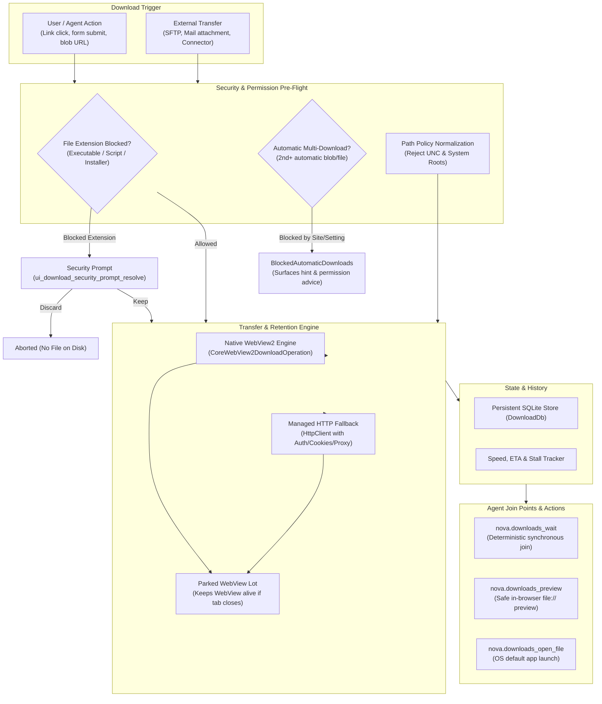
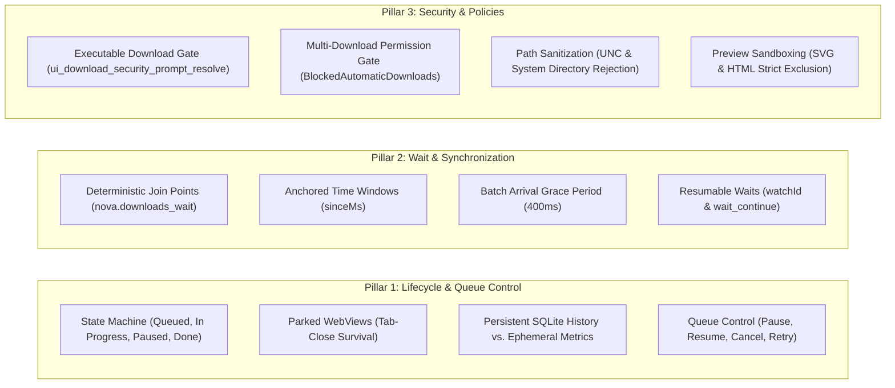

# Downloads Pipeline & Security Management

> **Dual-engine download tracking, parked WebView lifecycle retention, executable security gates, and deterministic agent wait synchronization.**

---

## 1. Overview & Architectural Vision

In automated browser operations, file downloads represent a fundamental point of friction between asynchronous network streams, operating system file systems, and autonomous agent workflows:
* **The Synchronization Problem:** Agents frequently click a "Download Report" button and then attempt to guess how long the transfer will take. Polling the filesystem or sleeping for fixed intervals leads to race conditions, partial reads of incomplete files, and fragile automation.
* **The Tab Closure Hazard:** When an agent or user closes a browser tab, underlying browser engines often terminate or orphan in-progress downloads, corrupting large files.
* **The Executable Security Threat:** Untrusted websites can automatically trigger downloads of malicious executables (`.exe`, `.bat`, `.ps1`), relying on unattended environments or user distraction to land payloads on disk.
* **The Multi-File Silence:** When a web application initiates multiple automatic file downloads (such as exporting several invoices), Chromium silently drops all downloads after the first one unless explicit permissions are granted.

Nova AI Workspace addresses these challenges through a unified **Download Pipeline & Security Architecture**. It combines native WebView2 stream tracking, managed HTTP fallback transfers, persistent SQLite bookkeeping, and explicit agent synchronization gates.

---

## 2. Core Pillars of the Download Architecture

### Pillar 1: Lifecycle & Queue Control
Nova tracks all downloads through a formal state machine:
* **Dual Engines:** Native WebView2 downloads handle browser-native streams; managed HTTP fallback transfers handle complex authenticated endpoints, preserving cookies, CSRF tokens, and proxy routes.
* **Parked WebViews:** If a tab closes while downloads are running, its WebView is not destroyed. It is parked (hidden, muted, and removed from active tab strips) until the last download finishes, ensuring progress events are never lost.
* **Persistent Bookkeeping:** Downloads are persisted in an internal SQLite database (`DownloadDb`), retaining history, source URLs, and target paths across browser restarts.

### Pillar 2: Wait & Synchronization Join Points
AI agents require deterministic guarantees before accessing files on disk:
* **`nova.downloads_wait`:** Blocks until downloads finish, fail, or pause, returning resolved disk paths.
* **Anchored Windows:** Lookback windows (`sinceMs`) are anchored at the instant of the call and do not slide forward during polling, preventing missed downloads.
* **Batch Grace Periods:** A 400ms late-arrival grace period prevents multi-file batch downloads from returning prematurely when the first file finishes while others are still queueing.
* **Resumable Long Waits:** Large downloads that exceed MCP timeouts can be seamlessly resumed via `resumable: true` and [`nova.wait_continue`](../../mcp-reference/tools/downloads/nova-wait-continue.md).

### Pillar 3: Security Gates & Sandbox Protection
Nova enforces multi-tier defense-in-depth before any file lands on disk:
* **Executable Security Gate:** Web pages attempting to download executable files (`.exe`, `.bat`, `.ps1`, `.msi`, `.reg`, etc.) trigger a security prompt. On unattended background surfaces, executable saves are automatically refused. On interactive surfaces, agents resolve the prompt via [`nova.ui_download_security_prompt_resolve`](../../mcp-reference/tools/app-shell-and-ui/nova-ui-download-security-prompt-resolve.md).
* **Multiple Automatic Download Detection:** Silently dropped secondary downloads are recorded in `BlockedAutomaticDownloads`, providing immediate feedback and remediation instructions.
* **Path Traversal & UNC Guard:** Custom download folders are sanitized against UNC paths (`\\server\share`) to prevent NTLM credential leaks, and protected Windows system directories are strictly rejected.
* **Safe In-Browser Previews:** [`nova.downloads_preview`](../../mcp-reference/tools/downloads/nova-downloads-preview.md) renders images, PDFs, media, and text safely inline, but **strictly excludes `.html` and `.svg`** to prevent script execution in the privileged `file://` context.

---

## 3. Dedicated Sub-Guides

| Guide | Description | Primary MCP Tools |
| :--- | :--- | :--- |
| **[Lifecycle, Queue & Parked WebViews](lifecycle-and-queue/README.md)** | Download state machine, dual-engine transfer mechanics, parked WebView retention on tab close, persistent SQLite history, and batch queue controls. | [`nova.downloads_list`](../../mcp-reference/tools/downloads/nova-downloads-list.md), [`nova.downloads_pause`](../../mcp-reference/tools/downloads/nova-downloads-pause.md), [`nova.downloads_resume`](../../mcp-reference/tools/downloads/nova-downloads-resume.md), [`nova.downloads_cancel`](../../mcp-reference/tools/downloads/nova-downloads-cancel.md), [`nova.downloads_retry`](../../mcp-reference/tools/downloads/nova-downloads-retry.md) |
| **[Wait Synchronization & Join Points](wait-and-synchronization/README.md)** | Deterministic agent join points, anchored time windows (`sinceMs`), multi-file batch grace periods, paused early-exits, and resumable wait continuations. | [`nova.downloads_wait`](../../mcp-reference/tools/downloads/nova-downloads-wait.md), [`nova.wait_continue`](../../mcp-reference/tools/downloads/nova-wait-continue.md), [`nova.wait_cancel`](../../mcp-reference/tools/downloads/nova-wait-cancel.md) |
| **[Security Gates & Policy Enforcement](security-and-policy/README.md)** | Executable download confirmation dialogs, unattended fail-closed policy, automatic multi-download permission gates, UNC path protection, and safe inline previews. | [`nova.ui_download_security_prompt_resolve`](../../mcp-reference/tools/app-shell-and-ui/nova-ui-download-security-prompt-resolve.md), [`nova.downloads_auto_open_get`](../../mcp-reference/tools/downloads/nova-downloads-auto-open-get.md), [`nova.downloads_auto_open_set`](../../mcp-reference/tools/downloads/nova-downloads-auto-open-set.md), [`nova.downloads_preview`](../../mcp-reference/tools/downloads/nova-downloads-preview.md), [`nova.downloads_open_file`](../../mcp-reference/tools/downloads/nova-downloads-open-file.md) |

---

## 4. MCP Tool Inventory (Downloads & Synchronization)

The download subsystem provides 17 dedicated MCP tools:

| Tool | Category | Capability Bundle | Primary Role |
| :--- | :--- | :--- | :--- |
| **[`nova.downloads_list`](../../mcp-reference/tools/downloads/nova-downloads-list.md)** | `safe` | `app_shell_recovery` | Query recent downloads with progress, speed, ETA, and error classifications. |
| **[`nova.downloads_wait`](../../mcp-reference/tools/downloads/nova-downloads-wait.md)** | `safe` | `app_shell_recovery` | Synchronously wait until downloads reach a terminal state, returning disk paths. |
| **[`nova.wait_continue`](../../mcp-reference/tools/downloads/nova-wait-continue.md)** | `safe` | `app_shell_recovery` | Resume waiting on a timed-out resumable watch without losing original context. |
| **[`nova.wait_cancel`](../../mcp-reference/tools/downloads/nova-wait-cancel.md)** | `safe` | `app_shell_recovery` | Cancel an active or pending resumable wait watch. |
| **[`nova.downloads_pause`](../../mcp-reference/tools/downloads/nova-downloads-pause.md)** | `safe` | `app_shell_recovery` | Pause a live in-progress download by ID. |
| **[`nova.downloads_resume`](../../mcp-reference/tools/downloads/nova-downloads-resume.md)** | `safe` | `app_shell_recovery` | Resume a paused download by ID. |
| **[`nova.downloads_cancel`](../../mcp-reference/tools/downloads/nova-downloads-cancel.md)** | `safe` | `app_shell_recovery` | Cancel an in-progress or queued download by ID. |
| **[`nova.downloads_retry`](../../mcp-reference/tools/downloads/nova-downloads-retry.md)** | `safe` | `app_shell_recovery` | Retry a failed download by re-navigating to its source URL. |
| **[`nova.downloads_pause_all`](../../mcp-reference/tools/downloads/nova-downloads-pause-all.md)** | `safe` | `app_shell_recovery` | Pause all active, pausable downloads simultaneously. |
| **[`nova.downloads_resume_all`](../../mcp-reference/tools/downloads/nova-downloads-resume-all.md)** | `safe` | `app_shell_recovery` | Resume all paused and resumable interrupted downloads. |
| **[`nova.downloads_cancel_all`](../../mcp-reference/tools/downloads/nova-downloads-cancel-all.md)** | `safe` | `app_shell_recovery` | Cancel all non-terminal downloads across the browser. |
| **[`nova.downloads_clear`](../../mcp-reference/tools/downloads/nova-downloads-clear.md)** | `safe` | `app_shell_recovery` | Purge completed, cancelled, and failed download history from SQLite and UI. |
| **[`nova.downloads_preview`](../../mcp-reference/tools/downloads/nova-downloads-preview.md)** | `safe` | `app_shell_recovery` | Open a completed download inline in a browser tab using sandboxed file:// preview. |
| **[`nova.downloads_open_file`](../../mcp-reference/tools/downloads/nova-downloads-open-file.md)** | `safe` | `app_shell_recovery` | Launch a downloaded file in the operating system's default handler. |
| **[`nova.downloads_open_folder`](../../mcp-reference/tools/downloads/nova-downloads-open-folder.md)** | `safe` | `app_shell_recovery` | Reveal the downloaded file in Windows File Explorer with the item highlighted. |
| **[`nova.downloads_auto_open_get`](../../mcp-reference/tools/downloads/nova-downloads-auto-open-get.md)** | `safe` | `app_shell_recovery` | Inspect the list of file extensions configured to auto-open upon completion. |
| **[`nova.downloads_auto_open_set`](../../mcp-reference/tools/downloads/nova-downloads-auto-open-set.md)** | `normal`| `app_shell_recovery` | Configure file extensions to automatically open in OS handlers (executable types blocked). |
| **[`nova.ui_download_security_prompt_resolve`](../../mcp-reference/tools/app-shell-and-ui/nova-ui-download-security-prompt-resolve.md)** | `normal` | `app_shell_recovery` | Programmatically resolve an executable-download security warning (`keep` or `discard`). |

---

## 5. Security Invariants & Guarantees

1. **Unattended Surface Protection:**
   If a download of an executable or script type is triggered on a background or automated tab without an active UI dialog handler, Nova **cancels the save immediately**. Unattended processes can never silently deposit executables onto disk.
2. **Strict Executable Blocklist:**
   Extensions capable of code execution in Windows (`.exe`, `.bat`, `.cmd`, `.ps1`, `.vbs`, `.js`, `.wsf`, `.msi`, `.reg`, `.dll`, `.jar`, etc.) can **never be added to the auto-open list**. Any attempt to configure them via `nova.downloads_auto_open_set` is rejected.
3. **UNC Path Rejection:**
   Configured download directories must not point to SMB UNC shares (`\\server\share`). This prevents malicious sites or manipulated settings from leaking NTLM credentials or directing files to remote network shares.
4. **SVG and HTML Preview Ban:**
   While images and PDFs can be previewed directly inside browser tabs via `nova.downloads_preview`, `.svg` and `.html` files are strictly rejected from inline preview because they contain active script engines in the privileged `file://` origin.
5. **No Blind Wait Success:**
   `nova.downloads_wait` never reports success on an empty match set. If no downloads match the criteria within the timeout window, it returns an explicit failure (`status: "timeout"`, `reasonCode: "download_wait.no_matching_downloads"`).

---

## 6. Related Documentation

* [MCP Tool Group Reference: Downloads Management](../../mcp-reference/tools/downloads/README.md)
* [Native Dialogs & UI Prompts](../native-dialogs-and-prompts/README.md)
* [Site Data Management & Cookie Inspector](../site-data-management/README.md)
* [Network & Proxy Infrastructure](../network/README.md)
* [Master MCP Tool Catalog](../../mcp-reference/tool-catalog.md)
