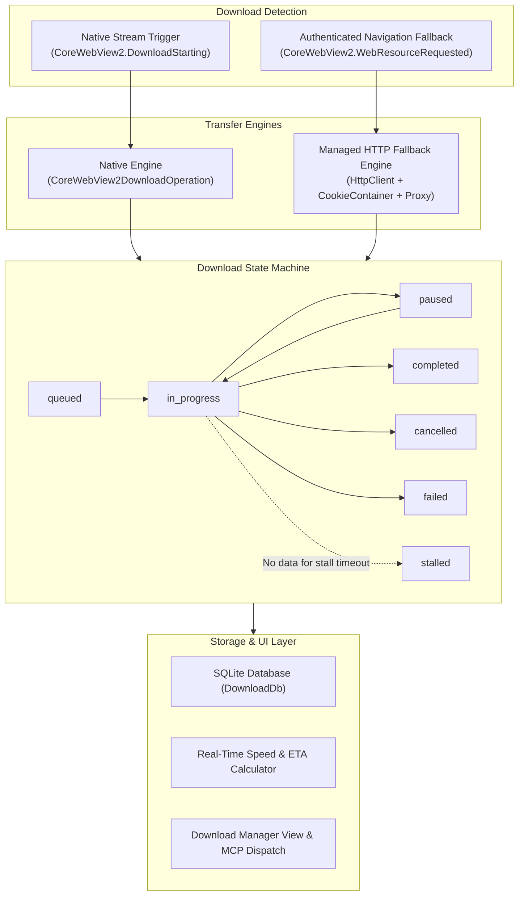
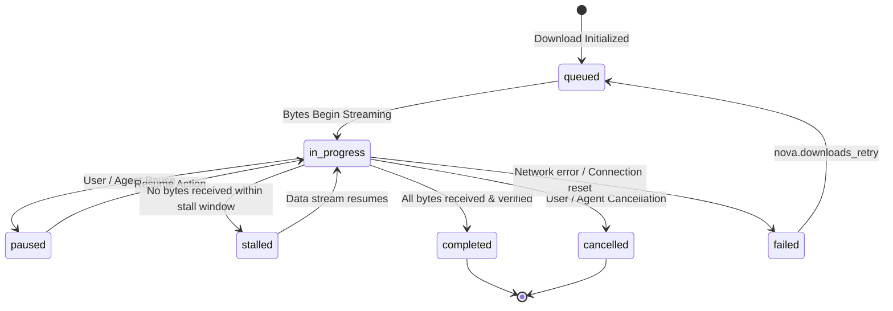
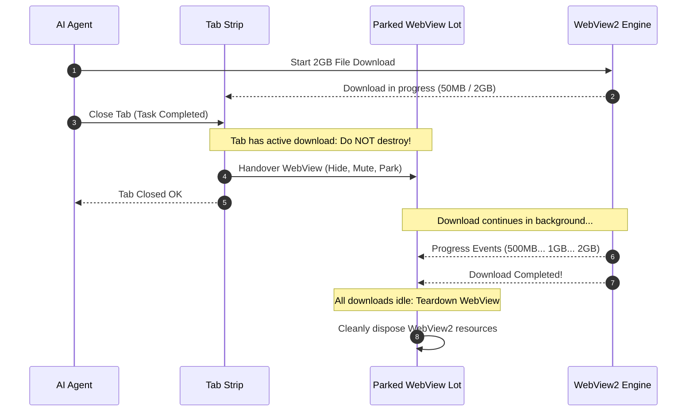
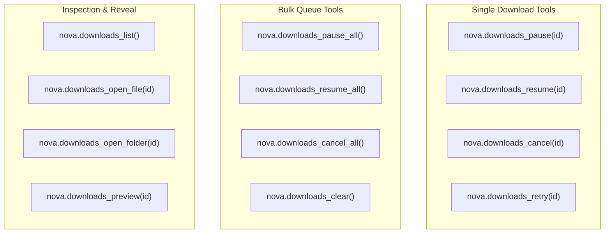

# Download Lifecycle, Queue Control & Parked WebViews

> **The mechanics of Nova's dual-engine download pipeline — state transitions, parked WebViews for tab-close resilience, SQLite persistence, and queue management.**

---

## 1. Overview & Dual-Engine Architecture

Web browsers handle downloads across two fundamentally different scenarios:
1. **Native Browser Downloads:** Initiated when navigating to a URL with `Content-Disposition: attachment` or clicking a direct file link. Handled directly by Chromium's native network stack via WebView2's `CoreWebView2DownloadOperation`.
2. **Complex Authenticated Fallbacks:** Endpoints requiring custom session cookies, CSRF tokens, specific `Referer`/`Origin` headers, or tab-scoped proxy routing that would otherwise navigate the browser tab away from its current SPA view.

Nova implements a **Dual-Engine Architecture** that manages both native streams and managed HTTP fallback downloads through a single unified state machine and persistent tracking database.



---

## 2. Dedicated Architecture Sub-Guides

| Guide | Description | Primary Topics |
| :--- | :--- | :--- |
| **[Dual-Engine Transfers & Parked WebViews](dual-engine-transfers-and-parked-webviews/README.md)** | Native Chromium stream handling vs. managed HTTP fallback, tab-closure retention pool, and socket stall detection. | Parked WebViews, `_downloadParkedWebViews`, stall heuristics |
| **[SQLite Persistence & Queue Orchestration](sqlite-persistence-and-queue-orchestration/README.md)** | Durable `DownloadDb` schema, in-memory throughput moving averages, and programmatic queue operations. | SQLite schema, `nova.downloads_pause`, bulk queue tools |

---

## 3. The Download State Machine

Every download tracked by Nova transitions through a defined set of lifecycle states:



### Lifecycle State Definitions
* **`queued`**: Download has been registered and authorized, but the transfer stream has not yet begun transferring bytes.
* **`in_progress`**: Bytes are actively arriving from the server. `SpeedBytesPerSecond` and `EstimatedTimeRemaining` are continuously updated.
* **`paused`**: Transfer is temporarily suspended. If supported by the server (`Accept-Ranges: bytes`), the download preserves its received byte offset.
* **`stalled`**: Download is technically `in_progress`, but no new bytes have arrived for several seconds (e.g. during a router failover or half-open TCP socket). Nova flags this explicitly to prevent agents from hanging indefinitely on dead connections.
* **`completed`**: File transfer has finished, the file handle is flushed to disk, and the final absolute `FilePath` is confirmed.
* **`cancelled`**: User or agent aborted the transfer. Any partial file segments (`.crdownload`) are removed from disk.
* **`failed`**: Transfer terminated due to an error (e.g. `NETWORK_FAILED`, `SERVER_BAD_RESPONSE`, `FILE_ACCESS_DENIED`). The error reason is categorized in `errorReason`.

---

## 4. Parked WebViews: Tab-Close Resilience

A critical challenge in modern browser automation is the **tab closure hazard**:

> [!WARNING]
> In Chromium and WebView2, a download operation belongs to the browser process, but all progress, pause/resume, and completion events are delivered through the specific `CoreWebView2` instance associated with the originating tab.

If an agent or user closes a tab while a 2 GB file is downloading, traditional implementations encounter a severe failure mode:
* The file continues growing on disk in the background.
* The tab's WebView is destroyed, severing the event bridge.
* The download tracker freezes, flags the download as `stalled`, and never reports completion.
* The agent times out and believes the download failed.

### Nova's Solution: The Parking Lot
Nova intercepts tab closure through an in-engine parked WebView retention manager. When a tab with active or pausable downloads is closed:
1. **WebView Parking:** Instead of destroying the `CoreWebView2` instance, Nova removes the tab from the visual tab strip and parks the WebView in a hidden dictionary (`_downloadParkedWebViews`).
2. **Mute & De-render:** The parked WebView is set to `Visibility = Collapsed`, `Opacity = 0`, `IsHitTestVisible = false`, and `IsMuted = true` to prevent any background audio or rendering overhead.
3. **Event Continuity:** The parked WebView remains alive in the background, receiving every progress update and completion event.
4. **Automatic Teardown:** Once the last download belonging to that tab reaches a terminal state (`completed`, `cancelled`, or `failed`), Nova automatically tears down the parked WebView and reclaims system resources.



---

## 5. Persistent Bookkeeping: SQLite vs. Ephemeral Metrics

Nova separates persistent historical records from real-time ephemeral metrics in `DownloadInfo`:

| Field | Storage | Purpose |
| :--- | :---: | :--- |
| `Id` | **SQLite (`DownloadDb`)** | Unique persistent GUID identifying the download across sessions. |
| `FileName` / `FilePath` | **SQLite** | Local file name and verified target disk path. |
| `Url` | **SQLite** | Origin URL of the download (used for retries). |
| `Status` | **SQLite** | Current lifecycle status (`completed`, `failed`, etc.). |
| `BytesReceived` / `TotalBytes` | **SQLite** | Transferred bytes and expected total bytes (-1 if unknown). |
| `SandboxId` / `TabId` | **SQLite** | Profile and tab ownership context. |
| `SourceJobId` | **SQLite** | Links external non-browser jobs (e.g. SFTP transfers) to download rows. |
| `StartedUtc` / `CompletedUtc` | **SQLite** | Accurate UTC timestamps. |
| `SpeedBytesPerSecond` | *Memory Only* | Real-time moving average calculated by `DownloadSpeedTracker`. |
| `EstimatedTimeRemaining` | *Memory Only* | Dynamic ETA based on current transfer speed. |
| `Stalled` | *Memory Only* | Boolean flag indicating lack of data flow during in-progress state. |

Because speed and ETA become stale the moment the browser restarts, they are computed in memory during active runs. When Nova restarts, historical downloads reload from SQLite with intact byte counts, paths, and statuses.

---

## 6. Queue Control & Batch Management

Nova provides fine-grained control over individual downloads and the entire transfer queue:



### Pausing & Resuming
* **`nova.downloads_pause`**: Suspends an active WebView2-native download.
* **`nova.downloads_resume`**: Resumes a paused download or an interrupted download that supports resumption (`CanResume: true`).
* **`nova.downloads_pause_all` / `nova.downloads_resume_all`**: Atomic bulk operations across the entire browser session. Ideal when bandwidth needs to be temporarily freed for a critical task.

### Retrying Failed Downloads
* **`nova.downloads_retry`**: When a download fails due to an intermittent network drop or temporary server error, `nova.downloads_retry` automatically re-navigates to the original source URL within the appropriate sandbox context.

### History Cleanup
* **`nova.downloads_clear`**: Purges all terminal downloads (`completed`, `cancelled`, `failed`) from both the in-memory tracker and persistent SQLite storage. Active and paused downloads are untouched.

---

## 7. Practical Agent Recipes

### Recipe 1: Inspecting the Active Download Queue
Retrieve the status of all active and recent downloads:

```json
// nova.downloads_list
{
  "limit": 10
}
```

Example response:
```json
{
  "downloads": [
    {
      "id": "7b3a9c4e2d1f4b8a9e0c5d6e7f8a9b0c",
      "fileName": "quarterly-report.pdf",
      "status": "in_progress",
      "bytesReceived": 15728640,
      "totalBytes": 31457280,
      "speedBytesPerSecond": 2621440,
      "filePath": "C:\\Users\\User\\Downloads\\quarterly-report.pdf",
      "canPause": true,
      "canResume": false,
      "stalled": false
    }
  ]
}
```

### Recipe 2: Emergency Queue Pause
If an autonomous agent needs to perform an urgent, bandwidth-intensive API call:

1. Pause all downloads:
   ```json
   // nova.downloads_pause_all
   {}
   ```
2. Perform high-priority task.
3. Resume all downloads:
   ```json
   // nova.downloads_resume_all
   {}
   ```

---

## 8. Related Tools & Documentation

* [Dual-Engine Transfers & Parked WebViews](dual-engine-transfers-and-parked-webviews/README.md): Deep dive into stream engines, tab-close retention, and stall heuristics.
* [SQLite Persistence & Queue Control](sqlite-persistence-and-queue-orchestration/README.md): Persistent `DownloadDb` schema and queue management tools.
* [Wait Synchronization & Join Points](../wait-and-synchronization/README.md): Deterministic agent wait synchronization.
* [Security Gates & Policy Enforcement](../security-and-policy/README.md): Executable and UNC path protection.
* [Downloads Management MCP Tool Group](../../../mcp-reference/tools/downloads/README.md): Complete MCP downloads reference.
* [Downloads Master Hub](../README.md): Master subsystem architectural catalog.
