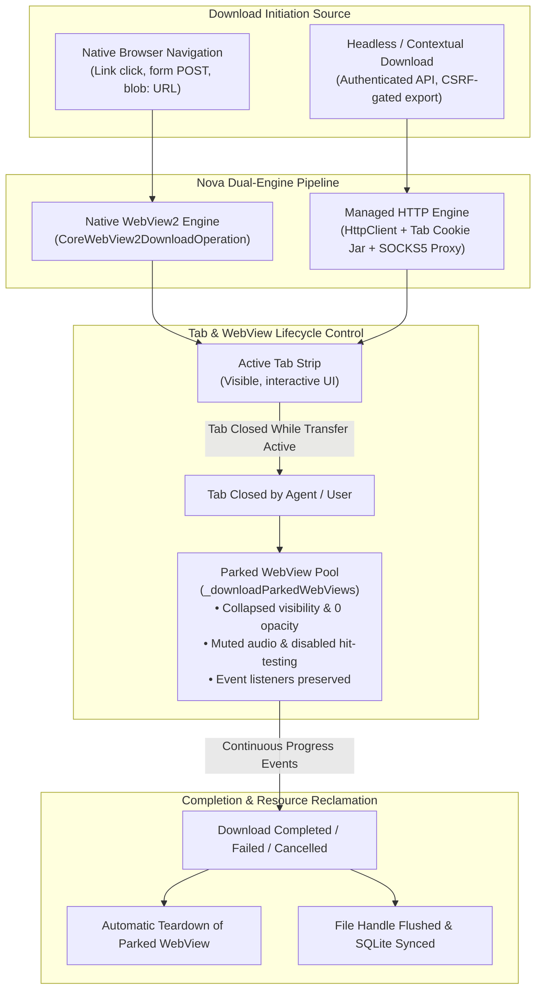
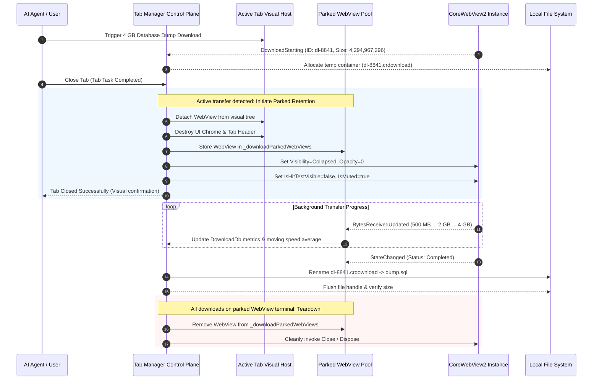
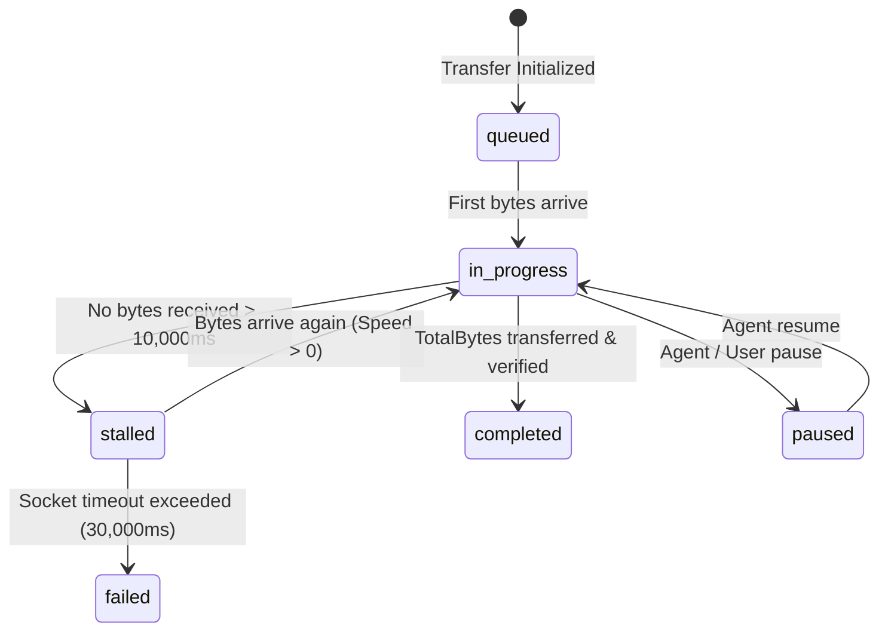

# Dual-Engine Transfers & Parked WebView Lifecycle

> **In-depth architecture of Nova's native WebView2 and managed HTTP transfer engines, parked WebView retention pool, tab-close survivability, and stall detection heuristics.**

---

## 1. Architectural Motivation & The Tab-Closure Problem

Browser download pipelines face two fundamental engineering dilemmas in automated environments:

1. **Protocol and Context Disparity:** Direct browser navigation to a file URL (`Content-Disposition: attachment`) triggers Chromium's native transfer stack. However, automated workflows frequently interact with Single Page Applications (SPAs) where downloads require complex session state—such as ephemeral CSRF tokens, dynamic `Authorization: Bearer` headers, custom request bodies, or tab-scoped proxy routes. Navigating the top-level frame away from an SPA interrupts the agent's interaction context.
2. **The Tab-Closure Hazard:** In Microsoft WebView2, download operations belong to the underlying browser process, but all event dispatching (progress callbacks, byte counters, pause/resume signaling, and completion notifications) routes through the originating tab's `CoreWebView2` instance. If an agent or user closes a tab while a multi-gigabyte transfer is in flight, the tab's WebView is destroyed. The transfer stream continues accumulating bytes on disk in the background, but the event bridge is severed. The automation host observes a dead stream, flags the download as permanently stalled, and times out without ever receiving the final verified file path.

Nova AI Workspace eliminates these failure modes by coupling a **Dual-Engine Transfer Pipeline** with an active **Parked WebView Retention Manager**.

---

## 2. Dual-Engine Transfer Mechanics

Nova intelligently routes downloads between two complementary transport mechanisms:

### Engine 1: Native WebView2 Engine (`CoreWebView2DownloadOperation`)

When a user or agent clicks a standard hyperlink, submits a file export form, or navigates to an endpoint returning `Content-Disposition: attachment`, WebView2 fires `DownloadStarting`.

* **Direct Disk Streaming:** Bytes flow directly from Chromium's native network stack to a temporary download container (`.crdownload`) in the target directory.
* **Kernel-Level Throughput:** Delivers raw socket performance for massive files (multi-gigabyte ISOs, database archives, high-definition media).
* **Native Pause and Resume:** Leverages Chromium's byte-range request logic (`Range: bytes=X-`) to pause and resume transfers across transient network interruptions.
* **Security Interception:** Triggers native OS file security inspections before the file handle is finalized on disk.

### Engine 2: Managed HTTP Fallback Engine

When file transfers are initiated from automated script blocks, background connectors, or authenticated API endpoints that cannot be navigated cleanly via the main browser frame:

* **Session Context Inheritance:** Nova extracts the active tab's cookie jar, session storage headers, and user-agent string, executing the download through a managed `HttpClient` pipeline.
* **Isolated Background Streams:** Downloads execute without altering the active DOM or triggering unwanted navigation events in the agent's work tab.
* **Custom Proxy Routing:** Transfers automatically honor sandbox-specific upstream proxy rules (e.g. routing internal enterprise downloads through authenticated SOCKS5 tunnels).
* **Buffer Flow Control:** Downloads stream in 64 KiB chunks with periodic disk syncs, calculating real-time throughput metrics.

---

## 3. Parked WebView Retention Pool

When an agent or user closes a browser tab, Nova's tab manager evaluates whether any downloads associated with that tab are currently active or paused.

### Retention Invariants

1. **Visual Isolation:** The parked WebView is stripped of all visual representation. It consumes zero compositing or rendering cycles.
2. **Audio Muting:** `IsMuted = true` is enforced immediately upon parking, ensuring that media streams embedded in the originating page cannot produce background noise.
3. **Event Subscription Preservation:** Download event handlers (`BytesReceivedChanged`, `StateChanged`) remain bound. The SQLite state database and in-memory speed trackers receive uncorrupted telemetry until the final byte lands.
4. **Deterministic Teardown:** Once all downloads belonging to a parked WebView reach a terminal state (`completed`, `cancelled`, or `failed`), the retention manager unregisters all event handlers and disposes of the underlying `CoreWebView2` instance.

---

## 4. Stall Detection & Recovery Heuristics

Network streams frequently fail silently—for instance, during an upstream router failover or dropped TCP half-open connection where no RST packet is received. Traditional download managers hang indefinitely in an `in_progress` state.

Nova continuously computes stream health metrics to distinguish between healthy slow connections and dead sockets:

* **Stall Window (10s):** If an active transfer receives zero bytes over a rolling 10,000ms window, Nova flags `stalled: true` in the transfer model.
* **Agent Visibility:** The `stalled` boolean is exposed through [`nova.downloads_list`](../../../../mcp-reference/tools/downloads/nova-downloads-list.md), alerting autonomous agents that a connection may require intervention.
* **Auto-Recovery via Retry:** If a stalled download eventually drops its TCP connection, it transitions to `failed` with error code `NETWORK_TIMEOUT`. Agents can immediately trigger [`nova.downloads_retry`](../../../../mcp-reference/tools/downloads/nova-downloads-retry.md) to re-establish the connection without restarting the entire workflow.

---

## 5. Related Architecture Guides

* [SQLite Persistence & Queue Control](../sqlite-persistence-and-queue-orchestration/README.md): Database schema, speed calculations, and bulk queue tools.
* [Lifecycle, Queue & Parked WebViews Hub](../README.md): Domain overview for download lifecycle management.
* [Executable Gates & Security Prompts](../../security-and-policy/executable-gates-and-security-prompts/README.md): Pre-flight executable verification.
* [Deterministic Join Points & Lookback Windows](../../wait-and-synchronization/deterministic-join-points-and-lookback-windows/README.md): Synchronizing agent actions with download completion.
* [Downloads Master Hub](../../README.md): Comprehensive downloads architecture catalog.
