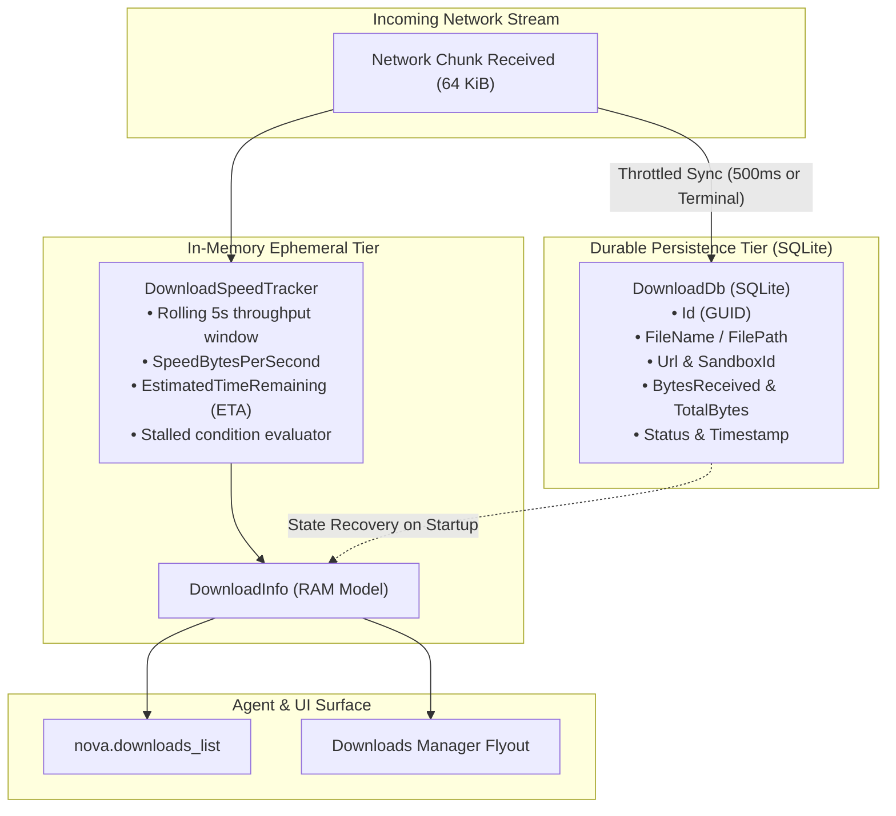
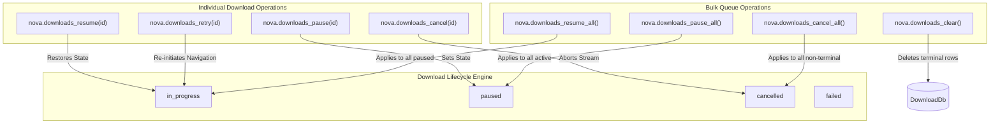

# SQLite Persistence & Queue Orchestration

> **Persistent download bookkeeping in SQLite (`DownloadDb`), in-memory velocity tracking, batch queue orchestration, and historical cleanup controls.**

---

## 1. Architectural Overview & State Separation

Modern browser automation requires robust download history tracking that survives process restarts while delivering microsecond-latency updates to active agents. To achieve this balance, Nova splits download state into two distinct tiers:

1. **Persistent State Tier (SQLite - `DownloadDb`):** Durable metadata—unique GUIDs, target file paths, origin URLs, sandbox and tab associations, total expected bytes, and terminal statuses—are committed to an embedded SQLite database. If Nova or the host machine reboots during or after a transfer, history remains completely intact.
2. **Ephemeral Metrics Tier (In-Memory `DownloadSpeedTracker`):** Highly volatile telemetry—instantaneous transfer speed, rolling 5-second moving averages, dynamic Estimated Time of Arrival (ETA), and socket stall indicators—is maintained exclusively in RAM. This prevents high-frequency SQLite write amplification while streaming multi-megabyte transfers.



---

## 2. SQLite Database Schema (`DownloadDb`)

Nova maintains the `downloads` table within its localized profile database. The schema records full operational context:

| Column | Type | Constraints | Description |
| :--- | :--- | :--- | :--- |
| `id` | `TEXT` | `PRIMARY KEY` | Globally unique transfer identifier (GUID string). |
| `file_name` | `TEXT` | `NOT NULL` | The sanitized base name of the file (e.g. `report.csv`). |
| `file_path` | `TEXT` | `NOT NULL` | Absolute Windows file system path where the payload resides. |
| `url` | `TEXT` | `NOT NULL` | Source HTTP/HTTPS or blob URL from which the download originated. |
| `status` | `TEXT` | `NOT NULL` | Lifecycle state: `queued`, `in_progress`, `paused`, `completed`, `cancelled`, `failed`. |
| `bytes_received`| `INTEGER` | `NOT NULL` | Cumulative bytes committed to disk so far. |
| `total_bytes` | `INTEGER` | `NOT NULL` | Expected file size from `Content-Length` (-1 if chunked/unknown). |
| `sandbox_id` | `TEXT` | `NULL` | ID of the isolated sandbox profile that initiated the transfer. |
| `tab_id` | `TEXT` | `NULL` | Originating tab identifier (used for parked WebView associations). |
| `source_job_id` | `TEXT` | `NULL` | Cross-subsystem link if the download was initiated by SFTP or mail. |
| `started_utc` | `TEXT` | `NOT NULL` | ISO 8601 UTC timestamp of transfer initiation. |
| `completed_utc`| `TEXT` | `NULL` | ISO 8601 UTC timestamp of terminal settlement. |
| `error_reason` | `TEXT` | `NULL` | Detailed error classification if status is `failed`. |

### Database Invariants
* **Transaction Batching:** In-progress byte counts are flushed to SQLite periodically (every 500ms) rather than per-chunk to eliminate disk I/O bottlenecks.
* **Terminal Immutability:** Once a download transitions to `completed`, `cancelled`, or `failed`, its row is written synchronously with its final `completed_utc` timestamp and sealed against further modification.

---

## 3. Queue Control Tools

Nova provides comprehensive programmatic controls for manipulating active downloads individually or in bulk:



### Individual Item Controls

1. **[`nova.downloads_pause`](../../../../mcp-reference/tools/downloads/nova-downloads-pause.md):** Suspends an active download stream. If the remote HTTP server sent `Accept-Ranges: bytes`, the underlying TCP socket is closed cleanly while retaining the current byte offset.
2. **[`nova.downloads_resume`](../../../../mcp-reference/tools/downloads/nova-downloads-resume.md):** Re-establishes a network socket for a paused download, issuing a range request (`Range: bytes={received}-`) to continue transferring without restarting from byte zero.
3. **[`nova.downloads_cancel`](../../../../mcp-reference/tools/downloads/nova-downloads-cancel.md):** Immediately terminates the active transfer, aborts the disk stream, and deletes the temporary `.crdownload` file from the file system.
4. **[`nova.downloads_retry`](../../../../mcp-reference/tools/downloads/nova-downloads-retry.md):** If a transfer encountered a transient socket drop or server failure (`status: "failed"`), calling retry re-navigates to the originating `Url` within the exact sandbox context where it was initiated.

### Bulk Queue Controls

1. **[`nova.downloads_pause_all`](../../../../mcp-reference/tools/downloads/nova-downloads-pause-all.md):** Atomically suspends all currently running downloads across every tab and sandbox profile. Essential when an agent must execute an urgent latency-sensitive operation without bandwidth contention.
2. **[`nova.downloads_resume_all`](../../../../mcp-reference/tools/downloads/nova-downloads-resume-all.md):** Resumes all suspended and resumable interrupted downloads across the browser.
3. **[`nova.downloads_cancel_all`](../../../../mcp-reference/tools/downloads/nova-downloads-cancel-all.md):** Cancels every non-terminal download currently queued or transferring, freeing locks on temporary files.
4. **[`nova.downloads_clear`](../../../../mcp-reference/tools/downloads/nova-downloads-clear.md):** Cleans up clutter by deleting all settled records (`completed`, `cancelled`, and `failed`) from both the in-memory cache and SQLite database. Active or paused downloads are protected and remain untouched.

---

## 4. Practical Tool Usage & JSON Payloads

### Example 1: Listing Recent Downloads with Speed Metrics

Querying the queue via [`nova.downloads_list`](../../../../mcp-reference/tools/downloads/nova-downloads-list.md):

```json
// Request
{
  "limit": 5
}

// Response
{
  "downloads": [
    {
      "id": "e9b21f3a-4c28-4f81-a62e-9d8a1c3b5e7f",
      "fileName": "enterprise-backup-2026.tar.gz",
      "filePath": "C:\\Users\\Operator\\Downloads\\enterprise-backup-2026.tar.gz",
      "status": "in_progress",
      "bytesReceived": 104857600,
      "totalBytes": 524288000,
      "speedBytesPerSecond": 10485760,
      "estimatedTimeRemaining": 40.0,
      "stalled": false,
      "canPause": true,
      "canResume": false,
      "sandboxId": "prod-environment",
      "startedUtc": "2026-10-18T10:30:00Z"
    }
  ]
}
```

### Example 2: Pausing Bandwidth Prioritization

When an agent needs to throttle download activity during critical reasoning phases:

```json
// Pause all background streams
// nova.downloads_pause_all
{}

// Response confirms bulk operation
{
  "ok": true,
  "pausedCount": 3
}
```

---

## 5. Related Architecture Guides

* [Dual-Engine Transfers & Parked WebViews](../dual-engine-transfers-and-parked-webviews/README.md): Native WebView2 vs Managed HTTP and tab closure parking.
* [Lifecycle, Queue & Parked WebViews Hub](../README.md): High-level domain overview.
* [Deterministic Join Points & Lookback Windows](../../wait-and-synchronization/deterministic-join-points-and-lookback-windows/README.md): Agent wait synchronization.
* [Security Gates & Policy Enforcement](../../security-and-policy/README.md): Executable and UNC path protection.
* [Downloads Master Hub](../../README.md): Master subsystem catalog and MCP tool inventory.
