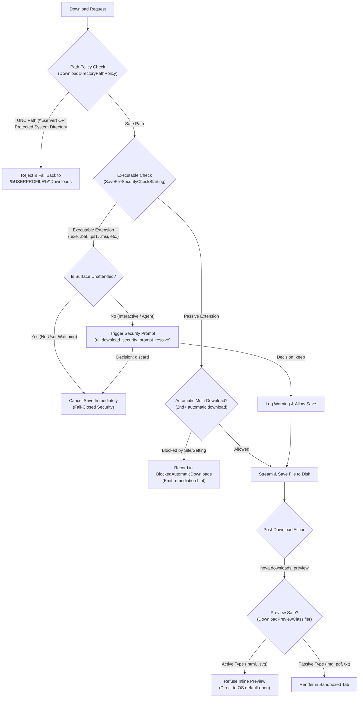
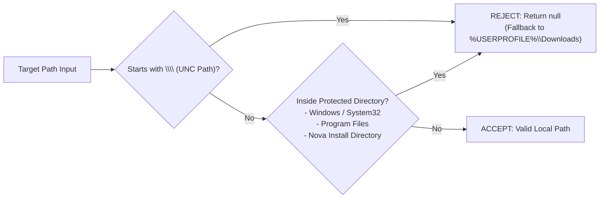

# Download Security Gates, Policy Enforcement & Preview Sandboxing

> **Multi-tier defense-in-depth — executable download verification, automatic multi-download permission gates, UNC path sanitization, and sandboxed inline previews.**

---

## 1. Overview & Threat Model

Browser download systems are a primary attack vector for client-side compromise. An autonomous AI browser must protect the host operating system against four distinct security threats:
1. **Drive-By Executable Downloads:** Malicious websites initiating downloads of `.exe`, `.bat`, `.ps1`, or `.msi` payloads without explicit user consent.
2. **Unattended Execution Hazards:** Background processes or automated subagents silently accepting executable payloads onto disk while no human is watching.
3. **Privilege Escalation via In-Browser Previews:** Rendering downloaded `.html` or `.svg` files inside `file://` origins, where embedded scripts can access local files or execute arbitrary code.
4. **Credential Harvesting via UNC Shares:** Manipulating download paths to point to remote SMB shares (`\\attacker.com\share`), triggering Windows NTLM authentication leaks.

Nova enforces strict, multi-tiered security policies across the entire download lifecycle:



---

## 2. Dedicated Architecture Sub-Guides

| Guide | Description | Primary Topics |
| :--- | :--- | :--- |
| **[Executable Gates & Security Prompts](executable-gates-and-security-prompts/README.md)** | Fail-closed binary interception, `AlwaysBlockedExtensions` catalog, unattended surface protection, and programmatic prompt resolution. | `SaveFileSecurityCheckStarting`, `ui_download_security_prompt_resolve` |
| **[Path Policies, Multi-Downloads & Previews](path-policies-multi-downloads-and-previews/README.md)** | Target path sanitization, UNC share defense, multiple automatic download permission gates, and the strict SVG/HTML inline preview ban. | UNC rejection, `BlockedAutomaticDownloads`, SVG/HTML ban |

---

## 3. The Executable Download Security Gate

When a web page attempts to save an executable file, Microsoft WebView2 fires the `SaveFileSecurityCheckStarting` event. Nova intercepts this event natively before any byte is committed to disk.

### The Always-Blocked Extension Catalog
Nova maintains a hardened catalog of file extensions capable of executing code in Windows (`DownloadAutoOpenPolicy.AlwaysBlockedExtensions`):
* **Binaries & Scripts:** `.exe`, `.bat`, `.cmd`, `.com`, `.ps1`, `.psm1`, `.psd1`, `.ps1xml`, `.pssc`, `.vbs`, `.vbe`, `.js`, `.jse`, `.mjs`, `.cjs`, `.wsf`, `.wsh`, `.sh`
* **Installers & Packages:** `.msi`, `.msp`, `.appx`, `.appxbundle`, `.apk`, `.jar`, `.inf`
* **Windows Shell & Control Panel:** `.lnk`, `.pif`, `.reg`, `.hta`, `.cpl`, `.msc`, `.gadget`, `.scf`, `.url`
* **System Libraries & Drivers:** `.dll`, `.sys`, `.drv`, `.ocx`

> [!CAUTION]
> This list is strictly **add-only**. Extensions in this catalog can **never** be added to the auto-open list, and they **always** trigger the security gate before landing on disk.

### Unattended Surface Protection (Fail-Closed)
If an executable download is initiated on a background surface or automated runner where no human UI dialog can be displayed:
* Nova sets `args.CancelSave = true`.
* The file is **immediately discarded** without writing anything to disk.
* A security event is logged: `Executable download refused on a surface without a user`.

### Programmatic Agent Resolution
On interactive surfaces, Nova displays a security confirmation dialog. Autonomous agents can inspect and resolve the dialog programmatically via [`nova.ui_download_security_prompt_resolve`](../../../mcp-reference/tools/app-shell-and-ui/nova-ui-download-security-prompt-resolve.md):

```json
// Discard the file (safe default)
{
  "decision": "discard"
}

// Keep the file (for build artifacts or installer tests)
{
  "decision": "keep"
}
```

When an agent chooses `keep`, Nova records an explicit audit log (`Executable download kept by an agent (File=..., Extension=...)`) and saves the file.

---

## 4. Multiple Automatic Downloads Permission Gate

Modern web browsers enforce strict security boundaries against "drive-by downloads":
* The **first** automatic download initiated by a web page is permitted.
* Any **subsequent** automatic download initiated by the same page triggers the "multiple automatic downloads" permission prompt.

In unattended or automated environments, this permission defaults to `Deny`. Consequently, web pages attempting to export multiple files (e.g. exporting 10 invoices simultaneously) silently lose all files after the first one. Because the browser engine drops them before a download operation is created, traditional download trackers show no trace of the failure.

### Nova's Detection & Remediation Architecture
1. **`BlockedAutomaticDownloads` Registry:** Nova's permission handler captures every refused automatic download, recording the origin, tab ID, and refusal reason (`site`, `setting`, `session`, or `user`).
2. **Early Feedback in `downloads_wait`:** If an agent calls `nova.downloads_wait` and no downloads start, Nova inspects the refusal registry. If a blocked download is detected, it terminates early with:
   ```json
   {
     "ok": false,
     "status": "blocked",
     "reasonCode": "download_wait.automatic_downloads_blocked",
     "blockedHint": "At least 1 automatic download(s) from https://example.com were refused and never started... Grant permission via nova.media_permission_set."
   }
   ```
3. **Agent Remediation:** Agents can grant permission directly using [`nova.media_permission_set`](../../../mcp-reference/tools/media-and-transcription/nova-media-permission-set.md):
   ```json
   {
     "origin": "https://example.com",
     "automaticDownloads": "allow_once"
   }
   ```

---

## 5. Directory Path Security Policy

Nova sanitizes all download target paths via `DownloadDirectoryPathPolicy`:



1. **UNC Path Rejection (`\\server\share`):**
   Directing downloads to UNC network paths is strictly forbidden. This prevents malicious web applications or altered configuration files from initiating outbound SMB connections that leak Windows NTLM hashes.
2. **Protected System Directory Rejection:**
   Downloads cannot target `C:\Windows`, `C:\Program Files`, `System32`, or Nova's own application installation directory (`AppContext.BaseDirectory`). This guarantees that downloads cannot overwrite application binaries or system files.
3. **Default Path Fallback:**
   If a configured path is invalid or rejected, Nova safely falls back to `%USERPROFILE%\Downloads`.
4. **Collision Handling:**
   If a file with the same name already exists in the target directory, Nova automatically appends an incrementing counter (e.g. `document (1).pdf`) to prevent silent file overwrites.

---

## 6. In-Browser Previews vs. OS Launching

Nova distinguishes between **passive, sandboxed in-browser previews** and **full operating system execution**:

| Capability | [`nova.downloads_preview`](../../../mcp-reference/tools/downloads/nova-downloads-preview.md) | [`nova.downloads_open_file`](../../../mcp-reference/tools/downloads/nova-downloads-open-file.md) |
| :--- | :--- | :--- |
| **Execution Context** | Sandboxed browser tab via `file:///` URI | External OS default application (via Windows Shell) |
| **Allowed File Types** | Passive images, PDFs, video, audio, plain text | Any non-executable file associated with an OS app |
| **`.html` & `.svg` Handling** | **STRICTLY BLOCKED** | Permitted (opens in external system app) |
| **Security Risk** | Zero (no script execution) | Low (isolated outside Nova process) |

### The SVG & HTML Preview Ban
> [!IMPORTANT]
> `nova.downloads_preview` **deliberately refuses to preview `.svg` and `.html` files**.
> * **SVG Vulnerability:** SVG is an active XML document format that can contain embedded `<script>` tags and event handlers (`onload`, `onclick`). If loaded in a browser tab under a `file:///` URI, WebView2 executes those scripts within the privileged local file origin.
> * **HTML Vulnerability:** Downloaded HTML files can contain arbitrary malicious JavaScript. Rendering them inside the browser's own session exposes the user to local cross-site scripting (DOM-XSS).

To inspect downloaded HTML or SVG files, agents should use [`nova.convert_to_markdown`](../../../mcp-reference/tools/files-and-documents/nova-convert-to-markdown.md) to inspect the content as safe text, or [`nova.downloads_open_file`](../../../mcp-reference/tools/downloads/nova-downloads-open-file.md) to open it in Notepad or an external editor.

### Supported In-Browser Preview Formats
* **Images:** `.jpg`, `.jpeg`, `.png`, `.gif`, `.webp`, `.bmp`, `.ico`
* **Documents:** `.pdf` (rendered via WebView2's built-in PDF viewer)
* **Video:** `.mp4`, `.webm`, `.mov`
* **Audio:** `.mp3`, `.wav`, `.ogg`, `.m4a`, `.flac`
* **Plain Text:** `.txt`, `.md`, `.log`, `.csv`, `.json`, `.xml`

---

## 7. Auto-Open Policy Configuration

Users and agents can configure specific safe file extensions to automatically open in the OS default handler upon download completion:
* **Inspect Configured Extensions:**
  ```json
  // nova.downloads_auto_open_get
  {}
  ```
* **Update Configured Extensions:**
  ```json
  // nova.downloads_auto_open_set
  {
    "extensions": [".pdf", ".csv", ".xlsx"]
  }
  ```

> [!NOTE]
> If any extension provided to `nova.downloads_auto_open_set` matches the `AlwaysBlockedExtensions` catalog, the tool rejects the call with an error, ensuring that dangerous file types can never be configured to auto-open.

---

## 8. Related Tools & Documentation

* [Executable Gates & Security Prompts](executable-gates-and-security-prompts/README.md): Deep dive into binary interception, unattended fail-closed policy, and prompt resolution.
* [Path Policies, Multi-Downloads & Previews](path-policies-multi-downloads-and-previews/README.md): UNC share defense, multi-download limits, and SVG/HTML preview restrictions.
* [Lifecycle, Queue & Parked WebViews](../lifecycle-and-queue/README.md): Stream mechanics and tab closure parking.
* [Wait Synchronization & Join Points](../wait-and-synchronization/README.md): Deterministic agent wait synchronization.
* [`nova.ui_download_security_prompt_resolve` Tool Reference](../../../mcp-reference/tools/app-shell-and-ui/nova-ui-download-security-prompt-resolve.md)
* [`nova.downloads_preview` Tool Reference](../../../mcp-reference/tools/downloads/nova-downloads-preview.md)
* [`nova.downloads_open_file` Tool Reference](../../../mcp-reference/tools/downloads/nova-downloads-open-file.md)
* [`nova.downloads_auto_open_set` Tool Reference](../../../mcp-reference/tools/downloads/nova-downloads-auto-open-set.md)
* [Downloads Master Hub](../README.md): Master subsystem architectural catalog.
