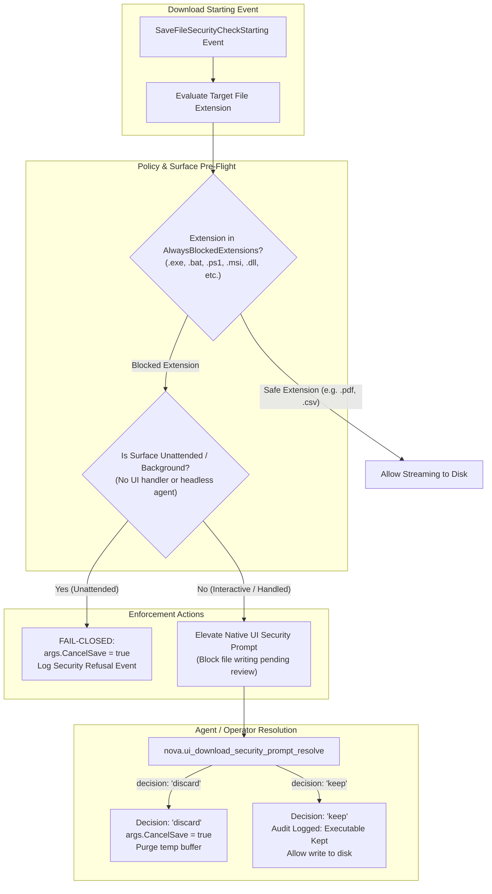
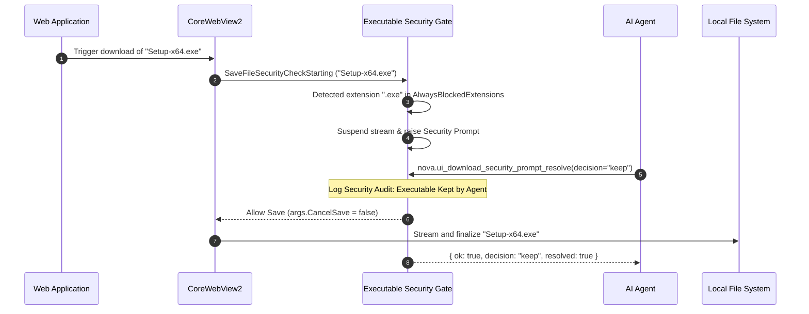

# Executable Download Security Gates & Prompt Resolution

> **Deep dive into Nova's fail-closed executable interception, the `AlwaysBlockedExtensions` catalog, unattended surface protection, and programmatic prompt resolution.**

---

## 1. Threat Model & Architectural Rationale

In browser automation, drive-by downloads represent one of the most perilous attack vectors against the host operating system:

* **Unattended Execution Risks:** Autonomous agents running unattended workflows (such as web crawling, data mining, or competitive intelligence) frequently encounter rogue advertisements, malicious redirects, or compromised third-party script tags that trigger downloads of executable binaries (`.exe`, `.msi`) or script files (`.bat`, `.ps1`, `.vbs`).
* **Silent Dropping Vulnerability:** If a browser silently accepts executables onto disk, an attacker only needs to combine the download with an OS vulnerability or user social engineering to achieve code execution.
* **Privileged Agent Hazard:** An agent configured with high autonomy or shell access might inadvertently execute a freshly downloaded file, confusing a malicious payload with a legitimate build artifact or dataset.

Nova AI Workspace prevents these attacks at the kernel-interception level using Microsoft WebView2's `SaveFileSecurityCheckStarting` event, governed by a **fail-closed security policy**.



---

## 2. The `AlwaysBlockedExtensions` Catalog

Nova maintains an immutable, hardened catalog of file extensions capable of executing code, altering system configurations, or loading dynamic libraries within Windows (`DownloadAutoOpenPolicy.AlwaysBlockedExtensions`).

| Category | File Extensions | Security Threat Context |
| :--- | :--- | :--- |
| **Windows Executables** | `.exe`, `.com`, `.scr`, `.pif` | Direct binary code execution with full user privileges. |
| **Command & Shell Scripts** | `.bat`, `.cmd`, `.ps1`, `.psm1`, `.psd1`, `.ps1xml`, `.pssc`, `.sh` | Interpreted command execution via cmd.exe, PowerShell, or Bash. |
| **Active Scripting & Host** | `.vbs`, `.vbe`, `.js`, `.jse`, `.mjs`, `.cjs`, `.wsf`, `.wsh` | Windows Script Host (WSH) and active script engine payloads. |
| **Installers & Packages** | `.msi`, `.msp`, `.appx`, `.appxbundle`, `.apk`, `.jar`, `.inf` | System package installations, driver infs, and Java archives. |
| **Shell & Control Panel** | `.lnk`, `.reg`, `.hta`, `.cpl`, `.msc`, `.gadget`, `.scf`, `.url` | Registry modifications, HTML applications, and Windows shell shortcuts. |
| **System Binaries & Drivers**| `.dll`, `.sys`, `.drv`, `.ocx` | Dynamic link library hijacking and kernel driver placement. |

### Immutability Invariant
> [!CAUTION]
> The `AlwaysBlockedExtensions` catalog is strictly **add-only** and non-overridable. No user setting, sandbox policy, or MCP command can whitelist these extensions for automatic downloading or auto-opening.

---

## 3. Unattended Surface Protection (Fail-Closed)

When an autonomous agent runs a scheduled task, background research subagent, or headless crawl, there is no interactive human user present to inspect security dialogs.

In this scenario, Nova enforces a strict **Fail-Closed Policy**:
1. When `SaveFileSecurityCheckStarting` fires for any extension present in the `AlwaysBlockedExtensions` catalog, Nova inspects the active surface context.
2. If the surface is flagged as unattended, headless, or lacks an active UI dialog host, Nova immediately sets:
   ```text
   args.CancelSave = true
   ```
3. The underlying network stream is aborted, zero bytes are committed to the file system, and an explicit security warning is recorded in the operational log:
   ```text
   [WARN] Executable download refused on a surface without a user (File: payload.exe, Origin: https://untrusted.com)
   ```

This guarantee ensures that background worker processes can never be leveraged by malicious websites to silently deposit malware or attack scripts onto the host file system.

---

## 4. Programmatic Prompt Resolution via MCP

On interactive surfaces or when an agent is specifically tasked with software testing (e.g. testing whether a developer release build downloads cleanly), Nova displays a native security warning banner and blocks file writing.

Agents inspect and resolve this barrier using [`nova.ui_download_security_prompt_resolve`](../../../../mcp-reference/tools/app-shell-and-ui/nova-ui-download-security-prompt-resolve.md):



### Parameter Reference

| Parameter | Type | Required | Values | Description |
| :--- | :--- | :---: | :--- | :--- |
| `decision` | `string` | **Yes** | `"keep"`, `"discard"` | The resolution decision: `"discard"` aborts and deletes; `"keep"` permits writing to disk. |

### Resolution Payloads

#### Discard Decision (Safe Default)
```json
// Request
{
  "decision": "discard"
}

// Response
{
  "ok": true,
  "decision": "discard",
  "resolved": true,
  "message": "Executable download prompt discarded. File was not written to disk."
}
```

#### Keep Decision (Audit-Logged)
```json
// Request
{
  "decision": "keep"
}

// Response
{
  "ok": true,
  "decision": "keep",
  "resolved": true,
  "message": "Executable download prompt accepted. File transfer proceeded."
}
```

---

## 5. Security Audit Logging & Telemetry

Whenever an executable download prompt is resolved with `"keep"`, Nova writes a tamper-evident entry to the operational audit log:

```text
[AUDIT] 2026-10-18T10:45:12.384Z Executable download kept by an agent (File: 'Setup-v1.4.2.exe', Extension: '.exe', Origin: 'https://releases.internal.corp', SandboxId: 'test-sandbox')
```

This log guarantees post-incident forensic visibility, allowing security administrators to verify exactly which agent or user authorized an executable payload to land on disk.

---

## 6. Related Architecture Guides

* [Path Policies, Multi-Downloads & Previews](../path-policies-multi-downloads-and-previews/README.md): UNC share protection, automatic multi-download limits, and SVG/HTML preview restrictions.
* [Security & Policy Domain Hub](../README.md): High-level overview of download security gates.
* [Dual-Engine Transfers & Parked WebViews](../../lifecycle-and-queue/dual-engine-transfers-and-parked-webviews/README.md): Stream mechanics and tab closure parking.
* [Wait Synchronization & Deterministic Join Points](../../wait-and-synchronization/deterministic-join-points-and-lookback-windows/README.md): Deterministic agent synchronization.
* [Downloads Master Hub](../../README.md): Master subsystem architectural catalog.
