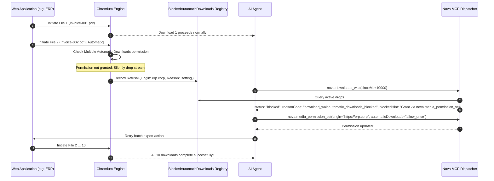

# Path Policies, Multi-Downloads & Preview Sandboxing

> **Target directory sanitization, UNC path protection, automatic multi-download permission gates, and the strict SVG/HTML inline preview ban.**

---

## 1. Architectural Overview

Beyond executable binary inspection, a secure browser automation engine must defend the host system against subtle storage and content injection vulnerabilities:

1. **NTLM Credential Leaks via UNC Paths:** If an untrusted website or compromised configuration directs a download to a network path (`\\evil-server\share`), the Windows SMB client automatically initiates an NTLM handshake, exposing the local user's password hash to remote attackers.
2. **System File Overwrites:** Untrusted downloads targeting operating system directories (`C:\Windows\System32`) or application binaries could compromise host stability.
3. **The Multi-File Silence:** When an enterprise application initiates a batch export (such as 10 PDF invoices), Chromium silently drops every file after the first one unless explicit permissions are granted. In unattended environments, this causes automated workflows to stall without error diagnostics.
4. **Local Origin Script Execution:** Rendering untrusted `.html` or `.svg` files within an inline browser tab under a privileged `file:///` URI allows embedded JavaScript to read local files or execute cross-site scripting (DOM-XSS) attacks.

Nova addresses these threats through three specialized defense layers:

```mermaid
flowchart TD
    subgraph PathSanitizer ["1. Target Path Policy Sanitizer"]
        P1["Configured Target Directory"] --> CheckUNC{"Starts with \\\\ (UNC Share)?"}
        CheckUNC -- "Yes" --> RejectUNC["REJECT: Block SMB Handshake<br/>Fallback to %USERPROFILE%\\Downloads"]
        CheckUNC -- "No" --> CheckSys{"Target is System / App Dir?<br/>- C:\\Windows / System32<br/>- C:\\Program Files<br/>- AppContext.BaseDirectory"}
        CheckSys -- "Yes" --> RejectSys["REJECT: Protect OS Integrity<br/>Fallback to %USERPROFILE%\\Downloads"]
        CheckSys -- "No" --> AcceptPath["ACCEPT Local Directory Path"]
    end

    subgraph MultiDownloadGate ["2. Multi-Download Permission Gate"]
        MD1["Browser Detects 2nd+ Automatic File"] --> CheckPerm{"Site Permission Granted?"}
        CheckPerm -- "No (Default in Automation)" --> DropFile["Chromium Drops Stream"]
        DropFile --> RecordRegistry["Record in BlockedAutomaticDownloads<br/>• Origin, tabId, refusalReason<br/>• Surface blockedHint to Agent"]
        CheckPerm -- "Yes (via media_permission_set)" --> AllowStream["Allow Subsequent Downloads"]
    end

    subgraph PreviewGate ["3. Sandboxed Inline Preview Gate"]
        PV1["nova.downloads_preview(id)"] --> ClassifyExt{"Evaluate File Extension"}
        ClassifyExt -- ".html or .svg (Active Code)" --> BlockPreview["STRICTLY BLOCKED:<br/>Refuse inline file:// tab<br/>Offer OS Open or Convert to Markdown"]
        ClassifyExt -- "PDF, Image, Video, Audio, Text" --> SafePreview["Render Inline in Sandboxed Tab"]
        ClassifyExt -- "CSV, TSV, XLSX, XLSM (Table)" --> TableView["Read-only Table View:<br/>cells as text, no macros,<br/>no file path in the address"]
    end
```



---

## 2. Target Path Security Policies (`DownloadDirectoryPathPolicy`)

Nova applies strict normalization and validation to every destination directory configured by users or agents:

### 1. UNC Path Rejection (`\\server\share`)
* **The Vulnerability:** Windows interprets any path starting with `\\` as an SMB Universal Naming Convention (UNC) share. Attempting to access an external UNC share initiates an outbound NetBIOS/SMB connection on port 445, sending the local user's NTLM hash.
* **Nova's Enforcement:** If a configured download directory starts with `\\` or `//`, Nova immediately rejects the path, flags a security violation in telemetry, and safely redirects the download to the standard local directory (`%USERPROFILE%\Downloads`).

### 2. Protected System Directory Shielding
Nova refuses to write downloaded files directly into critical operating system and application runtime locations:
* `C:\Windows` and all subdirectories (including `System32`, `SysWOW64`, `WinSxS`).
* `C:\Program Files` and `C:\Program Files (x86)`.
* Nova's own application binaries directory (`AppContext.BaseDirectory`).

### 3. Automatic Collision Avoidance
If a file with the target name already exists on disk, Nova does not silently overwrite the existing data:
* It generates a deterministic numeric suffix: `document.pdf` $\rightarrow$ `document (1).pdf` $\rightarrow$ `document (2).pdf`.
* The resolved, collision-free path is committed to `DownloadDb` and returned to the calling agent.

---

## 3. Multiple Automatic Downloads Permission Gate

Modern web engines classify downloads into two categories:
* **User-Initiated:** The direct result of a user click or keyboard activation.
* **Automatic:** Initiated by client-side JavaScript (`window.open`, hidden `<a>` clicks, or `<iframe src="...">` injections) after the initial user activation has expired.



### The `BlockedAutomaticDownloads` Registry
When Chromium refuses an automatic download, Nova captures the event in an internal refusal registry:
* **Captured Fields:** Origin URL, Tab ID, timestamp, and refusal classification (`site`, `setting`, `session`, or `user`).
* **Zero-Latency Agent Feedback:** When an agent calls `nova.downloads_wait` and no downloads are in progress, Nova checks this registry. Rather than timing out over 60 seconds, it returns immediately with an actionable remediation payload:

```json
{
  "ok": false,
  "status": "blocked",
  "reasonCode": "download_wait.automatic_downloads_blocked",
  "blockedHint": "At least 1 automatic download(s) from https://erp.corp were refused and never started because multiple automatic downloads are blocked. Grant permission via nova.media_permission_set(origin='https://erp.corp', automaticDownloads='allow_once')."
}
```

### Granting Multi-Download Permissions
Agents resolve the blockage using [`nova.media_permission_set`](../../../../mcp-reference/tools/media-and-transcription/nova-media-permission-set.md):

```json
// Grant single-session multi-download permission
{
  "origin": "https://erp.corp",
  "automaticDownloads": "allow_once"
}
```

---

## 4. In-Browser Previews vs. Operating System Launching

Nova strictly separates sandboxed in-browser previews from external operating system launching:

| Dimension | [`nova.downloads_preview`](../../../../mcp-reference/tools/downloads/nova-downloads-preview.md) | [`nova.downloads_open_file`](../../../../mcp-reference/tools/downloads/nova-downloads-open-file.md) | [`nova.downloads_open_folder`](../../../../mcp-reference/tools/downloads/nova-downloads-open-folder.md) |
| :--- | :--- | :--- | :--- |
| **Execution Surface** | Internal browser tab (`file:///` URI) | External Windows default application | Windows File Explorer |
| **Sandbox Security** | Sandboxed rendering context | External OS process boundary | System shell folder view |
| **Active Scripts (`.html`, `.svg`)** | **STRICTLY PROHIBITED** | Permitted (handled by OS browser/editor) | N/A (reveals file on disk) |
| **Supported File Types** | PDF, images, video, audio, plain text | Any non-executable registered file | Any file type |

### The SVG & HTML Preview Ban

> [!CAUTION]
> `nova.downloads_preview` **strictly refuses to render `.svg` and `.html` files**.
> * **The SVG Vulnerability:** SVG is not merely an image format; it is an XML document capable of embedding `<script>` tags, external resource references, and inline event handlers (`onload`, `onerror`). If an untrusted SVG file is rendered under a `file:///` URI, WebView2 executes the script within the privileged local file origin.
> * **The HTML DOM-XSS Vulnerability:** Downloaded HTML files can contain arbitrary malicious JavaScript designed to steal local browser state or interact with local network services.

If an agent attempts to preview an `.html` or `.svg` file, Nova rejects the call:

```json
// Request
{
  "id": "dl-4491"
}

// Response
{
  "ok": false,
  "error": "Preview refused: '.svg' files contain active script capabilities and cannot be safely rendered in a privileged file:// browser tab. Use nova.downloads_open_file to view in an external editor or nova.convert_to_markdown to inspect contents safely."
}
```

### Supported Safe In-Browser Preview Formats
* **Documents:** `.pdf` (utilizing WebView2's sandboxed Chromium PDF viewer)
* **Raster Images:** `.png`, `.jpg`, `.jpeg`, `.gif`, `.webp`, `.bmp`, `.ico`
* **Media Streams:** `.mp4`, `.webm`, `.mov`, `.mp3`, `.wav`, `.ogg`, `.m4a`, `.flac`
* **Plain Text:** `.txt`, `.md`, `.log`, `.csv`, `.json`, `.xml`

---

## 5. Auto-Open Policy Management

Agents and operators can configure safe file extensions to automatically launch in their operating system handler upon download completion:

* **Inspect Active Auto-Open Rules:**
  ```json
  // nova.downloads_auto_open_get
  {}
  ```
  ```json
  // Response
  {
    "extensions": [".pdf", ".csv", ".xlsx"]
  }
  ```

* **Configure Safe Auto-Open Extensions:**
  ```json
  // nova.downloads_auto_open_set
  {
    "extensions": [".pdf", ".docx", ".pptx"]
  }
  ```

> [!IMPORTANT]
> If any extension passed to `nova.downloads_auto_open_set` is present in the `AlwaysBlockedExtensions` catalog (`.exe`, `.bat`, `.ps1`, `.msi`, `.reg`, etc.), Nova rejects the entire operation, guaranteeing that dangerous file types can never be configured to launch automatically.

---

## 6. Related Architecture Guides

* [Executable Gates & Security Prompts](../executable-gates-and-security-prompts/README.md): Interception of Windows binaries and unattended fail-closed policy.
* [Security & Policy Domain Hub](../README.md): Domain overview for download security controls.
* [Dual-Engine Transfers & Parked WebViews](../../lifecycle-and-queue/dual-engine-transfers-and-parked-webviews/README.md): Stream mechanics and tab closure parking.
* [Deterministic Join Points & Lookback Windows](../../wait-and-synchronization/deterministic-join-points-and-lookback-windows/README.md): Agent wait synchronization.
* [Downloads Master Hub](../../README.md): Master subsystem architectural catalog.
