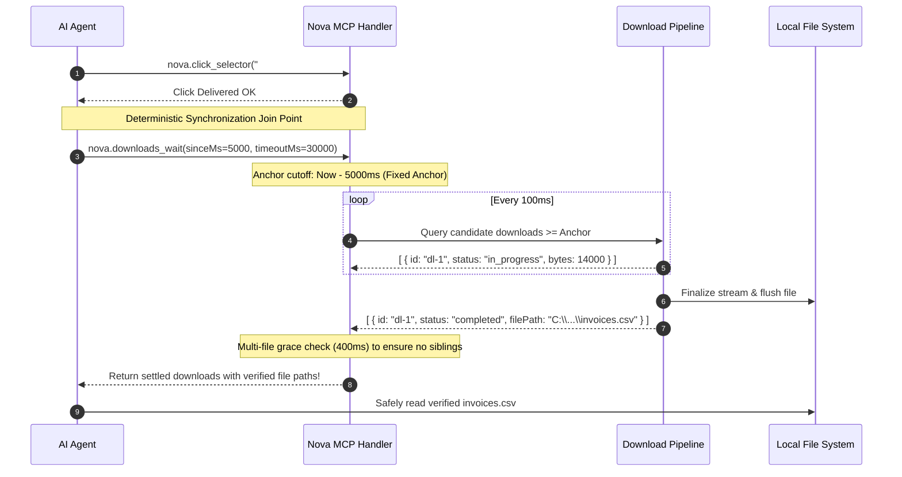
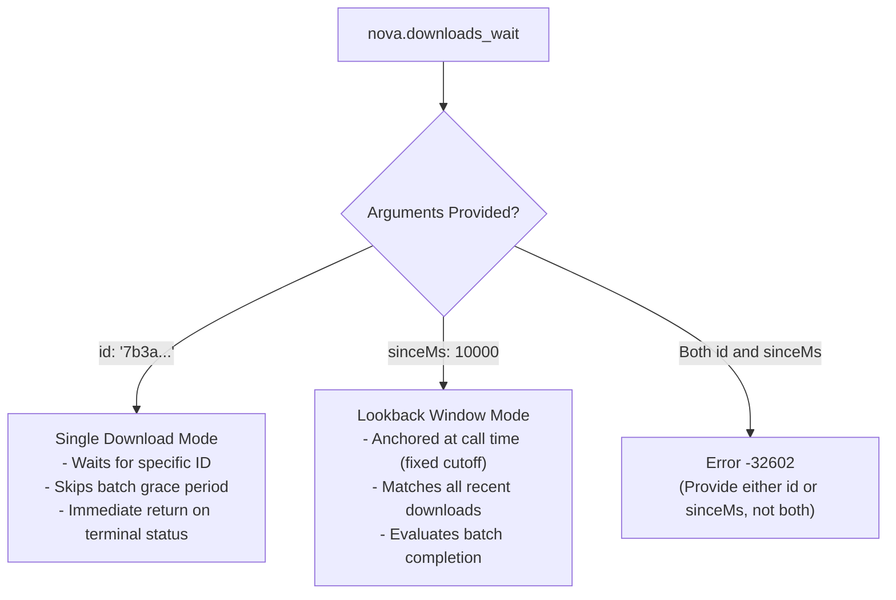
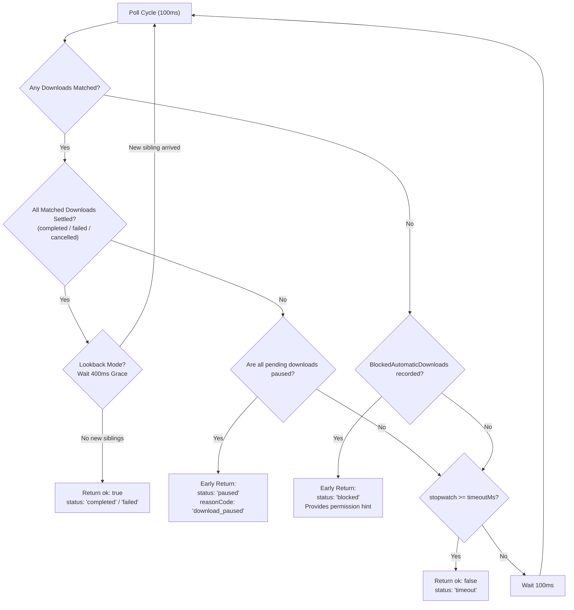
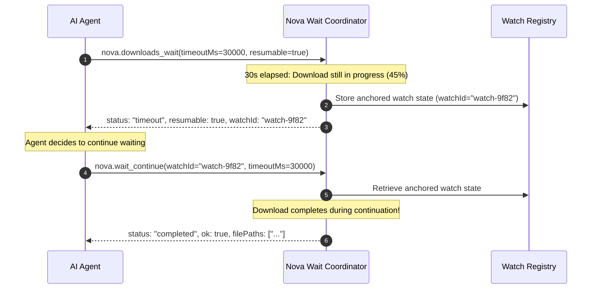

# Download Wait Synchronization & Deterministic Join Points

> **Bridging browser actions and filesystem readiness — deterministic join points, anchored time windows, batch grace periods, and resumable watch continuations.**

---

## 1. The Agent Synchronization Dilemma

In traditional browser automation, triggering a download and operating on the resulting file are disconnected operations:
1. An agent clicks an "Export Invoices as CSV" button.
2. The browser initiates an asynchronous network stream.
3. The agent has no native way of knowing when the bytes have completely arrived on disk.

To work around this, agents often resort to **heuristic sleep loops** or repetitive polling of download lists. This approach creates severe failure modes:
* **Race Conditions:** An agent begins reading a file while Chromium is still writing it, encountering partial data or file-lock errors.
* **Temporary File Confusion:** Operating on partial download segments (such as `.crdownload` or `.tmp` files) before they are renamed to their final extension.
* **Silent Dropping:** If the browser refuses an automatic download, a sleep loop burns its entire timeout waiting for a file that never started.

Nova resolves this with **`nova.downloads_wait`**, providing a deterministic, synchronous join point that bridges user actions and verified filesystem artifacts.



---

## 2. Modes of Operation: Single ID vs. Anchored Lookback

`nova.downloads_wait` operates in one of two distinct modes:



### 1. By ID (`id`)
Used when the download ID is already known (for example, from a previous `nova.downloads_list` call or an API trigger). The wait monitors only that specific download and returns as soon as it reaches `completed`, `failed`, or `cancelled`.

### 2. By Lookback Window (`sinceMs`)
Used immediately after an agent triggers a download via a click, form submit, or navigation.
* Default window: `10000` ms (10 seconds). Maximum: `600000` ms (10 minutes).
* **The Anchored Window Invariant:**
  > [!IMPORTANT]
  > The cutoff timestamp (`DateTime.UtcNow - sinceMs`) is calculated **once at the start of the call**.
  > It is deliberately **never recalculated** on subsequent polling ticks. A sliding window would advance with time and silently drop the download the agent was waiting for.

---

## 3. High-Signal Termination Rules

`nova.downloads_wait` avoids burning timeouts through intelligent state detection:



### 1. Batch Arrival Grace Period (400ms)
When a user action triggers a multi-file export (e.g. downloading 5 separate PDF receipts), the downloads do not register on the exact same millisecond. If the first small file finishes while sibling files are still queueing, an unbuffered wait would return prematurely with only 1 file.
* Nova applies a **400ms grace period** (`DownloadsWaitLateArrivalGrace`) the first time a lookback wait appears settled.
* If the number of matching downloads increases during the grace window, the wait continues until all siblings settle.
* In single `id` mode, this grace period is skipped to eliminate latency.

### 2. Paused Download Early-Exit
A paused download never finishes on its own. Waiting for a paused download would burn the entire 60-second timeout, mimicking a dead network connection.
* As soon as all incomplete downloads in the match set are in the `paused` state, the wait halts immediately.
* Returns `ok: false`, `status: "paused"`, `reasonCode: "download_paused"`.

### 3. Blocked Automatic Download Detection
If a website attempts to download multiple files automatically and the browser blocks them due to permissions:
* The blocked downloads never become active downloads.
* `nova.downloads_wait` queries `BlockedAutomaticDownloads`. If no downloads registered but a refusal was logged, it halts immediately.
* Returns `status: "blocked"`, `reasonCode: "download_wait.automatic_downloads_blocked"`, and includes an actionable `blockedHint` explaining how to grant permissions via `nova.media_permission_set`.

---

## 4. Resumable Waits (`resumable: true`)

Large file downloads (such as OS images or large datasets) often exceed standard MCP tool call timeouts (e.g. 60 seconds). To handle this gracefully without losing state:



* **`nova.wait_continue`**: Resumes waiting using the original anchored cutoff timestamp and download filter.
* **`nova.wait_cancel`**: Explicitly cleans up a registered watch if the agent decides not to wait any longer.

---

## 5. Parameter Reference & Schema

The wait tool is invoked via [`nova.downloads_wait`](../../../mcp-reference/tools/downloads/nova-downloads-wait.md):

| Parameter | Type | Required | Default | Range | Description |
| :--- | :--- | :---: | :--- | :--- | :--- |
| `id` | `string` | No | — | Max 64 chars | Wait for a single known download by ID. Mutually exclusive with `sinceMs`. |
| `sinceMs` | `integer` | No | `10000` | 0–600000 | Lookback window in milliseconds from call time. Mutually exclusive with `id`. |
| `timeoutMs` | `integer` | No | `60000` | 1000–300000 | Maximum duration to wait before timing out. |
| `resumable` | `boolean` | No | `false` | — | If true, returns a `watchId` on timeout to allow continuation via `nova.wait_continue`. |

### Structured Output Payload

```json
{
  "ok": true,
  "status": "completed",
  "reasonCode": "none",
  "waitedMs": 2450,
  "downloadCount": 1,
  "completedCount": 1,
  "failedCount": 0,
  "cancelledCount": 0,
  "pendingCount": 0,
  "pausedCount": 0,
  "downloads": [
    {
      "id": "c4d7e8a1b2c3d4e5f6a7b8c9d0e1f2a3",
      "fileName": "monthly_statement_oct2026.pdf",
      "filePath": "C:\\Users\\User\\Downloads\\monthly_statement_oct2026.pdf",
      "status": "completed",
      "bytesReceived": 5242880,
      "totalBytes": 5242880,
      "url": "https://bank.example.com/api/statements/download"
    }
  ],
  "truncated": false,
  "resumable": false
}
```

---

## 6. Practical Agent Recipes

### Recipe 1: Click and Synchronize
Trigger a download and wait for the file to be ready on disk:

1. Click download button:
   ```json
   // nova.click_selector
   { "selector": "button#download-csv" }
   ```
2. Immediately wait for the result:
   ```json
   // nova.downloads_wait
   { "sinceMs": 5000, "timeoutMs": 30000 }
   ```
3. Read the verified file from `downloads[0].filePath`.

### Recipe 2: Handling Long Resumable Downloads
For large archive downloads:

1. Initiate download and start resumable wait:
   ```json
   // nova.downloads_wait
   { "sinceMs": 5000, "timeoutMs": 30000, "resumable": true }
   ```
2. If the response indicates `status: "timeout"` with `watchId: "watch-abc"`, continue waiting:
   ```json
   // nova.wait_continue
   { "watchId": "watch-abc", "timeoutMs": 30000 }
   ```

---

## 7. Related Tools & Documentation

* [`nova.downloads_wait` Tool Reference](../../../mcp-reference/tools/downloads/nova-downloads-wait.md)
* [`nova.wait_continue` Tool Reference](../../../mcp-reference/tools/downloads/nova-wait-continue.md)
* [`nova.wait_cancel` Tool Reference](../../../mcp-reference/tools/downloads/nova-wait-cancel.md)
* [Lifecycle, Queue & Parked WebViews](../lifecycle-and-queue/README.md)
* [Security Gates & Policy Enforcement](../security-and-policy/README.md)
