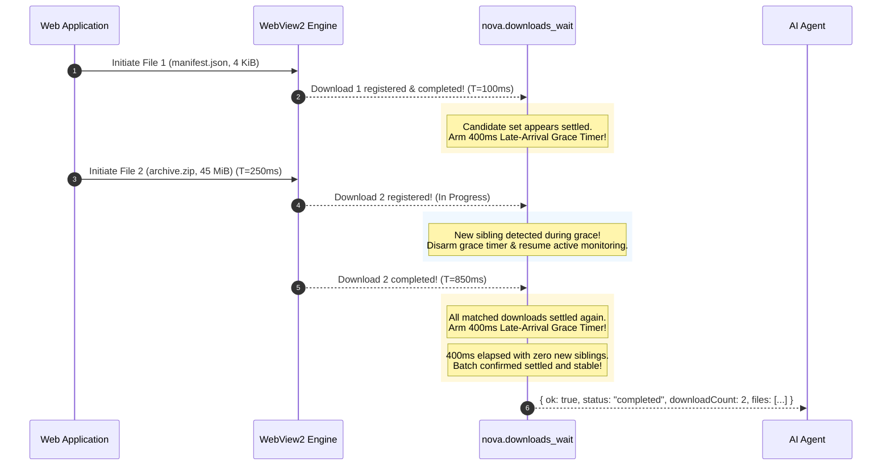
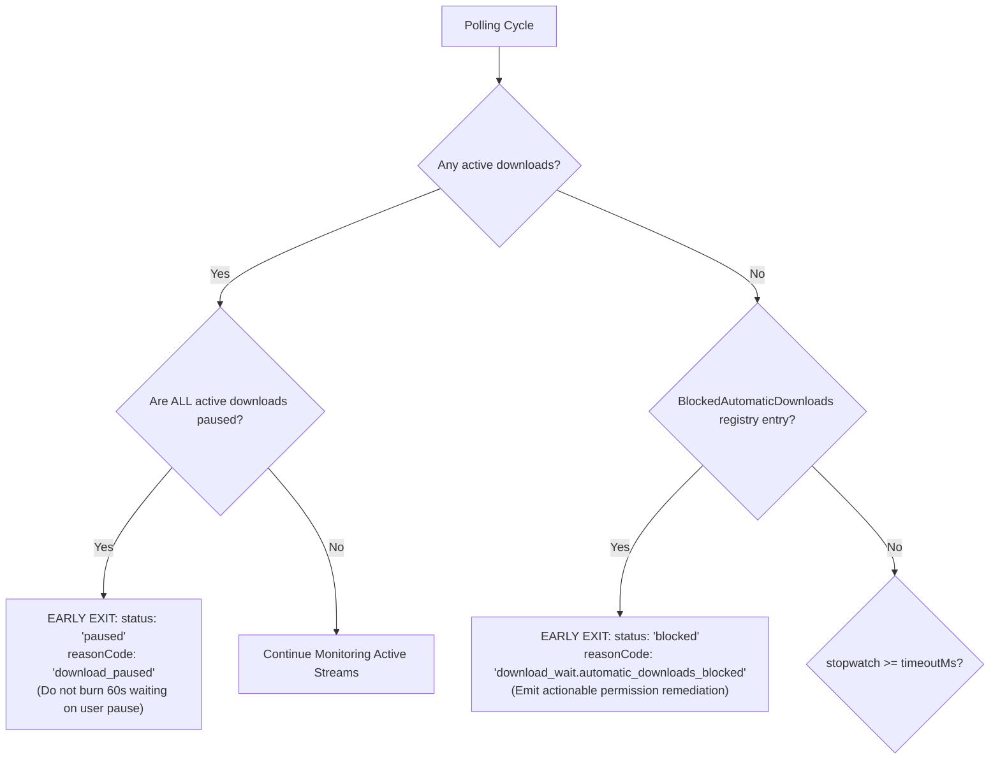
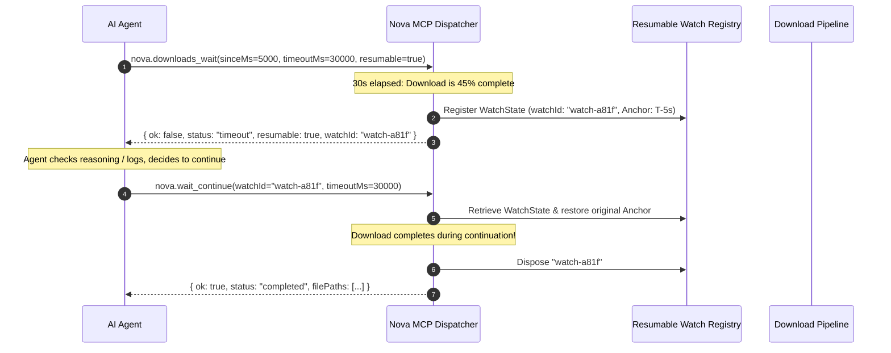

# Batch Grace Periods & Resumable Watches

> **Deep dive into Nova's 400ms multi-file late-arrival grace window, high-signal early-exit optimizations, and resumable long-transfer watches.**

---

## 1. Multi-File Batch Synchronization Challenges

In real-world enterprise web applications, an export operation rarely triggers a single monolithic stream:
* An ERP system exports a zip file alongside a metadata manifest.
* An accounting portal exports 10 monthly invoice PDFs sequentially via JavaScript loops.
* A document management system generates multiple signed receipts with asynchronous server-side generation delays.

In traditional automation, waiting for multi-file downloads exhibits a notorious **early-settlement flaw**:
1. The web page initiates Download 1 (a small 5 KiB metadata file) and Download 2 (a 50 MiB archive).
2. Download 1 finishes in 80 milliseconds.
3. Download 2 is still being prepared by the remote server and has not yet arrived at the browser's download manager.
4. An unbuffered wait sees 1 download, notes that it is `completed`, and returns immediately with a single file.
5. The agent continues its workflow, completely unaware that the primary 50 MiB archive arrived 200 milliseconds later.

Nova solves this race condition using a **Late-Arrival Batch Grace Period**.



---

## 2. The 400ms Late-Arrival Grace Window (`DownloadsWaitLateArrivalGrace`)

When running in lookback mode (`sinceMs`), `nova.downloads_wait` enforces a deterministic stabilization buffer:

1. **First Settlement Check:** As soon as all currently matched downloads reach a terminal status (`completed`, `failed`, or `cancelled`), Nova does not exit immediately. Instead, it arms a **400ms grace window**.
2. **Sibling Arrival Tracking:** During this 400ms buffer, Nova continues polling every 100ms. If the count of matching downloads increases (indicating a staggered sibling download was initiated by the page), the grace timer is immediately disarmed.
3. **Grace Disarming:** Monitoring returns to active tracking until all downloads in the expanded set reach a terminal state.
4. **Stable Settlement:** Only when the entire candidate set remains fully settled for a continuous 400ms window does the tool finalize its return payload.

### Single-Download Optimization
When an agent invokes `nova.downloads_wait` with an explicit `id`, the late-arrival grace period is **completely bypassed**. Because the agent is explicitly targeting a single known artifact, Nova returns the exact millisecond that download settles, eliminating unnecessary wait latency.

---

## 3. High-Signal Early-Exit Optimizations

A robust automation engine must fail fast and informatively rather than burning full 60-second timeouts on deadlocked operations. Nova integrates two high-signal early-exit optimizations:



### 1. Paused Early-Exit (`reasonCode: "download_paused"`)
A paused download will never make forward progress without explicit human or agent intervention.
* If all downloads matching the wait filter are in the `paused` state, waiting for the full `timeoutMs` (e.g. 60 seconds) would mimic a hung process.
* Nova detects this deadlock condition immediately, halts the wait cycle, and returns:
  ```json
  {
    "ok": false,
    "status": "paused",
    "reasonCode": "download_paused",
    "pausedCount": 1,
    "message": "All matching downloads are currently paused. Resume them via nova.downloads_resume to continue transfer."
  }
  ```

### 2. Blocked Automatic Download Early-Exit
When an untrusted origin attempts secondary automatic downloads without permission:
* Chromium blocks the transfer before any download object is created.
* An ordinary download tracker would observe zero downloads and idle until timing out.
* Nova cross-references the `BlockedAutomaticDownloads` security registry. If a blocked download was recorded for the active origin, it exits immediately with `status: "blocked"` and actionable remediation instructions (see [Path Policies & Multi-Downloads](../../security-and-policy/path-policies-multi-downloads-and-previews/README.md)).

---

## 4. Resumable Watches (`resumable: true`)

Massive file transfers (multi-gigabyte database dumps, installation ISOs, dataset archives) frequently exceed standard MCP tool call timeouts (typically 30–60 seconds). Aborting a wait due to a timeout forces the agent to reconstruct its query parameters, risking sliding-window race conditions.

Nova provides **Resumable Watches** to bridge multi-minute downloads across short MCP invocation boundaries.



### The Resumable Watch Lifecycle

1. **Initiation (`resumable: true`):** The agent signals that it wishes to preserve watch context if the transfer does not complete within `timeoutMs`.
2. **Watch Token Issuance:** If timeout occurs while downloads are still `in_progress`, Nova creates a persistent `WatchState` record and returns a unique `watchId`:
   ```json
   {
     "ok": false,
     "status": "timeout",
     "reasonCode": "download_wait.timeout",
     "resumable": true,
     "watchId": "watch-7d8a9b1c-4e2f"
   }
   ```
3. **Continuation via [`nova.wait_continue`](../../../../mcp-reference/tools/downloads/nova-wait-continue.md):** The agent passes the `watchId` back to Nova. Nova resumes monitoring using the **exact original anchored cutoff timestamp**, ensuring no downloads are missed.
4. **Explicit Cancellation via [`nova.wait_cancel`](../../../../mcp-reference/tools/downloads/nova-wait-cancel.md):** If the agent decides to abandon the transfer, calling `wait_cancel` cleanly purges the watch token and disarms all background listeners.

---

## 5. Parameter Reference: Resumable Wait Tools

### [`nova.wait_continue`](../../../../mcp-reference/tools/downloads/nova-wait-continue.md)

| Parameter | Type | Required | Default | Description |
| :--- | :--- | :---: | :--- | :--- |
| `watchId` | `string` | **Yes** | — | Unique watch token returned by a prior resumable wait. |
| `timeoutMs` | `integer` | No | `60000` | Duration to wait during this continuation slice (1000–300000 ms). |

### [`nova.wait_cancel`](../../../../mcp-reference/tools/downloads/nova-wait-cancel.md)

| Parameter | Type | Required | Default | Description |
| :--- | :--- | :---: | :--- | :--- |
| `watchId` | `string` | **Yes** | — | Unique watch token to cancel and release from memory. |

---

## 6. Related Architecture Guides

* [Deterministic Join Points & Anchored Windows](../deterministic-join-points-and-lookback-windows/README.md): Call-time cutoff anchoring and polling loop mechanics.
* [Wait Synchronization Hub](../README.md): High-level domain overview.
* [Dual-Engine Transfers & Parked WebViews](../../lifecycle-and-queue/dual-engine-transfers-and-parked-webviews/README.md): Background stream persistence and tab closure retention.
* [Executable Gates & Security Prompts](../../security-and-policy/executable-gates-and-security-prompts/README.md): Executable file security pre-flight.
* [Downloads Master Hub](../../README.md): Master subsystem architectural catalog.
