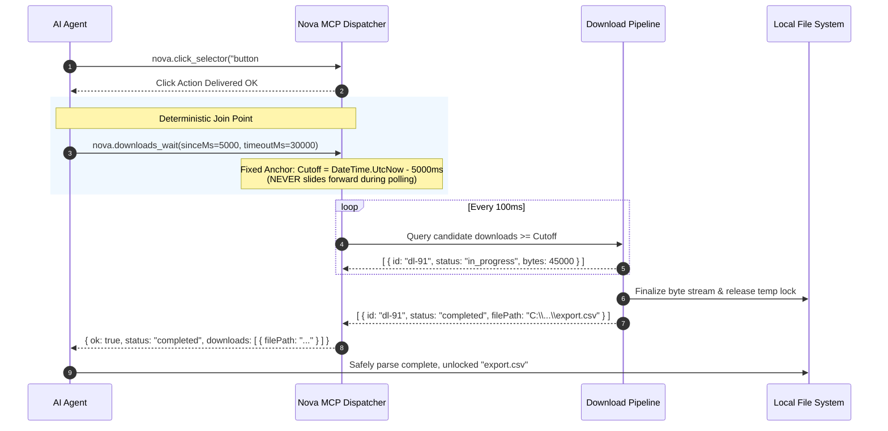
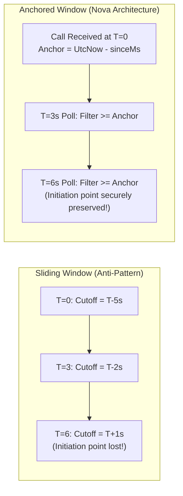
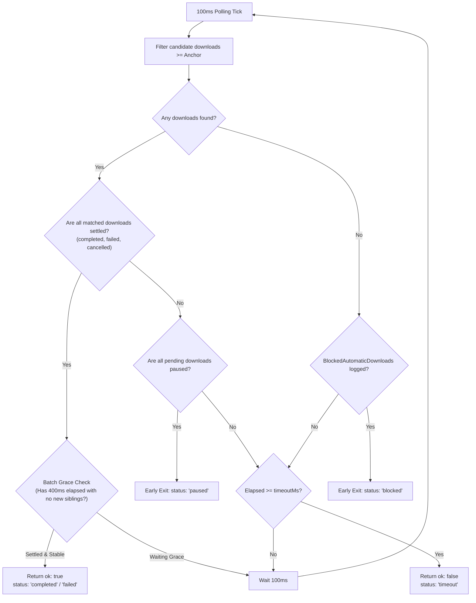

# Deterministic Join Points & Anchored Lookback Windows

> **Bridging browser actions and verified file system artifacts — eliminating heuristic sleeps, the Anchored Window Invariant, and terminal state evaluation.**

---

## 1. The Agent Synchronization Dilemma

In autonomous browser automation, triggering an action and operating on its resultant file on disk are inherently asynchronous and decoupled:

1. **The Heuristic Sleep Trap:** An autonomous agent clicks an "Export Report" button and executes a fixed sleep (e.g. `sleep 5000`). If the network is slow or the server takes 6 seconds to generate the file, the agent wakes up, finds no file, and fails. Conversely, if the download completes in 200ms, the agent wastes 4.8 seconds of idle latency.
2. **The Race Condition Hazard:** If an agent polls the file system directly, it risks reading a partial download segment (`.crdownload` or temporary file lock) before Chromium flushes and renames the file to its final extension, resulting in corrupt data parsing.
3. **The Sliding Window Trap:** If a polling loop queries downloads within the "last 5 seconds" on every iteration, the lookback cutoff slides forward with time. By the time the download finishes, the initiation timestamp has fallen outside the sliding window, causing the wait to drop the file and time out.

Nova resolves these issues with **`nova.downloads_wait`**, creating a deterministic synchronization join point backed by the **Anchored Window Invariant**.



---

## 2. The Anchored Window Invariant

The core architectural guarantee of `nova.downloads_wait` in lookback mode is the **Fixed Anchor**:



> [!IMPORTANT]
> When `nova.downloads_wait` receives a `sinceMs` argument (default: `10000` ms), the cutoff timestamp (`DateTime.UtcNow - TimeSpan.FromMilliseconds(sinceMs)`) is computed **exactly once** at the beginning of the call.
> 
> During the subsequent 100ms polling loop, this cutoff is **strictly immutable**. Even if a large download takes 45 seconds to stream, its initiation timestamp remains comfortably after the fixed anchor, guaranteeing that Nova never loses track of the transfer.

---

## 3. Dual Modes of Operation

`nova.downloads_wait` operates in one of two mutually exclusive modes:

| Dimension | Single Download Mode (`id`) | Lookback Window Mode (`sinceMs`) |
| :--- | :--- | :--- |
| **Primary Trigger** | Download ID is already known (from `downloads_list` or API). | Immediately follows a UI action (click, form submit). |
| **Target Filter** | Exact GUID matching. | All transfers initiated $\ge$ the fixed anchor cutoff. |
| **Batch Arrival Grace**| **Skipped** (immediate return upon settlement). | **Active** (evaluates 400ms late-arrival grace period). |
| **Mutual Exclusivity** | Must not include `sinceMs`. | Must not include `id`. |

### Argument Validation Error (-32602)
Supplying both `id` and `sinceMs` in the same call is an invalid state:
```json
// Error response
{
  "code": -32602,
  "message": "Invalid parameters: Provide either 'id' or 'sinceMs', not both."
}
```

---

## 4. Polling Cycle & Terminal Status Settlement

During the wait execution, Nova checks the download state engine every 100 milliseconds:



### Settlement Classifications

1. **`completed`:** All matching downloads transferred their complete byte payload, passed integrity verification, and finalized their destination disk paths.
2. **`failed`:** At least one matching download terminated with an error (e.g. `NETWORK_FAILED`, `SERVER_FORBIDDEN`). The error code and reason are populated in the response array.
3. **`cancelled`:** The user or an agent explicitly called `nova.downloads_cancel` on the operation.
4. **`paused`:** The wait detected that all active transfers have been suspended and halts early to avoid burning timeout latency.

---

## 5. Practical Tool Recipes

### Recipe 1: Click, Wait, and Parse
Trigger a CSV export and synchronously retrieve the resolved file path:

```json
// Step 1: Click the export button
// nova.click_selector
{
  "selector": "button#download-sales-csv"
}

// Step 2: Synchronize with download pipeline
// nova.downloads_wait
{
  "sinceMs": 5000,
  "timeoutMs": 30000
}
```

Example successful response:
```json
{
  "ok": true,
  "status": "completed",
  "reasonCode": "none",
  "waitedMs": 1420,
  "downloadCount": 1,
  "completedCount": 1,
  "failedCount": 0,
  "cancelledCount": 0,
  "pendingCount": 0,
  "pausedCount": 0,
  "downloads": [
    {
      "id": "f8a1c3e4-2b9d-47a6-91e0-8c2d5e7b3a1f",
      "fileName": "sales_q3_2026.csv",
      "filePath": "C:\\Users\\Operator\\Downloads\\sales_q3_2026.csv",
      "status": "completed",
      "bytesReceived": 2841902,
      "totalBytes": 2841902,
      "url": "https://dashboard.corp/api/sales/export"
    }
  ],
  "truncated": false,
  "resumable": false
}
```

---

## 6. Related Architecture Guides

* [Batch Grace Periods & Resumable Watches](../batch-grace-periods-and-resumable-watches/README.md): 400ms batch buffer, early-exit heuristics, and resumable watch continuation.
* [Wait Synchronization Hub](../README.md): High-level domain overview for deterministic wait synchronization.
* [Dual-Engine Transfers & Parked WebViews](../../lifecycle-and-queue/dual-engine-transfers-and-parked-webviews/README.md): Stream mechanics and tab closure parking.
* [Executable Gates & Security Prompts](../../security-and-policy/executable-gates-and-security-prompts/README.md): Pre-flight executable verification.
* [Downloads Master Hub](../../README.md): Master subsystem architectural catalog.
