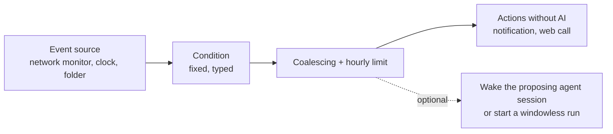

# Fastlanes: Event-Driven Automation

> [!NOTE]
> **Upcoming.** Fastlanes arrive with a coming release, which is not published yet. They replace Nova's earlier scheduled tasks; existing scheduled tasks are not carried over.

A fastlane is an automation an agent describes once and Nova then runs on its own. Nova waits for an event (no polling), checks a fixed condition and runs the actions without AI. Only when an event needs thought does a fastlane involve an agent, and then only the one the user approved.

---

## 1. Overview

* **Event sources:**
  * **Network monitor:** events of Nova's long-term network monitors (`nova.net_monitor_*`), for example an outage, loss, latency or a route change. Conditions: react when an event starts, when it still persists after a given time, or when it recovers.
  * **Time:** a schedule such as `weekdays 07:30` or `every 15m` in a chosen time zone. Appointments missed while Nova was off or the PC asleep can be caught up once or skipped.
  * **Folder:** files created, changed, deleted or renamed in a folder. Nova reads names, sizes and change times only and never opens the files.
* **Actions without AI:** a Nova and Windows notification, or a web call (`http_callback`). The web call sends a fixed message; the agent cannot add its own text.
* **Optional agent involvement:** Nova can wake the agent session that proposed the fastlane, or start a windowless Claude run with an approved task and the Nova tools the agent listed.
* **Limits:** events of one disturbance are coalesced into a window, and every fastlane has an hourly limit for deliveries.

---

## 2. Approval

An agent can only propose; it cannot approve anything. What is approved is the exact contract, so a changed proposal needs a new answer.

| Fastlane | What happens |
| :--- | :--- |
| Only notifies, wakes the proposing session, or calls an address on this PC or in the local network | Active at once; Nova tells the user, who can pause or delete it. |
| Starts a run on the user's Claude account, or calls an address on the internet | Nova asks the user first, in the usual prompt or in the agents panel. Until answered it does nothing. |

Unanswered proposals expire after a week. Both questions can be switched off in Nova's settings. A run is limited to the Nova tools the user approved; tools Nova cannot bound to a fixed reach are named apart in the question and are always asked.

---

## 3. Control and Safety

* **Pause and delete:** agents may pause and delete fastlanes. Only the user resumes what the user paused.
* **Overload protection:** a fastlane that reaches its hourly limit in each of three hours in a row is paused by Nova and reported to the user. Only the user resumes it.
* **Emergency stop:** while it is active, no fastlane runs, and what falls due in that time is not caught up afterwards. See [Emergency stop](../../getting-started/emergency-stop.md).
* **Changes:** a changed fastlane is a new revision. The approved revision keeps running until the user answers.
* **Settings:** the card **Agent runs** in Settings holds only the paths of the Claude and Codex programs.

---

## 4. MCP Tools

Capability bundle: `fastlanes`.

| Step | Tool |
| :--- | :--- |
| See what can be reacted to | [`nova.fastlane_catalog`](../../mcp-reference/tools/fastlanes/nova-fastlane-catalog.md) |
| Check a contract without storing it | [`nova.fastlane_preview`](../../mcp-reference/tools/fastlanes/nova-fastlane-preview.md) |
| Set up or change | [`nova.fastlane_create`](../../mcp-reference/tools/fastlanes/nova-fastlane-create.md), [`nova.fastlane_update`](../../mcp-reference/tools/fastlanes/nova-fastlane-update.md) |
| Read | [`nova.fastlane_list`](../../mcp-reference/tools/fastlanes/nova-fastlane-list.md), [`nova.fastlane_get`](../../mcp-reference/tools/fastlanes/nova-fastlane-get.md) |
| Pause, resume, delete | [`nova.fastlane_set_state`](../../mcp-reference/tools/fastlanes/nova-fastlane-set-state.md), [`nova.fastlane_delete`](../../mcp-reference/tools/fastlanes/nova-fastlane-delete.md) |
| Receive events as the woken session | [`nova.fastlane_subscribe`](../../mcp-reference/tools/fastlanes/nova-fastlane-subscribe.md), [`nova.fastlane_claim`](../../mcp-reference/tools/fastlanes/nova-fastlane-claim.md), [`nova.fastlane_ack`](../../mcp-reference/tools/fastlanes/nova-fastlane-ack.md) |

Full tool reference: [Fastlanes tool area](../../mcp-reference/tools/fastlanes/README.md).

---

## 5. Replaces Scheduled Tasks

Scheduled tasks (cron jobs, run history, task workspaces, task secrets) are retired. Their tools are gone from the catalog and existing tasks are not carried over. Set the automation up again as a fastlane where it fits.

---

## Related Documentation

* [Fastlanes for users](../../user-guide/tools/fastlanes.md)
* [Network](../network/README.md) - the long-term monitors a fastlane can listen to
* [Notifications](../notifications/README.md)
* [Core Features Hub](../README.md)
