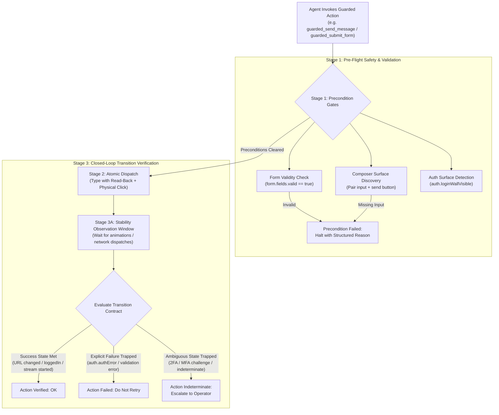

# Guarded Interactions & Form Automation

> [!IMPORTANT]
> In modern reactive web applications, clicking an element or submitting text is rarely a simple, instantaneous event. Submitting a form can trigger client-side validation errors, clicking *"Send"* in an AI chat interface requires waiting for asynchronous models to generate tokens, and logging in can branch into Two-Factor Authentication (2FA) or SSO flows. Naive, blind clicking leads to duplicate form submissions, dropped prompts, and rate-limit lockouts. Nova AI Workspace solves this with **Guarded Interactions**: high-level transactional macros governed by automated Closed-Loop transition contracts, pre-flight readiness gates, and post-action outcome verification.

---

## 1. Overview & Architectural Philosophy

Autonomous web agents fail most frequently at **commit points**—actions that permanently alter application state (sending messages, submitting orders, switching accounts, or logging in).

Traditional automation frameworks dispatch raw pointer clicks with no awareness of the surrounding application state:
1. **Missing Element Readiness:** An agent attempts to click a send button before typing has activated the input, or clicks a disabled form button before required fields pass client-side validation.
2. **Blind Duplicate Submissions:** If a slow network causes a submit button to spin, an unguided agent clicks it repeatedly, resulting in duplicate purchases, duplicate chat prompts, or double API charges.
3. **Silent Rejections & Ambiguous Branches:** A login fails with an inline error flash, or transitions to an MFA/TOTP prompt. A naive script treats this as a generic failure and enters an infinite retry loop.
4. **Dropped User Prompts:** If an error occurs during message dispatch, the typed prompt in the composer is wiped out, losing user input permanently.

Nova addresses these vulnerabilities through **Guarded Interactions**:



---

## 2. Guarded Action Architecture & Tools

Nova provides specialized guarded tools for every major class of high-impact web interactions:

| Tool | Target Interaction Scope | Key Built-In Safety Mechanisms |
| :--- | :--- | :--- |
| [`nova.guarded_send_message`](../../mcp-reference/tools/guarded-actions/nova-guarded-send-message.md) | Chat interfaces (ChatGPT, Claude.ai, Gemini, Slack, Teams) | Composer auto-discovery, type-first recovery, read-back verification, Enter-key fallback, `ReplyWatchObserverScript` streaming observation, text retention on error. |
| [`nova.guarded_submit_form`](../../mcp-reference/tools/guarded-actions/nova-guarded-submit-form.md) | Transactional forms, checkouts, settings saves | Client-side validation scanning (`:invalid`, `aria-invalid`), duplicate submit protection via `non_idempotent` retry policy, post-submit navigation verification. |
| [`nova.guarded_login`](../../mcp-reference/tools/guarded-actions/nova-guarded-login.md) | Authentication surfaces & login walls | Integrated Auth Surface Detection (ASD), explicit credential error trapping (`auth.authError`), and 2FA/MFA challenge branching (`verifyState="indeterminate"`). |
| [`nova.guarded_switch_model`](../../mcp-reference/tools/guarded-actions/nova-guarded-switch-model.md) | Model switchers in web AI interfaces | Verifies open model selector menu before clicking, and confirms that the active model label changed afterwards. |
| [`nova.guarded_switch_sandbox`](../../mcp-reference/tools/guarded-actions/nova-guarded-switch-sandbox.md) | Multi-tenant workspace & organization switchers | Asserts active workspace dropdown before clicking, and verifies tenant identifier transition after selection. |

---

## 3. Subsystem Architecture

The guarded interaction subsystem is organized into three architectural areas:

| Subsystem Guide | Scope & Key Concepts | Primary Components |
| :--- | :--- | :--- |
| **[Autonomous Chat Engine & Reply Watch](chat-macro/README.md)** | Atomic compose-and-send pipeline, composer auto-discovery, type-first wake-up recovery, read-back verification, isolated Chromium world observation (`__nova_reply_watch`), and C# streaming timeline reduction (`ReplyReducer`). | `McpServer.ComposeAndSend`<br>`ReplyWatchObserverScript`<br>`ReplyReducer`<br>`ReplyTimeline`<br>`EnterKeySend` |
| **[Transactional Form Submissions & Auth Gates](form-submission/README.md)** | Pre-dispatch HTML5 validation checks, duplicate submission defense, non-idempotent retry policies, Auth Surface Detection (ASD) integration, and 2FA/MFA challenge branching. | `McpServer.InputInteractionGuardedTools`<br>`AuthSurfaceDetector`<br>`GuardedCommitPoint`<br>`form.fields.valid` |
| **[Closed-Loop Transition Contracts](transition-contracts/README.md)** | Contract anatomy (`preconditions`, `postconditions`, `retryPolicy`, `stabilityWindowMs`), fact keys, operators, deep additive contract merging, and idempotency safeguards. | `TransitionContract`<br>`MergeWithProvidedTransitionContract`<br>`GuardedCommitPoint` |

---

## 4. Operational Invariants for Autonomous Agents

When building autonomous workflows that mutate external application state, agents must adhere to the following principles:

1. **Prefer Guarded Macros over Raw Clicks for State Mutations:**
   Never use bare `nova.input_click` or `nova.click_selector` to submit a form, send a message, or log into a portal. Raw clicks provide zero feedback on whether validation failed or whether duplicate submissions occurred.
2. **Respect `non_idempotent` Retry Policies:**
   All guarded macros declare `retryPolicy: "non_idempotent"`. If a call fails or reports `indeterminate`, **never immediately re-dispatch the exact same submit click**. Re-inspect the page using `nova.perceive` to determine whether the transaction was committed before taking corrective action.
3. **Use Reply-Watch Continuation for Long Generations:**
   When invoking `nova.guarded_send_message` with `waitForReplyMs`, long generations that exceed the timeout return a `reply.watchId`. Do not send the prompt again. Continue monitoring the existing generation using:
   ```json
   {
     "mode": "conversation",
     "replyWatchId": "rw-123456789",
     "waitMs": 30000
   }
   ```
4. **Leverage Integrated Blocker Clearance:**
   If a cookie consent banner or modal backdrop obscures a form submit button or chat composer, pass `autoDismissBlockers: true` to the guarded tool. Nova will resolve the blocker in-flight without aborting the interaction sequence.

---

## Related Documentation

* [Autonomous Chat Engine & Reply Watch Architecture](chat-macro/README.md)
* [Transactional Form Submissions & Auth Gates](form-submission/README.md)
* [Closed-Loop Transition Contracts](transition-contracts/README.md)
* [Auth Surface Detection (ASD) Architecture](../auth-surface-detection-asd/README.md)
* [Closed-Loop System (CLS)](../closed-loop-system-cls/README.md)
* [Tool Catalog: Guarded Actions & Blocker Clearance](../../mcp-reference/tools/guarded-actions/README.md)
