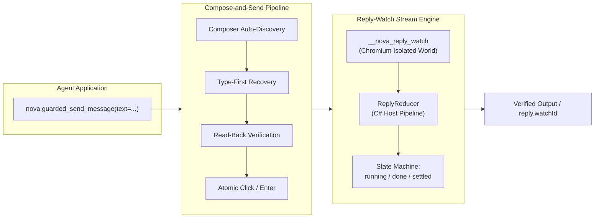

# Autonomous Chat Engine & Reply-Watch Architecture

> [!NOTE]
> `nova.guarded_send_message` is Nova's specialized macro for autonomous interaction with modern AI model web applications (ChatGPT, Claude.ai, Gemini, Perplexity) and collaboration platforms (Slack, Teams, Discord). It unifies composer auto-discovery, type-first wake-up recovery, read-back verification, and asynchronous response streaming into an atomic, closed-loop operation.

---

## 1. Overview & Architectural Role

Interacting with web-based LLMs and chat platforms is drastically different from submitting classic HTML forms:

```
┌────────────────────────────────────────────────────────────────────────┐
│                     Chat Interface Automation Traps                    │
├──────────────────────────────────┬─────────────────────────────────────┤
│ Architectural Obstacle           │ Impact on Autonomous Agents         │
├──────────────────────────────────┼─────────────────────────────────────┤
│ Rich Text & Virtualized Inputs   │ Inputs use ProseMirror, Lexical, or │
│ (contenteditable, draft-js)      │ custom contenteditable wrappers     │
│                                  │ that do not respond to value=.      │
├──────────────────────────────────┼─────────────────────────────────────┤
│ Conditional Send Buttons         │ Send buttons are completely omitted │
│ (Empty Composer Invisibility)    │ from the DOM or set to disabled     │
│                                  │ until the first character is typed. │
├──────────────────────────────────┼─────────────────────────────────────┤
│ Button Mutation During Streaming │ The send button morphs into a       │
│ (Send → Stop Streaming → Send)   │ "Stop Generating" square icon while │
│                                  │ tokens stream over SSE / WebSockets.│
├──────────────────────────────────┼─────────────────────────────────────┤
│ Unpredictable Generation Times   │ Generating long responses or code   │
│ (Streaming Delays up to 30 min)  │ takes minutes; standard timeouts    │
│                                  │ trigger false retry attempts.       │
└──────────────────────────────────┴─────────────────────────────────────┘
```

Nova resolves these challenges by dividing chat interaction into two tightly coupled subsystems:
1. **The Compose-and-Send Pipeline:** Responsible for input surface discovery, reactive wake-up, prompt read-back verification, atomic send dispatch, and prompt text retention on error.
2. **The Reply-Watch Stream Engine:** Responsible for isolated-world DOM mutation observation, network stream tracking, host-side timeline reduction, and asynchronous continuation without blocking tool connections.



---

## 2. Comprehensive Documentation Index

For exhaustive technical implementations, lifecycle diagrams, and operational recipes, consult the specialized architecture guides:

```
public/docs/core-features/guarded-interactions/chat-macro/
├── README.md                                 # This domain hub
├── compose-and-send-pipeline/
│   └── README.md                             # 6-step pipeline, type-first recovery, read-back verification, EnterKeySend
└── reply-watch-and-streaming/
    └── README.md                             # __nova_reply_watch, ReplyReducer, SSE/WebSocket tracking, continuation
```

| Architecture Guide | Focus & Key Concepts | Primary Components |
| :--- | :--- | :--- |
| **[The 6-Step Compose-and-Send Pipeline](compose-and-send-pipeline/README.md)** | Composer auto-discovery across ProseMirror/Lexical/textarea, Shadow DOM piercing, type-first wake-up recovery, DOM read-back verification against input corruption, physical click dispatch, modifier-safe `EnterKeySend` fallback, and zero-data-loss prompt text retention on error. | `McpServer.ComposeAndSend`<br>`TypeFirstRecovery`<br>`ReadBackVerifier`<br>`EnterKeySend`<br>`composer.text.empty` |
| **[Reply-Watch & Streaming Architecture](reply-watch-and-streaming/README.md)** | In-page isolated Chromium JavaScript world observer (`__nova_reply_watch`), tamper-proof execution invariants, document replacement detection, C# host streaming reducer (`ReplyReducer`), dual DOM/network stream evaluation, and asynchronous long-generation continuation via `reply.watchId`. | `ReplyWatchObserverScript`<br>`ReplyReducer`<br>`ReplyTimeline`<br>`ReplyNetworkLog`<br>`reply.watchId` |

---

## 3. Core Operational Invariants for Autonomous Agents

When operating web AI models or chat platforms, agents must adhere to the following rules:

1. **Never Re-Send on Stream Timeouts:**
   If a chat interaction returns `reply.state: "running"` after the initial wait window, **never call `nova.guarded_send_message` again with the same prompt**. Doing so clutters the conversation with duplicate requests. Use [`nova.read_text_structured`](../../../mcp-reference/tools/dom-and-reading/nova-read-text-structured.md) with `replyWatchId` to resume non-destructive observation.
2. **Rely on Zero-Data-Loss Retention:**
   If a send fails due to an unexpected blocker or disabled button, Nova guarantees the prompt text remains in the composer. Do not attempt blind re-typing; inspect the UI state with `nova.perceive` to diagnose why the submit button was unavailable.
3. **Use Blocker Dismissal for Popups:**
   Many AI interfaces present periodic surveys, terms updates, or cookie banners that obscure the composer. Always provide `autoDismissBlockers: true` to allow Nova's CMP and dialog dismissers to clear overlays transparently.

---

## Related Documentation

* [Guarded Interactions Overview](../README.md)
* [The 6-Step Compose-and-Send Pipeline](compose-and-send-pipeline/README.md)
* [Reply-Watch & Streaming Architecture](reply-watch-and-streaming/README.md)
* [Transactional Form Submissions & Auth Gates](../form-submission/README.md)
* [Closed-Loop Transition Contracts](../transition-contracts/README.md)
* [Tool Reference: `nova.guarded_send_message`](../../../mcp-reference/tools/guarded-actions/nova-guarded-send-message.md)
* [Tool Reference: `nova.read_text_structured`](../../../mcp-reference/tools/dom-and-reading/nova-read-text-structured.md)
