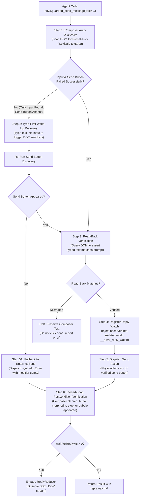
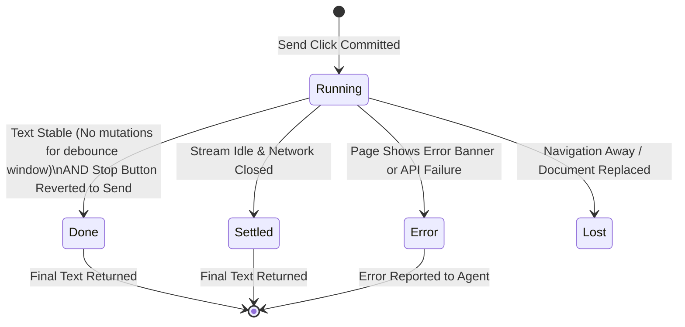

# Autonomous Chat Engine & Reply-Watch Architecture

> [!NOTE]
> `nova.guarded_send_message` is Nova's specialized macro for autonomous interaction with modern AI model web applications (ChatGPT, Claude.ai, Gemini, Perplexity) and collaboration platforms (Slack, Teams, Discord). It unifies composer auto-discovery, type-first wake-up recovery, read-back verification, and asynchronous response streaming into an atomic, closed-loop operation.

---

## 1. The Modern Chat Interface Challenge

Interacting with web-based LLMs and chat platforms is drastically different from submitting classic HTML forms:

```
┌────────────────────────────────────────────────────────────────────────┐
│                     Chat Interface Automation Traps                    │
├──────────────────────────────────┬─────────────────────────────────────┤
│ Architectural Obstacle           │ Impact on Autonomous Agents         │
├──────────────────────────────────┼─────────────────────────────────────┤
│ Rich Text & Virtualized Inputs   │ Inputs use ProseMirror, Lexical, or │
│ (contenteditable, draft-js)      │ custom contenteditable wrappers     │
│                                  │ that do not respond to value=.      │
├──────────────────────────────────┼─────────────────────────────────────┤
│ Conditional Send Buttons         │ Send buttons are completely omitted │
│ (Empty Composer Invisibility)    │ from the DOM or set to disabled     │
│                                  │ until the first character is typed. │
├──────────────────────────────────┼─────────────────────────────────────┤
│ Button Mutation During Streaming │ The send button morphs into a       │
│ (Send → Stop Streaming → Send)   │ "Stop Generating" square icon while │
│                                  │ tokens stream over SSE / WebSockets.│
├──────────────────────────────────┼─────────────────────────────────────┤
│ Unpredictable Generation Times   │ Generating long responses or code   │
│ (Streaming Delays up to 30 min)  │ takes minutes; standard timeouts    │
│                                  │ trigger false retry attempts.       │
└──────────────────────────────────┴─────────────────────────────────────┘
```

`nova.guarded_send_message` addresses every stage of this lifecycle through a coordinated dual-subsystem design: the **Compose-and-Send Pipeline** and the **Reply-Watch Stream Engine**.

---

## 2. The 6-Step Compose-and-Send Pipeline

Every execution of `nova.guarded_send_message` follows a deterministic sequence:



### The 6 Steps in Detail:

1. **Composer Auto-Discovery:** Resolves active chat containers by querying contenteditable elements, ProseMirror nodes, Lexical editors, and standard textareas. Automatically pierces open Shadow DOM boundaries and same-origin frames.
2. **Type-First Wake-Up Recovery:** On platforms like ChatGPT or Claude.ai, the send button does not exist in the DOM when the composer is empty. If discovery finds an input field but no send button, Nova types the prompt first to "wake up" the reactive framework, then immediately re-evaluates send-button discovery.
3. **Read-Back Verification:** Before clicking the send button, Nova queries the composer's inner text or value. If the typed text does not match the prompt (caused by browser autofill interference or dropped keystrokes), Nova aborts the click to prevent partial prompt dispatch.
4. **Text Retention & Rollback Safety:** If send resolution fails at any point, Nova **preserves the text inside the composer**. It never clears or deletes the user's prompt on failure, ensuring the operator or agent can inspect the input and recover cleanly.
5. **Send-Button Click & Enter-Key Fallback:** Dispatches a physical left click to the verified send button. If the button is non-clickable or obscured, Nova falls back to `EnterKeySend`—dispatching synthetic `Enter` key events with modifier protection (`Shift+Enter` = newline, `Enter` = send).
6. **Closed-Loop Postcondition Verification:** Verifies delivery by asserting that at least one of three transition facts became true:
   * The composer cleared its text (`composer.text.empty`).
   * The send button mutated into a "Stop Generating" control (`composer.send_button.stopped`).
   * A new message bubble containing the prompt's first line appeared in the transcript feed.

---

## 3. In-Page Reply Observer (`__nova_reply_watch`)

To monitor streaming replies without interfering with page scripts, Nova injects an observation engine into an **isolated Chromium JavaScript world**:

```javascript
// Runs in isolated world: '__nova_reply_watch'
window.__novaReplyWatch[watchId] = {
    originTime: performance.now(),
    anchorFound: false,
    replyTextHash: null,
    composerState: "stopped", // "ready" | "stopped" | "disabled"
    events: []
};
```

### Security & Isolation Invariants:
* **Tamper-Proof Execution:** The page scripts share the DOM with the isolated world, but cannot access `window.__novaReplyWatch` or inspect recorded events.
* **Document Replacement Detection:** If the web app executes a hard page reload or full navigation, the isolated world is discarded. A subsequent read returns `reasonCode: "reply.scope_changed"` or `reply.lost`, alerting the agent that the session navigated away.
* **Bounded Memory Overhead:** The observer records changes (anchor appearance, text length, hash changes) capped at 1,500 events per channel, costing minimal CPU ticks.

---

## 4. The C# Streaming Reducer (`ReplyReducer`)

While the in-page script records raw DOM events, decision logic is executed on the C# host by the `ReplyReducer`.

The reducer evaluates two independent observation channels:
1. **DOM Mutation Channel:** Text length progression, anchor stability, and send-button state transitions.
2. **Network Stream Channel:** Active Server-Sent Events (SSE) or NDJSON WebSocket streams (`ReplyNetworkLog`).



### State Transitions:
* **`running`:** Tokens are actively streaming; text length is expanding or network chunks are arriving.
* **`done`:** The model completed its answer: the stop button reverted to the send button, and text mutations halted.
* **`settled`:** The stream completed and an idle debounce period elapsed without further changes.
* **`scope_changed` / `lost`:** The user clicked a different chat thread or navigated to another URL while waiting.

---

## 5. Reply-Watch Continuation via `nova.read_text_structured`

When an LLM response takes several minutes to generate (such as generating extensive code or conducting deep research), setting `waitForReplyMs: 1800000` (30 minutes) on `nova.guarded_send_message` is supported, but holding an open MCP call can be inconvenient.

Instead, agents can specify a shorter wait (e.g. `waitForReplyMs: 10000`) and use the returned `reply.watchId` to follow up:

```json
{
  "mode": "conversation",
  "replyWatchId": "rw-123456789",
  "waitMs": 30000
}
```

### Operational Rules for Agents:
* **Zero Duplicate Sends:** Calling `read_text_structured` with `replyWatchId` is strictly read-only. It observes the existing generation without typing or sending anything.
* **Never "Retry" by Re-Sending:** If a reply wait times out, the agent must **never** call `nova.guarded_send_message` again with the same prompt. Doing so creates duplicate prompts in the user's chat history. Always continue observing via `replyWatchId`.

---

## Related Documentation

* [Guarded Interactions Overview](../README.md)
* [Transactional Form Submissions & Auth Gates](../form-submission/README.md)
* [Closed-Loop Transition Contracts](../transition-contracts/README.md)
* [Tool Reference: `nova.guarded_send_message`](../../../mcp-reference/tools/guarded-actions/nova-guarded-send-message.md)
* [Tool Reference: `nova.read_text_structured`](../../../mcp-reference/tools/dom-and-reading/nova-read-text-structured.md)
