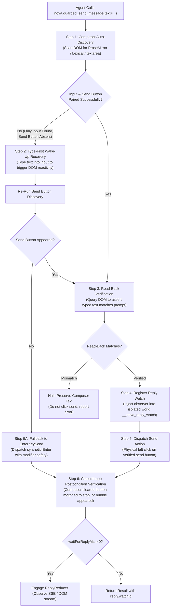

# The 6-Step Compose-and-Send Pipeline

> [!NOTE]
> Modern web chat interfaces (ChatGPT, Claude.ai, Gemini, Perplexity, Slack, Teams) present complex automation challenges: rich-text virtualized editors (`contenteditable`, ProseMirror, Lexical), conditional send buttons that do not exist in the DOM until text is typed, and dynamic button morphing during streaming. The **Compose-and-Send Pipeline** within [`nova.guarded_send_message`](../../../../mcp-reference/tools/guarded-actions/nova-guarded-send-message.md) provides an atomic, zero-data-loss execution engine that safely drives chat interactions from discovery to verified transmission.

---

## 1. Architectural Challenge: The Dynamic Chat Surface

Traditional browser automation tools treat message sending as two separate commands: `type(text)` followed by `click(send_button)`. In reactive chat applications, this naive approach fails across five distinct operational traps:

```
┌────────────────────────────────────────────────────────────────────────┐
│                     Chat Interface Automation Traps                    │
├──────────────────────────────────┬─────────────────────────────────────┤
│ Architectural Obstacle           │ Impact on Naive Automation          │
├──────────────────────────────────┼─────────────────────────────────────┤
│ Rich Text & Virtualized Inputs   │ Editors use ProseMirror, Lexical,   │
│ (contenteditable, draft-js)      │ or custom trees that do not bind to │
│                                  │ HTML input.value properties.        │
├──────────────────────────────────┼─────────────────────────────────────┤
│ Conditional Send Buttons         │ Send buttons are completely omitted │
│ (Empty Composer Invisibility)    │ from the DOM or marked disabled     │
│                                  │ until the first keystroke occurs.   │
├──────────────────────────────────┼─────────────────────────────────────┤
│ Unverified Input Corruption      │ Browser autofill, IME composition,  │
│ (Dropped Characters / Overwrite) │ or race conditions truncate text    │
│                                  │ before clicking send.               │
├──────────────────────────────────┼─────────────────────────────────────┤
│ Button Mutation During Streaming │ The send button morphs into a       │
│ (Send → Stop Streaming → Send)   │ "Stop Generating" square icon while │
│                                  │ tokens stream over SSE / WebSockets.│
├──────────────────────────────────┼─────────────────────────────────────┤
│ Destructive Error Behavior       │ If clicking fails, naive scripts    │
│ (Lost User Prompts)              │ clear the input, destroying complex │
│                                  │ multi-paragraph user prompts.       │
└──────────────────────────────────┴─────────────────────────────────────┘
```

Nova resolves these issues through a deterministic, closed-loop 6-step pipeline.

---

## 2. Pipeline Execution Flow

The compose-and-send pipeline operates as a transactional state machine:



---

## 3. The 6 Steps in Detail

### Step 1: Composer Auto-Discovery
Nova queries the active page to locate both the message input surface and its corresponding submission trigger:
* **Heuristic Search Order:** Evaluates active `[contenteditable="true"]` nodes, ProseMirror editors (`.ProseMirror`), Lexical rich-text containers (`[data-lexical-editor="true"]`), and standard `textarea` / `input[type="text"]` elements.
* **Shadow DOM Piercing:** Automatically traverses open Shadow Roots and same-origin frames to locate embedded chat components without requiring explicit frame selectors.
* **Button Pairing:** Scans adjacent or parent form containers for submit controls matching `button[type="submit"]`, `button[aria-label*="Send"]`, SVG arrow icons, or platform-specific test IDs (`[data-testid="send-button"]`).

### Step 2: Type-First Wake-Up Recovery
On platforms such as ChatGPT, Claude.ai, and modern web portals, the send button **does not exist in the DOM** while the input field is empty.
* **The Trapped State:** If an automation script searches for a send button before typing, discovery fails.
* **Nova's Wake-Up Strategy:** If discovery locates a valid composer input but cannot find an active send button, Nova enters **Type-First Recovery**:
  1. Nova sets focus and types the prompt text into the discovered input element.
  2. Typing triggers reactive input events (`input`, `beforeinput`, `keydown`).
  3. Nova pauses briefly for reactive frameworks (React, Vue, Svelte) to render the send button.
  4. Nova re-executes send-button discovery. If the button appears, the pipeline proceeds cleanly to Step 3.

### Step 3: Read-Back Verification
Before any submit click is dispatched, Nova queries the actual text content rendered in the composer:
* **Integrity Assertion:** The normalized text in the DOM must match the requested prompt.
* **Input Traps Prevented:** Protects against browser autofill interference, dropped keystrokes due to CPU throttling, IME composition glitches, and framework state overwrites.
* **Safety Abort:** If the DOM text differs from the requested prompt, Nova halts execution immediately before clicking send, returning a structured error:
  ```json
  {
    "ok": false,
    "reasonCode": "guarded_send.read_back_mismatch",
    "details": "Expected 240 characters, found 185 characters in composer DOM."
  }
  ```

### Step 4: Text Retention & Zero-Data-Loss Safety
A core operational invariant of Nova is **Prompt Text Retention**:
* If send resolution fails at any point (button disabled, read-back mismatch, or network disconnection), Nova **never clears the composer**.
* The typed text remains intact in the browser DOM.
* **Architectural Rationale:** AI prompts are often large, complex, and expensive to generate. Erasing an input field on failure forces the human operator or upstream agent to restart from scratch. Preserving the text allows visual inspection and manual or programmatic retry.

### Step 5: Send-Button Click & EnterKeySend Fallback
Once the input is verified, Nova commits the send action:
* **Physical Click Dispatch:** Dispatches a physical left click to the center coordinates of the verified send button via Chromium input simulation.
* **`EnterKeySend` Fallback:** If the web app lacks a visible send button or hides it under custom UI skins, agents can enable `enterKeySend: true` or rely on Nova's automatic fallback:
  * Dispatches synthetic `Enter` key events (`code: "Enter"`, `key: "Enter"`, `keyCode: 13`).
  * **Modifier Safety:** Nova strictly separates multiline inserts (`Shift+Enter`) from message submissions (`Enter`), preventing premature dispatch while typing multiline code blocks or prompts.

### Step 6: Closed-Loop Postcondition Verification
Nova verifies delivery by asserting that at least one of three transition facts becomes true within the observation window:
1. **`composer.text.empty`:** The composer input cleared its text value.
2. **`composer.send_button.stopped`:** The send button mutated into a "Stop Generating" or square pause icon.
3. **`chat.message.appeared`:** A new message bubble containing the prompt's first line appeared in the transcript feed.

If none of these conditions are met, Nova flags the interaction as unverified, preventing silent submission failures.

---

## 4. Practical Agent Invocation Patterns

### Standard Chat Message Dispatch

```json
{
  "targetId": "tab-101",
  "text": "Explain the architectural differences between optimistic locking and pessimistic locking.",
  "waitForReplyMs": 30000,
  "autoDismissBlockers": true
}
```

### Multiline Prompt with Forced Enter-Key Send

```json
{
  "targetId": "tab-101",
  "text": "def calculate_fibonacci(n):\n    if n <= 1: return n\n    return calculate_fibonacci(n-1) + calculate_fibonacci(n-2)",
  "enterKeySend": true,
  "waitForReplyMs": 45000
}
```

### Explicit Selector Overrides for Custom Web UIs

```json
{
  "targetId": "tab-101",
  "text": "Status report: all integration tests passed.",
  "composerSelector": "div.custom-chat-input[contenteditable='true']",
  "sendButtonSelector": "button.custom-send-btn",
  "waitForReplyMs": 15000
}
```

---

## Related Documentation

* [Autonomous Chat Engine & Reply-Watch Hub](../README.md)
* [Reply-Watch & Streaming Architecture](../reply-watch-and-streaming/README.md)
* [Transactional Form Submissions & Auth Gates](../../form-submission/README.md)
* [Closed-Loop Transition Contracts](../../transition-contracts/README.md)
* [Tool Reference: `nova.guarded_send_message`](../../../../mcp-reference/tools/guarded-actions/nova-guarded-send-message.md)
