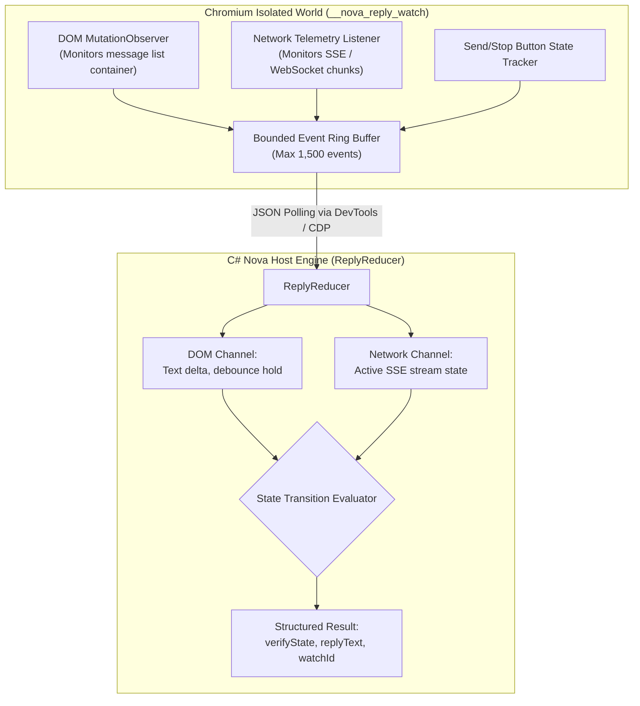
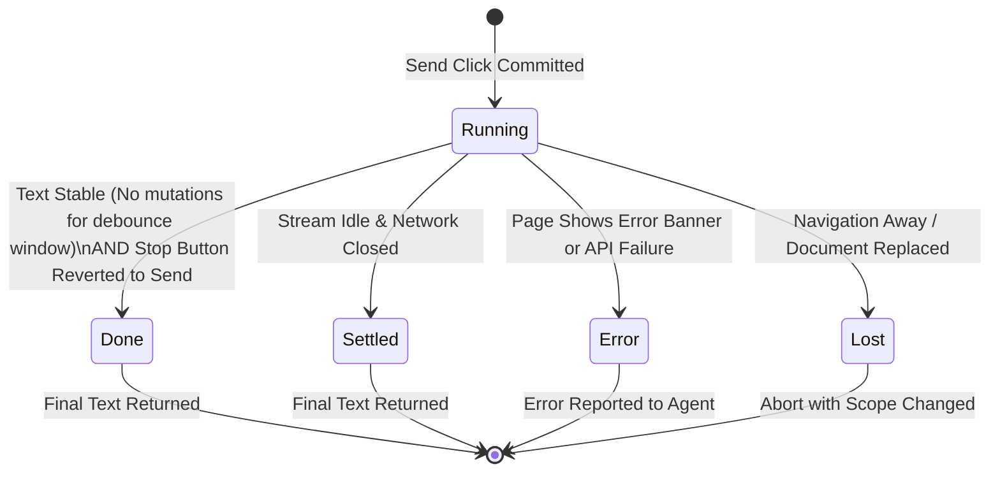

# Reply-Watch & Streaming Architecture

> [!NOTE]
> Autonomous agents interacting with AI platforms (ChatGPT, Claude.ai, Gemini) must frequently wait for models to generate extensive responses, code repositories, or analytical reports. Streaming responses over Server-Sent Events (SSE) or WebSockets can take anywhere from a few seconds to over thirty minutes. The **Reply-Watch & Streaming Architecture** decouples message transmission from response observation, providing an in-page isolated-world observer (`__nova_reply_watch`) and a C# streaming reducer (`ReplyReducer`) that stream output deterministically without holding open blocking connections.

---

## 1. Architectural Challenge: Asynchronous Streaming Generations

Traditional browser automation tools interact with chat applications by clicking send and executing a hard sleep (`sleep 10000`) or polling for a generic DOM selector. In production AI interfaces, this leads to three severe failure modes:

```
┌────────────────────────────────────────────────────────────────────────┐
│                   Streaming Observation Failure Modes                  │
├──────────────────────────────────┬─────────────────────────────────────┤
│ Architectural Obstacle           │ Impact on Automation                │
├──────────────────────────────────┼─────────────────────────────────────┤
│ Premature Termination            │ Polling detects the first few words │
│ (Partial Output Truncation)      │ of a streamed paragraph and returns │
│                                  │ an incomplete response to the agent.│
├──────────────────────────────────┼─────────────────────────────────────┤
│ Connection Timeout & Abort       │ MCP protocol calls have client-side │
│ (Blown RPC Timeouts)             │ timeouts (often 60–120 seconds).    │
│                                  │ Holding a tool call open for a      │
│                                  │ 10-minute generation causes crashes.│
├──────────────────────────────────┼─────────────────────────────────────┤
│ Accidental Duplicate Re-Sends    │ When a timeout triggers, unguided   │
│ (Chat History Pollution)         │ agents call `send_message` again,   │
│                                  │ spamming duplicate prompts.         │
├──────────────────────────────────┼─────────────────────────────────────┤
│ Untracked Navigation / Thread Hop│ If the user or another tab changes  │
│ (Silent Context Drift)           │ the active chat thread, the tool    │
│                                  │ reads output from the wrong conversation. │
└──────────────────────────────────┴─────────────────────────────────────┘
```

Nova solves these challenges by combining an **isolated-world JavaScript observer** with a **host-side C# event reducer**.

---

## 2. In-Page Reply Observer (`__nova_reply_watch`)

Immediately before the send click is committed (Step 4 of the [Compose-and-Send Pipeline](../compose-and-send-pipeline/README.md)), Nova injects an observation engine into an **isolated Chromium JavaScript world**:

```javascript
// Injected into Chromium isolated world: '__nova_reply_watch'
window.__novaReplyWatch = window.__novaReplyWatch || {};

window.__novaReplyWatch[watchId] = {
    watchId: watchId,
    originTime: performance.now(),
    lastActivityTime: performance.now(),
    anchorFound: false,
    replyTextHash: null,
    textLength: 0,
    composerState: "ready", // "ready" | "stopped" | "disabled"
    events: []
};
```



### Security & Isolation Invariants:

1. **Tamper-Proof Execution:** The page scripts share the DOM tree with the isolated world, but untrusted web JavaScript cannot access `window.__novaReplyWatch` or inspect recorded events.
2. **Document Replacement Detection:** If the web application executes a hard page reload or full navigation, the isolated world is discarded. A subsequent read returns `reasonCode: "reply.scope_changed"` or `reply.lost`, alerting the agent that the session navigated away from the monitored thread.
3. **Bounded Memory Overhead:** The observer records DOM mutations, text length progression, and hash changes capped at **1,500 events per channel**. It operates with negligible CPU overhead and zero memory leakage.

---

## 3. The C# Streaming Reducer (`ReplyReducer`)

While the in-page script records raw DOM mutations, final decision logic is executed on the C# host by the `ReplyReducer`.

The reducer evaluates two independent observation channels:
* **DOM Mutation Channel:** Text length progression, message anchor stability, and send-button state transitions (Stop Generating $\to$ Send).
* **Network Stream Channel:** Active Server-Sent Events (SSE) or NDJSON WebSocket streams logged via `ReplyNetworkLog`.

### State Machine & Transitions



### Transition Semantics:

| State | Definition | Architectural Decision |
| :--- | :--- | :--- |
| `running` | Tokens are actively streaming; text length is expanding or network chunks are arriving. | Continue waiting or return `reply.watchId` for asynchronous polling. |
| `done` | The model completed its answer: the stop button reverted to the send button, and text mutations halted. | Return full reply text with `verifyState: "verified"`. |
| `settled` | The stream completed and an idle debounce period elapsed without further changes. | Return reply text with `verifyState: "verified"`. |
| `error` | The page rendered an explicit API quota error, rate-limit banner, or content moderation flag. | Halt and report structured failure reason to agent. |
| `scope_changed` / `lost` | The user clicked a different chat thread or navigated to another URL while waiting. | Halt observation and alert agent to session context drift. |

---

## 4. Asynchronous Continuation via `reply.watchId`

When an LLM response takes several minutes to generate (such as generating extensive code repositories or conducting deep research), holding a single MCP tool call open is impractical and risks client-side RPC timeouts.

Nova provides a robust two-phase pattern:
1. **Initial Dispatch:** Call `nova.guarded_send_message` with a modest wait window (e.g. `waitForReplyMs: 15000`).
2. **Asynchronous Polling:** If the response is still streaming when the timeout expires, Nova returns a persistent `reply.watchId`. The agent can then monitor or retrieve the output incrementally using [`nova.read_text_structured`](../../../../mcp-reference/tools/dom-and-reading/nova-read-text-structured.md):

```json
{
  "targetId": "tab-101",
  "mode": "conversation",
  "replyWatchId": "rw-48921-987123",
  "waitMs": 30000
}
```

```
┌────────────────────────────────────────────────────────────────────────┐
│                   Asynchronous Continuation Flow                       │
└──────────────────────────────────┬─────────────────────────────────────┘
                                   │
              Agent calls nova.guarded_send_message(waitMs=15000)
                                   ▼
              15s elapsed: Model still generating tokens
              Returns: { "ok": true, "reply": { "watchId": "rw-123", "state": "running" } }
                                   │
                                   ▼
              Agent performs other tasks or waits...
                                   │
                                   ▼
              Agent calls nova.read_text_structured(replyWatchId="rw-123", waitMs=30000)
                                   │
                                   ▼
              Generation completes during wait:
              Returns: { "ok": true, "reply": { "state": "done", "text": "..." } }
```

### Operational Invariants for Agents:

* **Zero Duplicate Sends:** Calling `read_text_structured` with `replyWatchId` is strictly read-only. It observes the existing generation without typing or sending anything.
* **Never "Retry" by Re-Sending:** If a reply wait times out, the agent must **never** call `nova.guarded_send_message` again with the same prompt. Doing so creates duplicate prompts in the user's chat history. Always continue observing via `replyWatchId`.

---

## 5. Error Recovery & Boundary Handling

The reply-watch subsystem handles real-world edge cases gracefully:

1. **Model Moderation & Rate Limits:** If an AI service displays an error banner (e.g. *"You've reached your usage limit"* or *"Content flagged"*), `ReplyReducer` captures the error text and transitions immediately to `error`, freeing the agent without waiting for the full timeout.
2. **Context Retention on Disconnect:** If the network disconnects mid-stream, the partial response text accumulated up to the disconnection point is preserved and returned in the result payload, preventing complete output loss.
3. **Multi-Tab Isolation:** Each `replyWatchId` is keyed to its originating WebView and tab instance. Streaming events from other tabs or Sandboxes never leak into the watch session.

---

## Related Documentation

* [Autonomous Chat Engine & Reply-Watch Hub](../README.md)
* [The 6-Step Compose-and-Send Pipeline](../compose-and-send-pipeline/README.md)
* [Transactional Form Submissions & Auth Gates](../../form-submission/README.md)
* [Closed-Loop Transition Contracts](../../transition-contracts/README.md)
* [Tool Reference: `nova.guarded_send_message`](../../../../mcp-reference/tools/guarded-actions/nova-guarded-send-message.md)
* [Tool Reference: `nova.read_text_structured`](../../../../mcp-reference/tools/dom-and-reading/nova-read-text-structured.md)
