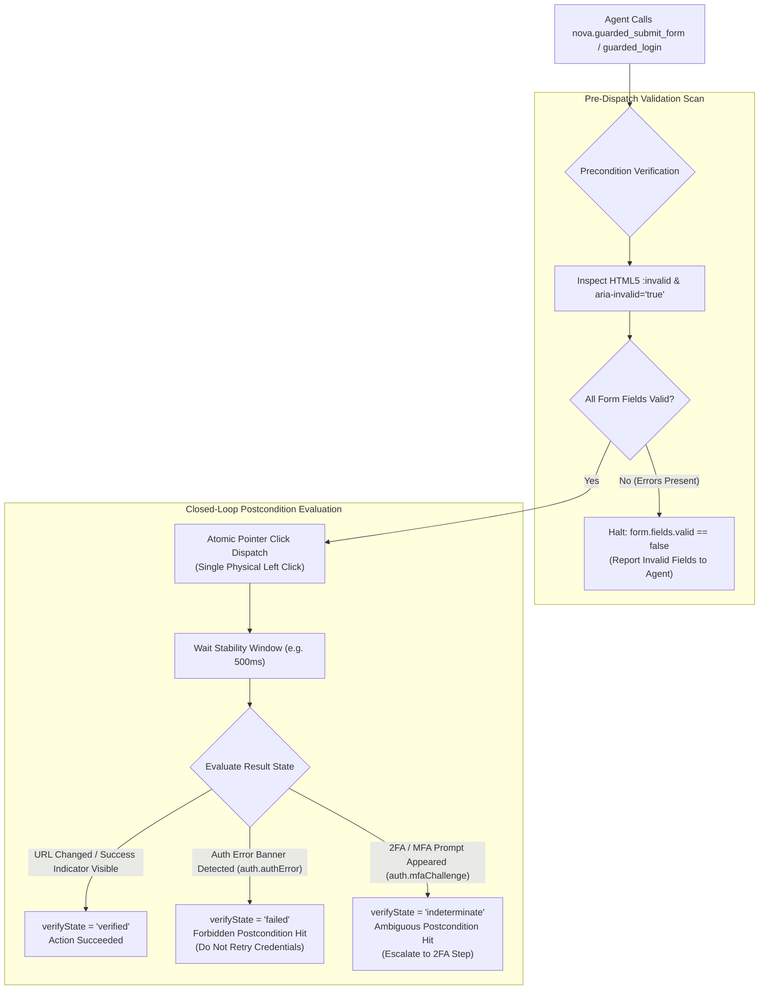

# Transactional Form Submissions & Auth Surface Integration

> [!NOTE]
> In enterprise web portals, submitting a form or completing authentication is rarely a simple button click. Forms enforce complex client-side validation rules, payment flows require single-submit idempotency, and login surfaces frequently branch into Multi-Factor Authentication (2FA/MFA) challenges. Nova AI Workspace models these operations as **transactional state transitions** governed by `nova.guarded_submit_form` and `nova.guarded_login`.

---

## 1. The Transactional Form Philosophy

Traditional browser automation tools treat form submission as an unmonitored click:
```javascript
// Traditional automation: click and pray
await page.click('button[type="submit"]');
```

This blind approach fails across three major operational vectors:
1. **Unchecked Client-Side Validation:** If a required field is empty or contains an invalid email format, modern browsers or JavaScript frameworks block submission and display inline tooltips. The automation script reports the click as "successful" even though the form was never submitted.
2. **Duplicate Submission Vulnerabilities:** If an agent encounters a slow checkout or registration process and retries the submit click, the backend may process the payment twice or create duplicate accounts.
3. **Authentication Ambiguity:** When logging into a service, an incorrect password and a 2FA/TOTP prompt both prevent immediate login. Treating both as generic errors leads agents to repeatedly submit the same password, rapidly triggering IP rate-limit bans and account lockouts.

Nova solves this by wrapping form submissions in **transactional commit contracts**:



---

## 2. Guarded Form Submission (`nova.guarded_submit_form`)

`nova.guarded_submit_form` provides an automated transition contract tailored for standard web forms:

```json
{
  "targetId": "tab-101",
  "selector": "form#checkout-form button[type='submit']",
  "autoDismissBlockers": true
}
```

### Automated Invariants:
1. **Precondition (`form.fields.valid`):** Evaluates the form elements associated with the submit button. If any control matches `:invalid` or carries `aria-invalid="true"`, Nova halts before clicking and reports the specific invalid field.
2. **Postcondition (`success`):** Deems the submission verified when either:
   * The page navigates away from the form URL.
   * A success indicator element (`form.successIndicator.visible`) renders in the DOM.
3. **Idempotency Safeguard (`non_idempotent`):** Prevents duplicate form submissions by instructing the agent and runtime never to repeat the submit click blindly if the postcondition check times out.

---

## 3. Guarded Login & Auth Surface Detection (`nova.guarded_login`)

Authentication is the highest-risk interaction an autonomous agent performs. `nova.guarded_login` integrates directly with Nova's [Auth Surface Detection (ASD)](../../auth-surface-detection-asd/README.md) subsystem to distinguish between true authentication failures and multi-step verification flows:

```json
{
  "targetId": "tab-101",
  "selector": "button#sign-in-btn"
}
```

### The Three-Way Postcondition Outcome Matrix:

```
┌────────────────────────────────────────────────────────────────────────┐
│                     Guarded Login Outcome Matrix                       │
├───────────────────┬───────────────────┬────────────────────────────────┤
│ Detected State    │ verifyState       │ Architectural Decision         │
├───────────────────┼───────────────────┼────────────────────────────────┤
│ auth.loggedIn     │ verified          │ Success: Session established.  │
│                   │                   │ Agent proceeds to task.        │
├───────────────────┼───────────────────┼────────────────────────────────┤
│ auth.authError    │ failed            │ Failure: Forbidden post-state. │
│                   │                   │ Bad credentials or locked      │
│                   │                   │ account. DO NOT RETRY.         │
├───────────────────┼───────────────────┼────────────────────────────────┤
│ auth.mfaChallenge │ indeterminate     │ Ambiguous: 2FA/TOTP challenge. │
│ or auth.stage     │                   │ Halted safely. Agent or user   │
│                   │                   │ must provide secondary token.  │
└───────────────────┴───────────────────┴────────────────────────────────┘
```

### Why Indeterminate Handling Prevents Account Lockouts:
Traditional automation scripts check only if the dashboard loaded; if not, they retry typing the password. On systems with 2FA, this causes the agent to retry credentials five times in ten seconds, locking the human user's corporate account.

In Nova, when `auth.mfaChallenge` is detected, the postcondition resolves as **ambiguous** rather than failed:
* `verifyState`: `"indeterminate"`
* `retryAdvice`: `"do_not_retry"`
* The agent is explicitly informed that an MFA step is required, preventing brute-force lockouts.

---

## 4. Model & Workspace Switchers

In web-based AI tools and multi-tenant SaaS dashboards, switching the active model or workspace involves complex dropdown menus:

### A. Guarded Model Switching (`nova.guarded_switch_model`)
Targets the desired model option inside an open model menu:
* **Precondition:** Verifies that a model selector control is present on the page.
* **Dispatch:** Clicks the designated menu item.
* **Postcondition:** Verifies that the visible model label updated to reflect the new selection. If the label did not change, returns `ok: false` with `reasonCode: "guarded_commit.postcondition_failed"`.

### B. Guarded Sandbox & Organization Switching (`nova.guarded_switch_sandbox`)
Targets workspace or team switchers in web platforms (such as Slack, GitHub, or AWS console):
* **Precondition:** Asserts that an organization or workspace switcher exists.
* **Postcondition:** Confirms that the active workspace badge, URL tenant path, or organization name changed to the target selection.

---

## Related Documentation

* [Guarded Interactions Overview](../README.md)
* [Autonomous Chat Engine & Reply Watch](../chat-macro/README.md)
* [Closed-Loop Transition Contracts](../transition-contracts/README.md)
* [Auth Surface Detection (ASD) Architecture](../../auth-surface-detection-asd/README.md)
* [Tool Reference: `nova.guarded_submit_form`](../../../mcp-reference/tools/guarded-actions/nova-guarded-submit-form.md)
* [Tool Reference: `nova.guarded_login`](../../../mcp-reference/tools/guarded-actions/nova-guarded-login.md)
* [Tool Reference: `nova.guarded_switch_model`](../../../mcp-reference/tools/guarded-actions/nova-guarded-switch-model.md)
