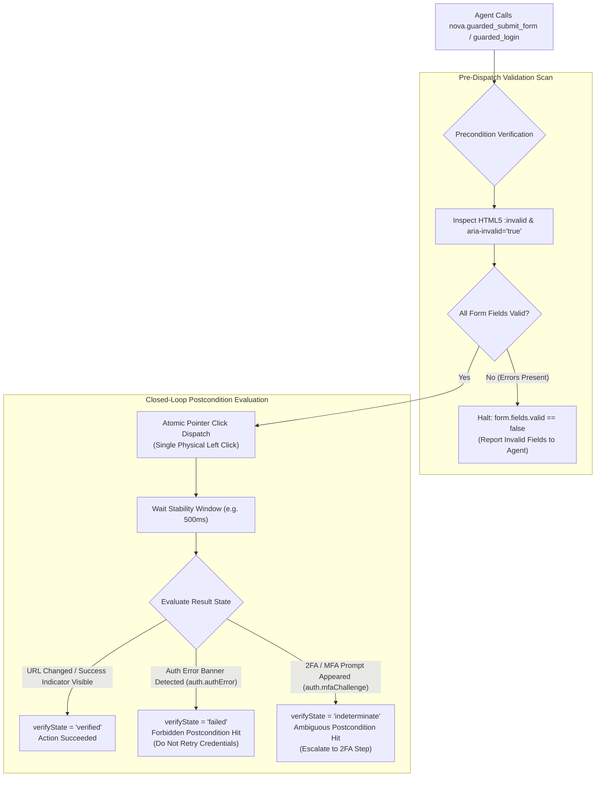

# Transactional Form Submissions & Auth Surface Integration

> [!NOTE]
> In enterprise web portals, submitting a form or completing authentication is rarely a simple button click. Forms enforce complex client-side validation rules, payment flows require single-submit idempotency, and login surfaces frequently branch into Multi-Factor Authentication (2FA/MFA) challenges. Nova AI Workspace models these operations as **transactional state transitions** governed by [`nova.guarded_submit_form`](../../../mcp-reference/tools/guarded-actions/nova-guarded-submit-form.md) and [`nova.guarded_login`](../../../mcp-reference/tools/guarded-actions/nova-guarded-login.md).

---

## 1. Overview & Architectural Role

Traditional browser automation tools treat form submission as an unmonitored click:
```javascript
// Traditional automation: click and pray
await page.click('button[type="submit"]');
```

This blind approach fails across three major operational vectors:
1. **Unchecked Client-Side Validation:** If a required field is empty or contains an invalid email format, modern browsers or JavaScript frameworks block submission and display inline tooltips. The automation script reports the click as "successful" even though the form was never submitted.
2. **Duplicate Submission Vulnerabilities:** If an agent encounters a slow checkout or registration process and retries the submit click, the backend may process the payment twice or create duplicate accounts.
3. **Authentication Ambiguity:** When logging into a service, an incorrect password and a 2FA/TOTP prompt both prevent immediate login. Treating both as generic errors leads agents to repeatedly submit the same password, rapidly triggering IP rate-limit bans and account lockouts.

Nova solves this by wrapping form submissions and authentication in **transactional commit contracts**:



---

## 2. Comprehensive Documentation Index

For exhaustive technical implementations, validation scanning mechanics, and authentication outcome flows, consult the specialized architecture guides:

```
public/docs/core-features/guarded-interactions/form-submission/
├── README.md                                 # This domain hub
├── form-validation-and-idempotency/
│   └── README.md                             # HTML5 :invalid scanning, ARIA checks, non_idempotent retry policy
└── auth-surface-and-mfa-gates/
    └── README.md                             # ASD integration, 3-way outcome matrix, 2FA/MFA branching, model/workspace switchers
```

| Architecture Guide | Focus & Key Concepts | Primary Components |
| :--- | :--- | :--- |
| **[Form Validation & Idempotency Safeguards](form-validation-and-idempotency/README.md)** | Pre-dispatch HTML5 `:invalid` and `aria-invalid="true"` scanning, `form.fields.valid` precondition evaluation, atomic pointer dispatch, URL and success indicator postcondition checks, and `non_idempotent` duplicate submission defenses. | `McpServer.InputInteractionGuardedTools`<br>`form.fields.valid`<br>`form.successIndicator.visible`<br>`non_idempotent` |
| **[Auth Surface & MFA Gates](auth-surface-and-mfa-gates/README.md)** | Direct integration with Auth Surface Detection (ASD), the three-way outcome matrix (`verified`, `failed`, `indeterminate`), forbidden credential error trapping (`auth.authError`), 2FA/MFA challenge branching preventing account lockouts, and guarded model/workspace switchers. | `AuthSurfaceDetector`<br>`GuardedCommitPoint`<br>`auth.loggedIn`<br>`auth.authError`<br>`auth.mfaChallenge` |

---

## 3. Core Operational Invariants for Autonomous Agents

When submitting forms or authenticating through Nova, agents must follow these operational rules:

1. **Never Re-Submit on Indeterminate Outcomes:**
   If a form submission times out or returns `verifyState: "indeterminate"`, **never immediately re-dispatch the submit button**. The backend may be processing the transaction. Always inspect the page with `nova.perceive` to verify state changes before proceeding.
2. **Obey `do_not_retry` on Authentication Failures:**
   When `nova.guarded_login` returns `verifyState: "failed"` with `auth.authError`, the server has rejected the credentials. Immediately halt and request updated credentials from the operator.
3. **Escalate MFA Challenges Gracefully:**
   When `nova.guarded_login` returns `verifyState: "indeterminate"` with `auth.mfaChallenge`, do not treat it as a failure. Inform the user or transition to the secondary TOTP authentication step.

---

## Related Documentation

* [Guarded Interactions Overview](../README.md)
* [Form Validation & Idempotency Safeguards](form-validation-and-idempotency/README.md)
* [Auth Surface & MFA Gates](auth-surface-and-mfa-gates/README.md)
* [Autonomous Chat Engine & Reply Watch](../chat-macro/README.md)
* [Closed-Loop Transition Contracts](../transition-contracts/README.md)
* [Auth Surface Detection (ASD) Architecture](../../auth-surface-detection-asd/README.md)
* [Tool Reference: `nova.guarded_submit_form`](../../../mcp-reference/tools/guarded-actions/nova-guarded-submit-form.md)
* [Tool Reference: `nova.guarded_login`](../../../mcp-reference/tools/guarded-actions/nova-guarded-login.md)
* [Tool Reference: `nova.guarded_switch_model`](../../../mcp-reference/tools/guarded-actions/nova-guarded-switch-model.md)
* [Tool Reference: `nova.guarded_switch_sandbox`](../../../mcp-reference/tools/guarded-actions/nova-guarded-switch-sandbox.md)
