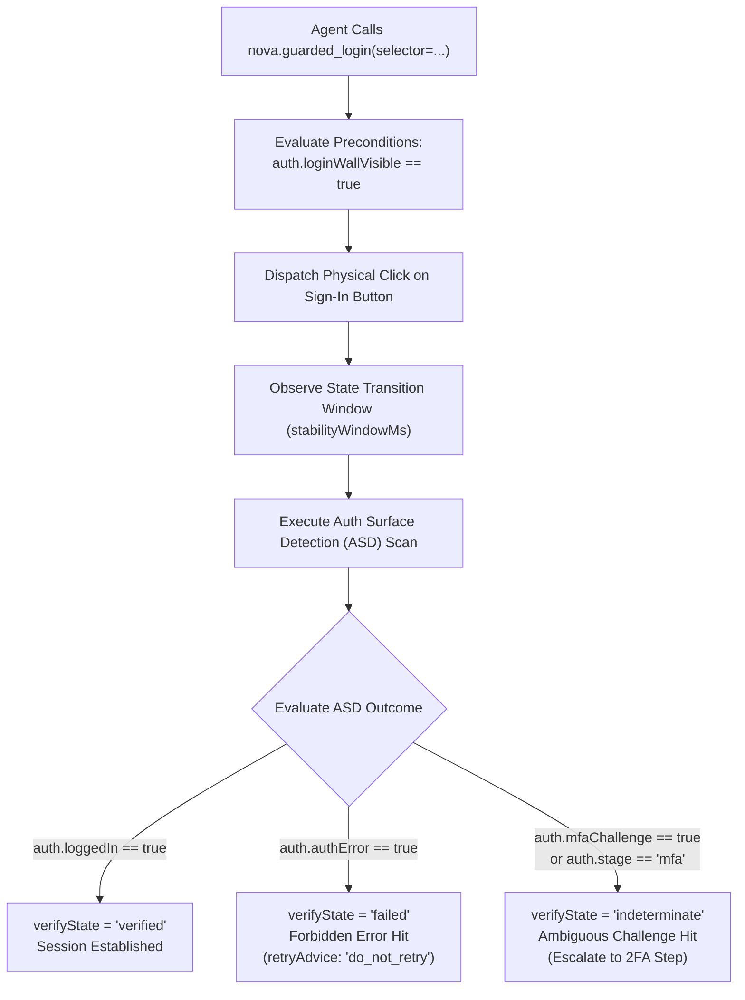

# Auth Surface & MFA Gates

> [!NOTE]
> Authentication is the highest-risk interaction an autonomous web agent can execute. A mismanaged login flow can trigger rate-limiting firewalls, solve CAPTCHAs incorrectly, or trigger enterprise security lockouts that disable human employee credentials. The **Auth Surface & MFA Gates** subsystem integrates [`nova.guarded_login`](../../../../mcp-reference/tools/guarded-actions/nova-guarded-login.md), [`nova.guarded_switch_model`](../../../../mcp-reference/tools/guarded-actions/nova-guarded-switch-model.md), and [`nova.guarded_switch_sandbox`](../../../../mcp-reference/tools/guarded-actions/nova-guarded-switch-sandbox.md) directly with [Auth Surface Detection (ASD)](../../../auth-surface-detection-asd/README.md) to enforce three-way branching and prevent brute-force retries.

---

## 1. Architectural Challenge: The Login Trap

Traditional automation frameworks treat login as a simple binary check:

```javascript
// Traditional script: click login and check if dashboard opened
await page.click('button#login-submit');
if (!page.url().includes('/dashboard')) {
    // Failure! Retry entering password...
    await retryLogin();
}
```

In production web applications, this naive logic leads to catastrophic failures:

```
┌────────────────────────────────────────────────────────────────────────┐
│                        Login Automation Traps                          │
├──────────────────────────────────┬─────────────────────────────────────┤
│ Architectural Obstacle           │ Impact on Naive Automation          │
├──────────────────────────────────┼─────────────────────────────────────┤
│ 2FA/MFA Challenge Misdetection   │ A 2FA/TOTP prompt is treated as a   │
│                                  │ failed login. The agent retries the │
│                                  │ password 5 times in 10 seconds,     │
│                                  │ permanently locking the account.    │
├──────────────────────────────────┼─────────────────────────────────────┤
│ Blind Credential Re-Submission   │ When bad credentials display an     │
│                                  │ inline error flash, the agent tries │
│                                  │ again, burning API rate limits.     │
├──────────────────────────────────┼─────────────────────────────────────┤
│ SSO / Identity Provider Bounces  │ Multi-step SAML or OAuth redirects  │
│                                  │ are aborted midway because the URL  │
│                                  │ does not match the final domain.    │
└──────────────────────────────────┴─────────────────────────────────────┘
```

Nova resolves this by integrating authentication submission with a **three-way Closed-Loop outcome matrix**.

---

## 2. Integrated Auth Surface Detection (ASD)

When [`nova.guarded_login`](../../../../mcp-reference/tools/guarded-actions/nova-guarded-login.md) is invoked, it coordinates with Nova's underlying `AuthSurfaceDetector`:



---

## 3. The Three-Way Outcome Matrix

Nova evaluates authentication results through a deterministic tripartite state machine:

```
┌────────────────────────────────────────────────────────────────────────┐
│                     Guarded Login Outcome Matrix                       │
├───────────────────┬───────────────────┬────────────────────────────────┤
│ Detected State    │ verifyState       │ Architectural Decision         │
├───────────────────┼───────────────────┼────────────────────────────────┤
│ auth.loggedIn     │ verified          │ Success: Session established.  │
│                   │                   │ Agent proceeds to task.        │
├───────────────────┼───────────────────┼────────────────────────────────┤
│ auth.authError    │ failed            │ Failure: Forbidden post-state. │
│                   │                   │ Bad credentials or locked      │
│                   │                   │ account. DO NOT RETRY.         │
├───────────────────┼───────────────────┼────────────────────────────────┤
│ auth.mfaChallenge │ indeterminate     │ Ambiguous: 2FA/TOTP challenge. │
│ or auth.stage     │                   │ Halted safely. Agent or user   │
│                   │                   │ must provide secondary token.  │
└───────────────────┴───────────────────┴────────────────────────────────┘
```

### Outcome Analysis:

1. **`verified` (`auth.loggedIn`):**
   * The page successfully established a session cookie or JWT token and navigated past the authentication barrier into an authenticated dashboard or application workspace.
2. **`failed` (`auth.authError`):**
   * The application rendered an explicit authentication failure banner (e.g. *"Incorrect email or password"*, *"Account suspended"*).
   * **Mandatory Rule:** Nova sets `retryAdvice: "do_not_retry"`. The agent must never attempt to submit the same credentials again.
3. **`indeterminate` (`auth.mfaChallenge`):**
   * The primary credentials were correct, but the system transitioned to a secondary verification prompt (SMS code, Authenticator TOTP, hardware security key, or push notification).
   * **Account Lockout Prevention:** By classifying MFA as `indeterminate` rather than `failed`, Nova prevents the agent from retrying the primary password. The agent receives actionable feedback indicating that secondary verification is required.

---

## 4. Model & Workspace Switcher Guards

Beyond primary login portals, modern AI and SaaS platforms feature contextual identity and configuration switchers that require guarded validation:

### A. Guarded Model Switching (`nova.guarded_switch_model`)
In platforms like ChatGPT, Claude.ai, or custom AI interfaces, switching models involves opening a floating menu and selecting an item:
* **Precondition:** Verifies that the model selector dropdown is currently open and visible.
* **Dispatch:** Executes a physical left click on the target model menu item.
* **Postcondition Verification:** Queries the active model badge in the main interface to verify that the visible model text updated to match the target. If the label remains unchanged, Nova returns `verifyState: "failed"` with `reasonCode: "guarded_commit.postcondition_failed"`.

### B. Guarded Sandbox & Organization Switching (`nova.guarded_switch_sandbox`)
In multi-tenant cloud platforms (AWS, GitHub, Slack, Notion), switching between accounts, teams, or Sandboxes requires careful state validation:
* **Precondition:** Asserts that an organization switcher or tenant menu exists in the current view.
* **Dispatch:** Selects the designated target organization or workspace.
* **Postcondition Verification:** Verifies that the active organization badge, workspace title, or URL path updated to reflect the new tenant ID.

---

## 5. Practical Agent Invocation Examples

### Guarded Login Submission

```json
{
  "targetId": "tab-101",
  "selector": "form#login-form button[type='submit']",
  "autoDismissBlockers": true
}
```

### Guarded Model Switching

```json
{
  "targetId": "tab-101",
  "selector": "div[role='menuitem']:has-text('GPT-4o')",
  "modelName": "GPT-4o"
}
```

### Guarded Workspace / Organization Switching

```json
{
  "targetId": "tab-101",
  "selector": "button[data-org-id='org_finance_prod']",
  "sandboxName": "Production Finance"
}
```

---

## Related Documentation

* [Transactional Form Submissions & Auth Gates Hub](../README.md)
* [Form Validation & Idempotency Safeguards](../form-validation-and-idempotency/README.md)
* [Auth Surface Detection (ASD) Architecture](../../../auth-surface-detection-asd/README.md)
* [Closed-Loop Transition Contracts](../../transition-contracts/README.md)
* [Tool Reference: `nova.guarded_login`](../../../../mcp-reference/tools/guarded-actions/nova-guarded-login.md)
* [Tool Reference: `nova.guarded_switch_model`](../../../../mcp-reference/tools/guarded-actions/nova-guarded-switch-model.md)
* [Tool Reference: `nova.guarded_switch_sandbox`](../../../../mcp-reference/tools/guarded-actions/nova-guarded-switch-sandbox.md)
