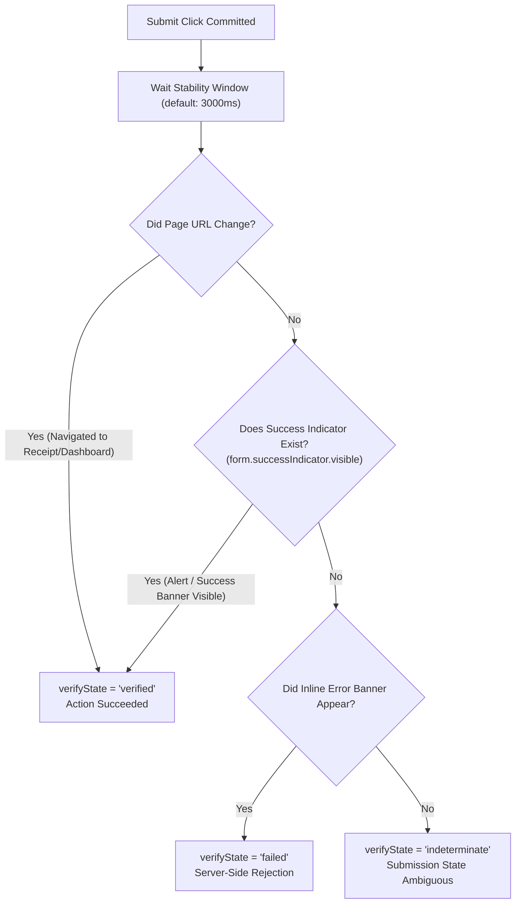

# Form Validation & Idempotency Safeguards

> [!NOTE]
> Web form submissions are non-reversible state mutations. Submitting a checkout form, saving configuration settings, or submitting job applications can alter financial records, user profiles, or business workflows. The **Form Validation & Idempotency** engine within [`nova.guarded_submit_form`](../../../../mcp-reference/tools/guarded-actions/nova-guarded-submit-form.md) ensures that forms are validated prior to dispatch, executed via atomic physical clicks, and safeguarded against duplicate submissions.

---

## 1. Architectural Challenge: The Blind Click Trap

Traditional automation scripts treat submitting a form as a single unmonitored click:

```javascript
// Traditional automation: click and pray
await page.click('button[type="submit"]');
```

In enterprise web applications, this approach leads to three critical failure modes:

```
┌────────────────────────────────────────────────────────────────────────┐
│                     Form Automation Failure Modes                      │
├──────────────────────────────────┬─────────────────────────────────────┤
│ Failure Mode                     │ Root Cause & Real-World Impact      │
├──────────────────────────────────┼─────────────────────────────────────┤
│ Silent Validation Rejection      │ Client-side HTML5 or JS validation  │
│                                  │ flags a field as invalid. The click │
│                                  │ is reported as successful, but the  │
│                                  │ form was never dispatched.          │
├──────────────────────────────────┼─────────────────────────────────────┤
│ Duplicate Submission Cascades    │ On slow connections, an unguided    │
│                                  │ agent clicks a spinning submit      │
│                                  │ button multiple times, causing      │
│                                  │ double charges or duplicate orders. │
├──────────────────────────────────┼─────────────────────────────────────┤
│ Premature Success Reporting      │ The tool checks for success before  │
│                                  │ asynchronous server-side validation │
│                                  │ responses complete.                 │
└──────────────────────────────────┴─────────────────────────────────────┘
```

Nova prevents these failures by enforcing a **pre-flight validation scan** and a **`non_idempotent` retry policy**.

---

## 2. Pre-Dispatch Validation Scan

Before touching the submit button, Nova inspects the entire form container associated with the target control:

```mermaid
flowchart TD
    SubmitCall["Agent Calls nova.guarded_submit_form"] --> FindForm["Associate Target Control with Parent <form> or Scope"]
    FindForm --> ScanDOM["Scan Form Controls for Validation Constraints"]

    ScanDOM --> CheckHTML5{"Any Control Matches :invalid?"}
    CheckHTML5 -- "Yes" --> ExtractError["Extract Field Name & Validation Message\n(field.validationMessage)"]

    CheckHTML5 -- "No" --> CheckAria{"Any Control Has aria-invalid='true'?"}
    CheckAria -- "Yes" --> ExtractAriaError["Extract Field & Inline Error Label"]

    ExtractError --> FailHalt["Halt with Precondition Failed:\nform.fields.valid == false"]
    ExtractAriaError --> FailHalt

    CheckAria -- "No" --> ClearPre["Precondition Cleared:\nform.fields.valid == true"]
    ClearPre --> AtomicClick["Dispatch Atomic Pointer Click"]
```



### Validation Inspection Mechanisms:

1. **HTML5 Constraint Validation:**
   * Queries `:invalid` pseudo-class states across `input`, `select`, and `textarea` elements.
   * Evaluates built-in constraints: `required`, `pattern`, `minlength`, `maxlength`, `min`, `max`, and `type="email"|"url"`.
   * Reads each invalid control's `validationMessage` to provide meaningful error descriptions back to the agent.
2. **Accessible Rich Internet Applications (ARIA) Scanning:**
   * Modern JavaScript frameworks (React Hook Form, Formik, Angular Reactive Forms) often suppress native browser tooltips and instead apply `aria-invalid="true"`.
   * Nova scans for `[aria-invalid="true"]` and captures associated error messages via `aria-describedby` or adjacent `.error-message` containers.
3. **Structured Failure Response:**
   * If any field fails validation, Nova **does not click the submit button**. It immediately returns a structured failure detailing exactly which fields require attention:
     ```json
     {
       "ok": false,
       "reasonCode": "guarded_submit.validation_failed",
       "verifyState": "failed",
       "invalidFields": [
         {
           "name": "billing_zip",
           "selector": "input#zip-code",
           "message": "Please enter a valid 5-digit ZIP code."
         }
       ]
     }
     ```

---

## 3. Atomic Dispatch & Settlement

When all fields pass the pre-dispatch scan, Nova commits the submission:

1. **Coordinate Verification:** Locates the submit button's visible bounding rectangle, ensuring it is not obscured by sticky headers or floating overlays.
2. **Physical Left Click:** Dispatches an atomic physical left click to the center of the control via Chromium's input subsystem. This correctly triggers native `mousedown`, `mouseup`, and `click` event chains that JavaScript frameworks rely upon.
3. **Observation Settlement Window:** After clicking, Nova pauses for an initial stability debounce window (`stabilityMs: 500`) to allow client-side network dispatch and loading state animations to initialize.

---

## 4. Post-Submit Verification

Nova evaluates success through a Closed-Loop transition contract checking two primary outcome signals:



* **URL Transition (`url.changed`):** In multi-step checkout or signup flows, successful submission almost always navigates to a new URL (e.g. `/checkout/review`, `/order/confirmation`, `/dashboard`).
* **In-Page Success Confirmation (`form.successIndicator.visible`):** In Single Page Applications (SPAs), the URL may remain unchanged while a notification toast (e.g. *"Settings updated successfully"*) or receipt container mounts in the DOM.

---

## 5. The `non_idempotent` Retry Policy

All form submissions in Nova enforce `retryPolicy: "non_idempotent"`:

```json
{
  "retryPolicy": "non_idempotent",
  "ambiguityPolicy": "signal"
}
```

### Why Non-Idempotent Safeguards are Mandatory:

1. **Slow API Backends:** If a payment gateway takes four seconds to process a transaction and the tool call times out at three seconds, the payment may still succeed on the server.
2. **Anti-Duplication Guard:** If an agent encounters a timeout or indeterminate result, Nova's return payload explicitly provides:
   ```json
   {
     "verifyState": "indeterminate",
     "retryAdvice": "do_not_retry",
     "details": "Submit button clicked, but neither navigation nor success confirmation occurred within 3000ms. Inspect page state before attempting another submission."
   }
   ```
3. **Autonomous Agent Rule:** Agents receiving `do_not_retry` must never immediately call `nova.guarded_submit_form` again. They must use [`nova.perceive`](../../../../mcp-reference/tools/dom-and-reading/nova-perceive.md) to inspect the DOM and determine whether the transaction was committed.

---

## 6. Practical Agent Invocation Examples

### Standard Form Submission with Blocker Clearance

```json
{
  "targetId": "tab-101",
  "selector": "form#user-settings-form button[type='submit']",
  "autoDismissBlockers": true
}
```

### Submission with Custom Stability Window

```json
{
  "targetId": "tab-101",
  "selector": "button#place-order-button",
  "stabilityWindowMs": 5000,
  "autoDismissBlockers": true
}
```

---

## Related Documentation

* [Transactional Form Submissions & Auth Gates Hub](../README.md)
* [Auth Surface & MFA Gates](../auth-surface-and-mfa-gates/README.md)
* [Autonomous Chat Engine & Reply Watch](../../chat-macro/README.md)
* [Closed-Loop Transition Contracts](../../transition-contracts/README.md)
* [Tool Reference: `nova.guarded_submit_form`](../../../../mcp-reference/tools/guarded-actions/nova-guarded-submit-form.md)
