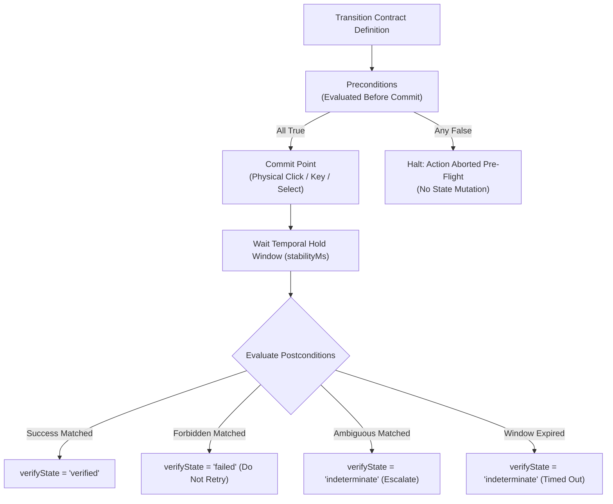

# Closed-Loop Transition Contracts & Idempotency Safeguards

> [!NOTE]
> Every guarded interaction in Nova AI Workspace is evaluated through a **Transition Contract**. Transition contracts shift the responsibility of verifying UI mutations from conversational LLM memory into deterministic protocol assertions. They define explicit preconditions, atomic commit points, success criteria, explicit failure traps, and non-idempotent retry policies.

---

## 1. Overview & Architectural Role

Traditional browser automation tools treat web actions as fire-and-forget commands, forcing upstream LLMs to infer whether an action succeeded by analyzing subsequent DOM dumps or screenshots. This creates latency, burns token budgets, and often results in duplicate submissions or missed error banners.

Nova replaces conversational guesswork with **Transition Contracts**:
* **Deterministic Verification:** Contracts evaluate machine-verifiable facts (`form.fields.valid`, `url.changed`, `auth.authError`) directly on the browser runtime.
* **Non-Idempotent Protection:** Prevents duplicate form submissions, duplicate chat prompts, and accidental multi-buys by setting cautious retry advice when outcomes are ambiguous.
* **Additive Composition:** Built-in system safety templates can be augmented with caller-supplied assertions without compromising core platform invariants.



---

## 2. Comprehensive Documentation Index

For exhaustive technical schemas, operator catalogs, and runtime merging rules, consult the specialized architecture guides:

```
public/docs/core-features/guarded-interactions/transition-contracts/
├── README.md                                 # This domain hub
├── contract-anatomy-and-operators/
│   └── README.md                             # Contract JSON schema, all/any condition trees, assertion operators, stability holds
└── contract-merging-and-cls/
    └── README.md                             # Additive contract merging, pinned invariants, CLS runtime integration, ambiguity policies
```

| Architecture Guide | Focus & Key Concepts | Primary Components |
| :--- | :--- | :--- |
| **[Contract Anatomy & Fact Operators](contract-anatomy-and-operators/README.md)** | Transition contract JSON schema, `actionKind`, `retryPolicy`, `ambiguityPolicy`, condition tree logic (`all` vs `any`), complete catalog of assertion operators (`eq`, `neq`, `exists`, `not_exists`, `contains`, `gt`, `gte`, `lt`, `lte`), and temporal stability windows (`stabilityWindowMs` vs `stabilityMs`). | `TransitionContract`<br>`FactAssertion`<br>`stabilityWindowMs`<br>`stabilityMs` |
| **[Contract Merging & Closed-Loop System (CLS)](contract-merging-and-cls/README.md)** | Additive contract merging mechanics (`MergeWithProvidedTransitionContract`), combining built-in macro templates with agent extensions, pinned security invariants, Closed-Loop System (CLS) fact extraction and verification engine integration, and ambiguity resolution policies. | `MergeWithProvidedTransitionContract`<br>`ClosedLoopSystem`<br>`FactExtractionPipeline`<br>`ambiguityPolicy` |

---

## 3. Core Operational Invariants for Autonomous Agents

When constructing or consuming transition contracts in Nova, agents must follow these operational guidelines:

1. **Never Attempt to Override Non-Idempotent Policies:**
   High-impact tools (`guarded_send_message`, `guarded_submit_form`, `guarded_login`) automatically pin `retryPolicy: "non_idempotent"`. Even if an agent attempts to set `retryPolicy: "idempotent"`, Nova maintains non-idempotent protection to prevent accidental duplicate actions.
2. **Distinguish `stabilityWindowMs` from `stabilityMs`:**
   * `stabilityWindowMs` is the maximum time to wait for a state transition to occur (the observation timeout).
   * `stabilityMs` is the debounce hold duration for which a state must remain true before success is declared (preventing transient animation glitches).
3. **Handle `indeterminate` State Appropriately:**
   If a contract resolves with `verifyState: "indeterminate"`, do not assume failure and re-dispatch. Inspect current UI state using [`nova.perceive`](../../../mcp-reference/tools/dom-and-reading/nova-perceive.md).

---

## Related Documentation

* [Guarded Interactions Overview](../README.md)
* [Contract Anatomy & Fact Operators](contract-anatomy-and-operators/README.md)
* [Contract Merging & Closed-Loop System (CLS)](contract-merging-and-cls/README.md)
* [Autonomous Chat Engine & Reply Watch](../chat-macro/README.md)
* [Transactional Form Submissions & Auth Gates](../form-submission/README.md)
* [Closed-Loop System (CLS) Architecture](../../closed-loop-system-cls/README.md)
* [Tool Catalog: Guarded Actions & Blocker Clearance](../../../mcp-reference/tools/guarded-actions/README.md)
