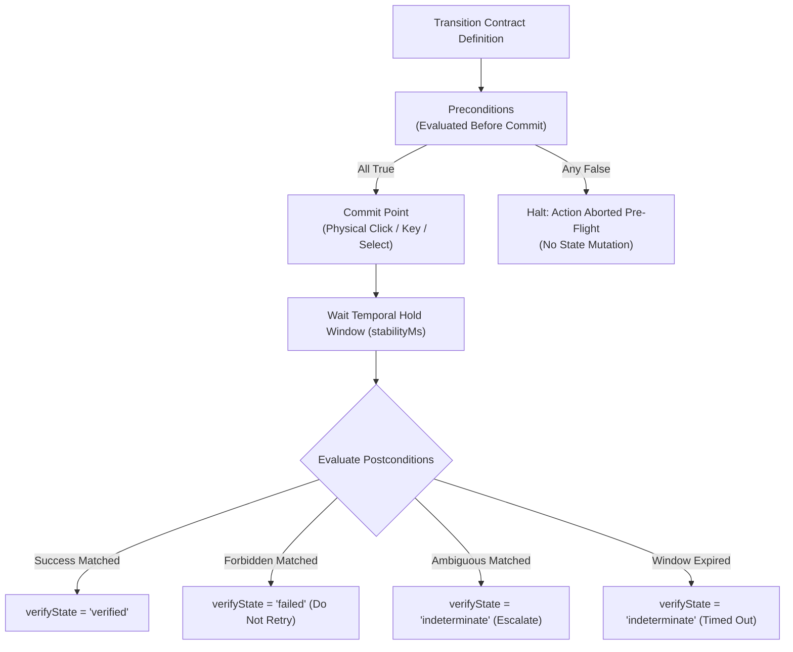

# Contract Anatomy & Fact Operators

> [!NOTE]
> Autonomous agents that rely solely on conversational LLM memory to verify web actions frequently suffer from hallucinations, confirmation bias, and false progress. Nova AI Workspace shifts the burden of verification from LLM interpretation into deterministic, machine-evaluable **Transition Contracts**. This guide details the complete JSON schema of transition contracts, condition trees, supported assertion operators, and temporal stability guards.

---

## 1. Architectural Philosophy: Protocol-Level Verification

In standard browser automation, an agent decides whether an action worked by reading an accessibility tree or taking a screenshot after clicking. This creates significant latency, consumes unnecessary tokens, and fails when subtle error banners appear outside the main viewport.

A **Transition Contract** formalizes an interaction as an atomic state transition:
* **Preconditions:** Assertions that must evaluate to `true` before the pointer event is dispatched.
* **Commit Point:** The exact physical input action (click, keystroke, select) that mutates application state.
* **Postconditions:** A tripartite outcome specification:
  * `success`: Conditions indicating that the intended state change completed.
  * `forbidden`: Explicit failure traps (e.g. error banners, validation rejections) that prohibit retries.
  * `ambiguous`: Indeterminate states (e.g. 2FA prompts, captcha challenges) that require escalation.



---

## 2. Complete Transition Contract Schema

A full transition contract is represented as a structured JSON object:

```json
{
  "actionKind": "submit_form",
  "retryPolicy": "non_idempotent",
  "ambiguityPolicy": "signal",
  "stabilityWindowMs": 3000,
  "stabilityMs": 500,
  "preconditions": {
    "all": [
      {
        "factKey": "form.fields.valid",
        "operator": "eq",
        "expected": true
      }
    ]
  },
  "postconditions": {
    "success": {
      "any": [
        {
          "factKey": "url.changed",
          "operator": "eq",
          "expected": true
        },
        {
          "factKey": "form.successIndicator.visible",
          "operator": "eq",
          "expected": true
        }
      ]
    },
    "forbidden": {
      "any": [
        {
          "factKey": "auth.authError",
          "operator": "eq",
          "expected": true
        }
      ]
    },
    "ambiguous": {
      "any": [
        {
          "factKey": "auth.mfaChallenge",
          "operator": "eq",
          "expected": true
        }
      ]
    }
  }
}
```

### Configuration Fields:

| Field | Type | Default | Description |
| :--- | :--- | :--- | :--- |
| `actionKind` | `string` | `"custom"` | Classification of the action: `send_message`, `submit_form`, `select_option`, `dismiss_overlay`, or `custom`. |
| `retryPolicy` | `string` | `"non_idempotent"` | `non_idempotent`: cautious retry advice (`do_not_retry`); `idempotent`: safe to re-dispatch; `no_retry`: suppresses retry advice. |
| `ambiguityPolicy` | `string` | `"signal"` | Behavior when indeterminate: `signal` (reports indeterminate state to caller), `retry_once` (executes one safe re-read), or `abort`. |
| `stabilityWindowMs`| `integer` | `3000` | Maximum observation duration to wait for postconditions to resolve. |
| `stabilityMs` | `integer` | `500` | Hold duration for which a success condition must remain continuously true without reverting. |

---

## 3. Condition Trees: `all` vs `any`

Both `preconditions` and `postconditions` organize assertion rules into logical conjunctions:

* **Conjunction (`all`):** Every assertion in the list must evaluate to `true`. Commonly used in preconditions:
  ```json
  {
    "preconditions": {
      "all": [
        { "factKey": "form.fields.valid", "operator": "eq", "expected": true },
        { "factKey": "button.disabled", "operator": "eq", "expected": false }
      ]
    }
  }
  ```
* **Disjunction (`any`):** At least one assertion in the list must evaluate to `true`. Commonly used in success postconditions where multiple indicators signify completion:
  ```json
  {
    "postconditions": {
      "success": {
        "any": [
          { "factKey": "url.changed", "operator": "eq", "expected": true },
          { "factKey": "dom.element.exists", "operator": "exists", "selector": ".confirmation-toast" }
        ]
      }
    }
  }
  ```

---

## 4. Fact Assertion Syntax & Operators

Every condition is composed of assertion objects:

```json
{
  "factKey": "dom.element.count",
  "operator": "gte",
  "expected": 1,
  "frameId": "frame-main-content"
}
```

### Supported Operators:

| Operator | Comparison Semantics | Example JSON Assertion |
| :--- | :--- | :--- |
| `eq` | Strict equality ($==$) | `{ "factKey": "auth.loggedIn", "operator": "eq", "expected": true }` |
| `not_eq` / `neq` | Inequality (!=) | `{ "factKey": "selectedModel.label", "operator": "not_eq", "expected": "GPT-4" }` |
| `exists` | Value exists and is non-null | `{ "factKey": "composer.send_button.stopped", "operator": "exists" }` |
| `not_exists` | Value is absent, null, or removed | `{ "factKey": "overlay.blockingDiv", "operator": "not_exists" }` |
| `contains` | Substring inclusion or array containment | `{ "factKey": "page.url", "operator": "contains", "expected": "/dashboard" }` |
| `gt` | Greater than ($\gt$) | `{ "factKey": "cart.itemCount", "operator": "gt", "expected": 0 }` |
| `gte` | Greater than or equal ($\ge$) | `{ "factKey": "dom.element.count", "operator": "gte", "expected": 1 }` |
| `lt` | Less than ($\lt$) | `{ "factKey": "form.errorCount", "operator": "lt", "expected": 5 }` |
| `lte` | Less than or equal ($\le$) | `{ "factKey": "form.errorCount", "operator": "lte", "expected": 0 }` |

---

## 5. Temporal Stability Windows (`stabilityWindowMs` vs `stabilityMs`)

Modern reactive web UIs frequently undergo transient visual flickers during state transitions:
* A submit button briefly displays a CSS loading spinner before an inline error banner renders.
* A modal dialog begins a fade-out animation but halts midway due to a validation rejection.

If an automation system checks postconditions immediately (e.g. 5ms after the click), it risks capturing temporary states and declaring premature success.

Nova solves this using two distinct timing parameters:

```
Click Committed
  │
  ├─────────────────────── stabilityWindowMs (e.g. 3000ms) ────────────────────────┤
  │                                                                                │
  │   [Transient Animations]       [Success Condition Met]                         │
  │   ───────────────────────►     ▲                                               │
  │                                └─── stabilityMs (500ms Hold) ────► Verified OK │
  │                                                                                │
```

1. **`stabilityWindowMs` (Observation Ceiling):** The maximum time Nova will observe the page waiting for postconditions to resolve (default: 3,000ms). If no condition matches before this ceiling expires, the interaction resolves as `indeterminate`.
2. **`stabilityMs` (Debounce Hold):** Once a success condition is met, it must **remain true continuously** for `stabilityMs` (default: 500ms) without triggering any `forbidden` postconditions. If the state reverts or an error flashes during the hold window, verification is withheld.

---

## Related Documentation

* [Closed-Loop Transition Contracts Hub](../README.md)
* [Contract Merging & Closed-Loop System (CLS)](../contract-merging-and-cls/README.md)
* [Autonomous Chat Engine & Reply Watch](../../chat-macro/README.md)
* [Transactional Form Submissions & Auth Gates](../../form-submission/README.md)
* [Closed-Loop System (CLS) Architecture](../../../closed-loop-system-cls/README.md)
