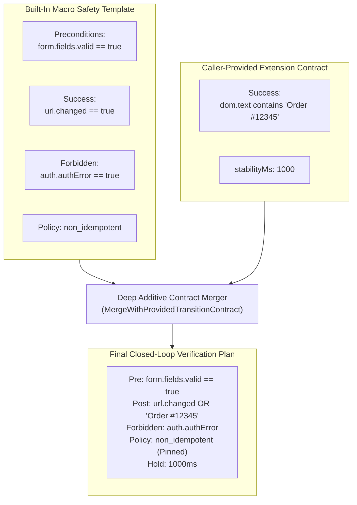
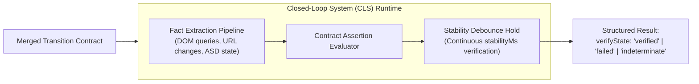

# Contract Merging & Closed-Loop System (CLS)

> [!NOTE]
> Nova AI Workspace combines predefined macro safety templates with dynamic caller extensions through **Additive Contract Merging**. This mechanism allows autonomous agents to supply domain-specific verification rules without sacrificing system-level safety invariants (such as HTML5 validation scanning or credential error trapping). Merged contracts are evaluated by Nova's runtime verification engine within the [Closed-Loop System (CLS)](../../../closed-loop-system-cls/README.md).

---

## 1. Macro Templates vs Caller Extensions

When an agent invokes a guarded tool such as [`nova.guarded_submit_form`](../../../../mcp-reference/tools/guarded-actions/nova-guarded-submit-form.md) or [`nova.guarded_send_message`](../../../../mcp-reference/tools/guarded-actions/nova-guarded-send-message.md), writing a full transition contract from scratch would be redundant and error-prone.

Nova provides **Built-in Macro Templates** that encode universal web platform safety invariants:
* Chat templates enforce empty-composer verification and send-button morphing.
* Form templates enforce `:invalid` scanning and single-submit idempotency.
* Login templates enforce ASD credential error trapping and MFA branching.

However, complex workflows often require **domain-specific assertions**—for example, verifying that an order number was generated, that a balance updated, or that a specific success toast rendered. Agents provide these extensions via the optional `transitionContract` argument.



---

## 2. Additive Merging Rules & Pinned Invariants

Nova merges caller contracts additively using the following deterministic rules:

### A. Precondition & Postcondition Conjunctions
* **Preconditions (`all`):** Caller-supplied preconditions are appended to the built-in precondition array. Both the system checks and the agent checks must pass before the click is committed.
* **Success Postconditions (`any`):** Caller-supplied success conditions are appended as alternative pathways. If *either* the default navigation occurs *or* the caller's custom DOM element appears, the action is verified.
* **Forbidden Postconditions (`any`):** Caller-supplied forbidden conditions are added to system error traps. Any match instantly aborts verification with `verifyState: "failed"`.

### B. Security & Invariant Pinning
To prevent malicious or poorly structured agent prompts from disabling vital safety rails:
1. **Pinned Preconditions:** Callers cannot remove or nullify built-in checks like `form.fields.valid`.
2. **Non-Idempotent Preservation:** High-impact tools enforce `retryPolicy: "non_idempotent"`. Even if a caller contract specifies `retryPolicy: "idempotent"` on a form submission, Nova enforces `non_idempotent` to prevent accidental double-submit cascades.
3. **Observation Ceilings:** If a caller provides an excessively large `stabilityWindowMs` (e.g. 10 minutes), Nova caps the window to system safety bounds to prevent unkillable hanging RPC requests.

---

## 3. Integration with the Closed-Loop System (CLS)

Once merged, the final contract is submitted to Nova's Closed-Loop verification engine:



1. **Fact Extraction Pipeline:** As the browser settles after the commit point, CLS extracts active UI facts:
   * Current navigation URL and history depth.
   * ASD authentication flags (`auth.loggedIn`, `auth.authError`, `auth.mfaChallenge`).
   * Visible text content and matching DOM selectors.
   * Active network streams (SSE / WebSocket activity).
2. **Runtime Assertion Evaluation:** Evaluates assertion operators (`eq`, `contains`, `exists`, `gt`, `lt`) against extracted facts.
3. **Debounce Verification:** When a success postcondition evaluates to true, CLS arms the `stabilityMs` debounce timer. If the condition remains true for the entire hold duration without tripping any forbidden condition, the outcome transitions to `verified`.

---

## 4. Ambiguity Resolution & Error Recovery

When a postcondition does not resolve cleanly within the stability window, the contract's `ambiguityPolicy` determines the operational recovery path:

| `ambiguityPolicy` | Runtime Action | Recommended Agent Behavior |
| :--- | :--- | :--- |
| `signal` *(Default)* | Halts observation and returns `verifyState: "indeterminate"` with `retryAdvice: "do_not_retry"`. | The agent must not repeat the action. Inspect the page with [`nova.perceive`](../../../../mcp-reference/tools/dom-and-reading/nova-perceive.md) to inspect current DOM state. |
| `retry_once` | Executes one automated re-read of the DOM after an additional settlement delay before declaring indeterminate. | Useful in SPAs with heavy client-side rendering where elements take longer to mount. |
| `abort` | Instantly rolls back the interaction and raises a fatal execution exception. | Used in high-security workflows where partial execution is strictly intolerable. |

---

## 5. Practical Invocation Example: Form Submit with Custom Contract

```json
{
  "targetId": "tab-101",
  "selector": "button#submit-application",
  "transitionContract": {
    "actionKind": "submit_form",
    "stabilityWindowMs": 5000,
    "stabilityMs": 1000,
    "postconditions": {
      "success": {
        "any": [
          {
            "factKey": "dom.element.text",
            "selector": ".application-status-badge",
            "operator": "contains",
            "expected": "Application Received"
          }
        ]
      },
      "forbidden": {
        "any": [
          {
            "factKey": "dom.element.exists",
            "selector": ".server-error-banner",
            "operator": "exists"
          }
        ]
      }
    }
  }
}
```

---

## Related Documentation

* [Closed-Loop Transition Contracts Hub](../README.md)
* [Contract Anatomy & Fact Operators](../contract-anatomy-and-operators/README.md)
* [Closed-Loop System (CLS) Architecture](../../../closed-loop-system-cls/README.md)
* [Autonomous Chat Engine & Reply Watch](../../chat-macro/README.md)
* [Transactional Form Submissions & Auth Gates](../../form-submission/README.md)
