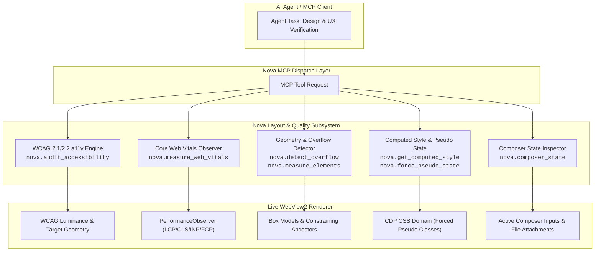
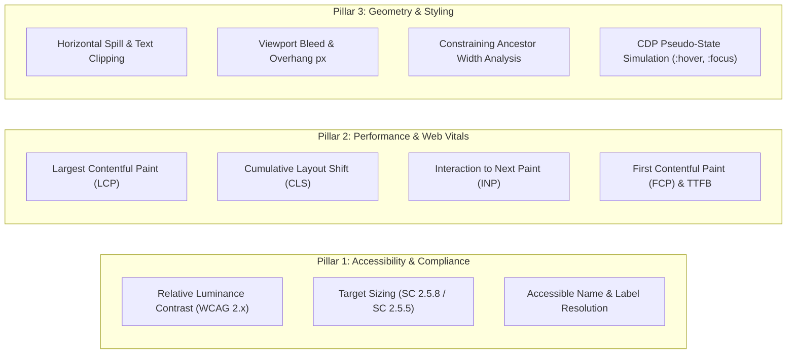

# Layout Quality, Automated Accessibility & Core Web Vitals

> **Comprehensive visual quality, WCAG compliance auditing, Core Web Vitals performance gating, and deep geometric inspection for autonomous AI agents.**

---

## 1. Overview & Architectural Vision

When autonomous AI agents evaluate modern web applications, traditional approaches suffer from two failure modes:
1. **Raw Visual Screenshots Alone Are Deceptive:** High-resolution screenshots capture pixel output, but they cannot detect text silently truncated by CSS `text-overflow: ellipsis`, interactive elements pushed off-screen into an invisible horizontal overhang, or tiny touch targets that frustrate mobile users.
2. **Unchecked JavaScript Evaluation Is Dangerous:** Relying on `page.evaluate()` or ad-hoc scripts to inject third-party audit bundles (like `axe-core` or Lighthouse scripts) introduces latency, risks crashing the renderer with forced layout thrashing, and can cause unpredictable side effects on production DOMs.

Nova AI Workspace provides an **in-engine, deterministic layout and quality subsystem**. Implemented natively within Microsoft WebView2 and exposed via structured Model Context Protocol (MCP) tools, Nova gives agents instant, high-precision telemetry on accessibility, rendering performance, and layout integrity without external npm packages or arbitrary script injection.

---

## 2. Core Pillars of the Subsystem

The subsystem is organized into three specialized functional areas:

### Pillar 1: Automated Accessibility (a11y) & WCAG Compliance
Automated checking of the live DOM against WCAG 2.1 and WCAG 2.2 rules without heavy external libraries. It inspects:
* **Color Contrast:** Calculates mathematical relative luminance ratios between text and nearest opaque ancestor backgrounds, enforcing $4.5:1$ for normal text and $3.0:1$ for large text.
* **Touch Target Size:** Enforces minimum physical rendered sizes (default 24px for WCAG 2.2 SC 2.5.8 Level AA; configurable to 44px for Level AAA and mobile guidelines).
* **Accessible Labels:** Verifies that images have `alt` attributes, form inputs have programmatic labels (`<label>`, `aria-label`, `aria-labelledby`, `title`), and interactive buttons/links have non-empty accessible names.

### Pillar 2: Real-User Core Web Vitals & Performance Gating
Measures user experience metrics directly using browser-native `PerformanceObserver` instances:
* **Two-Phase Probe Architecture:** Installs buffered observers to backfill load events, pauses for an interaction or settling window, and collects aggregated data.
* **Standard Ratings:** Evaluates LCP, CLS, INP, and FCP against Google Web Vitals thresholds (`good`, `needs-improvement`, `poor`).
* **Windowed vs. Cumulative Measurement:** Configurable `reset` parameter allows measuring layout shifts during a specific workflow (e.g., clicking a dropdown or scrolling) versus tracking lifetime page metrics.

### Pillar 3: Layout Geometry, Overflow & Computed Styling
Dissects physical container mechanics to find bugs invisible to human review:
* **Overflow & Clipping Detection:** Distinguishes between clipped text (`text-overflow: ellipsis`, `overflow-x: hidden`) and unclipped horizontal spill.
* **Vertical Asymmetry Rationale:** Deliberately ignores normal vertical overflow (since web pages scroll vertically) while strictly flagging clipped vertical overflow (`overflow-y: hidden`).
* **Viewport Bleed:** Detects non-fixed elements pushing past the right viewport boundary, calculating exact `overhangPx`.
* **Constraining Ancestor Analysis:** Compares an element's width side-by-side with its viewport and the innermost ancestor narrower than the window, catching layout breakage inside sidebars and panels.
* **Authoritative Computed Styles:** Safely reads resolved CSS properties, box-model dimensions, and custom CSS variables without executing arbitrary JavaScript.
* **Forced Pseudo-States:** Uses Chrome DevTools Protocol (CDP) to force `:hover`, `:focus`, `:active`, `:focus-visible`, and `:visited` without moving the mouse pointer or triggering disruptive event listeners.

---

## 3. Dedicated Architectural Guides

The layout quality, accessibility, and performance architecture is decomposed into three core architectural domains and six fine-grained implementation sub-guides:

### Domain 1: Automated Accessibility (a11y) & WCAG Compliance Engine
* **[Automated Accessibility (a11y) Engine Hub](accessibility-audit/README.md):**
  WCAG 2.1/2.2 contrast mathematics, ancestor background walking, interactive target sizing, label resolution, and renderer protection caps.
  * **[In-Engine WCAG Rules & Contrast](accessibility-audit/axe-core-engine-and-wcag-rules/README.md):**
    Native in-engine audit vs script injection, relative luminance formulas, ancestor background resolution, and 8,000-node safety caps.
  * **[Audit Reporting & Color Contrast](accessibility-audit/audit-reporting-and-color-contrast/README.md):**
    Target sizing geometry (24px/44px), accessible name and form label resolution (`CSS.escape`), advisory contrast boundaries, and response schemas.

### Domain 2: Real-User Core Web Vitals & Performance Gating
* **[Real-User Core Web Vitals Hub](core-web-vitals/README.md):**
  Two-phase `PerformanceObserver` probe, buffered metrics, LCP/CLS/INP/FCP rating thresholds, and windowed reset semantics.
  * **[PerformanceObserver & Synthetic Instrumentation](core-web-vitals/performance-observer-and-synthetic-instrumentation/README.md):**
    Two-phase probe architecture, buffered observers (`layout-shift`, `largest-contentful-paint`, `event`), and async host delays.
  * **[Diagnostic Attribution & Threshold Gates](core-web-vitals/diagnostic-attribution-and-threshold-gates/README.md):**
    Official rating thresholds, windowed vs cumulative reset semantics, layout shift attribution, and CI/CD quality gates.

### Domain 3: Layout Geometry, Overflow Detection & Computed Styling
* **[Layout Geometry & Overflow Detection Hub](layout-geometry-and-overflow/README.md):**
  Text clipping vs. horizontal overflow, intentional vertical asymmetry, viewport bleed overhang, constraining ancestors, and CDP pseudo-states.
  * **[Bounding Rectangles & Constraining Ancestors](layout-geometry-and-overflow/bounding-client-rect-and-box-model-metrics/README.md):**
    Multi-selector geometric analysis, Three Widths container constraints, passive measurement, and authoritative computed styles.
  * **[Overflow Detection & Pseudo-State Inspection](layout-geometry-and-overflow/overflow-detection-and-pseudo-state-inspection/README.md):**
    Horizontal spillage, intentional vertical asymmetry rationale, viewport bleed, CDP pseudo-state simulation, and composer readiness.

---

## 4. Tool Selection & Comparison Matrix

| Scenario / Goal | Recommended Tool | Key Strengths & Outputs |
| :--- | :--- | :--- |
| **Check design accessibility** | `nova.audit_accessibility` | Returns structured WCAG violations, contrast ratios, missing labels, and undersized tap targets. |
| **Measure page speed & layout shift** | `nova.measure_web_vitals` | Reports LCP, CLS, INP, FCP, TTFB with automated `good` / `needs-improvement` / `poor` ratings. |
| **Detect broken layouts & clipped text** | `nova.detect_overflow` | Scans subtree for horizontal spill, hidden text truncation, and viewport-bleeding elements with overhang px. |
| **Debug responsive panel sizing** | `nova.measure_elements` | Batches up to 25 selectors; compares element width with nearest constraining ancestor width and viewport width. |
| **Read exact font/color/spacing** | `nova.get_computed_style` | Authoritative CSS computed styles and box model values without JS `eval()`. |
| **Inspect hover or focus styles** | `nova.force_pseudo_state` | CDP-level state forcing; holds multiple elements in hover/focus simultaneously without pointer interference. |
| **Inspect chat composer readiness** | `nova.composer_state` | Extracts text, verifies attachment presence (file inputs vs. DOM chips), and inspects send button readiness. |

---

## 5. Architectural Invariants & Safety Guarantees

1. **Forced Layout Thrashing Protection (8,000 Node Cap):**
   Calling `getComputedStyle()` or `getBoundingClientRect()` repeatedly forces the browser renderer to synchronously recalculate layout. To prevent freezing complex SPAs with massive DOM trees, probes enforce a hard cap of **8,000 scanned elements**. If a subtree exceeds this limit, the probe terminates gracefully and returns `truncated: true`.
2. **Explicit Not-Found Errors (`-32004`):**
   If a provided CSS `selector` fails to match any element in the active document, Nova returns an explicit JSON-RPC error code `-32004` (`No element matched selector '...'`). Probes never return a deceptive `ok: true` with zero findings on missing selectors.
3. **Advisory Contrast Notice:**
   Because calculating true pixel contrast across background gradients, semi-transparent overlays, and canvas images requires full GPU rasterization, Nova's contrast engine traverses opaque ancestor backgrounds. Findings are marked as advisory leads for verification rather than legal compliance verdicts.
4. **State Simulation vs. Page Operation:**
   Forcing a pseudo-class via `nova.force_pseudo_state` instructs the browser styling engine to render the requested state, but it **does not fire DOM mouse or keyboard events**. A flyout menu that depends on a JavaScript `mouseenter` event listener will remain closed when `:hover` is forced. For operational interactions, use [`nova.input_move`](../../mcp-reference/tools/browser-automation/nova-input-move.md) or [`nova.click_selector`](../../mcp-reference/tools/browser-automation/nova-click-selector.md).
5. **Passive Geometric Measurement:**
   `nova.measure_elements` and `nova.detect_overflow` measure bounding rectangles in place and **deliberately do not scroll elements into view**. Scrolling elements alters page scroll offsets, which would invalidate subsequent measurements.

---

## 6. Related Documentation

* [MCP Tool Group Reference: Layout Quality, Geometry & Web Vitals](../../mcp-reference/tools/layout-and-qa/README.md)
* [DOM Perception & Structured Reading](../dom-perception/README.md)
* [Guarded Interactions & Form Automation](../guarded-interactions/README.md)
* [Browser Interaction & Input Simulation](../browser-interaction/README.md)
* [Master MCP Tool Catalog](../../mcp-reference/tool-catalog.md)
