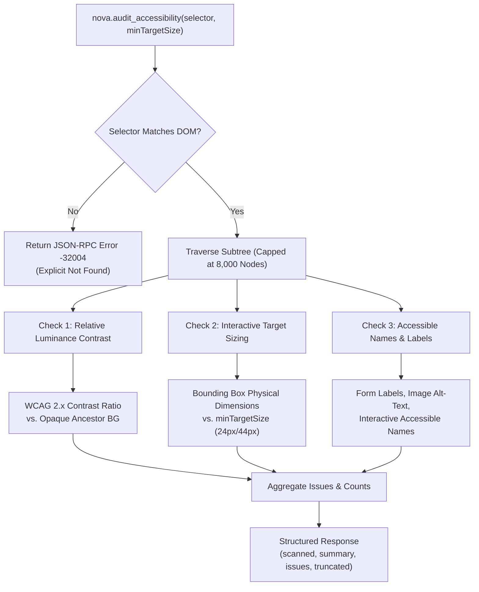
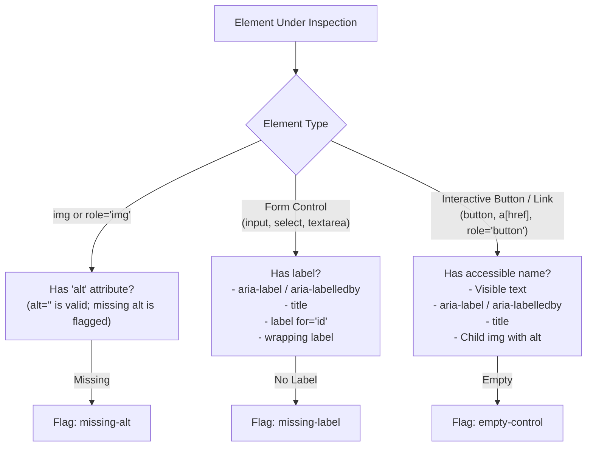

# Automated Accessibility (a11y) & WCAG Compliance Engine

> **Lightweight, built-in accessibility auditing for autonomous agents — enforcing WCAG 2.1/2.2 contrast rules, interactive tap target dimensions, and accessible naming without external runtime dependencies.**

---

## 1. Overview & Motivation

Modern web applications frequently suffer from accessibility regressions: low-contrast typography that strains readability, touch targets too tiny for mobile fingertips, unlabelled form inputs, and icon-only buttons that provide zero semantic hints to screen readers.

Traditional automation tools solve this by injecting heavy third-party testing libraries (such as `axe-core`) into the browser context. While comprehensive, these libraries carry significant overhead:
* They inject megabytes of JavaScript into target pages, altering the memory profile.
* They often trigger extensive forced layout recalculations, causing multi-second renderer pauses.
* They report hundreds of verbose structural violations that obscure immediate UX blockers.

Nova provides **`nova.audit_accessibility`**, an in-engine accessibility and UX audit probe. Built directly into the browser core, it audits live DOM components with zero script injection latency, reporting high-signal violations across three critical check families.



---

## 2. The Three Check Families

### 2.1. Relative Luminance Color Contrast (`includeContrast: true`)

The contrast auditor verifies that text elements maintain sufficient visual separation from their underlying background in accordance with WCAG 2.2 Success Criterion 1.4.3 (Contrast Minimum, Level AA).

#### The Mathematics of Luminance
Luminance is calculated using the standard sRGB relative luminance definition ($L$):

$$L = 0.2126 \cdot R_{lin} + 0.7152 \cdot G_{lin} + 0.0722 \cdot B_{lin}$$

Where each color channel ($c \in \{R, G, B\}$) normalized to $[0, 1]$ is linearised:

$$c_{lin} = \begin{cases} \frac{c}{12.92} & \text{if } c \le 0.03928 \\ \left(\frac{c + 0.055}{1.055}\right)^{2.4} & \text{if } c > 0.03928 \end{cases}$$

The contrast ratio ($CR$) between the lighter luminance ($L_1$) and darker luminance ($L_2$) is computed as:

$$CR = \frac{L_1 + 0.05}{L_2 + 0.05}$$

#### Evaluation Thresholds
* **Normal Text:** Requires a contrast ratio of at least **$4.5:1$**.
* **Large Text:** Defined as text $\ge 24\text{ px}$ (18pt) or $\ge 18.66\text{ px}$ (14pt) with bold weight ($\ge 700$). Large text requires a contrast ratio of at least **$3.0:1$**.

#### Ancestor Background Resolution
Because text elements frequently have a transparent background (`rgba(0, 0, 0, 0)`), the probe traverses upward through parent nodes until it identifies the nearest ancestor with a non-zero alpha background color. If no opaque ancestor is encountered up to the root, the background defaults to pure white (`rgb(255, 255, 255)`).

> [!NOTE]
> **Advisory Nature of Contrast:** The probe does not model complex CSS alpha compositing, CSS backdrop filters, or raster background images. When text overlays a background image or canvas, contrast findings should be treated as advisory leads and verified visually.

---

### 2.2. Interactive Target Sizing (`includeTargetSize: true`)

Touch and click targets that are too small lead to misclicks, especially on mobile devices or touchscreens. The target sizing auditor evaluates rendered physical dimensions (`getBoundingClientRect()`) for all interactive elements:
* Native links: `<a href="...">`
* Native buttons: `<button>`
* Form controls: `<select>`, `<textarea>`, non-hidden `<input>`
* ARIA interactive roles: `role="button"`, `"link"`, `"checkbox"`, `"radio"`, `"switch"`, `"tab"`, `"menuitem"`

#### Minimum Size Standards
* **Default Floor (`minTargetSize: 24`):** Enforces **WCAG 2.2 SC 2.5.8 (Target Size Minimum, Level AA)**, which mandates that interactive targets have an area of at least $24 \times 24$ CSS pixels.
* **Touch Guidance (`minTargetSize: 44`):** Can be raised to 44px to verify compliance with **WCAG 2.1 SC 2.5.5 (Level AAA)** and Apple/Google mobile design guidelines.

If either the rendered `width` or `height` falls below `minTargetSize`, the element is flagged with its exact dimensions and the required minimum.

---

### 2.3. Accessible Names & Labels (`includeLabels: true`)

Screen readers and accessibility services rely on programmatic labels to convey the purpose of UI elements:



1. **Images (`missing-alt`):** Flags `` tags and `role="img"` elements that lack an `alt` attribute. An empty `alt=""` is permitted (indicating decorative presentation), but omitting `alt` entirely is flagged.
2. **Form Controls (`missing-label`):** Form fields (excluding `hidden`, `submit`, `reset`, and `button` types) must have an associated programmatic label. The engine inspects:
   - `aria-label` or `aria-labelledby` referencing existing elements with text.
   - `title` attribute.
   - Associated `<label for="...">` tags. (The probe uses `CSS.escape(el.id)` to prevent syntax errors from IDs containing brackets or special characters).
   - Ancestor `<label>` wrapping elements.
3. **Empty Controls (`empty-control`):** Buttons and active hyperlinks must not be empty icon shells. They must contain non-whitespace text, an `aria-label`, an `aria-labelledby` reference, a `title`, or a child image with valid `alt` text.

---

## 3. Renderer Protection & Performance Safety

Auditing large web applications with tens of thousands of DOM elements poses a significant risk of **forced layout thrashing**:
* Inspecting `getComputedStyle()` forces the browser layout engine to synchronously recalculate CSS styles.
* Inspecting `getBoundingClientRect()` forces the layout engine to synchronously recalculate geometry and reflow.

To protect the host process and target tab from freezing, Nova implements strict runtime safeguards:
* **8,000 Element Hard Cap:** The traversal loop visits a maximum of 8,000 DOM elements per call.
* **Truncation Flag (`truncated: true`):** If the scanned subtree exceeds 8,000 nodes, or if the number of collected issues reaches `maxIssues`, the probe terminates immediately and sets `truncated: true`.
* **Component Scoping (`selector`):** Rather than scanning `body`, agents should scope audits to specific subtrees (e.g. `selector: "#checkout-modal"`, `selector: "form.payment-form"`).

---

## 4. MCP Tool Parameter Reference

The audit engine is invoked via [`nova.audit_accessibility`](../../../mcp-reference/tools/layout-and-qa/nova-audit-accessibility.md):

| Parameter | Type | Required | Default | Range | Description |
| :--- | :--- | :---: | :--- | :--- | :--- |
| `targetId` | `string` | No | `"active"` | — | Target tab identifier from `nova.tabs`. |
| `selector` | `string` | No | `"body"` | — | CSS selector for the root element to audit. Defaults to `"body"`. |
| `maxIssues` | `integer` | No | `200` | 1–2000 | Maximum number of issues to return before halting. |
| `minTargetSize` | `integer` | No | `24` | 1–200 | Minimum acceptable touch target dimension in CSS pixels. |
| `includeContrast` | `boolean` | No | `true` | — | Include relative luminance text-contrast checks. |
| `includeTargetSize`| `boolean` | No | `true` | — | Include interactive tap target size checks. |
| `includeLabels` | `boolean` | No | `true` | — | Include missing alt-text, form label, and empty control checks. |

> [!IMPORTANT]
> At least one of `includeContrast`, `includeTargetSize`, or `includeLabels` must be enabled. Setting all three to `false` will return error `-32602`.

---

## 5. Structured Output Schema

The tool returns a structured JSON payload containing summary statistics and detailed issue records:

```json
{
  "targetId": "tab-c7e1",
  "ok": true,
  "selector": "#auth-card",
  "minTargetSize": 24,
  "issueCount": 3,
  "truncated": false,
  "result": {
    "ok": true,
    "selectorMatched": true,
    "url": "https://example.com/login",
    "scanned": 42,
    "summary": {
      "contrast": 1,
      "targetSize": 1,
      "labels": 1,
      "total": 3
    },
    "issues": [
      {
        "type": "contrast",
        "selector": "div#auth-card > p.helper-text",
        "tag": "p",
        "text": "Password must be at least 8 characters long",
        "details": {
          "ratio": 2.84,
          "threshold": 4.5,
          "fontSizePx": 13,
          "largeText": false,
          "color": "rgb(150, 150, 150)",
          "background": "rgb(255, 255, 255)"
        }
      },
      {
        "type": "target-size",
        "selector": "div#auth-card > button.close-btn",
        "tag": "button",
        "text": "×",
        "details": {
          "width": 18,
          "height": 18,
          "min": 24
        }
      },
      {
        "type": "missing-label",
        "selector": "div#auth-card > input#remember-me",
        "tag": "input",
        "text": "",
        "details": {
          "control": "input",
          "inputType": "checkbox",
          "hint": "Associate a <label>, or add aria-label / aria-labelledby."
        }
      }
    ],
    "truncated": false
  }
}
```

---

## 6. Practical Agent Workflows & Recipes

### Recipe 1: Pre-Commit Component Audit
Before completing a UI feature or approving a PR, an agent audits the newly created component:

```json
{
  "selector": ".subscription-dialog",
  "minTargetSize": 24,
  "maxIssues": 50
}
```

If `summary.total > 0`, the agent reviews the `issues` list and updates the CSS classes or HTML markup to resolve the contrast or target-size failures.

### Recipe 2: Mobile Viewport Touch Compliance Gate
When verifying a responsive design for mobile devices, the agent sets the mobile viewport emulation and audits with strict 44px tap targets:

1. Emulate mobile device metrics:
   ```json
   // nova.emulation_set_device_metrics
   { "width": 390, "height": 844, "deviceScaleFactor": 3, "mobile": true }
   ```
2. Audit interactive elements with 44px floor:
   ```json
   // nova.audit_accessibility
   {
     "selector": "nav.mobile-nav",
     "minTargetSize": 44,
     "includeContrast": false,
     "includeLabels": false,
     "includeTargetSize": true
   }
   ```

### Recipe 3: Dark Mode Contrast Verification
To ensure a theme switch does not introduce unreadable text:

1. Emulate dark color scheme:
   ```json
   // nova.emulation_set_media
   { "features": [{ "name": "prefers-color-scheme", "value": "dark" }] }
   ```
2. Audit contrast across the main content area:
   ```json
   // nova.audit_accessibility
   {
     "selector": "main",
     "includeContrast": true,
     "includeTargetSize": false,
     "includeLabels": false
   }
   ```

---

## 7. Related Tools & Documentation

* [`nova.audit_accessibility` Tool Reference](../../../mcp-reference/tools/layout-and-qa/nova-audit-accessibility.md)
* [Real-User Core Web Vitals](../core-web-vitals/README.md)
* [Layout Geometry & Overflow Detection](../layout-geometry-and-overflow/README.md)
* [DOM Perception & Structured Reading](../../dom-perception/README.md)
