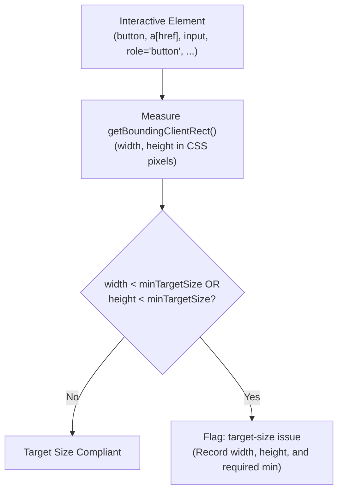
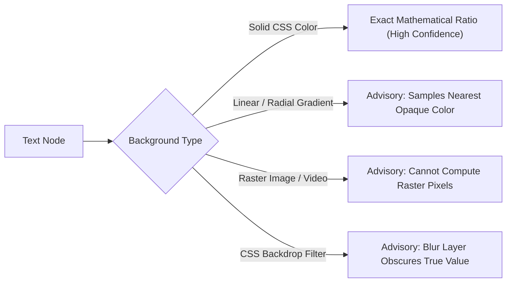

# Audit Reporting, Target Sizing & Accessible Name Resolution

This sub-guide details the reporting schema, touch target geometry validation, and programmatic accessible name and label resolution algorithms implemented in Nova AI Workspace's accessibility audit engine.

---

## 1. Interactive Tap Target Size Auditing (`includeTargetSize: true`)

Touch and click targets that are too small create frustrating experiences, causing unintended activations and accessibility failures for users with motor impairments or mobile touch devices.



### Evaluated Interactive Elements:
* Native interactive tags: `<button>`, `<a href="...">`, `<select>`, `<textarea>`, non-hidden `<input>`
* Interactive ARIA roles: `role="button"`, `role="link"`, `role="checkbox"`, `role="radio"`, `role="switch"`, `role="tab"`, `role="menuitem"`

### Standards & Configurable Floors:
* **WCAG 2.2 SC 2.5.8 (Level AA Floor - Default: 24px):** Mandates that interactive targets have an area of at least $24 \times 24$ CSS pixels. Elements below this threshold are flagged with their actual dimensions (e.g. `18x18px`).
* **WCAG 2.1 SC 2.5.5 (Level AAA & Mobile Guidelines - 44px):** Setting `"minTargetSize": 44` enforces strict compliance with Apple Human Interface Guidelines and Google Material Design touch specifications.

---

## 2. Accessible Name & Form Label Resolution (`includeLabels: true`)

Screen readers and accessibility APIs depend on semantic text attributes to describe interactive elements. Nova's label auditor inspects three distinct categories:

```mermaid
graph TD
    Node["Element Under Audit"] --> TypeCheck{"Element Category"}

    TypeCheck -->|img or role='img'| ImgCheck["Inspect 'alt' Attribute"]
    ImgCheck -->|Has alt (including alt='')| PassImg["Compliant"]
    ImgCheck -->|Attribute Missing| FlagAlt["Flag: missing-alt<br>Type: img"]

    TypeCheck -->|Form Input / Select / Textarea| FormCheck["Inspect Associated Labels"]
    FormCheck -->|aria-label / aria-labelledby| PassForm["Compliant"]
    FormCheck -->|title attribute| PassForm
    FormCheck -->|label for='id' (CSS.escape safe)| PassForm
    FormCheck -->|Ancestor label wrapper| PassForm
    FormCheck -->|None Present| FlagLabel["Flag: missing-label<br>Provide label association hint"]

    TypeCheck -->|Button or Link| BtnCheck["Inspect Accessible Text Content"]
    BtnCheck -->|Visible text > 0| PassBtn["Compliant"]
    BtnCheck -->|aria-label / title / child img alt| PassBtn
    BtnCheck -->|Empty icon shell| FlagBtn["Flag: empty-control<br>Actionable CTA text missing"]
```

### Label Resolution Mechanics:
1. **Images (`missing-alt`):**
   * An empty string `alt=""` is considered valid (it explicitly declares the image as decorative to screen readers).
   * Omitting the `alt` attribute entirely triggers a `missing-alt` violation.
2. **Form Controls (`missing-label`):**
   * Supported controls: `<input>` (excluding hidden, submit, and button types), `<select>`, `<textarea>`.
   * Checks `aria-label` and `aria-labelledby` attributes.
   * Checks `<label for="elementId">`. To avoid syntax crashes when IDs contain special characters (e.g. `user[email]` or `id:12`), Nova uses `CSS.escape(element.id)`.
   * Checks if the control is wrapped inside an ancestor `<label>`.
3. **Empty Controls (`empty-control`):**
   * Flags icon-only buttons (e.g. `<button><i class="fa fa-trash"></i></button>`) that lack textual descriptions, `aria-label`, `title`, or child images with `alt` text.

---

## 3. Advisory Contrast Considerations

While mathematical relative luminance calculation is exact for flat CSS background colors, web applications frequently use complex graphic techniques:



* **Flat Color Accuracy:** For solid text against solid background cards, the calculated ratio is authoritative.
* **Complex Layers:** When text overlays CSS gradients, background images, or glassmorphic blur layers (`backdrop-filter`), the probe traverses to the nearest opaque ancestor container. Findings are flagged with an advisory note, guiding agents to capture visual screenshots for secondary verification.

---

## 4. Structured Output Schema & Issue Taxonomy

The payload returned by [`nova.audit_accessibility`](../../../../mcp-reference/tools/layout-and-qa/nova-audit-accessibility.md) provides both macro summaries and granular issue locators:

```json
{
  "targetId": "tab-1024",
  "ok": true,
  "selector": "#billing-form",
  "minTargetSize": 24,
  "issueCount": 3,
  "truncated": false,
  "result": {
    "ok": true,
    "selectorMatched": true,
    "url": "https://app.example.com/checkout",
    "scanned": 84,
    "summary": {
      "contrast": 1,
      "targetSize": 1,
      "labels": 1,
      "total": 3
    },
    "issues": [
      {
        "type": "contrast",
        "selector": "div#billing-form > p.disclaimer",
        "tag": "p",
        "text": "Taxes and fees are calculated at checkout.",
        "details": {
          "ratio": 3.12,
          "threshold": 4.5,
          "fontSizePx": 12,
          "largeText": false,
          "color": "rgb(160, 160, 160)",
          "background": "rgb(255, 255, 255)"
        }
      },
      {
        "type": "target-size",
        "selector": "div#billing-form > button.info-tooltip",
        "tag": "button",
        "text": "?",
        "details": {
          "width": 16,
          "height": 16,
          "min": 24
        }
      },
      {
        "type": "missing-label",
        "selector": "div#billing-form > input#promo-code",
        "tag": "input",
        "text": "",
        "details": {
          "control": "input",
          "inputType": "text",
          "hint": "Associate a <label>, or add aria-label / aria-labelledby."
        }
      }
    ],
    "truncated": false
  }
}
```

---

## 5. Related Documentation

* **[Automated Accessibility (a11y) Engine Hub](../README.md)** — Pillar overview and recipes.
* **[In-Engine WCAG Rules & Contrast Architecture](../axe-core-engine-and-wcag-rules/README.md)** — Luminance formulas and 8,000-node safety caps.
* **[Layout Geometry & Overflow Detection](../../layout-geometry-and-overflow/README.md)** — Geometric inspection and container constraints.
* **[Real-User Core Web Vitals](../../core-web-vitals/README.md)** — Browser performance metrics.
* **[`nova.audit_accessibility` Tool Reference](../../../../mcp-reference/tools/layout-and-qa/nova-audit-accessibility.md)** — Parameter and return schema.
