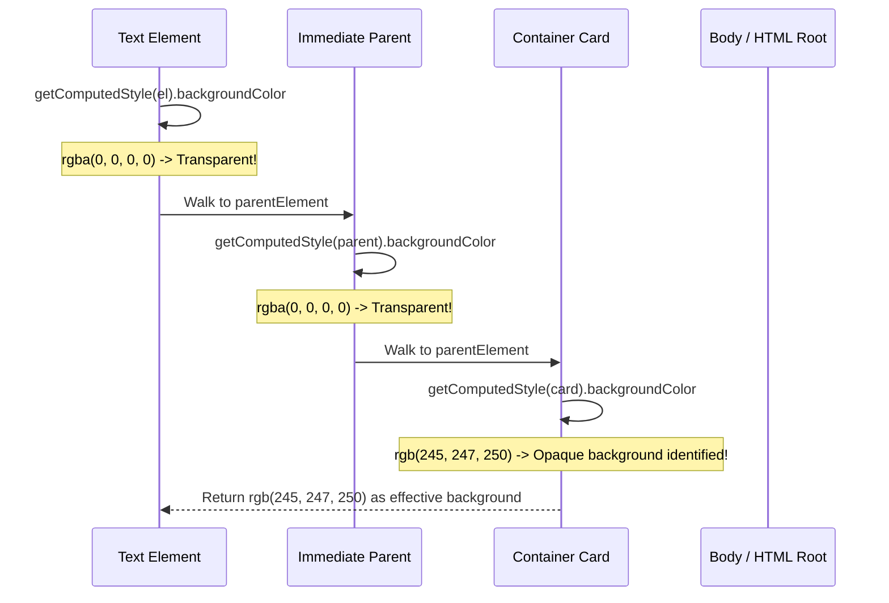

# In-Engine WCAG Rules Engine & Contrast Architecture

This sub-guide details Nova AI Workspace's built-in accessibility auditing engine, explaining how it evaluates WCAG 2.1 and WCAG 2.2 rules natively inside Microsoft WebView2 without external JavaScript test harnesses, its mathematical relative luminance pipeline, and its renderer protection safeguards.

---

## 1. Built-in Engine vs. Third-Party Script Injection

Traditional browser automation frameworks evaluate web accessibility by dynamically injecting external JavaScript testing libraries (such as `axe-core`, Lighthouse audit scripts, or custom npm packages) into target pages via `page.evaluate()`:

```mermaid
flowchart TD
    subgraph Traditional["Traditional Approach (Script Injection)"]
        T1["Agent calls page.evaluate()"]
        T2["Inject 1–3 MB axe-core JS bundle"]
        T3["Force Full-Tree Layout Recalculation"]
        T4["Pollute Window Scope & Alter Memory"]
        T5["Multi-Second Latency & Renderer Freezes"]
    end

    subgraph Nova["Nova AI Workspace (Native In-Engine Audit)"]
        N1["Agent calls nova.audit_accessibility"]
        N2["Native C# WebView2 Evaluation Dispatch"]
        N3["Zero External Dependencies Injected"]
        N4["8,000-Node Renderer Safety Cap"]
        N5["Sub-100ms Structured JSON Response"]
    end

    T1 --> T2 --> T3 --> T4 --> T5
    N1 --> N2 --> N3 --> N4 --> N5
```



### Critical Advantages of Nova's Architecture:
1. **Zero External Bundle Overhead:** Third-party bundles consume megabytes of memory and can interfere with single-page application (SPA) module loaders, Content Security Policies (CSP), or security sandboxes. Nova's engine executes lightweight, self-contained auditing logic directly on the page context.
2. **Deterministic Error Handling (`-32004`):** If a specified CSS selector does not match any element in the DOM, Nova returns an explicit JSON-RPC error code `-32004` (`No element matched selector '...'`). It never returns a deceptive `ok: true` with zero findings.
3. **Renderer Protection (8,000 Node Cap):** Evaluating computed styles and bounding rectangles triggers synchronous reflows. Nova caps subtree traversal at 8,000 nodes, terminating gracefully with `truncated: true` if exceeded.

---

## 2. Mathematical Relative Luminance & Contrast Evaluation

The contrast auditing family (`includeContrast: true`) enforces **WCAG 2.2 Success Criterion 1.4.3 (Contrast Minimum, Level AA)**.

```mermaid
flowchart TD
    Node["Target Text Element"]
    ExtractColor["Read CSS color from getComputedStyle"]
    Traverse["Walk Ancestors Upward for Background"]
    Luminance["Calculate Linear sRGB Relative Luminance L1, L2"]
    Ratio["Calculate Contrast Ratio CR = (L1 + 0.05) / (L2 + 0.05)"]
    Evaluate{"Evaluate against Thresholds"}

    Node --> ExtractColor
    Node --> Traverse
    ExtractColor --> Luminance
    Traverse --> Luminance
    Luminance --> Ratio
    Ratio --> Evaluate

    Evaluate -->|Font < 24px (Normal)| CheckAA{"CR >= 4.5:1?"}
    Evaluate -->|Font >= 24px OR (>=18.66px AND Bold)| CheckLarge{"CR >= 3.0:1?"}

    CheckAA -->|Yes| Pass["Pass"]
    CheckAA -->|No| FailAA["Flag: contrast issue (threshold: 4.5)"]
    CheckLarge -->|Yes| Pass
    CheckLarge -->|No| FailLarge["Flag: contrast issue (threshold: 3.0)"]
```

### Relative Luminance Formulation
Relative luminance ($L$) represents the photometric luminance of any point in a color space, normalized to 0 for pure black and 1 for pure white. Under sRGB (IEC 61966-2-1), luminance is computed as:

$$L = 0.2126 \cdot R_{lin} + 0.7152 \cdot G_{lin} + 0.0722 \cdot B_{lin}$$

Where each color channel ($c \in \{R, G, B\}$) normalized to $[0, 1]$ is converted from non-linear gamma space to linear values:

$$c_{lin} = \begin{cases} \frac{c}{12.92} & \text{if } c \le 0.03928 \\ \left(\frac{c + 0.055}{1.055}\right)^{2.4} & \text{if } c > 0.03928 \end{cases}$$

The contrast ratio ($CR$) is then derived from the lighter luminance ($L_1$) and darker luminance ($L_2$):

$$CR = \frac{L_1 + 0.05}{L_2 + 0.05}$$

### Contrast Ratio Criteria:
* **Normal Typography:** $CR \ge 4.5:1$ is required for all text under 24px (or under 18.66px if bold).
* **Large Typography:** $CR \ge 3.0:1$ is required for text $\ge 24\text{ px}$ (18pt) or $\ge 18.66\text{ px}$ (14pt) with bold weight ($\text{weight} \ge 700$).

---

## 3. Ancestor Background Resolution Algorithm

Webpage text elements almost universally default to a transparent background (`rgba(0, 0, 0, 0)`), deriving their visual backdrop from parent wrappers, cards, sections, or the root canvas.



### Algorithm Steps:
1. Extract `getComputedStyle(element).color` for the text foreground.
2. Initialize traversal at `element.parentElement`.
3. Inspect `getComputedStyle(current).backgroundColor`.
4. If the background has an alpha channel $> 0$ (e.g. `rgb(r, g, b)` or `rgba(r, g, b, a)` where $a > 0.1$), accept it as the effective background color.
5. If the root `<html>` or `<body>` element is reached without finding an opaque layer, default to pure white (`rgb(255, 255, 255)`).
6. Convert RGB values to linear sRGB and calculate contrast ratio.

---

## 4. Subtree Scoping & Performance Safeguards

Auditing large DOM trees across massive enterprise dashboards can quickly degrade browser performance if unconstrained. Nova provides multiple scoping mechanisms:

```json
// Example: Scoping an audit to an isolated component modal
{
  "selector": "#account-settings-modal",
  "maxIssues": 100,
  "includeContrast": true,
  "includeTargetSize": true,
  "includeLabels": true
}
```

* **Targeted Selectors:** Agents should never scan `body` when verifying an individual component or dialog. Scoping to the component root (e.g. `selector: ".user-table"`) reduces scanned node counts by up to 99%.
* **Early Halting:** Once `maxIssues` violations are identified (default 200, configurable up to 2000), the probe ceases processing immediately and returns `truncated: true`.
* **Renderer Protection Threshold:** Regardless of `maxIssues`, the probe visits at most 8,000 DOM elements.

---

## 5. Related Documentation

* **[Automated Accessibility (a11y) Engine Hub](../README.md)** — Pillar overview and recipe index.
* **[Audit Reporting & Color Contrast Sub-Guide](../audit-reporting-and-color-contrast/README.md)** — Tap target dimensions, accessible name resolution, and report schema.
* **[Layout Quality & Web Vitals Master Hub](../../README.md)** — Architectural vision and safety guarantees.
* **[`nova.audit_accessibility` Tool Reference](../../../../mcp-reference/tools/layout-and-qa/nova-audit-accessibility.md)** — Complete parameter and output specification.
