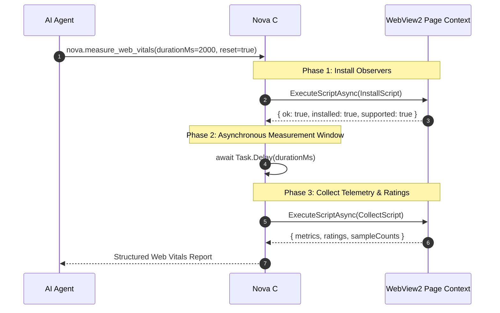
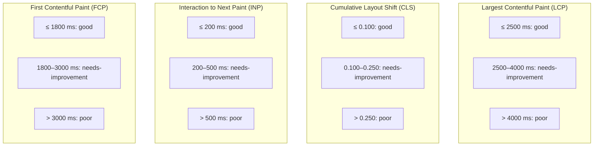
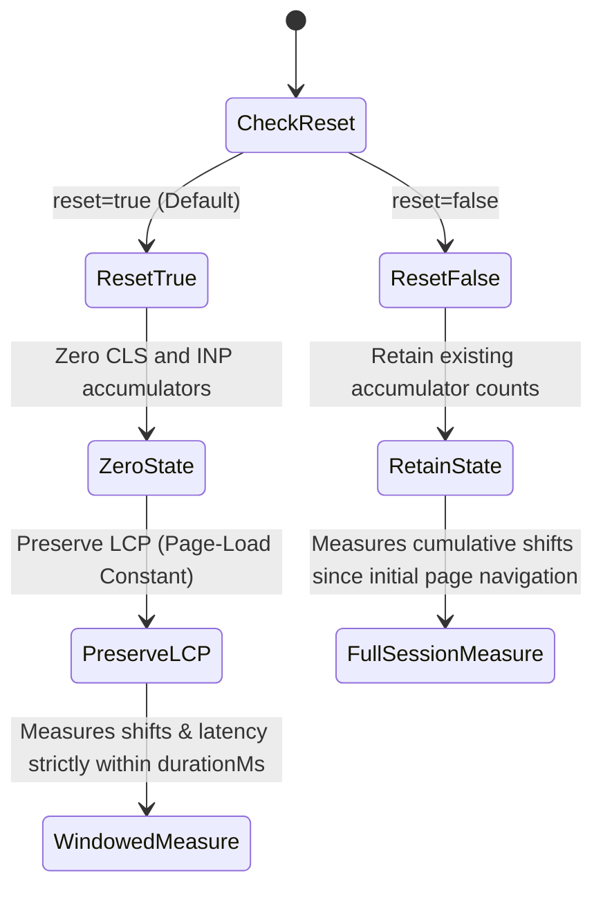

# Real-User Core Web Vitals & Performance Gating

> **Browser-native Core Web Vitals telemetry for autonomous agents — measuring Largest Contentful Paint (LCP), Cumulative Layout Shift (CLS), Interaction to Next Paint (INP), and First Contentful Paint (FCP) with automated rating gates.**

---

## 1. Overview & Purpose

Web performance and visual stability are critical criteria for web quality:
* **Layout Shifts (CLS):** Unexpected content jumps during page load or dynamic interaction cause users to misclick buttons or lose their reading position.
* **Loading Speed (LCP / FCP):** Slow page rendering impairs conversion rates and triggers agent navigation timeouts.
* **Responsiveness (INP):** Heavy JavaScript execution blocks the main thread, resulting in sluggish UI response to clicks and keystrokes.

Automated agents often face a dilemma when verifying page performance: traditional headless tooling requires complex multi-process harnesses (like Lighthouse CLI), while injecting ad-hoc `PerformanceObserver` scripts via raw `eval` fails because browser script runners do not await JavaScript Promises.

Nova provides **`nova.measure_web_vitals`**, a dedicated, in-engine performance telemetry tool. Using a coordinated two-phase architecture, it captures live browser performance metrics and automatically rates them against Google Web Vitals thresholds (`good`, `needs-improvement`, `poor`).



---

## 2. Dedicated Architecture Sub-Guides

| Guide | Description | Primary Topics |
| :--- | :--- | :--- |
| **[PerformanceObserver & Synthetic Instrumentation](performance-observer-and-synthetic-instrumentation/README.md)** | Two-phase probe architecture, buffered observers (`layout-shift`, `largest-contentful-paint`, `event`), and async host delays. | Two-phase probe, `PerformanceObserver`, `Task.Delay`, navigation timing |
| **[Diagnostic Attribution & Threshold Gates](diagnostic-attribution-and-threshold-gates/README.md)** | Official rating thresholds, windowed vs cumulative reset semantics, layout shift attribution, and CI/CD quality gates. | Thresholds, LCP invariant, windowed delta, quality gates |

---

## 3. Two-Phase Probe Architecture

In Microsoft WebView2, `ExecuteScriptAsync` executes synchronously on the JavaScript thread and returns immediately without awaiting pending Promises or asynchronous observer callbacks.

To reliably capture asynchronous performance events without blocking the browser UI thread, Nova splits measurement into distinct phases:

1. **Phase 1: In-Page Observer Installation:**
   Nova attaches a persistent state object to `window.__novaWebVitals` and registers three native `PerformanceObserver` instances:
   * `layout-shift` (with `buffered: true` so shifts that occurred before the tool call are captured).
   * `largest-contentful-paint` (with `buffered: true` to retrieve the page's primary visual paint candidate).
   * `event` (with `buffered: true` and `durationThreshold: 16` to monitor interaction latency).
2. **Phase 2: Asynchronous Host Delay:**
   The C# handler suspends execution asynchronously using `await Task.Delay(durationMs, ct)`. This leaves the browser renderer free to paint frames, execute animations, process user inputs, and buffer performance entries.
3. **Phase 3: Synchronous Telemetry Collection:**
   Nova queries `window.__novaWebVitals`, along with standard `performance.getEntriesByType('paint')` and `performance.getEntriesByType('navigation')`, aggregates the results, computes ratings, and returns structured data.

---

## 4. Metrics & Rating Thresholds

Nova evaluates observed metrics against official Google Core Web Vitals thresholds:



| Metric | Threshold: `good` | Threshold: `needs-improvement` | Threshold: `poor` | Measurement Details |
| :--- | :---: | :---: | :---: | :--- |
| **LCP** (`lcpMs`) | $\le 2500\text{ ms}$ | $2500\text{ ms} < \text{LCP} \le 4000\text{ ms}$ | $> 4000\text{ ms}$ | Render time or load time of the largest visual element. Persistent across calls. |
| **CLS** (`cls`) | $\le 0.100$ | $0.100 < \text{CLS} \le 0.250$ | $> 0.250$ | Sum of layout shift values excluding shifts with recent user input (`!hadRecentInput`). |
| **INP** (`inpMs`) | $\le 200\text{ ms}$ | $200\text{ ms} < \text{INP} \le 500\text{ ms}$ | $> 500\text{ ms}$ | Max observed event duration with duration $\ge 16\text{ ms}$. `null` if no interaction occurred. |
| **FCP** (`fcpMs`) | $\le 1800\text{ ms}$ | $1800\text{ ms} < \text{FCP} \le 3000\text{ ms}$ | $> 3000\text{ ms}$ | Time until the browser renders the first bit of DOM content. |
| **TTFB** (`ttfbMs`) | — | — | — | Time to First Byte (`responseStart` from navigation timing). |
| **DCL** (`domContentLoadedMs`) | — | — | — | Navigation timing `domContentLoadedEventEnd`. |
| **Load** (`loadMs`) | — | — | — | Navigation timing `loadEventEnd`. |

---

## 5. Reset Semantics: Windowed vs. Cumulative Measurement

The `reset` parameter controls whether accumulators are zeroed before the measurement window begins:



* **`reset: true` (Default):**
  Zeroes `cls`, `clsEntries`, and `inp` accumulators on `window.__novaWebVitals`. This enables **windowed delta measurement**: the agent measures layout shifts and interaction latency that occur specifically during the `durationMs` window (e.g. while opening an accordion or scrolling an infinite list).
* **`reset: false`:**
  Leaves existing accumulators intact. This enables **cumulative session measurement**: tracking the total accumulated layout shifts experienced by a user across a sequence of multiple steps.
* **LCP Invariant:**
  LCP represents the arrival of the page's primary visual content during the initial load. It is **never reset**, ensuring that subsequent calls still report the authoritative initial load paint time.

---

## 6. Parameter Reference & Schema

The tool is invoked via [`nova.measure_web_vitals`](../../../mcp-reference/tools/layout-and-qa/nova-measure-web-vitals.md):

| Parameter | Type | Required | Default | Range | Description |
| :--- | :--- | :---: | :--- | :--- | :--- |
| `targetId` | `string` | No | `"active"` | — | Target tab identifier from `nova.tabs`. |
| `durationMs`| `integer`| No | `2000` | 0–10000 | Settling window in milliseconds to observe layout shifts and interaction timing. |
| `reset` | `boolean` | No | `true` | — | Zero CLS and INP accumulators before measurement begins. |

### Structured Output Payload

```json
{
  "targetId": "tab-c7e1",
  "ok": true,
  "durationMs": 2000,
  "reset": true,
  "result": {
    "ok": true,
    "url": "https://example.com/products",
    "observed": true,
    "metrics": {
      "lcpMs": 1420.5,
      "cls": 0.024,
      "inpMs": 48.0,
      "fcpMs": 680.2,
      "ttfbMs": 185.0,
      "domContentLoadedMs": 850.0,
      "loadMs": 1210.0
    },
    "ratings": {
      "lcp": "good",
      "cls": "good",
      "inp": "good",
      "fcp": "good"
    },
    "sampleCounts": {
      "layoutShifts": 2,
      "lcpCandidates": 1
    },
    "note": null
  }
}
```

> [!NOTE]
> When no user interaction (such as a click or keypress) occurs during the measurement window, `metrics.inpMs` and `ratings.inp` are reported as `null`. In this case, `note` explains: *"INP requires user interaction during the measurement window; none was observed."*

---

## 7. Practical Agent Workflows & Recipes

### Recipe 1: Initial Page Load Quality Gate
An agent navigates to a new page and ensures it meets baseline performance standards before taking actions:

1. Navigate to the page:
   ```json
   // nova.navigate
   { "url": "https://example.com/dashboard" }
   ```
2. Measure initial vitals:
   ```json
   // nova.measure_web_vitals
   { "durationMs": 1500, "reset": true }
   ```
3. Evaluate ratings:
   Assert that `ratings.lcp === "good"` and `ratings.cls === "good"`. If `ratings.cls === "poor"`, investigate layout instability using [`nova.detect_overflow`](../../../mcp-reference/tools/layout-and-qa/nova-detect-overflow.md).

### Recipe 2: Interaction Layout Stability Test
Verify that dynamic UI actions (such as expanding a filter drawer or opening an image modal) do not cause disruptive layout shifts:

1. Prime the observer with `durationMs: 0`:
   ```json
   // nova.measure_web_vitals
   { "durationMs": 0, "reset": true }
   ```
2. Click the dynamic trigger:
   ```json
   // nova.click_selector
   { "selector": "#open-filter-drawer" }
   ```
3. Measure shifts during and after transition:
   ```json
   // nova.measure_web_vitals
   { "durationMs": 1000, "reset": false }
   ```
4. Verify `result.metrics.cls < 0.05`.

---

## 8. Related Tools & Documentation

* **[PerformanceObserver & Synthetic Instrumentation Sub-Guide](performance-observer-and-synthetic-instrumentation/README.md)** — Two-phase probe mechanics and observer lifecycle.
* **[Diagnostic Attribution & Threshold Gates Sub-Guide](diagnostic-attribution-and-threshold-gates/README.md)** — Google ratings thresholds, LCP invariant, and quality gates.
* **[`nova.measure_web_vitals` Tool Reference](../../../mcp-reference/tools/layout-and-qa/nova-measure-web-vitals.md)** — Complete tool parameter reference.
* **[Automated Accessibility (a11y) Engine](../accessibility-audit/README.md)** — In-engine accessibility auditing.
* **[Layout Geometry & Overflow Detection](../layout-geometry-and-overflow/README.md)** — Container analysis and overflow inspection.
* **[Browser Automation & Click Selectors](../../../mcp-reference/tools/browser-automation/nova-click-selector.md)** — Element interaction and click simulation.
