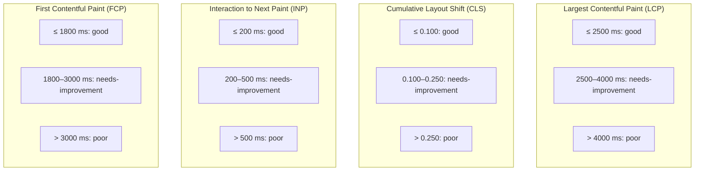
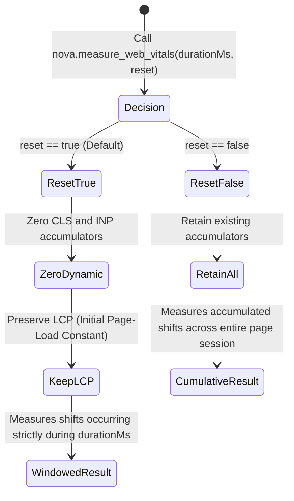
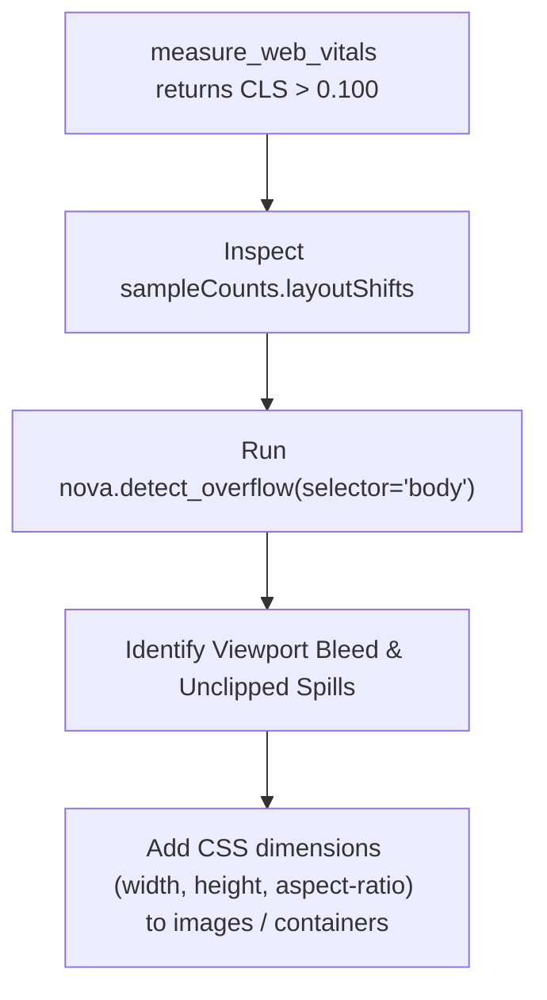
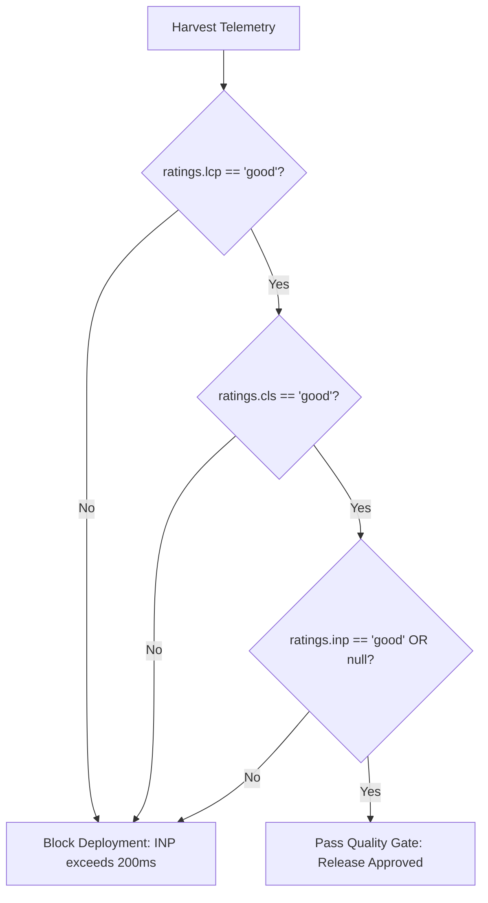

# Diagnostic Attribution & Core Web Vitals Quality Gates

This sub-guide details how Nova AI Workspace rates Core Web Vitals against official industry standards, explains the windowed vs. cumulative reset semantics, details layout shift attribution, and outlines automated quality gating patterns for autonomous AI agents.

---

## 1. Web Vitals Thresholds & Rating Engine

Nova evaluates captured performance metrics against official Google Web Vitals benchmarks, classifying each metric into three standardized rating tiers: `good`, `needs-improvement`, or `poor`.



### Threshold Classification Matrix

| Metric | Property | Rating: `good` | Rating: `needs-improvement` | Rating: `poor` | Architectural Impact |
| :--- | :--- | :---: | :---: | :---: | :--- |
| **LCP** | `metrics.lcpMs` | $\le 2500\text{ ms}$ | $2500\text{ ms} < \text{LCP} \le 4000\text{ ms}$ | $> 4000\text{ ms}$ | Measures perceived loading speed of hero content. Slow LCP triggers agent navigation timeouts. |
| **CLS** | `metrics.cls` | $\le 0.100$ | $0.100 < \text{CLS} \le 0.250$ | $> 0.250$ | Measures visual layout stability. Elevated CLS leads to accidental clicks on moving targets. |
| **INP** | `metrics.inpMs` | $\le 200\text{ ms}$ | $200\text{ ms} < \text{INP} \le 500\text{ ms}$ | $> 500\text{ ms}$ | Measures responsiveness to user input. High INP indicates main-thread blocking by JavaScript. |
| **FCP** | `metrics.fcpMs` | $\le 1800\text{ ms}$ | $1800\text{ ms} < \text{FCP} \le 3000\text{ ms}$ | $> 3000\text{ ms}$ | Measures time to initial DOM paint. Reflects network and critical CSS delivery performance. |

---

## 2. Windowed vs. Cumulative Reset Semantics

The `reset` parameter controls whether accumulators on `window.__novaWebVitals` are cleared prior to starting the measurement window:



### 1. Windowed Delta Measurement (`reset: true` - Default)
* Clears previously accumulated layout shift entries and interaction records.
* Allows agents to isolate the exact visual impact of a specific interaction (e.g. clicking a tab, expanding an accordion, or rendering a dynamic table).
* **The LCP Invariant:** LCP represents the arrival of primary page content during initial load. It is **never reset**, ensuring that subsequent calls still report the authoritative initial load paint time.

### 2. Cumulative Session Measurement (`reset: false`)
* Retains all accumulated entries.
* Useful for tracking the overall user experience across a continuous, multi-step agent interaction workflow.

---

## 3. Layout Shift Attribution & Debugging

When `ratings.cls` returns `needs-improvement` or `poor`, agents must diagnose which elements caused the visual shift:



1. **`sampleCounts.layoutShifts`:** Indicates how many discrete shift events contributed to the final score.
2. **Correlation with Layout Geometry:** Unstable layouts often stem from images without explicit `aspect-ratio` or `height` attributes, web fonts swapping asynchronously without size adjustments, or dynamic banners pushing main content down.
3. **Cross-Tool Investigation:** Use [`nova.detect_overflow`](../../../../mcp-reference/tools/layout-and-qa/nova-detect-overflow.md) to locate elements overflowing containers or bleeding past the viewport boundary.

---

## 4. Automated Agent Quality Gating Pattern

Autonomous AI agents operating in continuous integration (CI) or deployment verification pipelines can use Web Vitals as automated quality gates:

```json
// Example: Strict deployment verification gate
{
  "name": "nova.measure_web_vitals",
  "arguments": {
    "durationMs": 3000,
    "reset": true
  }
}
```



---

## 5. Related Documentation

* **[Real-User Core Web Vitals Hub](../README.md)** — Pillar overview and rating matrix.
* **[PerformanceObserver & Synthetic Instrumentation](../performance-observer-and-synthetic-instrumentation/README.md)** — Two-phase probe mechanics and execution architecture.
* **[Layout Geometry & Overflow Detection](../../layout-geometry-and-overflow/README.md)** — Physical container measurement.
* **[`nova.measure_web_vitals` Tool Reference](../../../../mcp-reference/tools/layout-and-qa/nova-measure-web-vitals.md)** — MCP parameter specification.
