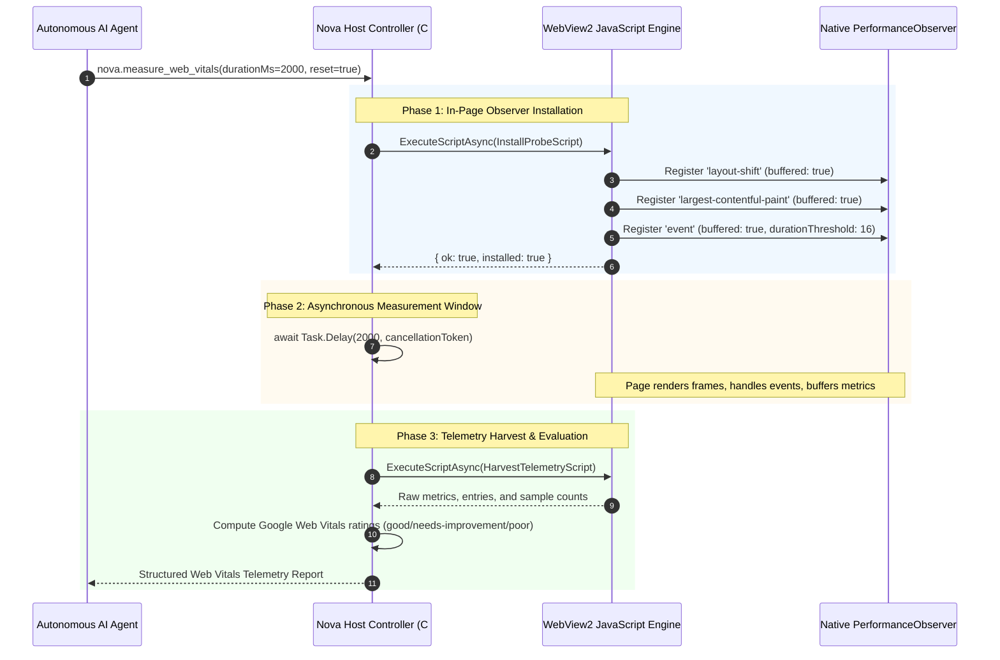
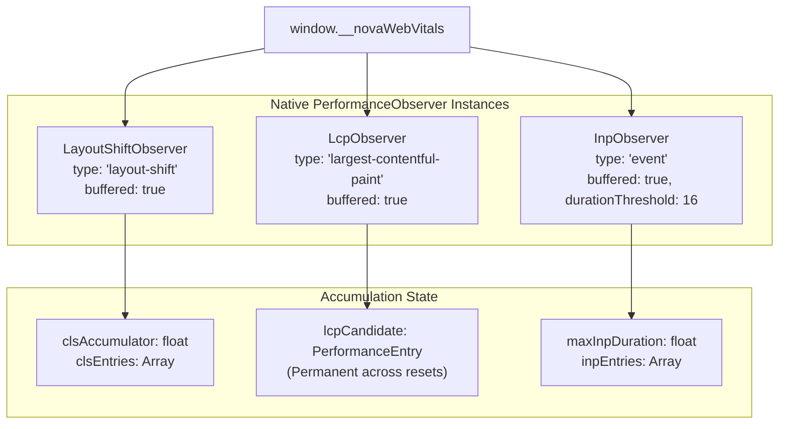
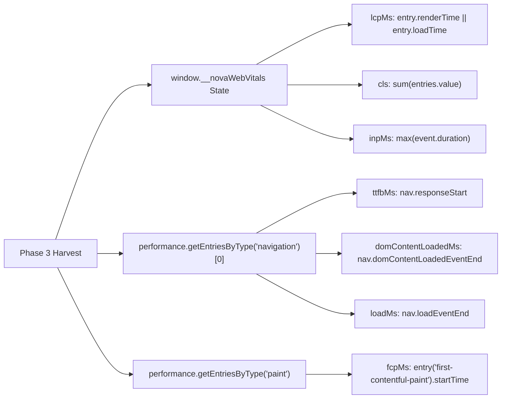

# PerformanceObserver & Two-Phase In-Engine Telemetry

This sub-guide details the execution architecture of Nova AI Workspace's Core Web Vitals measurement engine, explaining why standard script evaluation fails to capture asynchronous browser performance events, how the two-phase probe coordinates with native `PerformanceObserver` instances, and how buffered event aggregation prevents telemetry loss.

---

## 1. The WebView2 Evaluation Challenge

When automating performance measurements inside Microsoft WebView2 or Chromium-based browsers, agents encounter a fundamental runtime limitation:
* **`ExecuteScriptAsync` Executes Synchronously:** Calling `ExecuteScriptAsync` runs code synchronously on the JavaScript thread and returns immediately with the script's direct return value.
* **Script Engines Do Not Await Promises:** If an agent injects a script that returns a JavaScript `Promise` or registers an asynchronous event listener, `ExecuteScriptAsync` returns an empty object or string before the promise resolves or the listener triggers.
* **Layout Thrashing from Ad-Hoc Scripts:** Ad-hoc scripts polling the DOM or measuring reflows create artificial layout recalculations that distort the very metrics being measured.

Nova eliminates this complexity through a **coordinated two-phase host-and-client probe**:



---

## 2. Phase 1: In-Page Observer Installation (`window.__novaWebVitals`)

During Phase 1, Nova injects a non-destructive state coordinator attached to `window.__novaWebVitals`. This state coordinator persists across tool invocations during the lifetime of the document:



### Registered Observers & Options:
1. **`layout-shift` (`buffered: true`):**
   * Buffers layout shifts that occurred prior to tool invocation (such as shifts during initial HTML parsing).
   * Filters out shifts where `entry.hadRecentInput === true` (exempting intentional shifts triggered by user actions within a 500ms input window).
2. **`largest-contentful-paint` (`buffered: true`):**
   * Captures candidate elements as the page progressively renders large images or text blocks.
   * Records the final candidate before the user's first input event.
3. **`event` (`buffered: true, durationThreshold: 16`):**
   * Monitors user interaction latency (clicks, keypresses, pointer taps).
   * Only records interactions with a duration $\ge 16\text{ ms}$ (the duration of one $60\text{ fps}$ display frame), avoiding unneeded telemetry overhead for trivial interactions.

---

## 3. Phase 2: Asynchronous Host Delay Window

Once observers are installed, Nova executes a non-blocking asynchronous delay in C#:

```csharp
// Architectural host synchronization pattern
await Task.Delay(durationMs, cancellationToken);
```

### Critical Invariants of the Delay Window:
* **Zero UI Thread Blocking:** `Task.Delay` runs asynchronously on the .NET thread pool. The WinUI 3 application shell and WebView2 compositor remain completely responsive.
* **Natural Page Activity:** During the delay window, the browser processes CSS animations, network fetch responses, scheduled JavaScript timers, and user or agent inputs.
* **Controlled Observation Duration:** Callers specify `durationMs` (default: 2000ms, range: 0–10000ms). Setting `durationMs: 0` immediately harvests historical buffered metrics without waiting for dynamic events.

---

## 4. Phase 3: Telemetry Harvesting & Navigation Timing

When the delay window expires, Phase 3 executes a synchronous collection script that extracts metrics from `window.__novaWebVitals` and the standard W3C Navigation Timing Level 2 API:



### Metric Extraction Details:
* **Time to First Byte (TTFB):** Derived from `navigation.responseStart`, measuring backend server responsiveness and network latency.
* **First Contentful Paint (FCP):** Extracted from the `paint` performance entry, marking the moment when text or an image first appears.
* **DOM Content Loaded & Load:** Extracted from navigation timings to measure document parsing and sub-resource completion.

---

## 5. Related Documentation

* **[Real-User Core Web Vitals Hub](../README.md)** — Pillar overview and rating matrix.
* **[Diagnostic Attribution & Threshold Gates Sub-Guide](../diagnostic-attribution-and-threshold-gates/README.md)** — Good/poor rating boundaries, windowed reset semantics, and deployment gates.
* **[Layout Geometry & Overflow Detection](../../layout-geometry-and-overflow/README.md)** — Physical container measurement.
* **[`nova.measure_web_vitals` Tool Reference](../../../../mcp-reference/tools/layout-and-qa/nova-measure-web-vitals.md)** — MCP parameter specification.
