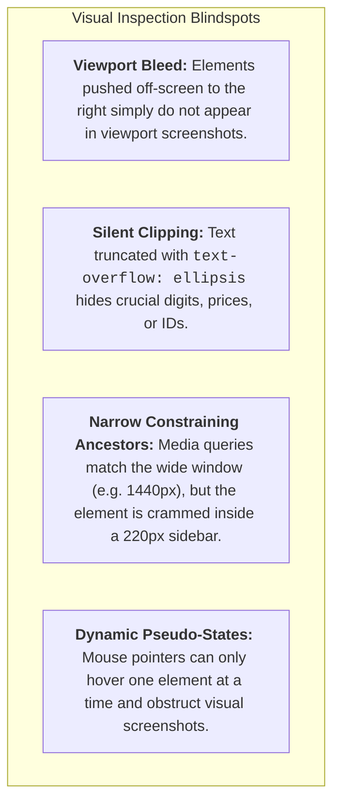
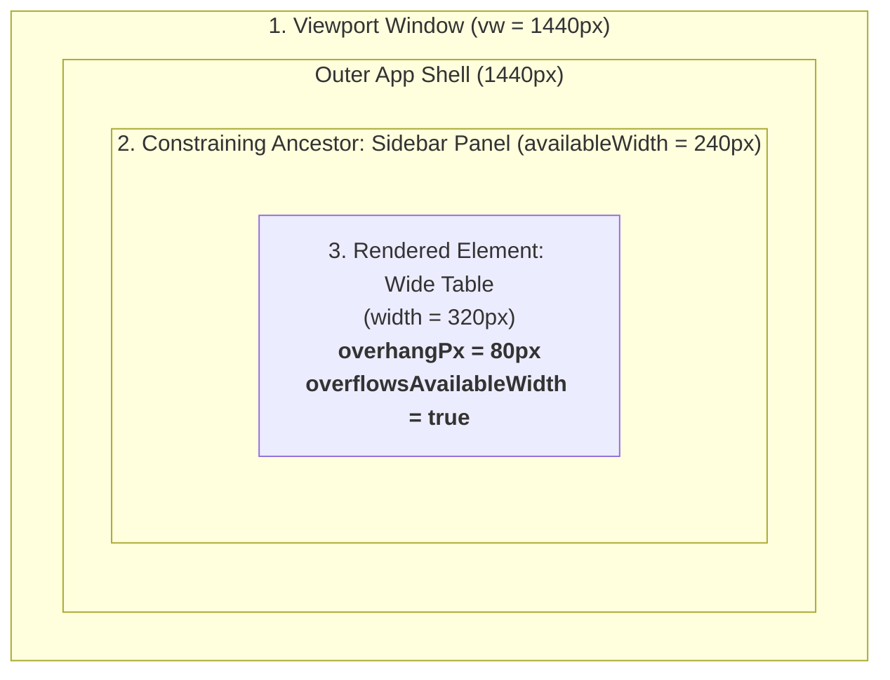
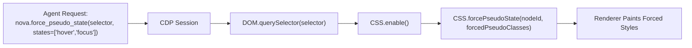
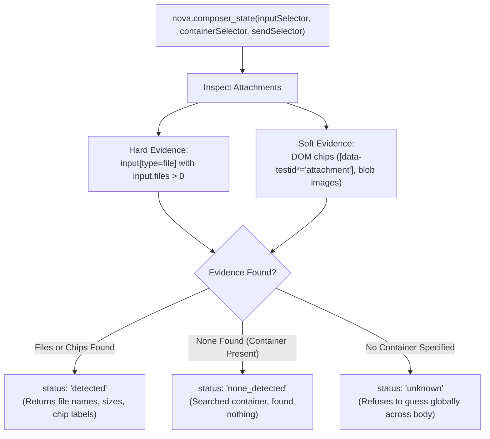

# Layout Geometry, Overflow Detection & Computed Styling

> **High-precision geometric inspection, container constraint analysis, text clipping detection, pure computed style extraction, and CDP pseudo-state simulation for autonomous agents.**

---

## 1. Overview: Why Screenshots Are Not Enough

Autonomous agents auditing user interfaces frequently rely on full-page screenshots. However, visual inspection alone fails in several critical layout failure modes:



Nova provides a suite of specialized geometric inspection tools that analyze the rendered layout tree directly:
* **`nova.detect_overflow`**: Scans the DOM for horizontal spills, silently clipped text, and viewport bleed.
* **`nova.measure_elements`**: Multi-selector geometric analysis comparing element width against its viewport and its nearest constraining ancestor.
* **`nova.get_computed_style`**: Authoritative CSS computed styles and box models without executing arbitrary JavaScript.
* **`nova.force_pseudo_state`**: CDP-level CSS pseudo-state forcing (`:hover`, `:focus`, `:active`) without mouse interference.
* **`nova.composer_state`**: Structured inspection of chat inputs, file attachments, and send controls.

---

## 2. Dedicated Architecture Sub-Guides

| Guide | Description | Primary Topics |
| :--- | :--- | :--- |
| **[Bounding Rectangles & Constraining Ancestors](bounding-client-rect-and-box-model-metrics/README.md)** | Multi-selector geometric analysis, Three Widths container constraints, passive measurement, and authoritative computed styles. | Three Widths, constraining ancestors, `nova.measure_elements`, `nova.get_computed_style` |
| **[Overflow Detection & Pseudo-State Inspection](overflow-detection-and-pseudo-state-inspection/README.md)** | Horizontal spillage, intentional vertical asymmetry rationale, viewport bleed, CDP pseudo-state simulation, and composer readiness. | `nova.detect_overflow`, vertical asymmetry, `CSS.forcePseudoState`, `nova.composer_state` |

---

## 3. Overflow & Layout Bug Detection (`nova.detect_overflow`)

The overflow detection engine inspects rendered DOM nodes (capped at 8,000 nodes for renderer safety) to identify structural clipping and boundary spillages.

```mermaid
flowchart TD
    El[Rendered Element] --> CheckX{scrollWidth > clientWidth + 1?}
    CheckX -- "Yes" --> CheckClipX{textOverflow == 'ellipsis' OR<br/>overflowX in ['hidden','clip']?}
    CheckClipX -- "Yes" --> FlagClipX["Issue: clipped-text (x-axis)"]
    CheckClipX -- "No" --> FlagOverX["Issue: overflow (x-axis)"]
    
    CheckX -- "No" --> CheckY{scrollHeight > clientHeight + 1 AND<br/>overflowY in ['hidden','clip']?}
    CheckY -- "Yes" --> FlagClipY["Issue: clipped-text (y-axis)<br/>(Content Silently Cut Off)"]
    CheckY -- "No" --> CheckBleed{position not in ['fixed','sticky'] AND<br/>rect.right > vw + 2 AND rect.left < vw?}
    CheckBleed -- "Yes" --> FlagBleed["Issue: viewport-bleed<br/>(Calculates overhangPx)"]
    CheckBleed -- "No" --> Next[Pass]
```

### The Deliberate Vertical Asymmetry Rationale
A key design principle of `nova.detect_overflow` is its **asymmetric handling of horizontal vs. vertical overflow**:
* **Horizontal Axis:** Web layouts are almost always designed to fit horizontally. Any unclipped horizontal overflow (`scrollWidth > clientWidth`) is considered a layout defect.
* **Vertical Axis:** Web pages naturally scroll vertically. Normal vertical overflow (`overflow-y: auto`, `scroll`, or `visible`) is intentional on the vast majority of containers. Flagging every vertically scrollable element would bury the agent in false positives.
* **The Exception:** Vertical overflow is **strictly flagged** if and only if `overflow-y` is set to `hidden` or `clip`. In this state, content is silently truncated and unreachable by scrolling, representing a severe UX bug.

### Viewport Bleed & Page Horizontal Scroll
* **`viewport-bleed`:** Identifies elements whose right edge extends beyond the viewport width (`rect.right > vw + 2`), excluding deliberately positioned `fixed` and `sticky` headers. Reports exact `overhangPx`.
* **`pageHorizontalScroll`:** Inspects `document.scrollingElement` to determine whether the document as a whole exhibits an unwanted horizontal scrollbar.

---

## 4. Multi-Selector Measurement & Constraining Ancestors (`nova.measure_elements`)

When diagnosing responsive bugs inside complex multi-column layouts, single-element bounding boxes fail to tell the whole story. An element might appear broken not because its own styling is faulty, but because a parent container restricts its available space.

`nova.measure_elements` measures up to 25 CSS selectors in a single round-trip and reports the **three widths** that define any layout defect:
1. **Window Width (`viewportWidth`):** The physical browser viewport dimension.
2. **Constraining Ancestor Width (`availableWidth`):** The width offered by the innermost ancestor narrower than the window.
3. **Element Width (`rect.width`):** The physical rendered width of the element itself.



### The Constraining Ancestor Algorithm
The probe walks upward through `parentElement` nodes. It ignores ancestors with `clientWidth === 0` (collapsed or hidden subtrees) and ancestors where `clientWidth >= vw` (full-width wrappers). The search stops at the **first narrower ancestor**, accurately identifying the layout bottleneck (such as a sidebar drawer, modal card, or grid cell).

### Key Geometric Telemetry
* **`usedWidthRatio`:** Ratio of element width to available container width ($\text{width} / \text{available}$).
* **`overflowsAvailableWidth`:** Boolean flag indicating whether the element exceeds its container boundary ($\text{width} > \text{available} + 1$).
* **`overhangPx`:** Exact pixel measurement of container spill.
* **`withinViewportX`:** Verifies whether the element's bounding rect is physically situated between $-1$ and $\text{vw} + 1$, detecting elements pushed entirely off the screen.

> [!NOTE]
> Unlike `nova.get_element_rect`, `nova.measure_elements` **deliberately does not scroll elements into view**. Scrolling changes page scroll offsets and invalidates relative positioning across sibling measurements.

---

## 5. Authoritative Computed Styling (`nova.get_computed_style`)

Extracting CSS properties via `page.evaluate("getComputedStyle(...)")` is verbose, error-prone, and exposes the agent to JavaScript evaluation security concerns.

`nova.get_computed_style` returns structured, type-safe styling data for any DOM element:
* **Box Geometry:** Rendered `width`, `height`, `x`, and `y` bounding box coordinates.
* **Typography:** `fontFamily`, `fontSize`, `fontWeight`, `fontStyle`, `lineHeight`, `letterSpacing`, `textAlign`, `textTransform`.
* **Colors:** Fully resolved `color` and `backgroundColor` strings.
* **Box Model:** `display`, `position`, `boxSizing`, borders, `borderRadius`, `overflow`, `zIndex`.
* **Visibility:** `opacity` and `visibility`.
* **Custom Properties (`properties` array):** Explicitly requests custom CSS variables (e.g. `["--primary-accent", "--sidebar-width"]`) or specialized CSS properties.

If the target selector does not exist in the DOM, the tool returns an explicit error `-32004`.

---

## 6. Deterministic Pseudo-State Forcing (`nova.force_pseudo_state`)

Testing responsive states like hover, focus, and active with a synthetic mouse pointer (`nova.input_move`) introduces significant limitations:

| Pointer Movement (`nova.input_move`) | Forced Pseudo-State (`nova.force_pseudo_state`) |
| :--- | :--- |
| Can only reach `:hover` and `:focus`. | Reaches `:hover`, `:focus`, `:active`, `:focus-visible`, `:focus-within`, `:visited`, `:target`. |
| Single-pointer limitation: can only hover **one** element at a time. | Multi-element forcing: hold entire toolbars or tables in `:hover` simultaneously. |
| Pointer hovers over the element, triggering tooltips and obstructing visual screenshots. | Pointer stays away, capturing clean, unobstructed UI state captures. |
| Operates via high-level OS/input event loops. | Operates directly via the Chrome DevTools Protocol (`CSS.forcePseudoState`). |



### Invariants & Non-Goals
* **No Event Dispatch:** A forced pseudo-class paints the styling; **it fires no JavaScript events**. A dropdown menu driven by a JavaScript `onmouseenter` listener will remain closed. For interactive event testing, use [`nova.input_move`](../../../mcp-reference/tools/browser-automation/nova-input-move.md).
* **Does Not Survive Re-render:** Forced states attach to the underlying DOM node ID. If a reactive framework (React, Vue, Svelte) unmounts and recreates the element, the forced state is discarded.
* **Persistence:** Forced states persist across tool calls on the same document until explicitly cleared (`states: []`) or cleared by page navigation.

---

## 7. Chat Composer State Inspection (`nova.composer_state`)

When an agent interacts with web-based chat interfaces (e.g. ChatGPT, Claude, internal LLM portals), determining whether a message or attachment is ready to send is non-trivial. Text in the input might be present, but has the file upload finished? Is the send button enabled?

`nova.composer_state` solves this with a specialized tri-state inspection model:



### Tri-State Attachment Classification
1. **`detected`**: Verified file inputs with loaded `files` or matched visual attachment chips.
2. **`none_detected`**: A valid `containerSelector` was searched and zero attachment indicators were found.
3. **`unknown`**: No `containerSelector` was provided. The engine refuses to scan the entire page globally, as doing so would falsely attribute unrelated page images as attachments.

### Send Button Readiness
Inspects the specified `sendSelector`:
* `ready`: Button is physically visible and neither HTML `disabled` nor `aria-disabled="true"`.
* `not_ready`: Button exists but is disabled or hidden.
* `unknown`: Send control does not exist in the DOM (common in interfaces where the send icon only appears once text is entered).

---

## 8. Practical Agent Recipes

### Recipe 1: Automated Layout Smoke Test
Run an immediate check after loading a page to verify responsive integrity:

```json
// nova.detect_overflow
{
  "selector": "body",
  "maxIssues": 50
}
```

Check `result.pageHorizontalScroll` and `result.summary.viewportBleed`. If any elements bleed past `vw`, inspect the reported `selector` and `overhangPx`.

### Recipe 2: Debugging a Crammed Control
When a button or form field wraps unexpectedly inside a layout:

```json
// nova.measure_elements
{
  "selectors": ["#main-content", ".sidebar-nav", ".sidebar-nav button.cta-btn"],
  "matchMode": "first"
}
```

Compare `widthContext.availableWidth` against `rect.width` to pinpoint which ancestor enforces the narrow boundary.

### Recipe 3: Clean Hover State Screenshot
Capture a button's hover styling without the mouse cursor in the image:

1. Force hover state:
   ```json
   // nova.force_pseudo_state
   { "selector": "button.submit-primary", "states": ["hover"] }
   ```
2. Capture screenshot:
   ```json
   // nova.capture_screenshot
   { "selector": "button.submit-primary" }
   ```
3. Clear forced state:
   ```json
   // nova.force_pseudo_state
   { "selector": "button.submit-primary", "states": [] }
   ```

---

## 9. Related Tools & Documentation

* **[Bounding Rectangles & Constraining Ancestors Sub-Guide](bounding-client-rect-and-box-model-metrics/README.md)** — Multi-selector geometric analysis, Three Widths container constraints, and computed styles.
* **[Overflow Detection & Pseudo-State Inspection Sub-Guide](overflow-detection-and-pseudo-state-inspection/README.md)** — Layout spillage, deliberate vertical asymmetry rationale, and CDP state forcing.
* **[`nova.detect_overflow` Tool Reference](../../../mcp-reference/tools/layout-and-qa/nova-detect-overflow.md)** — Overflow scanning tool reference.
* **[`nova.measure_elements` Tool Reference](../../../mcp-reference/tools/layout-and-qa/nova-measure-elements.md)** — Element measurement tool reference.
* **[`nova.get_computed_style` Tool Reference](../../../mcp-reference/tools/layout-and-qa/nova-get-computed-style.md)** — Computed style tool reference.
* **[`nova.force_pseudo_state` Tool Reference](../../../mcp-reference/tools/layout-and-qa/nova-force-pseudo-state.md)** — CDP pseudo-state tool reference.
* **[`nova.composer_state` Tool Reference](../../../mcp-reference/tools/layout-and-qa/nova-composer-state.md)** — Chat composer inspection tool reference.
* **[Automated Accessibility (a11y) Engine](../accessibility-audit/README.md)** — Contrast and target size auditing.
* **[Real-User Core Web Vitals](../core-web-vitals/README.md)** — Performance telemetry and rating gates.
