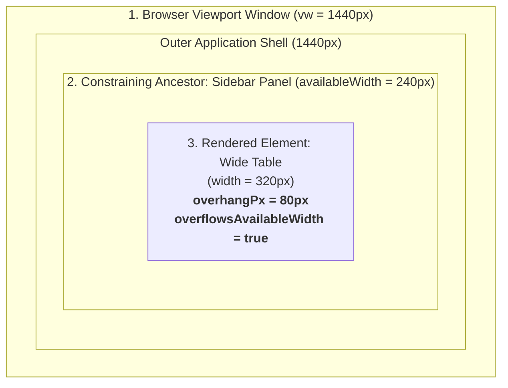
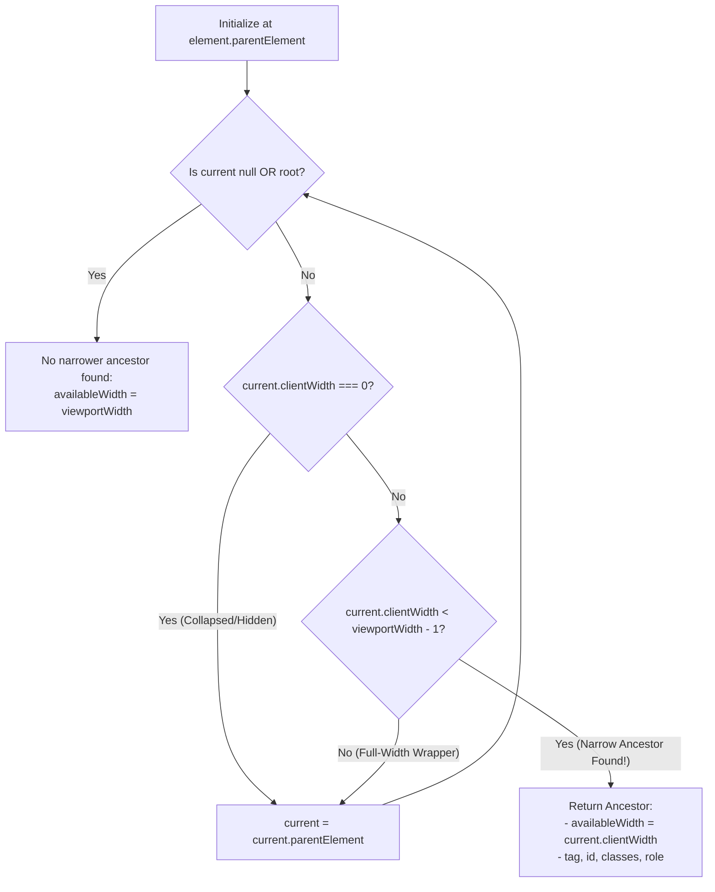

# Bounding Rectangles, Box Models & Constraining Ancestors

This sub-guide details Nova AI Workspace's multi-selector geometric analysis engine, the Three Widths container constraint algorithm, passive measurement invariants, and authoritative computed style extraction.

---

## 1. The Three Widths Architectural Model

When an agent diagnoses responsive bugs or component layout breakage, inspecting single-element bounding boxes in isolation frequently leads to incorrect conclusions. A button or table might be rendered at 320px inside an 800px window—yet it is wrapped inside a 240px sidebar drawer, resulting in severe 80px container overflow.

Nova's [`nova.measure_elements`](../../../../mcp-reference/tools/layout-and-qa/nova-measure-elements.md) evaluates the **Three Widths** that define any layout defect:



### The Three Widths:
1. **Viewport Width (`viewportWidth`):** The total physical pixel width of the browser viewport window.
2. **Constraining Ancestor Width (`availableWidth`):** The width provided by the innermost parent element that is narrower than the viewport window.
3. **Element Width (`rect.width`):** The physical rendered width of the target element.

---

## 2. The Constraining Ancestor Traversal Algorithm

To locate the true layout bottleneck without false positives from full-width container wrappers or hidden elements, Nova executes an upward DOM walk:



### Algorithm Invariants:
* **Collapsed Ancestors Skipped:** Elements with `clientWidth === 0` (such as collapsed accordions or display:none wrappers) are skipped to avoid reporting 0px available width.
* **Full-Width Containers Skipped:** Ancestors whose `clientWidth` equals or exceeds `viewportWidth` are ignored as unconstraining wrappers.
* **Innermost Narrow Ancestor Selected:** The search stops at the very first ancestor that is genuinely narrower than the window, accurately identifying the modal card, sidebar, grid column, or drawer that constrains the component.

---

## 3. Geometric Telemetry Metrics

For every matched element, Nova computes high-precision layout telemetry:

| Property | Formula | Description |
| :--- | :--- | :--- |
| `usedWidthRatio` | $\frac{\text{rect.width}}{\text{availableWidth}}$ | Ratio of element width to container width. Values $> 1.0$ indicate container spillage. |
| `overflowsAvailableWidth` | $\text{rect.width} > \text{availableWidth} + 1$ | Boolean flag indicating whether the element physically spills outside its parent container. |
| `overhangPx` | $\max(0, \text{rect.width} - \text{availableWidth})$ | Exact pixel measurement of container overflow. |
| `withinViewportX` | $\text{rect.left} \ge -1 \land \text{rect.right} \le \text{vw} + 1$ | Boolean flag indicating whether the element is physically situated within the horizontal screen viewport. |

### The Passive Measurement Invariant
A critical architectural guarantee of `nova.measure_elements` and `nova.detect_overflow` is that **they deliberately do not scroll elements into view**:
* Tools that invoke `scrollIntoView()` alter the page's `scrollLeft` and `scrollTop` offsets.
* In multi-selector queries, scrolling the first element would shift the bounding boxes of subsequent elements, destroying comparative spatial measurements.
* Nova measures bounding boxes in place, preserving true scroll coordinates across all sibling elements.

---

## 4. Authoritative Computed Style Extraction (`nova.get_computed_style`)

Extracting CSS properties via `page.evaluate("window.getComputedStyle(...)")` is hazardous: it risks syntax errors, triggers unmanaged layout reflows, and fails on complex CSS custom properties.

[`nova.get_computed_style`](../../../../mcp-reference/tools/layout-and-qa/nova-get-computed-style.md) provides a secure, structured read facade:

```json
// Example: Querying layout properties and custom theme variables
{
  "selector": ".dashboard-card",
  "properties": ["--card-border-radius", "--accent-color", "box-shadow"]
}
```

### Extracted Style Domains:
* **Typography:** `fontFamily`, `fontSize`, `fontWeight`, `fontStyle`, `lineHeight`, `letterSpacing`, `textAlign`, `textTransform`.
* **Colors:** Fully resolved RGB/RGBA strings for `color` and `backgroundColor`.
* **Box Model:** `display`, `position`, `boxSizing`, `padding`, `margin`, `border`, `borderRadius`, `overflow`, `zIndex`.
* **Dimensions:** Bounding box `width`, `height`, `x`, and `y` coordinates.
* **Custom Variables:** Dynamically resolves CSS variables passed in the optional `properties` array.

If the requested selector is absent from the DOM, Nova returns an explicit error `-32004`.

---

## 5. Related Documentation

* **[Layout Geometry & Overflow Detection Hub](../README.md)** — Pillar overview and recipe index.
* **[Overflow Detection & Pseudo-State Inspection Sub-Guide](../overflow-detection-and-pseudo-state-inspection/README.md)** — Asymmetric clipping detection, CDP pseudo-states, and composer inspection.
* **[Automated Accessibility (a11y) Engine](../../accessibility-audit/README.md)** — Interactive touch targets and contrast auditing.
* **[`nova.measure_elements` Tool Reference](../../../../mcp-reference/tools/layout-and-qa/nova-measure-elements.md)** — Multi-selector measurement parameters.
* **[`nova.get_computed_style` Tool Reference](../../../../mcp-reference/tools/layout-and-qa/nova-get-computed-style.md)** — Computed style parameters and return schema.
