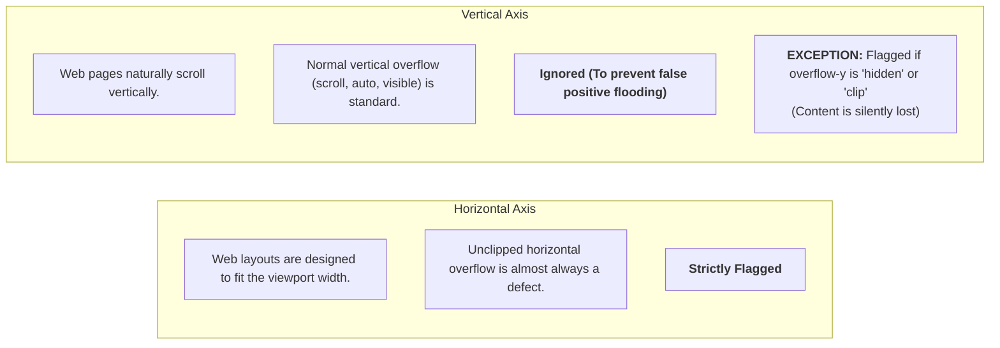
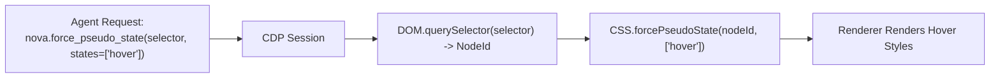

# Overflow Detection, CDP Pseudo-States & Composer State

This sub-guide details Nova AI Workspace's overflow and clipping detection engine, the intentional vertical asymmetry rationale, Chrome DevTools Protocol (CDP) pseudo-state simulation, and chat composer inspection.

---

## 1. Overflow & Clipping Detection Engine (`nova.detect_overflow`)

Web layouts break in subtle ways that visual screenshots cannot reliably reveal: text silently cut off by CSS rules, elements bleeding off-screen to the right, or unintentional horizontal page scrollbars.

[`nova.detect_overflow`](../../../../mcp-reference/tools/layout-and-qa/nova-detect-overflow.md) scans the DOM tree (capped at 8,000 nodes for renderer protection) to diagnose layout spillage:

```mermaid
flowchart TD
    El[Rendered Element] --> CheckX{scrollWidth > clientWidth + 1?}
    CheckX -- "Yes" --> CheckClipX{textOverflow == 'ellipsis' OR<br/>overflowX in ['hidden','clip']?}
    CheckClipX -- "Yes" --> FlagClipX["Issue: clipped-text (x-axis)"]
    CheckClipX -- "No" --> FlagOverX["Issue: overflow (x-axis)"]
    
    CheckX -- "No" --> CheckY{scrollHeight > clientHeight + 1 AND<br/>overflowY in ['hidden','clip']?}
    CheckY -- "Yes" --> FlagClipY["Issue: clipped-text (y-axis)<br/>(Content Silently Cut Off)"]
    CheckY -- "No" --> CheckBleed{position not in ['fixed','sticky'] AND<br/>rect.right > vw + 2 AND rect.left < vw?}
    CheckBleed -- "Yes" --> FlagBleed["Issue: viewport-bleed<br/>(Calculates overhangPx)"]
    CheckBleed -- "No" --> Next[Pass]
```

### Issue Taxonomy:
* **`clipped-text` (X-Axis):** Content exceeds the element width, but horizontal scrollbars are suppressed via `overflow-x: hidden`, `clip`, or `text-overflow: ellipsis`. Text or numbers are visually truncated.
* **`overflow` (X-Axis):** Content exceeds element width without clipping, causing unwanted internal horizontal scrollbars or container expansion.
* **`clipped-text` (Y-Axis):** Content exceeds element height while `overflow-y` is set to `hidden` or `clip`. Content is permanently inaccessible because users cannot scroll to reach it.
* **`viewport-bleed`:** Elements whose right boundary extends beyond the viewport window width (`rect.right > vw + 2`). Nova reports exact `overhangPx`.
* **`pageHorizontalScroll`:** Boolean flag reporting whether `document.scrollingElement` has an active horizontal scrollbar (`scrollWidth > clientWidth`).

---

## 2. The Deliberate Vertical Asymmetry Rationale

A foundational architectural design principle of `nova.detect_overflow` is its **asymmetric treatment of horizontal versus vertical overflow**:



### Why Normal Vertical Scrolling Is Not Flagged:
* **Standard Web Behavior:** Documents, long tables, feeds, and articles naturally have `scrollHeight > clientHeight`. Flagging every vertically scrollable element would bury the agent under thousands of false positives.
* **The Silent Clipping Exception:** When a container has `scrollHeight > clientHeight` but sets `overflow-y: hidden` or `clip`, content is physically truncated without a scrollbar. Because users have no way to access the truncated content, Nova strictly flags this as a `clipped-text` (y-axis) violation.

---

## 3. CDP-Level Pseudo-State Forcing (`nova.force_pseudo_state`)

Testing hover, focus, and active styling via synthetic mouse movements (`nova.input_move`) presents significant limitations for automated verification:

| Capability | Pointer Movement (`nova.input_move`) | Forced Pseudo-State (`nova.force_pseudo_state`) |
| :--- | :--- | :--- |
| **Supported States** | `:hover`, `:focus` only | `:hover`, `:focus`, `:active`, `:focus-visible`, `:focus-within`, `:visited`, `:target` |
| **Concurrency** | Single element (one pointer) | Multi-element (entire navigation bars or rows held simultaneously) |
| **Visual Cleanliness** | Pointer cursor hovers over target, triggering tooltips and obscuring screenshots | Cursor remains outside target, capturing clean, unobstructed UI captures |
| **Mechanism** | OS input simulation event loop | Chrome DevTools Protocol (`CSS.forcePseudoState`) |



### Critical Architectural Invariants:
1. **Style Painting Only (No Event Dispatch):** `force_pseudo_state` activates CSS pseudo-class styling rules directly within the rendering engine; **it does not fire JavaScript mouse or keyboard events**. A flyout dropdown driven by a JavaScript `onmouseenter` listener will remain closed. For event-driven interactions, use [`nova.input_move`](../../../../mcp-reference/tools/browser-automation/nova-input-move.md) or [`nova.click_selector`](../../../../mcp-reference/tools/browser-automation/nova-click-selector.md).
2. **Persistence Until Cleared:** Forced states persist across tool invocations on the active document until explicitly cleared (by passing `states: []`) or until the tab navigates to a new URL.
3. **Re-Render Lifecycle:** Forced states bind to the underlying CDP `NodeId`. If a reactive framework (React, Vue) completely unmounts and recreates the DOM node, the forced state is discarded.

---

## 4. Chat Composer State Inspection (`nova.composer_state`)

When autonomous agents automate interactions with conversational AI portals or customer support widgets, determining whether an input is ready to submit is complex: text might be typed, but is the file upload complete? Is the send button enabled?

[`nova.composer_state`](../../../../mcp-reference/tools/layout-and-qa/nova-composer-state.md) provides specialized tri-state inspection:

```mermaid
graph TD
    Call["nova.composer_state(inputSelector, containerSelector, sendSelector)"]
    Inspect["Inspect Composer Elements"]

    Inspect --> Text["Text Content & Character Count"]
    Inspect --> Attach["Attachment Inspection"]
    Inspect --> Send["Send Button Readiness"]

    Attach --> Hard["Hard Evidence: input[type=file] with files > 0"]
    Attach --> Soft["Soft Evidence: DOM chips ([data-testid*='attachment'], preview blobs)"]

    Hard & Soft --> AttStatus{"Evidence Found?"}
    AttStatus -->|Yes| S1["status: 'detected'<br/>(Reports filenames, sizes, labels)"]
    AttStatus -->|No (Container Searched)| S2["status: 'none_detected'"]
    AttStatus -->|No Container Specified| S3["status: 'unknown'<br/>(Refuses to scan global body)"]

    Send --> BtnStatus{"Button Evaluation"}
    BtnStatus -->|Visible & Not Disabled| B1["status: 'ready'"]
    BtnStatus -->|Disabled or Hidden| B2["status: 'not_ready'"]
    BtnStatus -->|Selector Not Found| B3["status: 'unknown'"]
```

### Tri-State Attachment Safety:
* **`detected`:** Verified file inputs with loaded `files` or matched visual attachment chips.
* **`none_detected`:** A valid `containerSelector` was searched and zero attachment indicators were found.
* **`unknown`:** No `containerSelector` was provided. The tool refuses to scan the entire page globally, preventing false positives from unrelated site logos or profile pictures.

---

## 5. Related Documentation

* **[Layout Geometry & Overflow Detection Hub](../README.md)** — Pillar overview and recipe index.
* **[Bounding Rectangles & Constraining Ancestors Sub-Guide](../bounding-client-rect-and-box-model-metrics/README.md)** — Three Widths model and computed styles.
* **[Automated Accessibility (a11y) Engine](../../accessibility-audit/README.md)** — Touch targets and contrast auditing.
* **[`nova.detect_overflow` Tool Reference](../../../../mcp-reference/tools/layout-and-qa/nova-detect-overflow.md)** — Parameter specification for overflow scanning.
* **[`nova.force_pseudo_state` Tool Reference](../../../../mcp-reference/tools/layout-and-qa/nova-force-pseudo-state.md)** — CDP pseudo-state forcing reference.
* **[`nova.composer_state` Tool Reference](../../../../mcp-reference/tools/layout-and-qa/nova-composer-state.md)** — Chat composer inspection reference.
