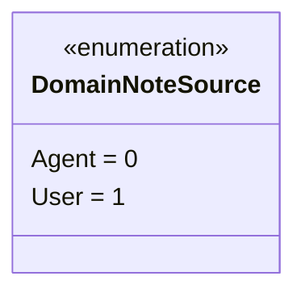
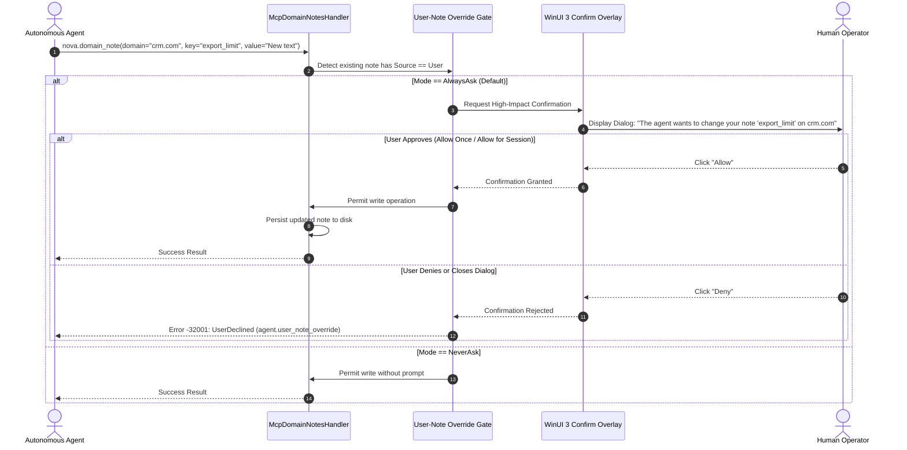
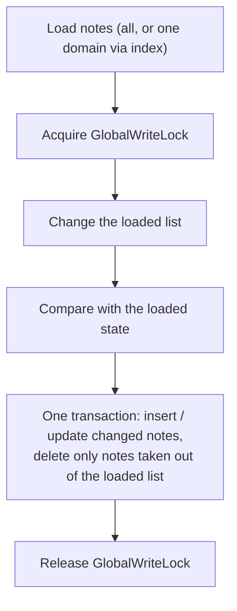
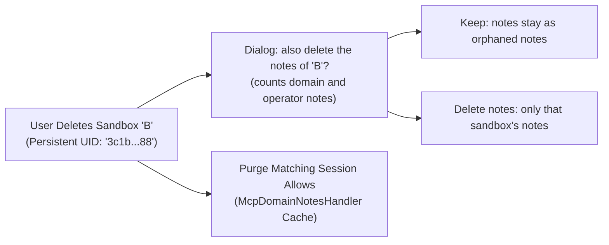

# Authorship, Override Permissions & Storage Architecture

> [!NOTE]
> This guide details the authority model, security gates, persistence layer, and lifecycle management of Domain Notes in Nova AI Workspace: human vs agent authorship, the User-Note Override Permission Gate, the local notes database, key validation rules, capacity limits, and what happens to notes when a sandbox is deleted.

---

## 1. The Dual Authorship Model

Domain Notes strictly distinguish between two sources of operational knowledge to maintain human control over browser automation:



| Source Property | Origin Channel | Operational Nature | Mutation Authority & Safeguards |
| :--- | :--- | :--- | :--- |
| **`User` (Human Directives)** | Authored via Nova's **Site Information** panel or **Settings → Site Notes**. | **Definitive UX intent.** High-stakes instructions, legal requirements, or personal boundaries (e.g. *„Never submit payment without asking“*). | **Protected.** Autonomous agents cannot modify, re-enforce, or delete user notes without explicit human permission via the `agent.user_note_override` gate. |
| **`Agent` (Heuristic Memory)** | Authored programmatically via the [`nova.domain_note`](../../../mcp-reference/tools/task-memory/nova-domain-note.md) MCP tool. | **Empirical observations.** Selector hints, layout quirks, or authentication patterns (e.g. *„The search bar is inside an iframe“*). | **Adaptive.** Autonomous agents can freely update, refine, re-enforce, or delete agent notes as websites evolve. |

---

### Core Authorship Invariants

1. **Source Spoofing Prohibition:** All notes written or updated through the MCP tool handler (`nova.domain_note`) are enforced as `Source = Agent`. An agent cannot mark its own notes as written by the user.
2. **Backward Compatibility Guarantee:** Notes authored before the introduction of the source field are automatically initialized as `Source = Agent` upon load, matching historical behavior.
3. **Store Choke-Point Repeat Protection:** Even if an agent attempts an upsert on an existing user note without changing its text, the persistence store choke-point **strictly forbids agents from modifying `repeatMinutes` or `repeatToolCalls` on user-authored notes**. Only human operators using the graphical interface may tune repeat thresholds for user directives.

---

## 2. The User-Note Override Permission Gate

When an autonomous agent attempts to modify the text, change the enforcement level, or delete a note whose source is `User`, Nova intercepts execution via the **User-Note Override Permission Gate** (`agent.user_note_override`):



### Confirmation Modes

Managed under **Settings → AI & agents → Access & rules → Site notes → Agent override permission**:

* **`AlwaysAsk` (Default):** Every individual attempt by an agent to mutate or delete a user note halts execution and presents an interactive WinUI 3 dialog to the operator.
* **`OncePerSession`:** Prompts the user on the first override attempt. If approved, the allowance is cached for the duration of the Nova application session for that specific note and action.
* **`NeverAsk`:** Overrides proceed immediately without user prompts (primarily used in automated CI/CD and regression testing environments).

---

### Session Allowance Cache Architecture

In `OncePerSession` mode, approved overrides are stored in an in-memory cache bounded to **512 entries** (`MaxUserNoteOverrideSessionAllows`):

$$\text{Cache Key Format: } \texttt{usernote\_override:\{scopeKey\}:\{domain\}:\{key\}:\{action\}:\{noteId\}:\{updatedTicks\}}$$

Where:
* `scopeKey`: `"global"` or `"sandbox:{persistentUid}"` (prevents allowances granted on Sandbox A from bleeding into Sandbox B or global notes).
* `action`: `"update"`, `"enforcement"`, or `"delete"`.
* `noteId`: The immutable GUID of the target note.
* `updatedTicks`: The note's `UpdatedUtc.Ticks` timestamp.

> [!IMPORTANT]
> **Automatic Invalidation via Timestamp Ticks:** Because `updatedTicks` is baked into the cache key, any subsequent edit to the note immediately changes its timestamp ticks, instantly invalidating the cached approval.

---

### Stale-State Detection (-32003)

If a user edits or deletes a site note in the browser UI while an agent's override confirmation dialog is open on screen, the underlying state changes. 

When the confirmation resolves, Nova verifies that `latest.UpdatedUtc == authorizedUserNoteUpdateStamp`. If the timestamps mismatch, Nova cancels the write and returns:

```json
{
  "code": -32003,
  "message": "Your site note \"export_limit\" changed while the agent override was pending. Retry so the permission check can use the current note.",
  "data": {
    "gateId": "agent.user_note_override",
    "reasonCode": "stale_user_note_state",
    "action": "update",
    "domain": "crm.com",
    "key": "export_limit"
  }
}
```

---

### Delete Confirmation, Multi-User-Note Protection & Ambiguity Handling

Domain notes are learned knowledge. Since 1.0.0-alpha.19, every `nova.domain_note_delete` shows the user a Nova dialog with the note before anything is removed, for agent notes as well as user notes, and Nova never remembers the answer. Declining returns `-32036` and the note stays; without a confirmation UI (for example an unattended run) the call fails with `-32033`. Agents should update a wrong note with `nova.domain_note` instead of deleting it.

1. **Individual Confirmations on Multi-Delete:** When an agent attempts a broad delete across multiple user notes (e.g. `scope="all"` matching both global and sandboxed user notes), Nova enforces separate confirmations for **each user note in the target set**. A single cached session allow cannot silently delete multiple user notes.
2. **Ambiguous Target Detection (-32602):** If both a global note and a sandbox-scoped note share the same `domain` and `key`, a bare delete call without an explicit `scope` or `sandboxId` will be rejected with `ambiguous_note_target`, returning candidate metadata so the agent can specify the exact target.
3. **Destructive Action Asymmetry:** In contrast to read paths (which combine global and sandbox notes), a delete call specifying `sandboxId` **deletes ONLY the sandbox-bound note**, preserving the global twin.

---

## 3. Storage Architecture & Persistence Pipeline

Since 1.0.0-alpha.19, Domain Notes live in a local SQLite database together with operator notes and connector extras:

$$\text{Path: } \%LOCALAPPDATA\%\backslash\text{NovaBrowser}\backslash\text{notes.db}$$



### Write and Read Behavior

1. **Thread Synchronization:** All load-mutate-save cycles synchronize on a process-wide lock (`DomainNotesStore.GlobalWriteLock`).
2. **Differential Saves:** A save writes only what changed since the list was loaded, inside one database transaction. A note is deleted only when the caller removed it from a list it had loaded. A save that did not start from a loaded list never deletes anything, so a failed read can no longer wipe the store.
3. **Per-Domain Reads:** Hot paths such as `nova.perceive` and the site-note gate read only the notes of the current domain (with parent-domain fallback) through an index instead of the whole store.
4. **Damage Handling:** A database that fails its integrity check, including one that becomes unreadable while Nova runs, is moved aside as `notes.corrupt.<time>.db` and rebuilt; the moved file stays on disk for recovery.

### One-Time Import of the Earlier JSON File

Versions up to 1.0.0-alpha.18 stored Domain Notes in `domain-notes.json`. On the first start of a version with `notes.db`, Nova imports that file once, together with the earlier operator-note and connector files. The old files are left unchanged as a frozen fallback; an unreadable old file is logged and does not stop the import of the others.

---

### Backward-Compatibility Wire Migrations

When importing an older `domain-notes.json`, Nova applies these one-time migrations:
1. **Stable GUID Assignment:** Legacy notes authored before the introduction of note IDs receive a stable GUID during the import (duplicate IDs are replaced the same way). This ensures that per-tab acknowledgment caches remain stable across app restarts.
2. **Punycode Domain Key Migration:** Stored domain keys containing Unicode characters (e.g. `münchen.de`) are converted to ASCII wire form (`xn--mnchen-3ya.de`), ensuring future lookups align with WebView2 host reporting.

---

## 4. Key Validation & Strict Capacity Limits

To keep input well-formed, Nova validates every note. Notes are never removed automatically; the store only refuses new notes beyond very high limits:

```mermaid
mindmap
  root((Capacity &<br/>Validation Limits))
    Keys & Values
      Key: Max 50 Chars
      Key Regex: ^[a-zA-Z0-9_\- ]+$
      Value: Max 100,000 Chars
    Store Capacities
      Max 1,000,000 Domains
      Max 1,000 Notes per Domain
      Never Pruned
```

### String Guards & Validation Rules

* **Key Length:** Maximum **50 characters**.
* **Key Character Pattern:** Strictly validated against the regular expression `^[a-zA-Z0-9_\- ]+$` (alphanumeric characters, hyphens, underscores, and spaces). Leading and trailing whitespace is trimmed.
* **Value Length:** Generous upper limit of **100,000 characters**. This allows power users to embed complete, system-prompt-grade runbooks and multi-step protocols into a single `Block` directive.
* **Domain Validation:** Hostnames must contain a period, cannot contain ports, protocols, spaces, or consecutive dots, and must be under standard hostname length limits.

---

### No Automatic Deletion

Domain notes are distilled knowledge, not raw logs, so Nova never prunes them by age, use or count. Earlier versions removed notes after 180 days and kept at most 20 notes per domain and 50 domains; since 1.0.0-alpha.19 that pruning is gone. When a limit (1,000,000 domains, 1,000 notes per domain) is reached, a new note is refused with an error and existing notes stay untouched.

---

## 5. Sandbox Deletion and Its Notes

Since 1.0.0-alpha.19, deleting a sandbox never deletes notes on its own:



1. **Notes Are Kept by Default:** Notes bound to the deleted sandbox remain as orphaned notes. Agents do not see them; the user can review, reassign or delete them in Settings.
2. **Explicit Choice:** If the sandbox has notes, a follow-up dialog shows how many domain and operator notes it has. Only the choice to delete them removes exactly the notes bound to that sandbox (`SandboxUid == persistentUid`); global notes and notes of other sandboxes are never touched.
3. **Session Allowance Purge (`PurgeSandboxScopedAllowsForUid`):** Cleanses all cached Once-Per-Session approvals matching `:sandbox:{persistentUid}:` from memory.
4. **Identity Safety:** If a user subsequently creates a new sandbox that happens to receive the reused letter handle `"B"`, it will not inherit ghost permissions or the orphaned notes of the deleted sandbox.

---

## Related Documentation

* **[Domain Notes Overview](README.md)** — Architectural hub, knowledge taxonomy, and tool suite.
* **[Delivery Levels & AAG Enforcement](delivery-levels-and-aag-enforcement.md)** — Three delivery tiers, dual-mode ack protocol, and bulk-acknowledgment.
* **[Scoping, Normalization & Repeat Policies](scoping-normalization-and-repeat-policies.md)** — Canonical host normalization, eTLD+1 resolution, and repeat intervals.
* **[Agent Awareness Gates (AAG)](../../agent-awareness-gates-aag/README.md)** — Runtime gate interception, tab leases, and safety guardrails.
