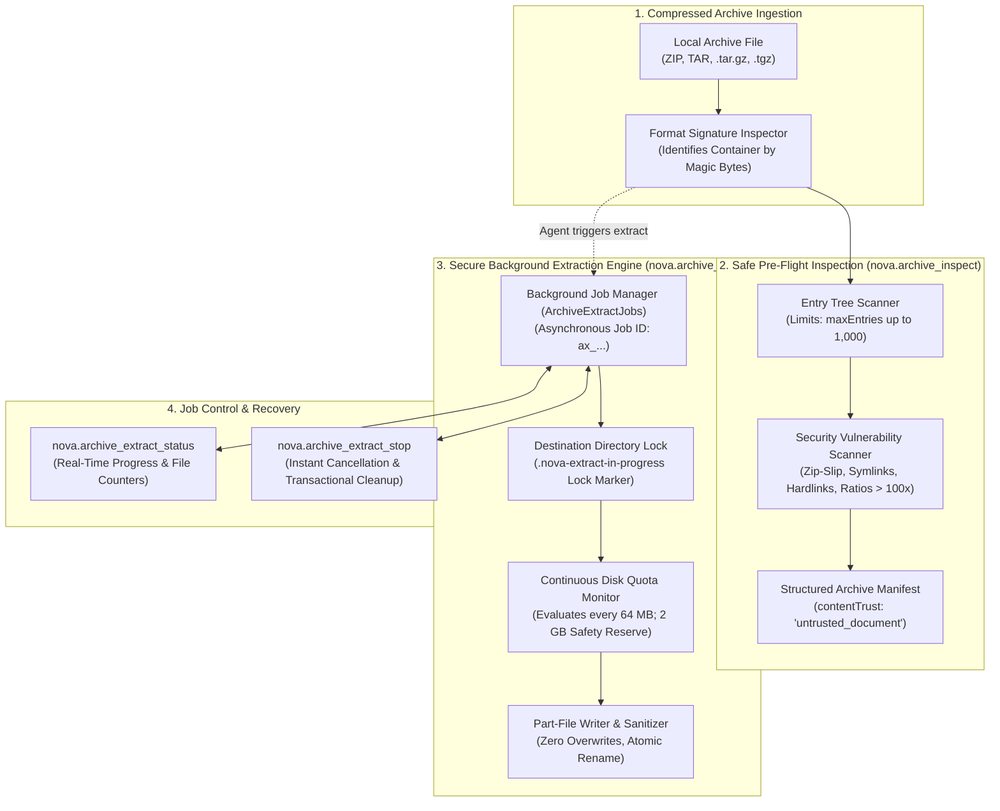

# Archive Inspection & Secure Extraction Architecture

Nova includes a native archive inspection and secure extraction engine for local ZIP, TAR, and gzip-compressed TAR (`.tar.gz`, `.tgz`) archives. It allows autonomous AI agents to explore compressed directory structures, audit archives for security risks, and extract multi-gigabyte files in the background without installing 7-Zip, WinRAR, or external command-line utilities.

> [!NOTE]
> **Upcoming.** Native archive operations arrive with 1.0.0-alpha.21, which is not published yet. Installed versions up to 1.0.0-alpha.20 do not have them.



---

## 1. Safe Pre-Flight Archive Inspection (`nova.archive_inspect`)

Compressed archives are a common delivery vector for path traversal attacks, compression bombs, and malicious link manipulations. An agent should never extract an archive blindly.

`nova.archive_inspect` provides a zero-extraction audit:
* **Container Detection:** Identifies ZIP, TAR, and `.tar.gz` by content magic bytes, ensuring renamed archives are handled correctly.
* **Entry Manifest:** Returns path hierarchies, uncompressed byte sizes, compressed byte sizes, compression ratios, and directory markers up to `maxEntries` (default $100$, up to $1{,}000$).
* **Vulnerability Warnings (`problem` & `warnings`):**
  * `unsafe_paths`: Detects entries containing path traversal markers (`../` or `..\`) designed to escape destination directories.
  * `symlinks` & `hardlinks`: Flags symbolic links and hard links that could target sensitive host files.
  * `special_files`: Detects device nodes, named pipes, and socket entries.
  * `suspicious_ratio`: Flags entries expanding $> 100\times$, indicating potential decompression bombs (zip bombs).
  * `encrypted_entries`: Identifies password-protected entries.

---

## 2. Secure Asynchronous Extraction (`nova.archive_extract`)

Extracting large server backups or dataset dumps takes time. Nova executes extractions as asynchronous background jobs:

### The Background Worker (`ArchiveExtractJobs`)
* Every extraction job receives a unique tracking ID (`ax_` followed by $24$ hexadecimal characters).
* The MCP invocation waits up to `wait` seconds (default $60$, up to $540$). Short jobs complete synchronously inline; long extractions return immediately with `state: "running"`, allowing the agent to poll status via `nova.archive_extract_status` or abort via `nova.archive_extract_stop`.

### Filesystem Sandboxing & Clean Destination Enclave
* **Default Destination:** Without an explicit `destinationDir`, Nova creates a clean, timestamped directory under `StoragePaths.ExportsDir/Archives/<ArchiveName>-<Timestamp>`.
* **The Empty Destination Guard (`destination_not_empty`):** If an agent specifies a custom `destinationDir`, the directory **must be completely empty or newly created**. Nova strictly refuses to extract into directories with existing files, preventing accidental file overwrites.
* **The Progress Lock Marker:** During active extraction, Nova writes a marker file `.nova-extract-in-progress` into the destination root. If Nova is interrupted mid-extraction, this marker alerts subsequent operations that the folder is incomplete.

### Continuous Disk Space Quota Monitoring
To protect host operating systems from disk exhaustion crashes:
* Before writing a single byte, Nova queries available drive space on the target volume.
* During extraction, Nova re-evaluates free disk space **every $64$ megabytes** of written data.
* If free drive space drops below **$2\text{ GB}$**, extraction halts immediately with error `insufficient_space`.
* Agents can additionally set a strict boundary via `maxTotalBytes`.

### Transactional Rollback & Cleanup
If an extraction fails, hits a size limit, or is stopped via `nova.archive_extract_stop`:
1. The background worker halts disk writes immediately.
2. Nova deletes all extracted files and subdirectories created during the run.
3. If Nova created the destination folder, it removes the folder entirely, leaving no residual half-extracted files behind.

---

## 3. Workflows & Examples

### Auditing and Extracting a Project Backup

```json
{
  "name": "nova_archive_inspect",
  "arguments": {
    "path": "C:\\Users\\Operator\\Downloads\\release_assets.zip"
  }
}
```

```json
{
  "name": "nova_archive_extract",
  "arguments": {
    "path": "C:\\Users\\Operator\\Downloads\\release_assets.zip",
    "wait": 30
  }
}
```

---

## Tool Reference Matrix

| Tool | Capability Bundle | Primary Role | Key Parameters |
| :--- | :--- | :--- | :--- |
| [`nova.archive_inspect`](../../../mcp-reference/tools/files-and-documents/nova-archive-inspect.md) | `page_read_debug` | Non-extracting entry inspection, compression ratio analysis, and vulnerability audit | `path`, `maxEntries?` |
| [`nova.archive_extract`](../../../mcp-reference/tools/files-and-documents/nova-archive-extract.md) | `page_read_debug` | Secure background extraction with disk quota enforcement and Zip-Slip protection | `path`, `destinationDir?`, `entries?`, `maxTotalBytes?`, `wait?` |
| [`nova.archive_extract_status`](../../../mcp-reference/tools/files-and-documents/nova-archive-extract-status.md) | `page_read_debug` | Polling progress and file counts of an active background extraction job | `jobId`, `wait?` |
| [`nova.archive_extract_stop`](../../../mcp-reference/tools/files-and-documents/nova-archive-extract-stop.md) | `page_read_debug` | Instant extraction cancellation with automatic transactional disk rollback | `jobId` |

---

[Media Intelligence overview](../README.md) · [Document Conversion](../document-conversion/README.md) · [Local Image Processing](../image-processing/README.md) · [All core features](../../README.md)
