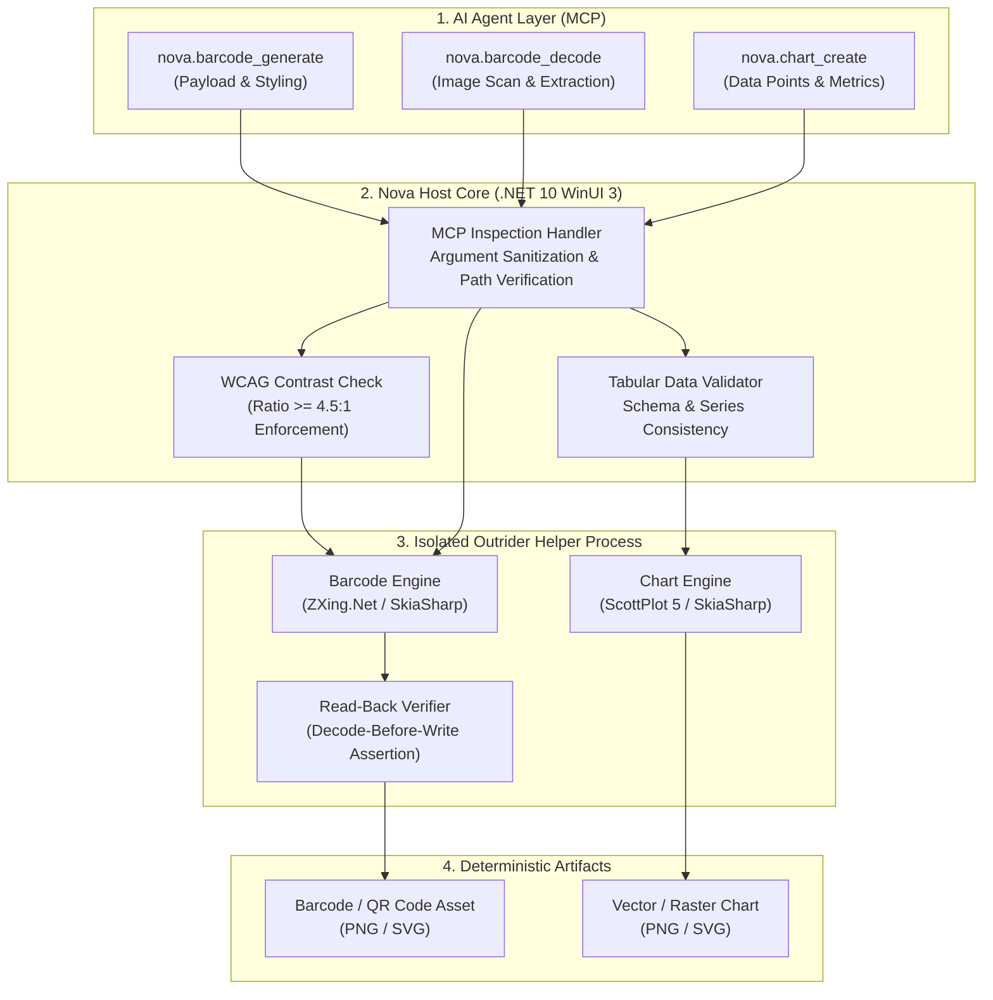
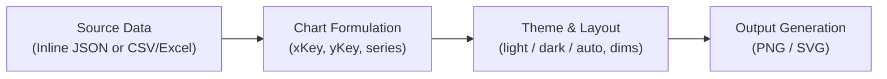

# Barcode, QR Code & Data Chart Synthesis Architecture

> [!NOTE]
> Nova provides high-precision on-device generation and decoding of 1D and 2D barcodes, alongside deterministic programmatic rendering of data charts. It allows AI agents to synthesize scannable codes, decode visual badges, and transform tabular records into clean vector and raster visualizations without third-party cloud APIs or external Python dependencies.

All barcode rendering, decoding verification, and chart visualization execute locally within Nova's native Outrider helper process, ensuring hardware crash isolation and strict data privacy.

---

## 1. High-Level Architecture & Process Topology

The Barcode and Chart subsystem connects MCP agent requests, strict parameter validation in the host, and isolated execution in the native helper process:

---

## 2. Barcode & QR Code Intelligence

### A. Supported Formats & Capabilities
Nova supports standard 1D linear barcodes and 2D matrix symbologies:
* **2D Matrix Codes:**
  * `qr` — Standard Quick Response code with configurable error correction (`L`, `M`, `Q`, `H`), structured payloads (URLs, WiFi, vCards), and aesthetic styling.
* **1D Linear Barcodes:**
  * `code128` — High-density alphanumeric barcode widely used in logistics and inventory.
  * `ean13` / `ean8` — Standard European Article Number barcodes for retail products.
  * `upca` — Universal Product Code for North American retail items.

### B. Aesthetic Customization & WCAG Contrast Verification
QR codes can be tailored for brand presentation while guaranteeing scannability:
* **Dot Modules & Finder Patterns:** Options include `classic` square blocks, `rounded` corners, and `dots`.
* **Gradients:** Multi-tone foreground transitions (`diagonal`, `horizontal`, `vertical`, `radial`).
* **Contrast Governance:** Nova calculates the relative luminance between `foreground` and `background` colors. In compliance with accessibility and machine vision standards, generation requires a contrast ratio of at least `4.5:1` to prevent unreadable codes.
* **Typographic Captions:** Human-readable labels can be rendered above or below the code (`captionPosition: "above" | "below"`) with configurable sizing, fonts, and casing (`asWritten`, `upper`, `lower`).

### C. The "Read-Back Before Write" Invariant
To eliminate malformed code artifacts caused by extreme dot styling or low-contrast gradients:
1. The Outrider helper renders the barcode in memory.
2. Before committing any bytes to disk, the built-in barcode decoder immediately attempts to read back the generated raster image.
3. If the decoder fails to extract the exact original payload, the operation halts with an actionable error (`barcode.readback_failed`), preventing unreadable assets from reaching production.

### D. Secure Decoding (`nova.barcode_decode`)
* **Passive Data Handling:** Decoded barcode content is strictly returned as passive string data. Nova never automatically navigates to decoded URLs or executes decoded strings.
* **Multi-Format Extraction:** Agents can decode multiple barcodes in a single image (`multiple: true`) or filter by specific symbologies (`formats: ["qr", "ean13"]`).

---

## 3. Data Chart & Visualization Synthesis

### A. Core Chart Types
The `nova.chart_create` tool generates presentation-grade data visualizations directly from structured records:
* **Comparative & Categorical:** `bar` (horizontal bars) and `column` (vertical columns).
* **Trends & Time Series:** `line` (continuous lines) and `area` (filled area charts).
* **Correlation:** `scatter` (XY point clusters).
* **Proportions & Compositions:** `pie` (classic circular slices) and `donut` (modern ring representation).

### B. Flexible Data Ingestion
Charts can be populated via two primary methods:
1. **Inline JSON Array (`data`):** An array of row objects directly supplied in the MCP call.
2. **File Reference (`sourcePath`):** Reading directly from local data files (`.csv`, `.tsv`, `.xlsx`, `.json`), optionally targeting specific spreadsheet tabs via the `sheet` parameter.

### C. Multi-Series & Theming
* **Multi-Series Plotting:** Agents can specify multiple numeric columns via `series: ["revenue", "expenses"]` to generate grouped column charts or multi-line graphs.
* **Themes & Dimensions:** Built-in themes include `light`, `dark`, and `auto` (adapting to system appearance). Dimensions range from compact thumbnail embeds (200x150 px) to 4K presentations (4000x4000 px).
* **Output Formats:** Supports both lossless raster images (`format: "png"`) and scalable vector graphics (`format: "svg"`).

---

## 4. Tool Catalog & Capabilities

| MCP Tool | Capability & Responsibility | Primary Parameters |
| :--- | :--- | :--- |
| [`nova.barcode_generate`](../../../mcp-reference/tools/files-and-documents/nova-barcode-generate.md) | Generates verified 1D/2D barcodes with contrast enforcement and styling. | `content`, `type`, `format`, `style`, `foreground`, `background`, `caption`, `outputPath` |
| [`nova.barcode_decode`](../../../mcp-reference/tools/files-and-documents/nova-barcode-decode.md) | Reads and extracts payload strings from local images containing barcodes. | `path`, `multiple`, `formats` |
| [`nova.chart_create`](../../../mcp-reference/tools/files-and-documents/nova-chart-create.md) | Synthesizes presentation-grade charts from structured JSON or tabular data files. | `type`, `data`, `sourcePath`, `xKey`, `yKey`, `series`, `theme`, `format`, `outputPath` |

---

## 5. Security & Isolation Invariants

1. **Outrider Fault Isolation:** All image generation, font rasterization, and barcode parsing run inside the isolated `NovaBrowser.Outrider.exe` helper process. A segmentation fault or out-of-memory condition in underlying graphic libraries cannot compromise the browser shell.
2. **Zero In-Memory Image Injection:** Chart and barcode outputs are saved directly to permitted local disk paths. Nova never pushes megabytes of raw base64 image data directly into the agent's LLM context window.
3. **No Unsolicited Network Access:** Barcode decoding and chart rendering are 100% offline. No telemetry, image hashes, or chart contents are transmitted to external servers.
