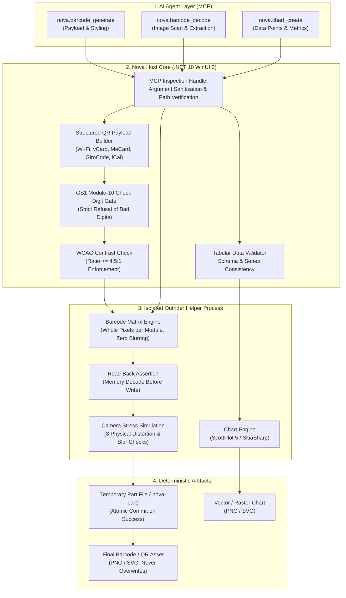
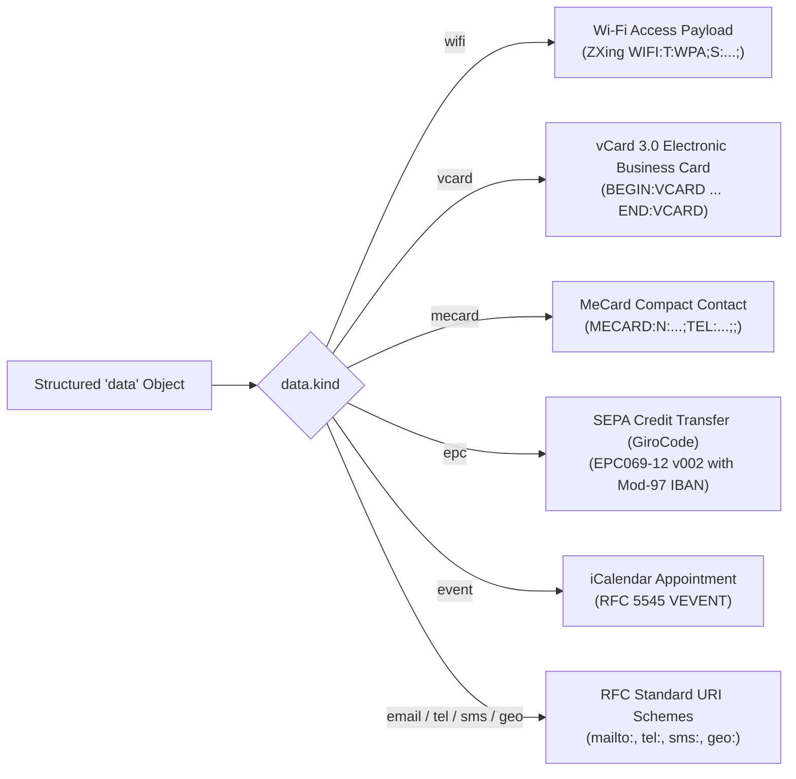
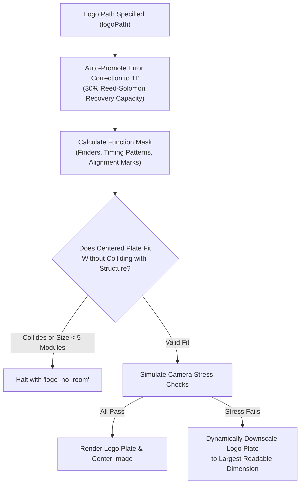
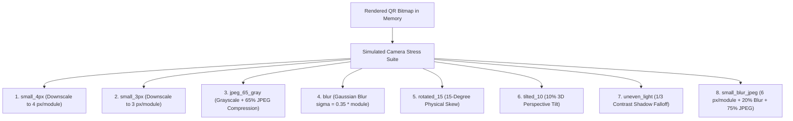
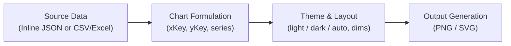

# Barcode, QR Code & Data Chart Synthesis Architecture

> [!NOTE]
> Nova provides high-precision on-device generation and decoding of 1D linear and 2D matrix barcodes, alongside deterministic programmatic rendering of data charts. It allows AI agents to synthesize scannable codes, decode visual badges, and transform tabular records into clean vector and raster visualizations without third-party cloud APIs, external Python dependencies, or licensing overhead.

All barcode rendering, decoding verification, and chart visualization execute locally within Nova's native Outrider helper process (`NovaBrowser.Outrider.exe`), ensuring hardware crash isolation, zero context-window bloat, and strict data privacy.

---

## 1. High-Level Architecture & Process Topology

The Barcode and Chart subsystem connects MCP agent requests, strict parameter validation in the host, and isolated execution in the native helper process:



---

## 2. Barcode & QR Code Intelligence

### A. Supported Formats & Symbologies
Nova enforces strict separation between generation capabilities and comprehensive decoding coverage:

#### 1. Generation Symbologies (`nova.barcode_generate`)
* **2D Matrix Codes:**
  * `qr` — Standard Quick Response code with configurable error correction (`L`, `M`, `Q`, `H`), aesthetic dot styling, gradient transitions, custom corner finders, embedded logos, and 9 high-level structured payload types.
* **1D Linear Retail & Logistics Barcodes:**
  * `code128` — High-density alphanumeric barcode supporting 1 to 80 printable ASCII characters (characters 32 to 126).
  * `ean13` — 13-digit European Article Number for global retail packaging.
  * `ean8` — 8-digit compact European Article Number for small retail items.
  * `upca` — 12-digit Universal Product Code standard across North American retail.

#### 2. Decoding Symbologies (`nova.barcode_decode`)
When decoding images from parcel labels, screenshots, or invoices, Nova's reading engine supports **12 distinct symbologies**:
* `qr` (Quick Response)
* `code128` (Logistics Alphanumeric)
* `ean13` & `ean8` (Retail EAN)
* `upca` & `upce` (North American Retail UPC)
* `code39` & `code93` (Industrial Alphanumeric)
* `itf` (Interleaved 2 of 5, high-density shipping cartons)
* `codabar` (Libraries, blood banks, air waybills)
* `datamatrix` (Small parts, medical devices)
* `pdf417` (Transport boarding passes, postal marks)
* `aztec` (Railway tickets, transit boarding)

---

### B. The GS1 Modulo-10 Check Digit Integrity Invariant
Retail barcodes (`ean13`, `ean8`, `upca`) rely on a mandatory check digit calculated via the GS1 Modulo-10 algorithm. 

#### Why Nova Refuses Bad Check Digits
In automated retail workflows, quietly "repairing" an invalid check digit is dangerous: an altered digit labels the wrong physical product or creates phantom inventory discrepancies. Nova enforces strict check digit integrity:
1. **Omitted Check Digit:** If an agent supplies the core digits without the check digit (7 digits for EAN-8, 11 digits for UPC-A, 12 digits for EAN-13), Nova automatically calculates the correct Modulo-10 check digit, appends it, and returns an informational notice in `warnings`.
2. **Incorrect Check Digit:** If an agent supplies the full number and the final digit does not match the computed Modulo-10 value, Nova **strictly halts with `invalid_check_digit`** and states the exact expected digit in the error message.

```
GS1 Modulo-10 Calculation:
1. Moving right-to-left from the digit preceding the check position, alternate weights 3 and 1.
2. Sum the weighted products: Sum = Σ (Digit_i × Weight_i).
3. Check Digit = (10 - (Sum mod 10)) mod 10.
```

---

### C. High-Level Structured Data Payloads (`data.kind`)
Instead of forcing agents to manually assemble string payloads (where subtle formatting or character escaping bugs cause mobile scanning apps to misinterpret data), `nova.barcode_generate` provides a dedicated `data` object that builds perfectly compliant payloads across 9 formats:



| `data.kind` | Required Fields | Optional Fields | Notes & Validation Standards |
| :--- | :--- | :--- | :--- |
| `wifi` | `ssid` | `password`, `security` (`wpa`, `wep`, `nopass`), `hidden` | Generates standard `WIFI:T:WPA;S:...;P:...;;`. In response objects, `encodedContentHidden` masks the Wi-Fi password to prevent credential leakage in chat logs. |
| `vcard` | `name` | `firstName`, `lastName`, `organization`, `title`, `phone`, `mobile`, `email`, `url`, `address`, `note` | vCard 3.0 standard. Escapes backslashes, semicolons, commas, and line breaks. Automatically extracts family and given names if omitted. |
| `mecard` | `name` | `firstName`, `lastName`, `organization`, `phone`, `mobile`, `email`, `url`, `address`, `note` | NTT DoCoMo MeCard format. Uses ~50% fewer characters than vCard, yielding fewer and larger module blocks for superior scanning on small business cards. |
| `epc` | `name`, `iban` | `bic`, `amount`, `reference`, `text` | SEPA GiroCode (EPC069-12 v002). **Strict ISO 13616 Modulo-97 IBAN validation** prevents failed bank transfers. Amount is clamped to €999,999,999.99 with max 2 decimal places. Fixed to Error Correction `M`. |
| `email` | `to` | `subject`, `body` | Generates standard `mailto:` URI with escaped subject and body strings. |
| `tel` | `number` | — | Generates `tel:` URI. Drops invalid formatting characters while verifying international dial prefixes. |
| `sms` | `number` | `body` | Generates `sms:` URI with URI-encoded text message payload. |
| `geo` | `latitude`, `longitude` | — | Generates `geo:` URI with decimal coordinate degrees (latitude $\pm 90^\circ$, longitude $\pm 180^\circ$). |
| `event` | `title`, `start` | `end`, `location`, `description` | iCalendar `VEVENT` (RFC 5545). Supports all-day events (`2026-10-20`), local floating times (`2026-10-20T09:30`), and fixed UTC instants (`Z` or `+02:00`). |

---

### D. Aesthetic QR Styling & WCAG Contrast Governance
Nova enables brand-aligned visual styling without sacrificing standard machine readability:

#### 1. Data Module Styling
* `style: "classic"` — Solid square pixel blocks (maximum scannability).
* `style: "rounded"` — Soft rounded module corners.
* `style: "dots"` — Discrete circular module dots.

> [!IMPORTANT]
> **Preserved Structure Patterns:** Regardless of whether `rounded` or `dots` is selected, Nova **always renders all structural patterns as solid square modules**:
> * The three $7 \times 7$ finder patterns at the corners.
> * The timing patterns along row 6 and column 6.
> * All alignment patterns ($5 \times 5$ blocks throughout higher-version symbols).
> * The format and version information bit bands.
> 
> Preserving rigid structure patterns ensures mobile phone edge-detection algorithms locate the code instantly before decoding stylized data modules.

#### 2. Mathematical WCAG Contrast Enforcement
Every color combination is verified before rendering:
* **Dark Modules on Light Background:** Nova computes sRGB relative luminance ($L = 0.2126R + 0.7152G + 0.0722B$). Codes with lighter modules on a dark background fail validation with `inverted_colors` because standard mobile camera apps rely on dark-on-light reflectance.
* **Minimum Contrast Ratio:** In accordance with ISO scannability and WCAG 2.x standards, Nova requires a contrast ratio of at least **`4.5:1`** between all modules and the background. If contrast falls below this threshold, generation halts with `contrast_too_low`.
* **Multi-Color Gradients:** When using `gradientTo` with `gradientDirection` (`diagonal`, `horizontal`, `vertical`, `radial`), Nova samples 4 intermediate blended steps along the gradient path. The weakest step must still satisfy the $\ge 4.5:1$ ratio.
* **Custom Finder Colors:** Corner finder patterns can be styled with an independent color via `finderColor`, which is individually contrast-checked against the background.

---

### E. Branded Logo Embedding & Function Mask Protection
A corporate logo (PNG or JPEG) can be embedded directly into the center of a QR code via `logoPath`:



1. **Automatic Error Correction Promotion:** Embedding a logo occludes data modules. Nova automatically promotes the QR code's error correction level to **Level `H`** (recovering up to 30% damaged or occluded codewords). Specifying any lower level (`L`, `M`, `Q`) alongside a logo is rejected with `logo_needs_ecc_h`.
2. **Width Share Boundary:** A logo plate (the logo image plus its quiet background border) is strictly clamped to at most **28% of the symbol width** (approximately 8% of the total symbol area), safely within Level H recovery capacity.
3. **Structure Collision Avoidance:** The logo area must be at least 5 modules wide and cannot touch any structural modules. Because QR Version 7 and higher symbols place an alignment pattern in the exact center of the matrix, codes with high character counts reject center logos with `logo_no_room` unless the payload is shortened.
4. **GiroCode Invariant:** SEPA GiroCodes (`data.kind: "epc"`) strictly forbid logos under EPC guidelines (which mandate Error Correction Level M); passing a logo to a GiroCode throws `logo_not_allowed`.

---

### F. Typographic Captions & Physical Print Sizing

#### 1. Human-Readable Captions
Agents can attach an integrated call-to-action (e.g. "Scan for Guest Wi-Fi" or "Pay Invoice") directly to the generated code asset:
* **Position & Casing:** Positioned above or below the code (`captionPosition: "below" | "above"`), with culture-invariant casing modes (`captionCase: "asWritten" | "upper" | "lower"`).
* **Font Family Verification:** Agents can specify any system font via `captionFont` (e.g. `"Bahnschrift"`, `"Segoe UI"`, `"Georgia"`). If a requested font is not installed on the Windows host, Nova falls back to `"Segoe UI"` and returns a descriptive notice in `warnings`.
* **Auto-Shrink Layout Protection:** If caption text exceeds the image width, Nova automatically scales down the font size so that the label fits cleanly within 92% of the symbol width without clipping, reporting `captionShrunk: true` in the internal layout audit.

#### 2. Physical Print Width Sizing (`printWidthMm`)
When designing codes for physical packaging, business cards, or print posters, agents can specify the intended print size via `printWidthMm`:
* **Module Millimeter Floor:** Nova calculates the physical size of individual modules:
  $$\text{Module Size (mm)} = \frac{\text{printWidthMm}}{\text{modules} + 2 \times \text{quietZone}}$$
* If an individual module falls below **`0.25 mm`**, generation is rejected with `print_module_too_small` because phone cameras cannot resolve modules smaller than a quarter of a millimeter.
* If a module falls between `0.25 mm` and `0.35 mm`, Nova generates the file but returns a warning advising that $\ge 0.35\text{ mm}$ is recommended for reliable handheld scanning.

---

### G. The "Read-Back Before Write" Invariant & Two-Phase Commit
To guarantee that corrupted, illegible, or overly stylized codes never reach production storage:

1. **In-Memory Rasterization:** The Outrider process renders the matrix and applies styling, captions, and logos entirely in memory.
2. **Decode-Before-Write Assertion:** Before a single byte is written to disk, Nova's built-in decoder executes a strict read-back against the memory bitmap (`ReadStrict`). If the decoder fails to extract the exact original content, the entire operation is aborted with `scan_validation_failed` or `write_failed`.
3. **Two-Phase Part-File Commit:** Outputs are initially rendered to a temporary `.nova-part` staging file. Only after the read-back assertion succeeds is the file atomically moved to its destination path.
4. **No-Overwrite Protection:** If an explicit `outputPath` points to an existing file, Nova immediately halts with `barcode_generate.output_exists`. Existing files are never overwritten.

---

### H. Simulated Camera Stress Testing & Quality Ratings
Beyond basic decode-before-write verification, every stylized QR code undergoes an automated **8-stage camera stress test** simulating real-world scanning conditions:



#### Quality Classification:
* **`robust`:** All 8 simulated camera stress checks passed (8/8). The code is exceptionally resilient to printing artifacts, low-end camera sensors, and poor lighting.
* **`verified`:** At most 2 stress checks failed (6/8 or 7/8). The code scans reliably under standard conditions but has slightly reduced tolerance for extreme tilt or dim light.
* **`experimental`:** More than 2 checks failed. Nova issues a warning recommending testing with a physical smartphone before printing, using `style: "classic"`, or increasing contrast.

---

### I. Secure Decoding & Untrusted Document Handling (`nova.barcode_decode`)
When reading barcodes from foreign files or scanned documents, Nova enforces strict security boundaries:

1. **Passive Data Model:** Decoded strings are returned strictly as passive string data. Nova **never automatically opens, navigates to, or executes decoded URLs or commands**.
2. **Untrusted Document Tagging:** Responses are flagged with `contentTrust: "untrusted_document"` to remind connected AI agents that barcode contents originate from external physical media and should be audited before following any links.
3. **High-Resolution Pre-Processing:** Nova converts images to 8-bit grayscale (`Gray8`), enables automatic rotation correction (`AutoRotate`), tests inverted reflectance (`TryInverted` for white-on-black badges), and activates heuristic recovery (`TryHarder`).
4. **Actionable Diagnostics:** If no readable code is found, Nova returns structured guidance suggesting cropping tightly around the code via `nova.image_transform(crop=...)` or increasing image resolution.

---

## 3. Data Chart & Visualization Synthesis

### A. Core Chart Types
The `nova.chart_create` tool generates presentation-grade data visualizations directly from structured records:
* **Comparative & Categorical:** `bar` (horizontal bars) and `column` (vertical columns).
* **Trends & Time Series:** `line` (continuous lines) and `area` (filled area charts).
* **Correlation:** `scatter` (XY point clusters).
* **Proportions & Compositions:** `pie` (classic circular slices) and `donut` (modern ring representation).



### B. Flexible Data Ingestion
Charts can be populated via two primary methods:
1. **Inline JSON Array (`data`):** An array of row objects directly supplied in the MCP call.
2. **File Reference (`sourcePath`):** Reading directly from local data files (`.csv`, `.tsv`, `.xlsx`, `.json`), optionally targeting specific spreadsheet tabs via the `sheet` parameter.

### C. Multi-Series & Theming
* **Multi-Series Plotting:** Agents can specify multiple numeric columns via `series: ["revenue", "expenses"]` to generate grouped column charts or multi-line graphs.
* **Themes & Dimensions:** Built-in themes include `light`, `dark`, and `auto` (adapting to system appearance). Dimensions range from compact thumbnail embeds (200x150 px) to 4K presentations (4000x4000 px).
* **Output Formats:** Supports both lossless raster images (`format: "png"`) and scalable vector graphics (`format: "svg"`).

---

## 4. MCP Tool Catalog & Parameter Reference

| MCP Tool | Capability Bundle | Primary Role | Key Parameters |
| :--- | :--- | :--- | :--- |
| [`nova.barcode_generate`](../../../mcp-reference/tools/files-and-documents/nova-barcode-generate.md) | `page_read_debug` | Generates verified, styled 1D/2D barcodes with WCAG contrast enforcement and camera stress testing. | `content`, `data`, `type`, `format`, `style`, `foreground`, `background`, `gradientTo`, `finderColor`, `logoPath`, `caption`, `printWidthMm`, `outputPath` |
| [`nova.barcode_decode`](../../../mcp-reference/tools/files-and-documents/nova-barcode-decode.md) | `page_read_debug` | Reads and extracts payload strings from local images across 12 symbologies. | `path`, `multiple`, `formats` |
| [`nova.chart_create`](../../../mcp-reference/tools/files-and-documents/nova-chart-create.md) | `page_read_debug` | Synthesizes presentation-grade charts from structured JSON or tabular data files. | `type`, `data`, `sourcePath`, `xKey`, `yKey`, `series`, `theme`, `format`, `outputPath` |

---

## 5. Security & Isolation Invariants

1. **Outrider Fault Isolation:** All image generation, font rasterization, and barcode parsing run inside the isolated `NovaBrowser.Outrider.exe` helper process. A segmentation fault, heap exhaustion, or crash in underlying graphic libraries cannot compromise the browser shell.
2. **Zero Base64 Memory Injection:** Barcode and chart outputs are saved directly to permitted local disk paths. Nova never pushes megabytes of raw image data directly into the agent's LLM context window.
3. **Password Masking Invariant:** Wi-Fi passwords generated via `data.kind: "wifi"` are omitted from response objects and logs (`encodedContentHidden: "contains the network password"`).
4. **Offline Local Execution:** Barcode generation, barcode reading, and chart rendering are 100% offline. No telemetry, image hashes, or chart contents are ever transmitted to external cloud servers.
