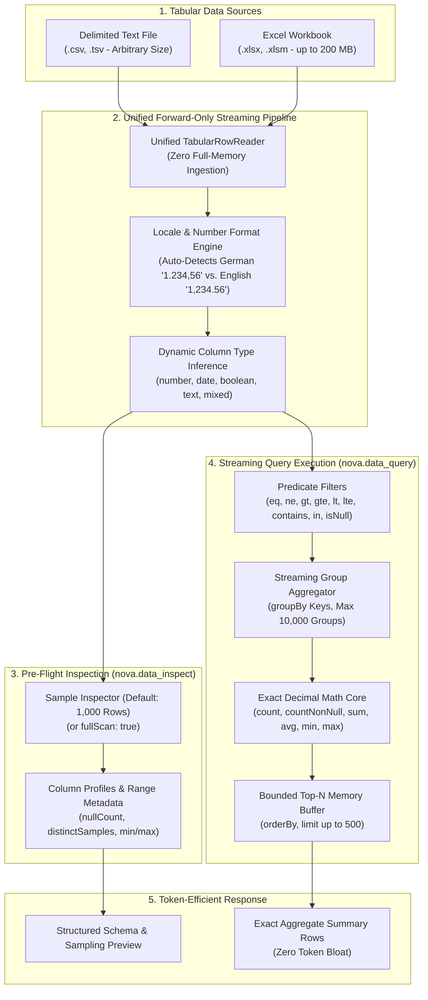

# Tabular Data Analysis & Streaming Query Architecture

Nova provides a high-performance, streaming data analysis subsystem for CSV, TSV, and Microsoft Excel (`.xlsx`, `.xlsm`) spreadsheets. It enables autonomous AI agents to inspect schema structures, infer column data types, filter records, compute grouping aggregates, and calculate exact financial totals locally without loading massive files into RAM or relying on external database services.

> [!NOTE]
> **Upcoming.** Native tabular data analysis tools arrive with 1.0.0-alpha.21, which is not published yet. Installed versions up to 1.0.0-alpha.20 do not have them.



---

## 1. The Pre-Flight Data Inspector (`nova.data_inspect`)

When asked to analyze a multi-gigabyte CSV export or a complex multi-sheet corporate workbook, an agent must never blindly read the entire document into its LLM context window.

`nova.data_inspect` provides a fast pre-flight scan:
* **Header & Column Discovery:** Detects headers on the first non-empty line; automatically deduplicates or repairs empty column labels.
* **Type Inference:** Analyzes the first $1{,}000$ rows (customizable via `sampleRows` or `fullScan: true`) and assigns typed classifications: `number`, `date`, `boolean`, `text`, or `mixed`.
* **Value Ranges:** Computes min/max bounds and null ratios without loading the file into memory.

### Dual Locale & Number Format Intelligence

Real-world financial spreadsheets frequently mix European and Anglo-American notation:
* English format: `1,234,567.89` (comma thousands, dot decimal)
* German/European format: `1.234.567,89` (dot thousands, comma decimal)

Nova's parser automatically resolves ambiguous numeric representations:
1. Examines values containing distinct decimal markers.
2. Correlates delimiters: semicolon-separated CSVs default to German decimal notation; comma-separated files default to English notation.
3. Every column output reports `numberFormatBasis` (`"german"`, `"english"`, or `"standard"`), alerting agents if an assumption was made.

---

## 2. In-Memory Streaming Query Engine (`nova.data_query`)

Rather than forcing an agent to write Python scripts or spin up an external SQLite instance, `nova.data_query` executes expressive relational queries directly over the streaming tabular row reader:

### Predicate Filters (`filters`)
Supports combined conditional assertions across columns:
* Comparison: `eq`, `ne`, `gt`, `gte`, `lt`, `lte`
* Pattern & Inclusion: `contains` (case-insensitive substring match), `in` (set membership)
* Nullability: `isNull`, `isNotNull`

### Aggregation & Exact Decimal Precision (`metrics`)
Large language models notoriously make arithmetic errors when summing long columns of floating-point numbers. Nova's query engine runs calculations locally in compiled C# using **exact 128-bit IEEE `decimal` arithmetic**:
* Supported metrics: `count`, `countNonNull`, `sum`, `avg`, `min`, `max`.
* Rounding errors and floating-point drift (e.g. `0.1 + 0.2 = 0.30000000000000004`) are physically impossible.

### Grouping & Memory Bounding (`groupBy`)
* Grouping records creates aggregation buckets in memory.
* To protect workstation stability against runaway cardinality (e.g. grouping by unique transaction IDs on millions of rows), Nova enforces a hard safety cap of **$10{,}000$ groups max**. If a query exceeds this limit, it halts cleanly with error `too_many_groups`.

### Streaming Memory Invariant
* Without grouping, Nova never buffers rows in RAM. It evaluates filter predicates on the fly and maintains only a small heap of the best matching `limit` rows (up to $500$).
* CSV files of multi-gigabyte size and Excel workbooks up to $200$ MB stream through the processor in constant memory.

---

## 3. Workflows & Examples

### Inspecting an Unknown Accounting Export

```json
{
  "name": "nova_data_inspect",
  "arguments": {
    "path": "C:\\Users\\Operator\\Downloads\\Q3_Expenses.csv",
    "sampleRows": 500
  }
}
```

Returns detected column types (`Category` $\rightarrow$ `text`, `Amount` $\rightarrow$ `number`, `InvoiceDate` $\rightarrow$ `date`) and locale inference (`numberFormatBasis: "german"`).

### Querying Department Totals with Exact Sums

```json
{
  "name": "nova_data_query",
  "arguments": {
    "path": "C:\\Users\\Operator\\Downloads\\Q3_Expenses.csv",
    "columns": ["Department"],
    "groupBy": ["Department"],
    "filters": [
      { "column": "Status", "op": "eq", "value": "Approved" }
    ],
    "metrics": [
      { "column": "Amount", "op": "sum", "as": "TotalApproved" },
      { "column": "Amount", "op": "count", "as": "TransactionCount" }
    ],
    "orderBy": [{ "column": "TotalApproved", "desc": true }],
    "limit": 10
  }
}
```

The agent receives the exact top-10 department totals in a single compact JSON envelope, consuming less than $300$ context tokens.

---

## Charts from the Results

[`nova.chart_create`](../../../mcp-reference/tools/files-and-documents/nova-chart-create.md) draws the rows of a query, or a CSV, Excel or JSON file, as a column, bar, line, area, scatter, pie or donut chart and saves it as a PNG or SVG file. It shows the data exactly as given: values are never guessed, empty cells stay gaps, and nothing is summed or sorted. That makes the usual path query first, then chart.

---

## Tool Reference Matrix

| Tool | Capability Bundle | Primary Role | Key Parameters |
| :--- | :--- | :--- | :--- |
| [`nova.data_inspect`](../../../mcp-reference/tools/files-and-documents/nova-data-inspect.md) | `page_read_debug` | Pre-flight schema inspection, column types, and data range profiling | `path`, `sheet?`, `sampleRows?`, `previewRows?`, `fullScan?`, `timeoutSeconds?` |
| [`nova.data_query`](../../../mcp-reference/tools/files-and-documents/nova-data-query.md) | `page_read_debug` | Streaming predicate filtering, grouping, and exact decimal aggregations | `path`, `sheet?`, `columns?`, `filters?`, `groupBy?`, `metrics?`, `orderBy?`, `limit?`, `timeoutSeconds?` |

---

[Media Intelligence overview](../README.md) · [Document Conversion](../document-conversion/README.md) · [Local Image Processing](../image-processing/README.md) · [All core features](../../README.md)
