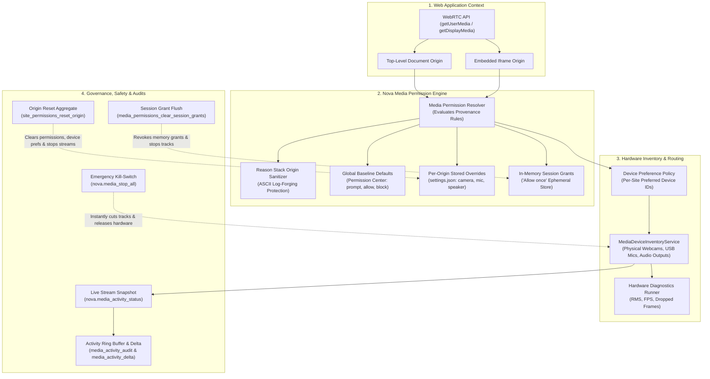
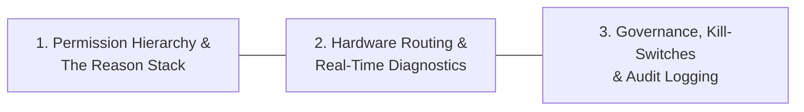

# Media Devices & Permissions Architecture

> [!NOTE]
> Nova enforces strict, transparent governance over web application access to sensitive hardware peripherals: webcams, microphones, speaker audio output, screen-sharing pipelines, and geolocation sensors. It implements a multi-layered permission model that separates persistent user preferences from ephemeral session grants, provides live stream monitoring, equips agents and users with an instant emergency kill-switch, and includes an isolated WebRTC hardware diagnostic suite.

---

## The 3 Pillars of Media Devices & Permissions

Nova's peripheral governance architecture is divided into three specialized domains:

| Sub-System | Scope & Responsibilities | Deep Dive Specification |
| :--- | :--- | :--- |
| **Permission Hierarchy & Reason Stack** | Multi-layered decision hierarchy (SessionGrant > OriginOverride > GlobalDefault), 5 peripheral axes (`camera`, `microphone`, `speaker`, `screenCapture`, `geolocation`), embedded iframe isolation, `reasonStack` provenance, and ASCII log-forging sanitization. | [Permission Hierarchy & Reason Stack](permission-hierarchy-and-reason-stack/README.md) |
| **Hardware Routing & Diagnostics** | Peripheral hardware inventory management, system default tracking (`__nova.system_default__`), device configuration drift detection, and isolated real-time WebRTC diagnostics (FPS, RMS audio energy, clipping, loopback). | [Hardware Routing & Diagnostics](hardware-routing-and-diagnostics/README.md) |
| **Governance, Kill-Switches & Audits** | $O(1)$ live stream status monitoring, global and origin-scoped emergency kill-switches (`nova.media_stop_all`), session grant flushing with immediate track termination, atomic origin resets, and token-efficient incremental delta audits. | [Governance, Kill-Switches & Audits](governance-killswitch-and-audit/README.md) |

---

## Comprehensive Documentation Index

Explore the dedicated deep-dive guides for technical specifications, evaluation rule stacks, and diagnostic procedures:

### 1. [Permission Hierarchy & The Reason Stack](permission-hierarchy-and-reason-stack/README.md)
* **The Permission Decision Model:** Hierarchical evaluation across ephemeral session grants, stored origin overrides, and global defaults.
* **Embedded Iframes & Origin Isolation:** Preventing third-party widgets from inheriting permissions granted to top-level documents.
* **Provenance Chains:** Detailed inspection of the 6-tier evaluation chain via `reasonStack`.
* **Reason Stack Sanitization:** Strict ASCII filtering to defend against log-forging and buffer overruns.

### 2. [Hardware Device Routing & Real-Time Diagnostics](hardware-routing-and-diagnostics/README.md)
* **Hardware Inventory & Preferences:** Mapping physical devices and handling the `__nova.system_default__` dynamic token.
* **Device Drift Detection:** Correlating stored preferences against live connected peripherals to identify missing hardware.
* **WebRTC Diagnostic Runner:** Non-disruptive telemetry testing for camera (resolution, FPS, drops), microphone (RMS volume, clipping), and speaker channels.

### 3. [Governance, Emergency Kill-Switches & Audits](governance-killswitch-and-audit/README.md)
* **Live Stream Monitoring:** Instant $O(1)$ stream status evaluation via `nova.media_activity_status`.
* **The Emergency Kill-Switch:** Immediate hardware handle release and stream termination via `nova.media_stop_all`.
* **Session Grant Flushing:** The immediate termination invariant when clearing in-memory grants.
* **Atomic Origin Reset:** Aggregated clearing of media, notification, and device bindings via `nova.site_permissions_reset_origin`.
* **Token-Efficient Auditing:** Incremental query deltas using sequence bookmarks via `nova.media_activity_delta`.

---

## Tool Reference

| Tool | Parameters | Output / Diagnostics |
| :--- | :--- | :--- |
| [`nova.media_permissions_list`](../../../mcp-reference/tools/media-and-transcription/nova-media-permissions-list.md) | `axis?`, `mode?`, `origin?`, `limit?`, `offset?` | Stored per-origin permissions and global Permission Center defaults |
| [`nova.media_permission_get`](../../../mcp-reference/tools/media-and-transcription/nova-media-permission-get.md) | `origin`, `requestingOrigin?` | Effective permission (`prompt`, `allow`, `block`), provenance `reasonStack` |
| [`nova.media_permission_set`](../../../mcp-reference/tools/media-and-transcription/nova-media-permission-set.md) | `origin`, `camera?`, `microphone?`, `speaker?`, `screenCapture?`, `geolocation?`, `lifetime?`, `clearAll?` | Confirmation of updated axes, previous state |
| [`nova.media_permissions_clear_session_grants`](../../../mcp-reference/tools/media-and-transcription/nova-media-permissions-clear-session-grants.md) | None | Count of cleared session grants and severed live media tracks |
| [`nova.media_activity_status`](../../../mcp-reference/tools/media-and-transcription/nova-media-activity-status.md) | None | Live stream inventory, active origin count, total active tracks |
| [`nova.media_stop_all`](../../../mcp-reference/tools/media-and-transcription/nova-media-stop-all.md) | `scope?` (`"all"`, `"origin"`), `origin?` | Count of severed media tracks and released hardware locks |
| [`nova.site_permissions_reset_origin`](../../../mcp-reference/tools/site-data-and-identity/nova-site-permissions-reset-origin.md) | `origin` | Outcome tuple indicating removed media, notification, and device rules |
| [`nova.media_device_preferences_list`](../../../mcp-reference/tools/media-and-transcription/nova-media-device-preferences-list.md) | `origin?` | Stored hardware device preferences per origin |
| [`nova.media_activity_audit`](../../../mcp-reference/tools/media-and-transcription/nova-media-activity-audit.md) | `kind?`, `limit?` | Chronological audit trail of recent permission decisions |
| [`nova.media_activity_delta`](../../../mcp-reference/tools/media-and-transcription/nova-media-activity-delta.md) | `sinceSequence?`, `limit?` | Incremental audit entries logged since specified sequence |
| [`nova.hardware_diagnostics_start`](../../../mcp-reference/tools/media-and-transcription/nova-hardware-diagnostics-start.md) | `kind` (`camera`, `microphone`, `speaker`), `targetId?` | Diagnostic session handle and initialized hardware device |
| [`nova.hardware_diagnostics_state`](../../../mcp-reference/tools/media-and-transcription/nova-hardware-diagnostics-state.md) | `targetId?` | Live hardware telemetry: FPS, resolution, RMS levels, packet metrics |
| [`nova.hardware_diagnostics_stop`](../../../mcp-reference/tools/media-and-transcription/nova-hardware-diagnostics-stop.md) | `targetId?` | Diagnostic summary and hardware release confirmation |

---

## Related Documentation

* [Media Intelligence Overview](../README.md)
* [Media Capture Architecture](../media-capture/README.md)
* [Media Playback Inspection](../media-playback/README.md)
* [Speech Transcription Architecture](../transcription/README.md)
* [All core features](../../README.md)
