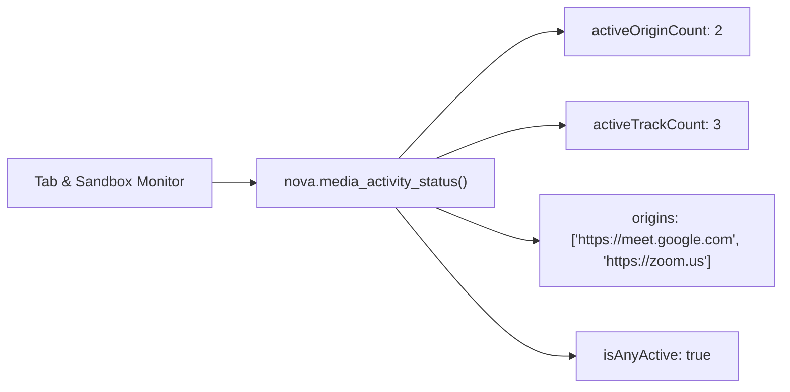
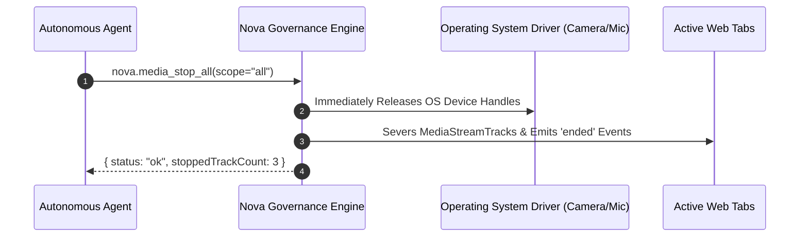
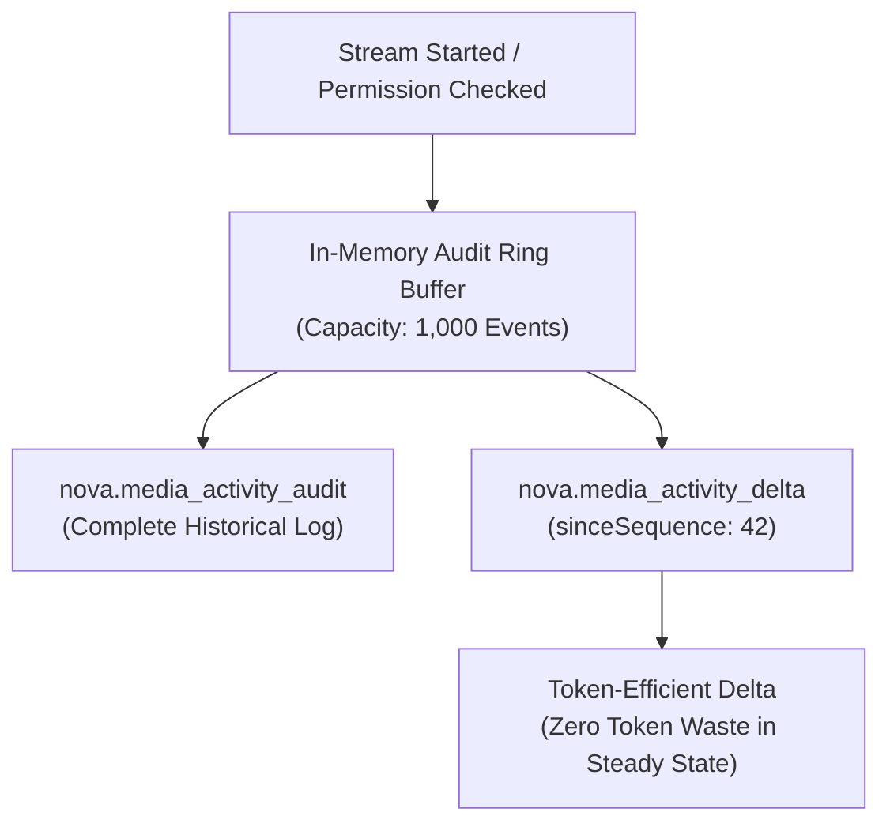

# Governance, Emergency Kill-Switches & Audits

> [!NOTE]
> Autonomous AI agents require continuous visibility into peripheral hardware usage and the power to enforce emergency security boundaries. **Nova AI Workspace** equips agents with $O(1)$ live stream snapshots, an instant emergency kill-switch, atomic site footprint resets, and token-efficient incremental audit deltas.

---

## 1. Live Stream Snapshot (`nova.media_activity_status`)

Rather than scanning historical log files, Nova provides an $O(1)$ live state snapshot inspecting active media streams across all open tabs and browser sandboxes:



### Key Behavioral Attributes

* **Sub-Millisecond Execution:** Evaluates internal track counters directly in memory without DOM evaluation or inter-process IPC hops.
* **Rapid Polling Friendly:** Autonomous agents can call `nova.media_activity_status` frequently to verify that camera or microphone streams have ceased before concluding sensitive workflows.

---

## 2. Emergency Kill-Switches

When an operator or autonomous agent detects suspicious behavior or unprompted peripheral access, Nova provides instant hardware termination controls:



### Scope Options for `nova.media_stop_all`

* **`scope="all"` (Default):** Cuts all active media streams across every open tab and profile. Hardware handles are released instantly, turning off physical webcam recording LEDs.
* **`scope="origin"`:** Targets only the specified origin (`origin="https://..."`), allowing legitimate conference streams in other tabs to continue uninterrupted.

### Session Grant Flushing with Immediate Stream Termination

Calling `nova.media_permissions_clear_session_grants` flushes all temporary in-memory "Allow once" grants.

> [!IMPORTANT]
> **The Immediate Termination Invariant:** Rather than merely clearing authorization tokens from memory while leaving active video streams open, Nova's clear routine actively terminates all active camera, microphone, and screen-sharing tracks relying on those grants.

---

## 3. Atomic Origin Reset (`nova.site_permissions_reset_origin`)

To eliminate a website's stored footprint in a single operation, Nova implements an aggregate atomic reset:

```
Reset Scope for Target Origin:
1. Deletes persistent media permission overrides (camera, mic, speaker, screen, geo)
2. Deletes notification permission rules
3. Deletes stored hardware device bindings
4. Flushes all ephemeral in-memory session grants
5. Severs any active media streams and resets CDP boundaries
```

This ensures complete data and permission hygiene when offboarding a client application.

---

## 4. In-Memory Activity Audit Trail & Incremental Deltas

Every permission query, prompt resolution, and stream state change is recorded in an in-memory ring buffer:



### Token-Efficient Incremental Audits (`nova.media_activity_delta`)

Background security agents monitoring application activity must avoid blowing their context window with redundant log data:
* The agent queries `nova.media_activity_delta` passing `sinceSequence: N`.
* Nova returns exclusively events logged after that sequence index.
* In steady-state operation, the response is empty (`[]`), consuming minimal context tokens.

---

## 5. Related Documentation

* [Media Devices & Permissions Overview](../README.md)
* [Permission Hierarchy & The Reason Stack](../permission-hierarchy-and-reason-stack/README.md)
* [Hardware Device Routing & Real-Time Diagnostics](../hardware-routing-and-diagnostics/README.md)
* [Media Activity Status Tool Reference](../../../../mcp-reference/tools/media-and-transcription/nova-media-activity-status.md)
* [Media Stop All Tool Reference](../../../../mcp-reference/tools/media-and-transcription/nova-media-stop-all.md)
* [Media Permissions Clear Session Grants Tool Reference](../../../../mcp-reference/tools/media-and-transcription/nova-media-permissions-clear-session-grants.md)
* [Site Permissions Reset Origin Tool Reference](../../../../mcp-reference/tools/site-data-and-identity/nova-site-permissions-reset-origin.md)
