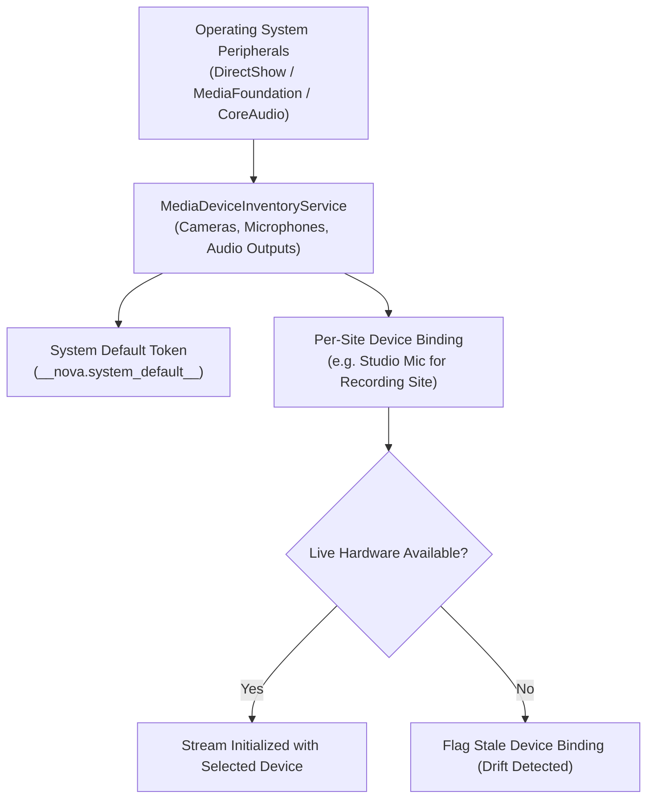
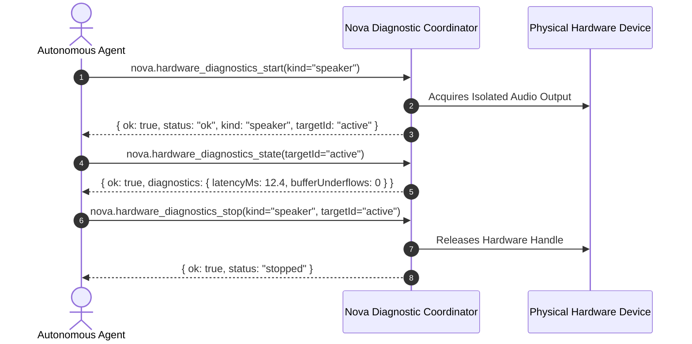

# Hardware Device Routing & Real-Time Diagnostics

> [!NOTE]
> Modern developer and enterprise workstations frequently connect multiple multimedia peripherals—built-in laptop webcams, external 4K USB conference cameras, studio podcast microphones, Bluetooth headsets, and virtual camera feeds. **Nova AI Workspace** manages hardware inventories, detects device configuration drift, provides a native WinUI 3 hardware test suite, and executes isolated WebRTC hardware diagnostics.

---

## 1. Hardware Inventory & Stored Preferences

Nova tracks physical and virtual multimedia peripherals via its internal `MediaDeviceInventoryService`:



### Stored Device Preferences (`nova.media_device_preferences_list`)

* **Default Device Token (`__nova.system_default__`):** Explicitly marks an axis as following the host operating system's default peripheral. When the user switches Windows audio outputs, Nova follows automatically without requiring manual re-configuration.
* **Per-Site Device Binding:** Users and agents can bind specific physical device IDs to specific origins (e.g. routing a recording studio site to a high-end USB audio interface while leaving office conferencing on standard laptop audio).

### Peripheral Device Drift Detection

When external USB webcams or Bluetooth headsets are unplugged:
* The stored device ID remains recorded in `settings.json`.
* Web applications attempting to open the missing device ID can hang or fall back unpredictably.
* `nova.media_device_preferences_list` exposes stored bindings alongside live connected hardware, allowing agents and operators to detect configuration drift and suggest updating preferences to live devices or `__nova.system_default__`.

---

## 2. Interactive Desktop Hardware Test Suite (`HardwareTestDialog`)

Operators and technicians can test local audio and video hardware directly inside Nova's desktop interface via **Settings → Media & permissions → Test hardware** or by clicking the camera/microphone icon in any tab's **Site Info** popover.

```
+-----------------------------------------------------------------------------------+
|  [Hardware Diagnostics Test Suite]                                        [_][O][X]|
+-----------------------------------------------------------------------------------+
|                                                                                   |
|  Camera Test:     [ Logitech Brio 4K Ultra HD                     v ]  [ Start ]  |
|  +-----------------------------------------------------------------------------+  |
|  | [Live Video Preview: 1920x1080 @ 30.0 fps - 0 dropped frames]               |  |
|  +-----------------------------------------------------------------------------+  |
|                                                                                   |
|  Microphone Test: [ RØDE NT-USB Mini Studio Microphone            v ]  [ Start ]  |
|  Level: 42% (peak: 78%)                                                           |
|  [==========================--------------] Speak to test microphone input       |
|                                                                                   |
|  Speaker Output:  [ Headphones (Realtek Audio)                    v ]  [ Play Tone]|
|  Plays a pure 440 Hz test tone to verify audio loopback and output routing.       |
|                                                                                   |
|  [ Close ]                                                                        |
+-----------------------------------------------------------------------------------+
```

### Subsystem Verification Engines:
1. **Microphone Diagnostics (`HardwareTestDialog.MicrophoneRuntime`):**
   * Initializes a native Windows `AudioGraph` configured with `QuantumSizeSelectionMode.LowestLatency` and `AudioRenderCategory.Speech`.
   * Samples live audio frames from the physical device node without routing audio to speakers (preventing feedback howling).
   * Calculates real-time acoustic RMS volume levels (0–100%) and renders a smooth VU meter bar.
   * Tracks peak energy with an automated 2% per-frame decay algorithm (`ComputeDecayedPeakLevel`) to detect clipping and signal overdrive.
2. **Speaker Verification (`HardwareTestDialog.SpeakerRuntime`):**
   * Synthesizes an in-memory 440 Hz sine wave audio stream (`CreateSpeakerToneStreamAsync`).
   * Routes playback directly to the selected Windows audio output endpoint using `Windows.Media.Playback.MediaPlayer`.
   * Verifies output channel mapping, buffer stability, and latency without requiring external test media files.
3. **Camera Diagnostics (`HardwareTestDialog.CameraRuntime`):**
   * Utilizes Windows `MediaFrameReader` and `MediaCapture` configured for `StreamingCaptureMode.Video`.
   * Directly captures and renders live preview frames into the WinUI 3 dialog surface.
   * Audits native video resolution, actual frame delivery cadence, and dropped frame counts.

---

## 3. Programmatic Diagnostics over MCP (`nova.hardware_diagnostics_*`)

AI agents can programmatically audit hardware health using Nova's diagnostic tool suite:

* [`nova.hardware_diagnostics_start`](../../../../mcp-reference/tools/media-and-transcription/nova-hardware-diagnostics-start.md) — Initializes an isolated hardware probe. Parameter `kind` must be `"video"`, `"microphone"`, or `"speaker"`.
* [`nova.hardware_diagnostics_state`](../../../../mcp-reference/tools/media-and-transcription/nova-hardware-diagnostics-state.md) — Samples live telemetry metrics.
* [`nova.hardware_diagnostics_stop`](../../../../mcp-reference/tools/media-and-transcription/nova-hardware-diagnostics-stop.md) — Terminates the probe and releases OS device handles.



---

## 4. The User Gesture Invariant (`diagnostics.user_gesture_required`)

When an autonomous AI agent invokes `nova.hardware_diagnostics_start` with `kind="video"` or `kind="microphone"` against a web tab:

```json
{
  "name": "nova.hardware_diagnostics_start",
  "arguments": {
    "kind": "microphone"
  }
}
```

The call will fail with reason code `diagnostics.user_gesture_required`:

> *"Hardware diagnostics start failed (microphone): Nova blocks camera and microphone access that no user gesture asked for, and this tool drives the page over CDP - so it has no gesture to show. This cannot succeed while that protection is on; it is a deliberate guard, not a transient error. The speaker test is unaffected."*

### Why This Guard Exists:
* **The CDP Evaluation Boundary:** Programmatic MCP tools drive pages via Chrome DevTools Protocol (CDP) script evaluation.
* **The Gesture Protection Invariant:** Modern web security standards and Nova's `NonUserInitiatedHardDenyRule` strictly prohibit web pages from activating cameras or microphones without an explicit physical user gesture (such as an interactive mouse click or keypress).
* **Deliberate Security Barrier:** If background automation could bypass user gesture checks to activate microphones, rogue scripts or prompt injections could silently record room audio.
* **Speaker Test Exception:** The speaker test (`kind="speaker"`) requires no capture permissions and succeeds without user gestures.

---

## 5. WebRTC Error Classification Taxonomy

When hardware diagnostics run on a page, Nova's script bridge (`HardwareDiagnosticsScriptBuilder`) traps DOM exceptions and standardizes them into structured error codes:

| DOM Exception Name | Diagnostic Error Code | Root Cause & Real-World Condition |
| :--- | :--- | :--- |
| `NotAllowedError` / `SecurityError` | `permission_denied` | Site permission denied, user clicked "Block", or gesture requirement not met. |
| `NotFoundError` / `DevicesNotFoundError` | `device_not_found` | Requested device ID is unplugged or no hardware of that kind exists. |
| `NotReadableError` / `TrackStartError` | `device_busy` | Another application (Teams, Zoom, OBS) holds an exclusive OS lock on the device. |
| `OverconstrainedError` | `constraints_unsatisfied` | Page requested a resolution, frame rate, or channel count the hardware cannot deliver. |
| `InsecureContext` | `insecure_context` | WebRTC capture attempted over plain HTTP (WebRTC requires HTTPS or `localhost`). |
| `NotSupportedError` | `unsupported` | Browser runtime or platform lacks support for the requested media pipeline. |
| `TimeoutError` | `timeout` | Hardware device initialization exceeded internal driver timeout limits. |

---

## 6. Related Documentation

* **[Permission Hierarchy & The Reason Stack](../permission-hierarchy-and-reason-stack/README.md)** — The 8-stage permission resolver and provenance logging.
* **[Governance, Kill-Switches & Device Audits](../governance-killswitch-and-audit/README.md)** — Emergency stream revocation and salted device ID logging.
* **[Microphone & Media Troubleshooting](../../../../troubleshooting/media-and-permissions.md)** — Resolving `diagnostics.user_gesture_required`, device locks, and OS privacy blocks.
* **[Hardware Diagnostics Start Tool Reference](../../../../mcp-reference/tools/media-and-transcription/nova-hardware-diagnostics-start.md)** — Tool schema and parameters.
* **[Media Device Preferences List Tool Reference](../../../../mcp-reference/tools/media-and-transcription/nova-media-device-preferences-list.md)** — Tool schema and parameters.
