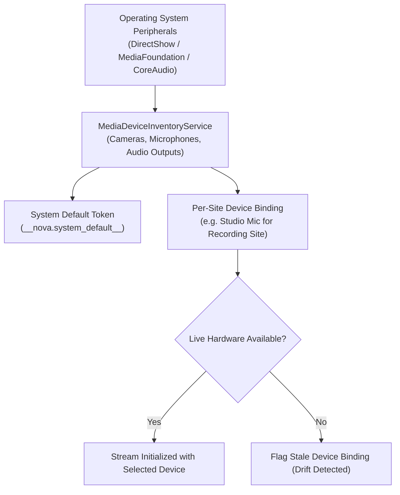
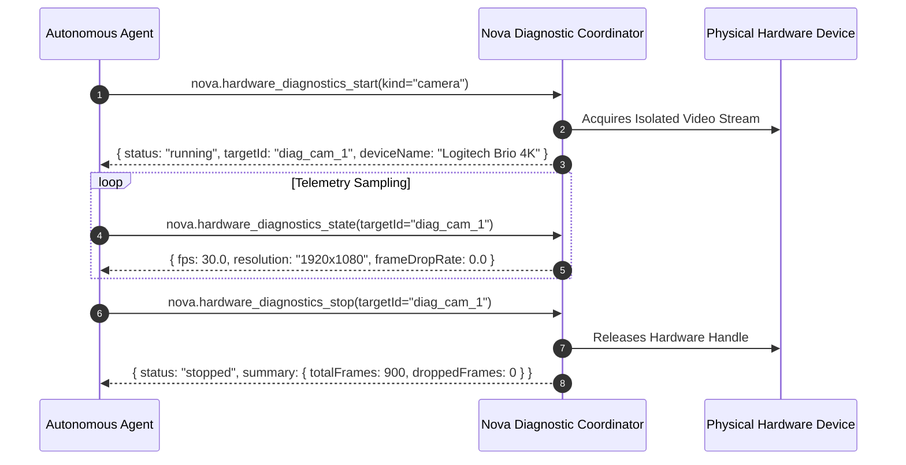

# Hardware Device Routing & Real-Time Diagnostics

> [!NOTE]
> Modern developer and enterprise workstations frequently connect multiple multimedia peripherals—built-in laptop webcams, external 4K USB conference cameras, studio podcast microphones, Bluetooth headsets, and virtual camera feeds. **Nova AI Workspace** manages hardware inventories, detects device configuration drift, and executes isolated WebRTC hardware diagnostics.

---

## 1. Hardware Inventory & Stored Preferences

Nova tracks physical and virtual multimedia peripherals via the `MediaDeviceInventoryService`:

### Stored Device Preferences (`nova.media_device_preferences_list`)

* **Default Device Token (`__nova.system_default__`):** Explicitly marks an axis as following the host operating system's default peripheral. When the user switches Windows audio outputs, Nova follows automatically.
* **Per-Site Device Binding:** Users and agents can bind specific physical device IDs to specific origins (e.g. routing a recording studio site to a high-end USB audio interface while leaving office conferencing on standard laptop audio).

### Peripheral Device Drift Detection

When external USB webcams or Bluetooth headsets are unplugged:
* The stored device ID remains recorded in `settings.json`.
* Web applications attempting to open the missing device ID can hang or fall back unpredictably.
* `nova.media_device_preferences_list` exposes stored bindings alongside live connected hardware, allowing agents to detect configuration drift and suggest updating preferences.

---

## 2. Real-Time WebRTC Hardware Diagnostics

When troubleshooting video conference failures or verifying audio capture quality, Nova provides an isolated, on-demand hardware diagnostic engine:

### Supported Diagnostic Axes

1. **Camera Diagnostics:**
   * Resolution verification (width $\times$ height).
   * Observed frame rate (FPS).
   * Dropped frame percentage and hardware delivery consistency.
2. **Microphone Diagnostics:**
   * Acoustic volume levels (RMS energy).
   * Dynamic range and clipping detection (identifying overdriven input gain).
   * Native audio sample rate (e.g. 44.1 kHz vs 48 kHz).
3. **Speaker Diagnostics:**
   * Audio output loopback verification.
   * Latency measurements and buffer underflow detection.

---

## 3. Safe Diagnostic Lifecycles

* **Zero Tab Interference:** Diagnostic sessions run in an isolated test context, ensuring that active video conference calls in adjacent tabs are not disrupted.
* **Guaranteed Handle Release:** Invoking `nova.hardware_diagnostics_stop` immediately tears down the test stream and releases OS hardware handles, turning off webcam activity LEDs.

---

## 4. Related Documentation

* [Media Devices & Permissions Overview](../README.md)
* [Permission Hierarchy & The Reason Stack](../permission-hierarchy-and-reason-stack/README.md)
* [Governance, Emergency Kill-Switches & Audits](../governance-killswitch-and-audit/README.md)
* [Hardware Diagnostics Start Tool Reference](../../../../mcp-reference/tools/media-and-transcription/nova-hardware-diagnostics-start.md)
* [Hardware Diagnostics State Tool Reference](../../../../mcp-reference/tools/media-and-transcription/nova-hardware-diagnostics-state.md)
* [Hardware Diagnostics Stop Tool Reference](../../../../mcp-reference/tools/media-and-transcription/nova-hardware-diagnostics-stop.md)
* [Media Device Preferences List Tool Reference](../../../../mcp-reference/tools/media-and-transcription/nova-media-device-preferences-list.md)
