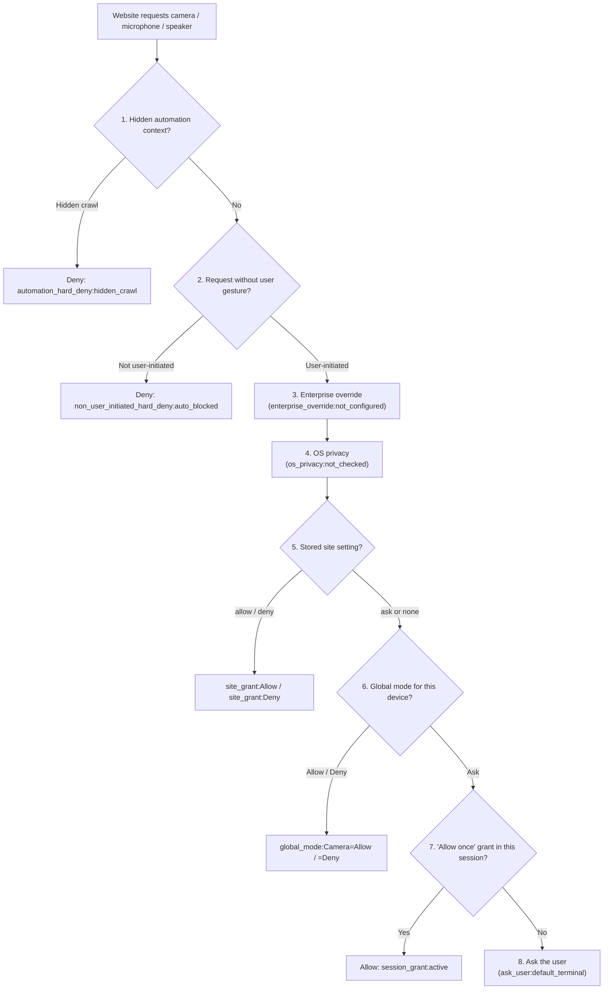

# Permission Hierarchy & The Reason Stack

> [!NOTE]
> Web applications frequently request access to high-risk hardware peripherals—webcams, microphones, speaker audio output, screen-sharing pipelines, and geolocation sensors. **Nova AI Workspace** enforces an 8-stage decision hierarchy and explains every decision with a **`reasonStack`**.

---

## 1. The 8-Stage Permission Resolver Architecture

When a website invokes `navigator.mediaDevices.getUserMedia` (camera, microphone) or selects an audio output, Nova decides through a fixed chain of eight stages. The first stage that reaches a decision ends the chain; every stage it passes leaves a line in the `reasonStack`:



### The 8 Stages in Order of Precedence

1. **Automation hard deny (always first):** Hidden crawl contexts never get camera or microphone access. Because this stage runs before everything else, no later setting can open a device to a background crawl.
2. **Non-user-initiated hard deny:** With the protected setting under Settings > Site permissions that blocks camera/microphone requests no user action started (on by default; agents cannot change it), a request that no user action started is denied before site or global settings are read.
3. **Enterprise override:** Reserved for managed policies; today it records `enterprise_override:not_configured` and passes on.
4. **OS privacy:** Nova does not read the Windows privacy switches here; the stage records `os_privacy:not_checked`. If Windows blocks the camera or microphone, the device simply delivers no signal even when Nova allows the site.
5. **Site setting:** The per-site choice from Settings or `nova.media_permission_set` (also per embedding frame). `allow` or `deny` decides; `ask` passes on.
6. **Global mode:** The default per device type (`Allow`, `Deny` or `Ask`) from the Permission Center.
7. **Session grant:** An "Allow once" answer for this site, kept in memory for the session; `nova.media_permissions_clear_session_grants` removes it.
8. **Ask the user:** Nova shows its permission prompt.

---

## 2. Granular Peripheral Axes & Decision States

Nova manages permissions independently across five distinct peripheral axes:

| Axis Identifier | Hardware / API Scope | Common Web Triggers |
| :--- | :--- | :--- |
| `camera` | Physical webcams, USB capture cards, virtual video sources. | `navigator.mediaDevices.getUserMedia({ video: true })` |
| `microphone` | Built-in microphones, USB audio interfaces, line inputs. | `navigator.mediaDevices.getUserMedia({ audio: true })` |
| `speaker` | Audio output endpoint selection and routing. | `HTMLMediaElement.setSinkId()` |
| `screenCapture` | Desktop displays, application windows, browser tabs. | `navigator.mediaDevices.getDisplayMedia()` |
| `geolocation` | GPS receivers, Wi-Fi location triangulation. | `navigator.geolocation.getCurrentPosition()` |

---

## 3. Provenance Chains & The `reasonStack`

[`nova.media_permission_get`](../../../../mcp-reference/tools/media-and-transcription/nova-media-permission-get.md) returns the stored setting, the `effective` value per device and, per device, the `provenance` of today's decision: `state`, the deciding `source`, its `lifetime` and the `reasonStack` of the stages it passed:

```json
{
  "origin": "https://meet.example.com",
  "effective": { "camera": "allow", "microphone": "allow", "speaker": "ask", "screenCapture": "ask", "geolocation": "ask" },
  "provenance": {
    "camera": {
      "state": "allow",
      "source": "SiteGrant",
      "lifetime": "persistent",
      "reasonStack": [
        "automation_hard_deny:not_in_automation_context",
        "non_user_initiated_hard_deny:user_initiated",
        "enterprise_override:not_configured",
        "os_privacy:not_checked",
        "site_grant:Allow:https://meet.example.com:Camera"
      ]
    }
  }
}
```

Shortened: the result also carries `stored`, `sessionGrants` and the provenance of the other devices.

### Origin Sanitization
Origins in the reason stack come from web pages and agent arguments, so Nova sanitizes them before writing them into a stack line: only plain ASCII letters, digits and URL punctuation stay, everything else (line breaks, control and escape characters, non-ASCII) becomes `_`. A page cannot forge extra stack lines or terminal output that way.

---

## 4. Embedded Iframes & Origin Isolation

Modern web applications embed third-party conferencing widgets or authentication portals inside `<iframe>` elements:

* **Explicit Frame Scoping:** Third-party iframes **never silently inherit** permissions granted to the top-level document.
* **Dual-Origin Verification:** An embedded iframe on `https://video-vendor.com` hosted inside `https://dashboard.corp.com` must be explicitly authorized for its own frame origin.
* **Caller Ambiguity Protection:** When querying permissions with `nova.media_permission_get`, agents can pass both `origin` (top-level) and `requestingOrigin` (iframe) to verify exact frame authorization.

---

## 5. Related Documentation

* **[Media Devices & Diagnostics Overview](../README.md)** — Architectural summary of media features.
* **[Hardware Device Routing & Real-Time Diagnostics](../hardware-routing-and-diagnostics/README.md)** — WebRTC diagnostics, AudioGraph VU meters, and CDP gesture guards.
* **[Governance, Kill-Switches & Device Audits](../governance-killswitch-and-audit/README.md)** — Salted device ID hashing and emergency stream revocation.
* **[Microphone & Media Troubleshooting](../../../../troubleshooting/media-and-permissions.md)** — Diagnostic steps for resolving hardware access blocks.
