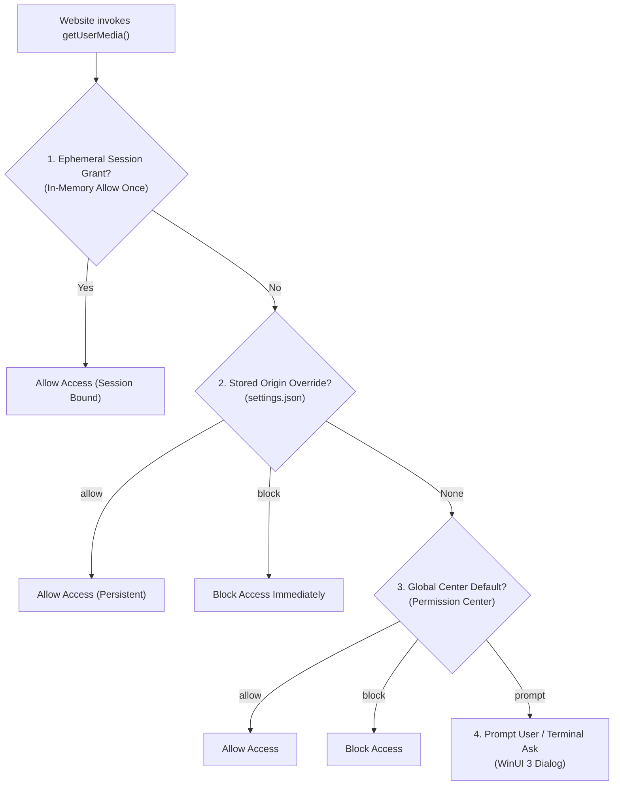
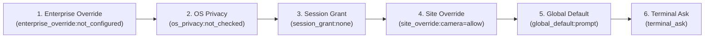

# Permission Hierarchy & The Reason Stack

> [!NOTE]
> Web applications frequently request access to high-risk hardware peripherals—webcams, microphones, speaker audio output, screen-sharing pipelines, and geolocation sensors. **Nova AI Workspace** enforces a transparent, multi-layered decision hierarchy and returns complete evaluation provenance via the **`reasonStack`**.

---

## 1. The Multi-Layered Permission Decision Model

When a website invokes `navigator.mediaDevices.getUserMedia` or `getDisplayMedia`, Nova evaluates effective access through a strict evaluation hierarchy:

$$\text{Effective Permission} = \text{SessionGrant} \succ \text{OriginOverride} \succ \text{GlobalDefault}$$



### Granular Peripheral Axes

Nova tracks permissions independently across five distinct peripheral axes:

1. **`camera`:** Physical webcams, capture cards, and virtual video devices.
2. **`microphone`:** Integrated microphones, USB audio interfaces, and digital input lines.
3. **`speaker`:** Audio output device selection and routing (`setSinkId`).
4. **`screenCapture`:** Desktop, window, and application sharing via `getDisplayMedia`.
5. **`geolocation`:** Physical GPS coordinates and Wi-Fi triangulation sensors.

### Decision States

* **`prompt` (Default):** Prompts the operator with an interactive WinUI 3 permission dialog displaying the requesting origin, requested axes, and persistence options.
* **`allow`:** Automatically permits the requesting origin to access the specified peripheral.
* **`block`:** Automatically rejects the peripheral request without notifying the site or prompting the operator.

---

## 2. Embedded Iframes & Origin Isolation

Modern web applications embed third-party widgets, payment gateways, and authentication portals inside `<iframe>` elements.

```
+--------------------------------------------------------+
| Top-Level Document Origin: https://dashboard.corp.com   |
|                                                        |
|   +------------------------------------------------+   |
|   | Embedded Iframe: https://video-vendor.com      |   |
|   | Requests: navigator.mediaDevices.getUserMedia  |   |
|   +------------------------------------------------+   |
+--------------------------------------------------------+
```

### The Iframe Permission Barrier

1. **Explicit Frame Scoping:** Third-party iframes **never silently inherit** permissions granted to the top-level document.
2. **Dual-Origin Verification:** An embedded widget on `https://video-vendor.com` hosted inside `https://dashboard.corp.com` must be explicitly authorized for its own frame origin.
3. **Caller Ambiguity Protection:** When querying permissions with `nova.media_permission_get`, agents can pass both `origin` (top-level) and `requestingOrigin` (iframe) to verify exact frame authorization.

---

## 3. Provenance Chains & The `reasonStack`

When agents query permissions using `nova.media_permission_get`, Nova provides the exact evaluation provenance chain:



### Evaluation Rule Hierarchy

1. **`enterprise_override`:** Enterprise group policy and DLP controls (highest precedence).
2. **`os_privacy`:** Windows operating system-level privacy toggles (camera/microphone privacy switches).
3. **`session_grant`:** In-memory "Allow once" grants valid for the active browser session.
4. **`site_override`:** Stored per-origin preferences recorded in `settings.json`.
5. **`global_default`:** Global Permission Center defaults.
6. **`terminal_ask`:** Fallback prompting the user.

### Example Provenance Output

```json
{
  "axis": "camera",
  "origin": "https://meet.google.com",
  "effective": "allow",
  "reasonStack": [
    "enterprise_override:not_configured",
    "os_privacy:not_checked",
    "session_grant:none",
    "site_override:camera=allow",
    "terminal_ask"
  ]
}
```

---

## 4. Reason Stack Origin Sanitization (Log-Forging Defense)

Origin strings originating from untrusted web pages or agent parameters could potentially inject control characters, newlines, or ANSI escape codes into audit log files and MCP envelopes.

Nova applies strict ASCII sanitization to every origin string before interpolating it into reason stack entries:
* All characters outside the strict character class `[A-Za-z0-9./:_-]` are replaced with `_`.
* Strings are strictly clamped in length to prevent buffer overruns or log-forging exploits.

---

## 5. Related Documentation

* [Media Devices & Permissions Overview](../README.md)
* [Hardware Device Routing & Real-Time Diagnostics](../hardware-routing-and-diagnostics/README.md)
* [Governance, Emergency Kill-Switches & Audits](../governance-killswitch-and-audit/README.md)
* [Media Permission Get Tool Reference](../../../../mcp-reference/tools/media-and-transcription/nova-media-permission-get.md)
* [Media Permission Set Tool Reference](../../../../mcp-reference/tools/media-and-transcription/nova-media-permission-set.md)
* [Media Permissions List Tool Reference](../../../../mcp-reference/tools/media-and-transcription/nova-media-permissions-list.md)
