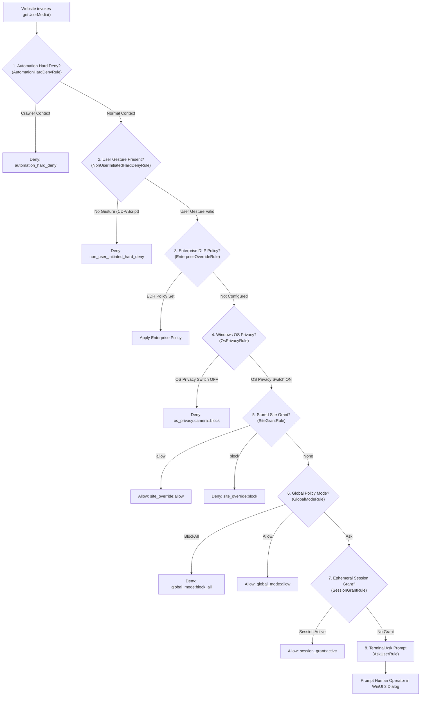

# Permission Hierarchy & The Reason Stack

> [!NOTE]
> Web applications frequently request access to high-risk hardware peripherals—webcams, microphones, speaker audio output, screen-sharing pipelines, and geolocation sensors. **Nova AI Workspace** enforces an 8-stage decision hierarchy and returns complete evaluation provenance via the **`reasonStack`**.

---

## 1. The 8-Stage Permission Resolver Architecture

When a website or web application invokes `navigator.mediaDevices.getUserMedia` or `getDisplayMedia`, Nova evaluates effective access through a strict, multi-layered priority chain implemented in `MediaPermissionResolver`:



### The 8 Rules in Order of Precedence:

1. **`AutomationHardDenyRule` (Position 0 - Invariant):**
   * Hidden crawl contexts, automated web scrapers, and headless discovery pipelines are **unconditionally hard-denied** camera and microphone access.
   * This rule sits at position 0 so that no downstream enterprise policy, OS toggle, or site setting can ever accidentally expose physical cameras to background web scrapers.
2. **`NonUserInitiatedHardDenyRule`:**
   * When `BlockNonUserInitiatedMediaRequests` is enabled in settings (default: `true`), requests lacking a verified user gesture are blocked before site grants or global policies are checked.
   * Protects against autonomous CDP scripts, popups, and tab switches activating microphones silently.
3. **`EnterpriseOverrideRule`:**
   * Enterprise Group Policy, DLP software, and endpoint management systems take precedence over user decisions.
4. **`OsPrivacyRule`:**
   * Evaluates Windows operating system privacy switches (**Windows Settings → Privacy & Security → Camera / Microphone**). If the operating system level toggle is disabled by the user, browser-level permissions cannot override it.
5. **`SiteGrantRule`:**
   * Persistent per-origin permission rules recorded in `settings.json` (e.g. `https://meet.google.com` $
ightarrow$ `allow`).
6. **`GlobalModeRule`:**
   * Evaluates the global Permission Center policy mode (`BlockAll`, `Ask`, `Allow`).
7. **`SessionGrantRule`:**
   * Evaluates transient, in-memory "Allow once" grants valid strictly for the active browser session. Cleared when the tab closes or via `nova.media_permissions_clear_session_grants`.
8. **`AskUserRule`:**
   * Terminal fallback rule that displays an interactive WinUI 3 permission dialog to the operator.

---

## 2. Granular Peripheral Axes & Decision States

Nova manages permissions independently across five distinct peripheral axes:

| Axis Identifier | Hardware / API Scope | Common Web Triggers |
| :--- | :--- | :--- |
| `camera` | Physical webcams, USB capture cards, virtual video sources. | `navigator.mediaDevices.getUserMedia({ video: true })` |
| `microphone` | Built-in microphones, USB audio interfaces, line inputs. | `navigator.mediaDevices.getUserMedia({ audio: true })` |
| `speaker` | Audio output endpoint selection and routing. | `HTMLMediaElement.setSinkId()` |
| `screenCapture` | Desktop displays, application windows, browser tabs. | `navigator.mediaDevices.getDisplayMedia()` |
| `geolocation` | GPS receivers, Wi-Fi location triangulation. | `navigator.geolocation.getCurrentPosition()` |

---

## 3. Provenance Chains & The `reasonStack`

When agents query permissions using [`nova.media_permission_get`](../../../../mcp-reference/tools/media-and-transcription/nova-media-permission-get.md), Nova returns the complete evaluation provenance stack:

```json
{
  "axis": "camera",
  "origin": "https://meet.google.com",
  "effective": "allow",
  "reasonStack": [
    "automation_hard_deny:skipped",
    "non_user_initiated_hard_deny:skipped",
    "enterprise_override:not_configured",
    "os_privacy:not_configured",
    "site_grant:allowed",
    "global_mode:skipped",
    "session_grant:skipped",
    "terminal_ask:skipped"
  ]
}
```

### Security Log Sanitization (`ReasonStackOriginSanitizer`)
Origin strings originating from untrusted web pages or external MCP parameters are strictly sanitized before being interpolated into reason stack strings:
* Restricted to ASCII alphanumeric characters and standard punctuation (`[A-Za-z0-9./:_-]`).
* Replaces newlines, carriage returns, ANSI escape codes, and non-ASCII glyphs with `_`.
* Prevents log-forging attacks and terminal escape injection.

---

## 4. Embedded Iframes & Origin Isolation

Modern web applications embed third-party conferencing widgets or authentication portals inside `<iframe>` elements:

* **Explicit Frame Scoping:** Third-party iframes **never silently inherit** permissions granted to the top-level document.
* **Dual-Origin Verification:** An embedded iframe on `https://video-vendor.com` hosted inside `https://dashboard.corp.com` must be explicitly authorized for its own frame origin.
* **Caller Ambiguity Protection:** When querying permissions with `nova.media_permission_get`, agents can pass both `origin` (top-level) and `requestingOrigin` (iframe) to verify exact frame authorization.

---

## 5. Related Documentation

* **[Media Devices & Diagnostics Overview](../README.md)** — Architectural summary of media features.
* **[Hardware Device Routing & Real-Time Diagnostics](../hardware-routing-and-diagnostics/README.md)** — WebRTC diagnostics, AudioGraph VU meters, and CDP gesture guards.
* **[Governance, Kill-Switches & Device Audits](../governance-killswitch-and-audit/README.md)** — Salted device ID hashing and emergency stream revocation.
* **[Microphone & Media Troubleshooting](../../../../troubleshooting/media-and-permissions.md)** — Diagnostic steps for resolving hardware access blocks.
