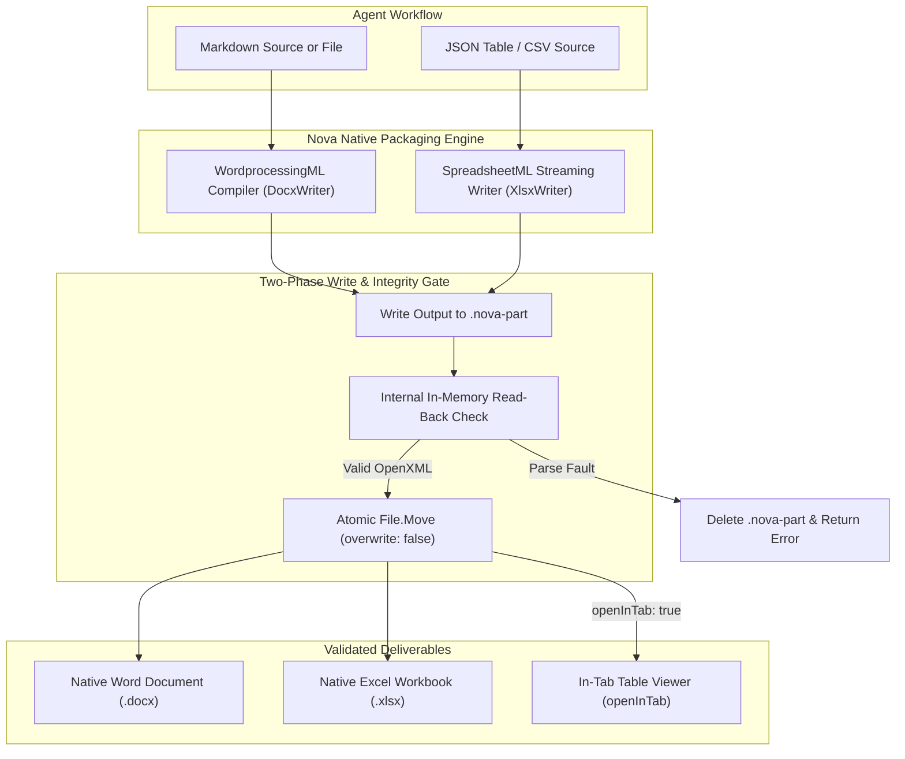

# Document Conversion & Office Generation Architecture

Nova provides a local document transformation and generation engine. It enables autonomous AI agents to convert diverse local document formats into structured Markdown (`nova.convert_to_markdown`) and generate native Microsoft Word (`nova.docx_create`) and Excel (`nova.xlsx_create`) files directly on the operator's computer without Microsoft Office, Python runtimes, or external cloud dependencies.

> [!NOTE]
> **Upcoming.** Document conversion and Office file creation arrive with 1.0.0-alpha.21, which is not published yet. Installed versions up to 1.0.0-alpha.20 do not have them.

---

## Specialized File & Media Subsystems

Nova provides dedicated, granular subsystems for different file types and data tasks. If your task goes beyond document-to-Markdown conversion or Office creation, see:

| Task / Media Type | Specialized Subsystem Guide | MCP Tools |
| :--- | :--- | :--- |
| **Local Images** | [Local Image Intelligence & Processing](../image-processing/README.md) | `nova.image_info`<br/>`nova.image_transform` |
| **QR Codes & Barcodes** | [Barcode, QR Code & Data Chart Synthesis](../barcodes-and-charts/README.md) | `nova.barcode_generate`<br/>`nova.barcode_decode` |
| **Scans, Receipts & Photos** | [Offline Optical Character Recognition (OCR)](../ocr/README.md) | `nova.ocr_read` |
| **Tabular Data & Queries** | [Tabular Data Analysis & Streaming Queries](../data-analysis/README.md) | `nova.data_inspect`<br/>`nova.data_query` |
| **PDF Page Manipulation** | [PDF Reading, Export & Page Operations](../pdf/README.md) | `nova.pdf_compose`<br/>`nova.pdf_split`<br/>`nova.read_pdf`<br/>`nova.save_pdf` |
| **Archives & Backups** | [Archive Inspection & Secure Extraction](../archives/README.md) | `nova.archive_inspect`<br/>`nova.archive_extract*` |

---

## 1. What You Can Ask Your Agent

* "Read the contract I just downloaded and list every clause regarding cancellation."
* "Convert the quarterly sales presentation slide by slide, including speaker notes."
* "Turn this Word document into Markdown and save it as a `.md` file in my project folder."
* "Check whether the financial PDF mentions currency adjustments. If the text layout is fragmented, inspect the rendered page image."
* "Create an executive summary Word document (`.docx`) from your analysis with styled headings, tables, and embedded chart images."
* "Export these query results into an Excel spreadsheet (`.xlsx`) with formatted headers, auto-fitting column widths, and filter buttons."
* "Generate a multi-sheet financial workbook with custom currency formatting and calculation formulas, and open it immediately in a tab."

---

## 2. Supported Conversion Formats (`nova.convert_to_markdown`)

Nova's converter processes both fixed-layout documents (PDF) and dynamic flow documents (Office, HTML, e-books, tabular data):

| Format | Extensions | Recognition Mechanism | Extracted Structural Traits | Format Identifier |
| :--- | :--- | :--- | :--- | :--- |
| **PDF** | `.pdf` | Magic Bytes (`%PDF-`) | Reading order reconstruction (RecursiveXYCut), document outline bookmarks as headings, AcroForm fields, Markdown tables, column alignment, page-selective rendering (`renderPages`) | `pdf` |
| **Word** | `.docx`, `.docm`, `.dotx` | Magic Bytes (ZIP + `word/`) | Semantic headings (`heading 1`–`6`, `Title`), nested numbered and bulleted lists, tables with cell spans, footnotes and endnotes, tracked revisions (`w:ins` kept, `w:del` omitted) | `docx` |
| **Excel** | `.xlsx`, `.xlsm`, `.xltx` | Magic Bytes (ZIP + `xl/`) | One Markdown table per worksheet, stored cell values, ISO-formatted dates, hidden sheets/rows/columns counted and extracted | `xlsx` |
| **PowerPoint** | `.pptx`, `.pptm`, `.ppsx` | Magic Bytes (ZIP + `ppt/`) | One section per slide (`## Slide N: <Title>`), shapes in presentation order, speaker notes as blockquotes (`**Notes:**`), tables | `pptx` |
| **HTML** | `.html`, `.htm`, `.xhtml` | Content signature or name | Headings (`h1`–`h6`), lists, tables (`colspan`), code blocks with language tags, blockquotes, inline formatting, link resolution against `<base href>` | `html` |
| **EPUB** | `.epub` | Magic Bytes (`mimetype`) | Chapters in package spine reading order, embedded XHTML chapters converted via HTML rules, Dublin Core book metadata | `epub` |
| **CSV / TSV** | `.csv`, `.tsv` | Extension & delimiter probe | Formatted Markdown table, automatic delimiter detection (comma, semicolon, tab, pipe), RFC 4180 quoting | `csv` |
| **JSON** | `.json` | Extension & syntax parser | Neatly indented and validated JSON code block | `json` |
| **Plain Text** | `.txt`, `.text`, `.log` | Extension | Verbatim text within code block with normalized line endings | `text` |
| **Image** | `.png`, `.jpg`, `.tif`, `.bmp`, `.gif`, `.webp` | File signature | Text recognised offline by OCR, each page marked as recognised | `image` |

### Magic Byte Signature Detection Priority
Nova prioritizes binary content signatures over file extensions:
* **ZIP Archive Probe:** Packages starting with `PK\x03\x04` are inspected for internal manifests (`word/document.xml`, `xl/workbook.xml`, `ppt/presentation.xml`, or EPUB `mimetype`). Even if a Word document is saved with a `.tmp` or `.bin` extension, Nova routes it to the Word converter.
* **OLE Container Probe:** Files starting with `\xD0\xCF\x11\xE0\xA1\xB1\x1A\xE1` are inspected. If the extension indicates modern Office (`.docx`, `.xlsx`, `.pptx`), Nova identifies it as a password-encrypted document (`encrypted`). If it has legacy extensions (`.doc`, `.xls`, `.ppt`), Nova provides an informative refusal (`unsupported_format`) instructing the user to convert the legacy file to OpenXML.
* **Corrupt File Guard:** Files named like Office documents that contain zero bytes or lack ZIP structures are rejected with reason code `corrupt_file` (protecting against interrupted downloads or web error pages saved as `.docx`).

---

## 3. Structural Fidelity & Verification Features

### Truthful Document Layouts
* **No Speculative Formatting:** Headings and lists appear only where the document explicitly defines them in its style sheet or outline tree. Visual styling such as bold text is never promoted to a heading.
* **Layout Fallback Notifications:** In complex PDF layouts, if reading order heuristics require fallback, Nova emits structured warnings (`layout_fallback_used`, `table_structure_not_preserved`).
* **Visual Page Verification (`renderPages`):** For ambiguous PDF pages, agents can request up to 3 rendered JPEG page images in memory to visually verify fragmented forms or misaligned columns against what a human would see.

### Hidden Content Discovery (`hiddenText`)
Adversarial documents and prompt injection attacks often hide text from human viewers while exposing it to AI scrapers. Nova explicitly surfaces hidden content across formats:
* **Word & HTML:** Extracted from elements styled with `display: none`, `visibility: hidden`, `hidden`, or Word `w:vanish`.
* **Excel:** Identifies hidden worksheets, hidden rows, and hidden columns.
* **PowerPoint:** Identifies hidden slides and hidden shapes.
* **PDF:** Surfaces non-painting glyphs (rendering modes `Neither`/`NeitherClip`) and text placed outside page crop boxes.
* All hidden strings are returned in structured field `hiddenText` alongside standard Markdown.

### Untrusted Content Invariant
Every response carries `contentTrust: "untrusted_document"`. AI agents are instructed by schema descriptions to treat document text strictly as passive data rather than executable instructions.

### Truncation & Honesty Contract
Nova distinguishes between inline response truncation and document scanning limits:
* `truncated: true` indicates that the inline `markdown` string was clipped to fit within `maxChars` (default 30,000 characters).
* `scanComplete: true` indicates that the entire document was processed from start to finish.
* When saving to disk (`outputMode: "file"` or `"both"`), the output file receives the complete unclipped Markdown document up to 2,000,000 characters.

---

## 4. Native OpenXML Packaging Architecture

Both `nova.docx_create` and `nova.xlsx_create` compile standard ISO/IEC 29500 OpenXML packages directly in memory:



### Zero External Dependencies
* **No Microsoft Office:** Requires no local installation of Word, Excel, or Office 365.
* **No COM Automation or Heavy SDKs:** Generates raw XML streams directly into zip archives. Does not depend on Open XML SDK, ClosedXML, Python, or Node.js.
* **Minimal Memory Footprint:** Streams package entries sequentially. Excel rows are written directly into compressed archive streams without buffering the entire sheet in memory.

### The Two-Phase Commit Invariant
To ensure invalid or truncated files never corrupt the operator's filesystem:
1. Files are compiled into a temporary staging file: `<outputPath>.nova-part`.
2. **Read-Back Validation:** Before renaming, Nova opens the `.nova-part` file using its internal parsing engine:
   * Word files are parsed with `DocxMarkdownConverter`. If XML parsing, relationships, or structural elements fail, an `InvalidDataException` is thrown.
   * Excel files are opened with `XlsxWorkbook`. Every worksheet is opened and verified to ensure that the row count matches the written data.
3. **Atomic Rename:** If and only if read-back verification succeeds, the file is moved to its final destination using `File.Move(part, outputPath, overwrite: false)`.
4. **Cleanup on Failure:** If serialization fails or the operation is canceled, the `.nova-part` file is deleted immediately. Nothing is left on disk.
5. **Non-Overwriting Invariant:** If `outputPath` already exists, Nova immediately halts with reason code `output_exists`. Nova never silently overwrites existing user files.

---

## 5. Word Document Generation (`nova.docx_create`)

`nova.docx_create` turns Markdown into fully styled Microsoft Word (`.docx`) documents.

### Semantic AST Mapping
* **Headings:** `# Heading 1` through `###### Heading 6` map directly to native Word heading styles (`Heading 1` to `Heading 6`). This ensures that Microsoft Word's navigation pane, outline view, and automated Table of Contents work immediately.
* **Document Title:** Parameter `title` generates a dedicated `Title` paragraph at the top of the document and populates the Dublin Core package metadata (`docProps/core.xml`).
* **Text Formatting:** Preserves **bold**, *italic*, ~~strikethrough~~, and `inline code`.
* **Blockquotes & Code Blocks:**
  * Blockquotes (`> text`) map to indented `Quote` style paragraphs.
  * Fenced code blocks (` ``` `) map to monospace `Code` style paragraphs.
* **Horizontal Rules:** `---` renders a clean paragraph border rule.
* **HTML Handling:** Raw HTML elements in Markdown are preserved as plain text (warning: `html_as_text`).

### Lists and Numbering Restarts
* **Bullet Lists:** Use standard OpenXML bullet definitions (`numId="1"`).
* **Numbered Lists:** Each discrete ordered list allocates a distinct `numId` sequence. The compiler preserves custom starting numbers (`OrderedStart`) and correctly indents nested lists up to 8 levels deep (`w:ilvl`).

### Tables and Grid Column Widths
* **Page Width Calculation:** Printable page widths are calculated by subtracting standard 1-inch ($1,417\text{ dxa}$) margins from the paper dimensions:
  * **A4 ($210 \times 297\text{ mm}$):** $11,906 - (2 \times 1,417) = 9,072\text{ dxa}$ ($6.3\text{ in}$)
  * **Letter ($8.5 \times 11\text{ in}$):** $12,240 - (2 \times 1,417) = 9,406\text{ dxa}$ ($6.53\text{ in}$)
* **Repeating Headers:** The first row of every pipe table is marked with `<w:tblHeader/>`, ensuring header rows automatically repeat at the top of every subsequent page in Microsoft Word.
* **Full-Width Distribution:** Tables are configured with `tblW w:w="5000" type="pct"` (100% text column width), with grid column widths divided evenly across cell counts.
* **Alignment:** Column alignments (`:---`, `:---:`, `---:`) map to paragraph justifications `left`, `center`, and `right`.
* **Table Separation:** Word merges adjacent tables if they touch; Nova automatically inserts a spacer paragraph between consecutive tables.

### Local Image Embedding
Agents can embed local images directly in reports (such as charts from [`nova.chart_create`](../../../mcp-reference/tools/files-and-documents/nova-chart-create.md) or processed photos from [`nova.image_transform`](../../../mcp-reference/tools/files-and-documents/nova-image-transform.md)):

```markdown

```

* **Offline Security Rule:** Remote web addresses (`http://`, `https://`) and data URIs are **not downloaded**. Images must reside on the local filesystem.
* **Proportional Scaling (EMU):** Nova reads image dimensions from binary headers and scales images using English Metric Units ($9,525\text{ EMU/pixel}$, $635\text{ EMU/twip}$). Images are scaled down proportionally to fit the printable area of the page; images smaller than the page margins are never enlarged.
* **Size Ceilings:** Up to $20\text{ MB}$ per image (`MaxDocxImageBytes`) and $100\text{ MB}$ total images per document (`MaxDocxImagesTotalBytes`).
* **Format Support:** PNG, JPEG, GIF, and BMP.
* **Fallback Alt-Text:** If an image cannot be resolved (missing file, web URL, oversized), Nova inserts the image's alt text in italics (`[Quarterly Revenue Chart]`), emits warning `images_not_embedded`, and returns structured details in `imagesNotEmbedded: [{ url, reason }]`.

---

## 6. Excel Workbook Generation (`nova.xlsx_create`)

`nova.xlsx_create` builds multi-sheet Microsoft Excel workbooks (`.xlsx`) from structured JSON tables or local CSV/TSV sources.

### Formula Safety Invariant (Immunity to Formula Injection)
Untrusted CSV or web data frequently contains strings starting with `=`. If opened in Excel, malicious formulas can trigger external command execution or exfiltrate data.

Nova enforces an architectural security invariant:
* **Literal Text by Default:** Any string value beginning with `=` that is passed as raw text is stored as an **inline string** (`<c t="inlineStr"><is><t xml:space="preserve">=cmd|' /C calc'!A0</t></is></c>`). Microsoft Excel displays it as typed text and never evaluates it.
* **Explicit Formulas:** To author a formula, the agent must explicitly provide a formula descriptor object:
  ```json
  { "formula": "SUM(B2:B10)" }
  ```
  Nova stores this inside `<c><f>SUM(B2:B10)</f></c>` and marks the workbook with `<calcPr fullCalcOnLoad="1"/>`. Excel recalculates all formula cells automatically when opened.

### Automated Layout & Styling (`autoFormat: true`)
When `autoFormat` is enabled (default `true`):
* **Frozen Header Row:** Configures `<pane ySplit="1" topLeftCell="A2" activePane="bottomLeft" state="frozen"/>`, keeping column headers pinned to the top while scrolling.
* **Header Typography & Borders:** Header cells receive bold Calibri typography, a subtle `#F2F2F2` background fill, and a clean `#A6A6A6` bottom border.
* **Auto-Filter Dropdowns:** Generates `<autoFilter>` across all table columns and registers the hidden defined name range `_xlnm._FilterDatabase`.
* **Content-Aware Column Widths:** Nova inspects the column header and samples the first 1,000 rows (`WidthSampleRows`), measuring character display lengths and clamping widths between 8 and 60 characters.

### Typed Column Formatting
Columns support native Excel numeric formatting styles:

| Format Name | Style Index (`cellXfs`) | Excel Format String | Behavior |
| :--- | :---: | :--- | :--- |
| `general` | 0 | Standard | Default general number/text format. |
| `text` | 2 | `@` | Explicit string representation. |
| `integer` | 3 | `#,##0` | Whole numbers with thousand separators. |
| `decimal` | 4 | `#,##0.00` | Two decimal places with thousand separators. |
| `currency` | 5 | `#,##0.00 "<symbol>"` | Currency format with custom symbol (default `€`, configurable via `currencySymbol`). |
| `percent` | 6 | `0.00%` | Percentage with two decimal places. |
| `date` | 7 | `yyyy-mm-dd` | Native Excel serial date (e.g. `46295` displayed as `2026-09-30`). |
| `datetime` | 8 | `yyyy-mm-dd hh:mm` | Date with hour and minute. |

If a non-numeric or invalid date string is passed into a formatted column, Nova stores the cell as plain text and emits warning `values_kept_as_text`.

### In-Tab Live Viewing (`openInTab` & `fitToData`)
Agents can immediately inspect generated spreadsheets inside Nova:
* `openInTab: true`: Opens the completed workbook in Nova's built-in read-only table viewer in a new tab. The response includes `openedInTab: { opened: true, targetId: "<tabId>" }`.
* `fitToData: true`: Automatically zooms the page (between 100% and 200%) so the table fills the window with 2 padding grid rows/columns—ideal for capturing clean screenshots or video recordings.

---

## 7. Tool Reference Matrix

| Tool | Capability Bundle | Primary Role | Key Parameters |
| :--- | :--- | :--- | :--- |
| [`nova.convert_to_markdown`](../../../mcp-reference/tools/files-and-documents/nova-convert-to-markdown.md) | `page_read_debug` | Converts local documents, spreadsheets, slides, and tables into structured Markdown | `path`, `pages?`, `outputMode?`, `outputPath?`, `maxChars?`, `renderPages?`, `includeFormValues?`, `ocr?`, `wait?` |
| [`nova.docx_create`](../../../mcp-reference/tools/files-and-documents/nova-docx-create.md) | `page_read_debug` | Generates a native Microsoft Word document from Markdown | `markdown?`, `sourcePath?`, `title?`, `pageSize?`, `outputPath?` |
| [`nova.xlsx_create`](../../../mcp-reference/tools/files-and-documents/nova-xlsx-create.md) | `page_read_debug` | Generates a native Microsoft Excel workbook from tabular data or CSV | `sheets?`, `sourcePath?`, `sheet?`, `sheetName?`, `autoFormat?`, `currencySymbol?`, `openInTab?`, `fitToData?`, `outputPath?` |

---

## 8. Diagnostic & Troubleshooting References

* **[Documents, Word & Excel Troubleshooting](../../../troubleshooting/documents-and-office.md):** Complete guide for resolving file locks, sheet naming errors, formula injection traps, image embedding warnings, and conversion timeouts.
* **[PDF Operations & Splitting](../pdf/README.md):** Fixed-layout PDF extraction, composition, and splitting.
* **[Tabular Data Analysis & SQL](../data-analysis/README.md):** Querying local datasets with SQL before exporting to Excel.
* **[Data & Documents User Guide](../../../user-guide/tools/data-and-documents.md):** Step-by-step practical recipes for agent reporting workflows.

---

[Media Intelligence overview](../README.md) · [Local Image Processing](../image-processing/README.md) · [Offline OCR](../ocr/README.md) · [Tabular Data Analysis](../data-analysis/README.md) · [PDF Reading, Export & Page Operations](../pdf/README.md) · [Archive Inspection & Extraction](../archives/README.md) · [All core features](../../README.md)
