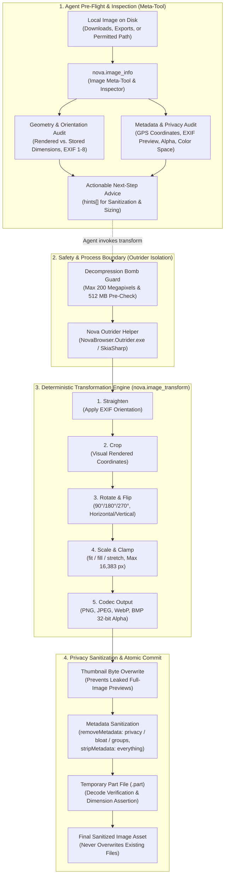
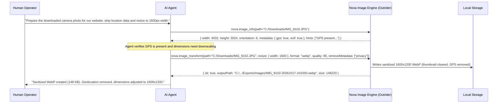

# Local Image Intelligence & Transformation Architecture

Nova provides a native, 100% local image intelligence and transformation engine. It empowers autonomous AI agents to inspect, audit, crop, resize, rotate, convert, and sanitize local image files without third-party cloud vision APIs, Python scripts, or image editing software.

All image decoding and encoding operations execute locally on the operator's workstation within an isolated native helper process, strictly preserving privacy and protecting the host browser from malformed image exploits.

> [!NOTE]
> **Upcoming.** Local image intelligence and transformation arrive with 1.0.0-alpha.21, which is not published yet. Installed versions up to 1.0.0-alpha.20 do not have them.



---

## 1. The Pre-Flight Image Meta-Tool (`nova.image_info`)

Autonomous agents frequently struggle with image processing because raw filesystem attributes reveal almost nothing about an image's visual structure. A smartphone photo might report $3024 \times 4032$ pixels in physical byte storage, yet display as $4032 \times 3024$ landscape on screen due to an EXIF orientation tag. If an agent attempts to crop coordinates based on raw storage dimensions, it cuts the wrong part of the image.

`nova.image_info` acts as the agent's dedicated **pre-flight image meta-tool**:

```json
{
  "name": "nova_image_info",
  "arguments": {
    "path": "C:\\Users\\Operator\\Downloads\\SiteAudit_Photo.jpg"
  }
}
```

### Comprehensive Structural Audit

1. **Visual vs. Stored Geometry:**
   * `width` & `height`: The effective dimensions of the image **as displayed to human operators and vision models**.
   * `storedWidth` & `storedHeight`: The physical pixel dimensions in the file stream before orientation compensation.
   * `orientation`: The raw EXIF tag ($1$ to $8$), explaining how the image was captured.
2. **Encoding & Channel Traits:**
   * `format`: Detected image container (`jpeg`, `png`, `webp`, `gif`, `bmp`, `ico`, `tiff`).
   * `frames`: Detects animated files ($> 1$ for animated GIFs and animated WebP).
   * `alphaChannel`: Indicates whether the image contains a transparency channel (`true` / `false`), critical before converting to non-alpha formats like JPEG.
   * `colorSpace`: Reports the color profile space (e.g. `sRGB`, `Display P3`).
3. **Metadata Inventory:**
   * Reports presence of camera parameters (`exif`), geolocation data (`gps`), embedded thumbnails (`exifThumbnail`), digital asset management tags (`xmp`), color management profiles (`colorProfile`), horizontal/vertical DPI (`dpiX`, `dpiY`), and comment blocks (`textComments`).
4. **Actionable Agent Hints (`hints[]`):**
   * Translates raw metadata facts into explicit operational recommendations:
     * *Privacy Alert:* *"The image carries a GPS position (where it was taken). Before sharing or uploading it, write a copy without them: nova.image_transform with removeMetadata=['privacy'] (keeps camera, exposure and date; stripMetadata=true removes everything)."*
     * *Token Efficiency Alert:* *"The image is very large (4032x3024). Resizing it with nova.image_transform saves context tokens."*
     * *Animation Warning:* *"The file contains multiple animation frames. A transformed copy will retain only the first frame."*

---

## 2. Deterministic Local Transformation (`nova.image_transform`)

`nova.image_transform` executes multi-operation image processing routines locally. The transformation runs through a strictly deterministic, 6-stage pipeline:

$$\text{Straighten} \longrightarrow \text{Crop} \longrightarrow \text{Rotate} \longrightarrow \text{Flip} \longrightarrow \text{Resize} \longrightarrow \text{Encode}$$

### Visual Coordinate Cropping

Because `nova.image_transform` straightens EXIF orientation before evaluating crop boundaries, all crop arguments (`crop.x`, `crop.y`, `crop.width`, `crop.height`) correspond **strictly to visual pixel coordinates** reported by `nova.image_info`. Operators and agents do not need to perform mental trigonometry to calculate bounding boxes on rotated camera photos.

### Sizing Modes & Upscaling Protection

Scaling is governed by three adaptive modes:
* **`fit` (Default):** Scales the image to fit entirely within the target bounding box (`resize.width`, `resize.height`) while preserving the exact aspect ratio.
* **`fill`:** Scales the image to cover the entire target box and evenly crops overflowing edges.
* **`stretch`:** Forces the output to the exact requested dimensions without aspect ratio preservation.
* **Upscaling Guard (`allowUpscale: false`):** By default, smaller images are never enlarged. Upscaling degrades visual clarity and wastes disk space; it requires explicit authorization via `allowUpscale: true`.

### Supported Codecs & Native WebP

Nova ships its own compiled image engine (SkiaSharp):
* **Read Support:** PNG, JPEG, WebP, GIF (static first frame), BMP, ICO natively; TIFF via Windows Imaging Component (WIC); HEIC and JPEG XR when system codecs are installed.
* **Write Support:** PNG, JPEG, WebP, BMP (32-bit with full alpha support).
* **Native WebP Without Codec Dependencies:** In standard Windows installations, WebP decoding/encoding requires an optional Microsoft Store extension. Nova includes full native WebP support out of the box, allowing lossy compression (quality $1$–$99$) and lossless compression (`quality: 100`).

---

## 3. Privacy & Security Invariants

Image processing engines are a frequent target of security exploits, memory corruption vulnerabilities, and unintentional data leaks. Nova implements four mandatory defense layers:

### 1. Outrider Process Boundary (Fault Containment)

All native image decoding, matrix transforms, and codec compression execute inside Nova's external helper process: **Nova Outrider** (`NovaBrowser.Outrider.exe`).
* If an agent encounters a maliciously crafted PNG decompressor exploit or a corrupted TIFF file that triggers a native memory fault, only the Outrider child process crashes.
* Nova's main WinUI 3 interface, active browser tabs, sandboxes, and MCP connections remain completely intact.

### 2. Decompression Bomb Protection

Attackers can construct tiny image files ($< 1$ MB compressed) that expand into tens of gigabytes in RAM (pixel bombs).
* Nova inspects the container header before allocating bitmap memory:
  $$\text{Target Megapixels} = \frac{\text{width} \times \text{height}}{1{,}000{,}000} \le 200 \text{ MP}$$
* Any image exceeding $200$ megapixels or a source filesize $> 512$ MB is rejected immediately with error code `limit_exceeded`.
* Output dimensions are clamped to a maximum of $16{,}383$ pixels per side, matching the physical boundary of the WebP specification.

### 3. EXIF Thumbnail Overwrite (Anti-Leak Invariant)

When photos taken with digital cameras or smartphones are cropped, standard software often updates the main image pixels while leaving the embedded EXIF preview thumbnail intact. If such a cropped image is uploaded, third parties can extract the thumbnail and view the **entire uncropped original scene**.

Nova eliminates this vulnerability:
* In `nova.image_transform`, embedded thumbnail bytes are actively overwritten and destroyed in memory before writing the output file.
* The EXIF orientation tag is reset to $1$ because pixels are already physically transformed upright.
* When metadata is retained and the file contains coordinates, Nova emits an explicit warning: `warnings: ["gps_kept"]`. `removeMetadata: ["privacy"]` removes GPS, names, serial numbers, software, free text, maker notes and XMP and keeps camera, exposure and date; `removeMetadata: ["bloat"]` drops only the bulk (maker notes, XMP edit history, software tags); single groups such as `location` work too, and `metadataRemoved` lists what went. Setting `stripMetadata: true` strips all EXIF, GPS, and XMP blocks completely.

### 4. Two-Phase Commit & No-Overwrite Guarantee

1. Nova writes generated images to a temporary part file (`.part`) in the destination directory.
2. Nova reads the part file back, decodes it, and asserts that generated pixel dimensions match the expected output.
3. Upon verification, the file is atomically renamed to its target filename.
4. Existing files are never overwritten (`output_exists`). Without an explicit `outputPath`, images land safely in `StoragePaths.ExportsDir/Images`.

---

## 4. Cross-Subsystem Workflows

### Workflow 1: Inspect, Sanitize & Resize a Photo for Web Sharing



### Workflow 2: Extract Text from an Image Region

When an image contains text (e.g. an infobox or diagram snippet):
1. Use `nova.image_info` to inspect layout and dimensions.
2. Use `nova.image_transform` to crop the exact region of interest.
3. Pass the resulting cropped image to [`nova.ocr_read`](../ocr/README.md) for offline dual-engine text recognition.

---

## 5. QR Codes & Barcodes

[`nova.barcode_generate`](../../../mcp-reference/tools/files-and-documents/nova-barcode-generate.md) creates a QR code (any text, link or script) or a Code 128, EAN-13, EAN-8 or UPC-A barcode as a PNG or SVG file. Every module is a whole number of pixels with the required empty margin, so scanners read it reliably. A wrong check digit in a product number is refused with the right one named, never quietly corrected. Nova reads every drawn code back before saving it.

[`nova.barcode_decode`](../../../mcp-reference/tools/files-and-documents/nova-barcode-decode.md) reads the codes in a photo, screenshot or scan, also when they are turned, slightly blurred or light on dark. With `multiple` it returns all of them. A code's content is treated as data: Nova never opens a link it finds, and the answer says when a code holds one.

---

## Tool Reference Matrix

| Tool | Capability Bundle | Primary Role | Key Parameters |
| :--- | :--- | :--- | :--- |
| [`nova.image_info`](../../../mcp-reference/tools/files-and-documents/nova-image-info.md) | `page_read_debug` | Pre-flight metadata, orientation, geometry and security inspection | `path` |
| [`nova.barcode_generate`](../../../mcp-reference/tools/files-and-documents/nova-barcode-generate.md) | `page_read_debug` | QR code or barcode as a verified PNG/SVG file | `content`, `type?`, `format?`, `width?`, `height?`, `errorCorrection?`, `includeText?`, `outputPath?` |
| [`nova.barcode_decode`](../../../mcp-reference/tools/files-and-documents/nova-barcode-decode.md) | `page_read_debug` | Reads QR codes and barcodes from an image | `path`, `multiple?`, `formats?` |
| [`nova.image_transform`](../../../mcp-reference/tools/files-and-documents/nova-image-transform.md) | `page_read_debug` | Deterministic cropping, resizing, conversion, and metadata sanitization | `path`, `outputPath?`, `format?`, `crop?`, `rotate?`, `flip?`, `resize?`, `quality?`, `stripMetadata?`, `removeMetadata?` |
| [`nova.image_contact_sheet`](../../../mcp-reference/tools/files-and-documents/nova-image-contact-sheet.md) | `page_read_debug` | A folder of images as one grid of named thumbnails (PNG, JPEG or A4 PDF pages) | `folder`, `format?`, `columns?`, `thumbSize?`, `labels?`, `title?` |

---

[Media Intelligence overview](../README.md) · [WinUI 3 Image Viewer](../image-viewer/README.md) · [Offline OCR](../ocr/README.md) · [Document Conversion](../document-conversion/README.md) · [All core features](../../README.md)
